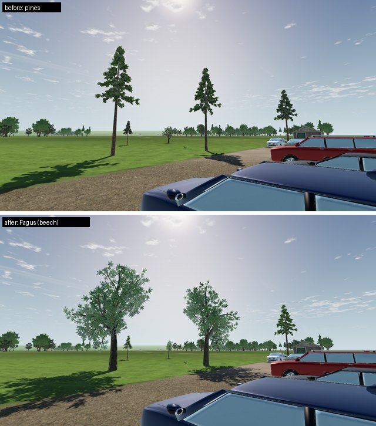
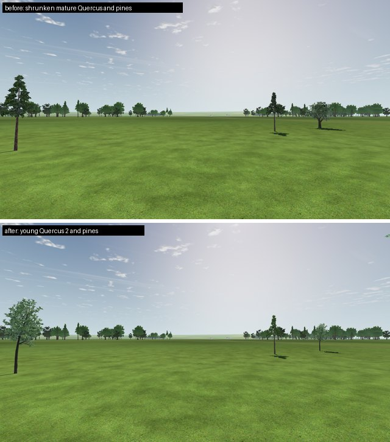
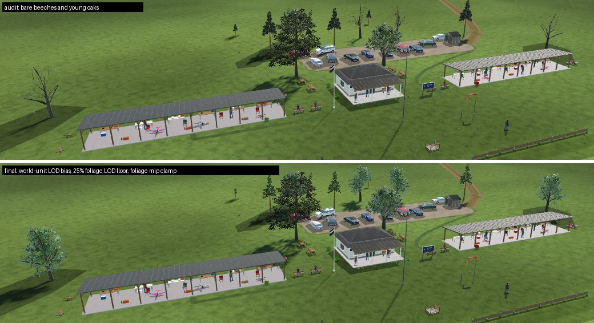

# L6c-R1 close-tree species variety and distant foliage

2026-10-21 · Landscape **L** (tree plan follow-up), with SC/LU (budgets) · Two downloaded LandscapeLab species join the 17 close trees, and a visual audit found that distant LandscapeLab crowns rendered bare. The collision envelopes change, so the world identity changes; the protected clubhouse maple does not.

## What changed

| Placement | Before | After |
| --- | --- | --- |
| Club shade trees (10) | 1 maple, 2 Quercus, 7 pines | 1 maple, 2 Quercus, **4 Fagus (beech)**, 3 pines |
| Club saplings (4) | 1 Quercus, 3 pines, at 3.2–4.8 m | **2 Quercus 2 (young oak)**, 2 pines |
| Farm and forest maples (3) | unchanged | unchanged |
| Source triangles, 17 trees | 85,672 | 116,962 |

The saplings were a mature oak shrunk to 3.8 m, with a thick bonsai trunk. Quercus 2 is a slender, open-grown young tree. Beech adds a second broadleaf crown and leaf colour to a club that read as mostly pine. The alias tables keep their slots: each seed keeps its slot, and only the species behind mature slots two and four and sapling slots zero and two changes. The four maples resolve as before.

[Club from the field, before and after](club-from-field.jpg).

## Source intake

- `Fagus.glb` (9,312 triangles, 2 surfaces) and `quercus2.glb` (11,144 / 2) come from `boku-ilen/landscapelab-assets` at `dfdde034`, under the same CC BY-SA 4.0 terms as Quercus and Pine. Their git blob SHA-1s are verified, and `convert_landscapelab_trees.py` copies them byte-for-byte.
- Fagus has its own upstream `LICENSE.md`: the leaf maps derive from photographs by Krzysztof Golik (CC BY-SA). It is kept as `LICENSE_Fagus.md` and pinned per asset in the conversion manifest and catalog.
- **Notices:**
  - `LICENSE_LANDSCAPELAB_LIBRARY.txt` covers the four trees and ships as the library's `LICENSE_LANDSCAPELAB.txt`, so export filters are unchanged.
  - The source `LICENSE_LANDSCAPELAB.txt` stays the Quercus and Pine notice, which the far-tree atlas recipe (`tools/trees/build.py`) and `assets/landscape/PROVENANCE.json` pin. Rewriting it in place had broken that recipe.
- Both GLBs use the supplier's metallic 0.5 convention. As for the other LandscapeLab trees, runtime duplicates their materials with metallic 0; the trees are now selected by `source_id`.
- The eight extracted maps use the reviewed GPU-compressed recipe of the Quercus maps. Fagus reuses Quercus's bark colour, normal and ORM images byte-for-byte, and Quercus 2 reuses its normal map. Godot imports them per GLB, so they occupy separate memory (see Open).
- **Matching texture reduction:** the Quaternius `Flowers.png` atlas (flower clumps and the common flowering bush) uses the same GPU-compressed policy, 3.77 → 0.95 MiB. The two trees add 8.0 MiB of GPU textures. The renderer estimate is 473 MiB against LU-34's 489 MiB, but that figure also includes other tracks' changes since then.
- **Unrelated repair:** the four Poly Haven understory receipts (`polyhaven_files.json`, `polyhaven_info.json`) were committed as LF while the conversion manifest pins their CRLF download bytes, so the library build failed on every LF checkout. Their pinned bytes are restored, and `.gitattributes` keeps them as `-text`.

## Collision and wind

The crown proxy must hold every source leaf. The lowest indexed leaf-triangle vertex sits at 0.1249 of height for Fagus and 0.3188 for Quercus 2, below the generic 0.355–0.38 crown edge. `CollisionWorld` therefore lowers their crown boxes to 0.12 and 0.31 of height. Quercus keeps 0.22; pine leaves start at 0.41.

| Tree | Sway limit | Smallest placed height | Crown escape at saturation | Trunk-band sway |
| --- | ---: | ---: | ---: | ---: |
| Quercus | 0.12 m | 9.35 m | −1.7 mm | 5.8 mm |
| Pine | 0.22 m | 3.20 m | −2.4 mm | 8.0 mm |
| Fagus | 0.13 m | 9.36 m | −3.7 mm | 1.8 mm |
| Quercus 2 | 0.15 m | 3.20 m | −6.5 mm | 12.5 mm |

A negative escape means every displaced vertex stays inside the crown box. Trunk-band sway stays within the 60 mm wind margin.

Mutation checks:
- Adding 1 cm to every limit fails all four containment checks.
- Fagus leaves at 0.11 of height fail the proxy lower-bound check.

## Visual audit

The audit rendered [32 views](audit/) of the production world (`World.build`) at 1280×720: the 20 postcard and budget views plus 12 tree and vegetation views. Reproduce it with [`fixtures/world_capture.gd`](fixtures/world_capture.gd) and [`audit/views.json`](audit/views.json).

| Finding | Owner | Status |
| --- | --- | --- |
| From the air, the four beeches and the young oaks rendered as bare trees, while their shadows kept full crowns | L | Fixed below |
| From 60 m the far forest reads as evenly spaced single trees on open grass; from the pilot line the treeline reads as one row | L (L7-R1) | Owner decision: same-count groves change the world |
| Woodland-edge field cards seen from 30–40 m: flat lime crowns beside one dark olive card, and a visible crossed-card seam | L | Open; seen only when flying low near the forest edge |
| Quaternius bushes are grounded at their lowest source vertex, 0.235 source units below the authored origin, so the foliage ball floats about 0.1 m above its shadow | L | Open; changes bush placement and collision |
| The orchard is a hard-edged brown rectangle; meadow flowers and lawn tufts read as confetti | LU-28; grass plan | Reported to owners |
| The lake rendered black in the first captures | — | Capture artefact. Compatibility fills the lake's reflection probe over many frames, and only while the lake is in view. Warm up with the lake in view before capturing |

## Distant LandscapeLab foliage

Three causes compounded; each was measured.

1. **MultiMesh LOD ignores per-instance scale.** Godot selects a level from the node transform, so it reads error in source units. Fagus is authored 1.02 m tall and placed about 9.5 m tall: one isolated beech dropped from 9,312 to 848 triangles by 80 m, while Quercus, authored 59.6 m tall, kept full detail at 600 m ([`fixtures/lod_distance_probe.gd`](fixtures/lod_distance_probe.gd)). LandscapeLab batches now set `lod_bias` to their largest instance scale.
2. **Generated LODs remove whole leaf cards.** Bark simplifies gracefully, but the leaf chains fall to 1–14% of their cards: Fagus 31% then 1%, Quercus 10%, Quercus 2 33% then 9%, pine 47% then 14% ([`fixtures/lod_chain_probe.gd`](fixtures/lod_chain_probe.gd)). Foliage now keeps only the levels that retain at least 25% of its triangles; bark keeps its full chain. Vertex and index data stay byte-identical.
3. **Averaged alpha mips erase small leaf cards.**
   - In texture space, all four leaf atlases keep their 0.5-cutoff coverage through mip 6 (box-filter ratio 1.00–1.11). They lose it at mip 7 (0.60–0.98) and beyond ([`fixtures/leaf_mip_coverage.py`](fixtures/leaf_mip_coverage.py)), and distant cards sample mips 7–9.
   - The tree shader therefore samples foliage albedo no coarser than mip 6. The `alpha_scissor_max_mip` uniform defaults to off, which keeps StandardMaterial3D parity.
   - Rejected alternatives:
     - Unmipped atlases keep coverage but speckle up close.
     - Clamping alpha alone leaves the colour of mips 7–9 nearly black, because the atlases' transparent texels are black (RGB ≤ 0.014).
     - Un-premultiplying that colour over-brightens distant crowns.
     - Godot's `mipmaps/limit` import option has no effect in 4.7.2.

Close-vegetation drawn primitives in the heaviest views, including the sun shadow pass ([`fixtures/veg_cost_probe.gd`](fixtures/veg_cost_probe.gd)):

| Variant | pilot_south | car_park | aerial_overview |
| --- | ---: | ---: | ---: |
| No fix | 102,321 | 111,777 | 72,943 |
| Foliage at full detail, plus LOD bias | 182,487 | 187,557 | 122,001 |
| **Final:** LOD bias, 25% foliage floor, mip-6 clamp | 120,759 | 119,685 | 66,089 |

- The shadow pass draws trees in both cascades of the default profile and costs about 1.6× the visible pass.
- In Compatibility the shadow pass draws the main mesh, not `ArrayMesh.shadow_mesh`. The shadow mesh gets the same foliage floor for renderers that use it.
- The static fallback (`--tree_wind=off`) keeps StandardMaterial3D without the clamp.
- The clubhouse maple keeps its default LOD. Its own leaf chain also falls to 1%, beyond about 800 m at 720p.

## Scene budget

The final LU-34 sweep at 1280×720 is in [summary](budget-summary-720.md) and [JSON](budget-summary-720.json). Outside close vegetation, primitives change by at most 18 in any of the 20 views; draw calls rise by up to 12 per view.

| Class | Worst primitives (LU-34 → now) | Close vegetation, worst | Draws, worst |
| --- | --- | ---: | ---: |
| Pilot | 405,301 → 451,503 (`runway_zoom_300`) | 120,759 | 335 |
| Ground | 474,905 → 523,385 (`postcard_pits`) | 126,699 | 367 |
| Aerial | 420,509 → 437,639 (`aerial_overview`) | 66,089 | 375 |

The LU-34 growth allowance for close vegetation (+50% primitives) assumed source-unit LOD, which hid the trees' real cost. Two heavier species with readable crowns cost +93%: Fagus is 9.3k triangles and each Quercus 2 sapling 11.1k, against 4.2k for a pine. Reducing the saplings to one young oak cut `runway_zoom_100` by 22k but left the worst pilot and ground views unchanged, so both stay.

[`scene_budget.json`](../../../../../tools/scenery/scene_budget.json) records the revision:
- Close vegetation is allocated its measured cost +10%: pilot 133,000, ground 140,000, aerial unchanged at 74,000.
- The pilot class total moves from 450,000 to 455,000. The pilot growth reserve is spent, so further pilot-view growth needs a matching reduction from the [LU-34 list](../../../landscape-upgrade/LU-34/README.md#reduction-plan-for-owners).
- Ground is at 523,385 of 525,000.
- `attribute_views.gd` now counts full-detail triangles per surface. Quercus foliage (2 × 2,636 triangles) is a recorded full-detail exception, because its only generated leaf level keeps 10% of the cards.
- The per-surface count also surfaced pre-existing debt: the parked Avanti batches have 17,847 and 11,898 full-detail triangles in surfaces that the SC-09-R1 bake left without LODs. They are recorded as fleet-owner exceptions.

## Checks

- `test_build_library.py` (9 tests), `convert_landscapelab_trees.py --check`, `build_library.py --check`, the far-tree atlas recipe pins, `place_woodland_edges.py --check` and `tools/trees` placement tests all pass.
- Builder mutations are rejected with a reason: the notice source swapped to the atlas notice, a changed Fagus licence hash, licence evidence outside the source directory, and Quercus 2 removed from the manifest.
- `test_imported_vegetation`, `test_imported_tree_rendering`, `test_vegetation_collision_proxies`, `test_landscape_vegetation` and `test_scenery_build` pass. These include the GPU-compressed recipe for the new maps and `Flowers.png`, LandscapeLab leaf maps that keep mips, catalog and alias composition, and the sway bound above.
- **Full suite on the final state:**
  - Parse check of every script: clean.
  - Units: 660 of 660 run. The only failures are the 8 `test_companions_*` tests, which fail on their pre-existing field-hash pin (AFC owner).
  - Final budget sweep: all limits pass.
- **LOD and foliage mutations** run on a disposable copy, and each fails its check:

  | Mutation | Fails |
  | --- | --- |
  | No LOD bias | Bias checks |
  | Every foliage LOD kept | Dense-level checks |
  | No mip clamp | Foliage-material checks |

## Open

- **Shared bark maps:** Fagus and Quercus 2 bark could reuse Quercus's identical maps through an external material resource, saving about 4 MiB of GPU textures. That needs its own import recipe and review.
- **Native-GPU review:** check the mip-6 clamp's distance transition and the wind motion on a native GPU, and have the owner review the club composition and the young-oak saplings.
- **Audit items:** far-forest groves, woodland-edge cards, floating bushes, and the protected maple's leaf LOD chain.
