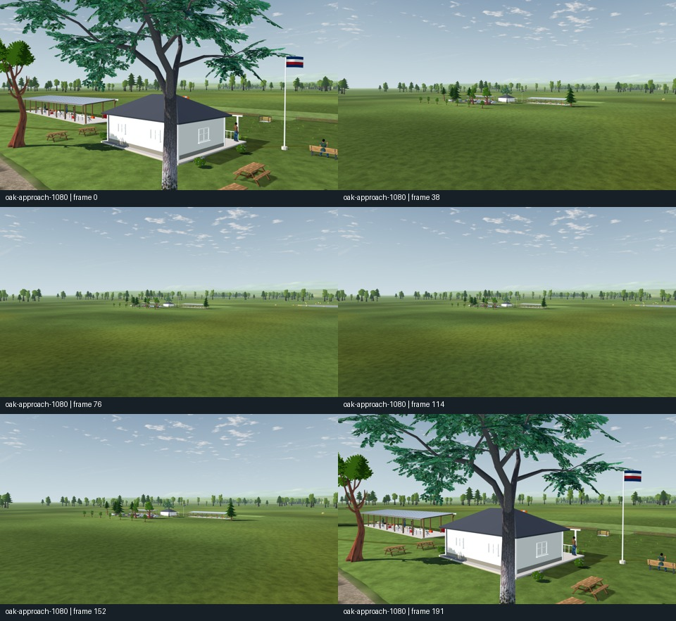

# Prescribed tree camera motion

2026-10-18. Six native clips cover three camera tracks at 1280×720 and 1920×1080, each with **192 samples at 24 samples/s**. These are offline camera samples through production scenery with 5 m/s shader wind, not active flight or frame-pacing measurements. Every original PNG hash, camera pose, FOV, shader clock and renderer counter is in the per-track report. The MP4 files and contact sheets remain for review; 18 selected still PNG copies were pruned because those views are present in the retained sheets/clips and can be regenerated with the retained capture controller and runner below.

| Track | Coverage |
| --- | --- |
| `oak-approach` | Same downloaded oak, 8→250→8 m, 42° FOV, Godot automatic mesh LODs. The oak preserves its static alpha-material fallback. |
| `card-orbit` | Full azimuth orbit of the first actual field tree, varying camera height from below its crown center to above it, 50° FOV. |
| `forest-pan` | Pilot-eye sweep from −35° to +35°, 50° FOV, fixed production field and directional wind. |

All six captures completed with 192 valid image hashes and no engine errors, on Godot 4.7.2 Compatibility / RTX 3090. The reports record the mesh LOD pixel threshold. Imported meshes and field cards are separate populations, so these tracks do not claim a qualified mesh-to-card transition. The source controller and exact runner are retained beside `series.json` and `sha256.json`.

The paired static `field-baseline` and `field-candidate` folders use the same cameras and lighting on the frozen comparison apps. The close view shows the replaced tree's finer branching and more open crown. The panoramic view records the changed layout; high-altitude haze limits its usefulness for judging foliage coverage. The card orbit exposes flat crossed planes and repeated source silhouettes at close aerial distances. This finding motivated the [bounded existing-baker comparison](../../../L8b/2026-10-18/README.md), rather than a claim that the current field forest has full 3D parallax.

Review the corresponding `.mp4` files for motion. Sampled image inspection and successful capture do not establish absence of every shimmer, transition flash or readability defect; the independent pilot review remains open. The videos also do not change the earlier decision to retain un-mipped alpha leaf maps after ordinary mips filled crown gaps.

Reproduce using `tools/trees/quality_capture.gd` with `--motion=oak-approach|card-orbit|forest-pan --frames=192 --wind=on`, the recorded resolution and a new `--out` directory. `runner.py.txt` records all six commands, encoder settings and static controls. The underlying original frame sequences remain under `tmp/tree-completion/motion-final`; durable reports bind them by exact hashes.
