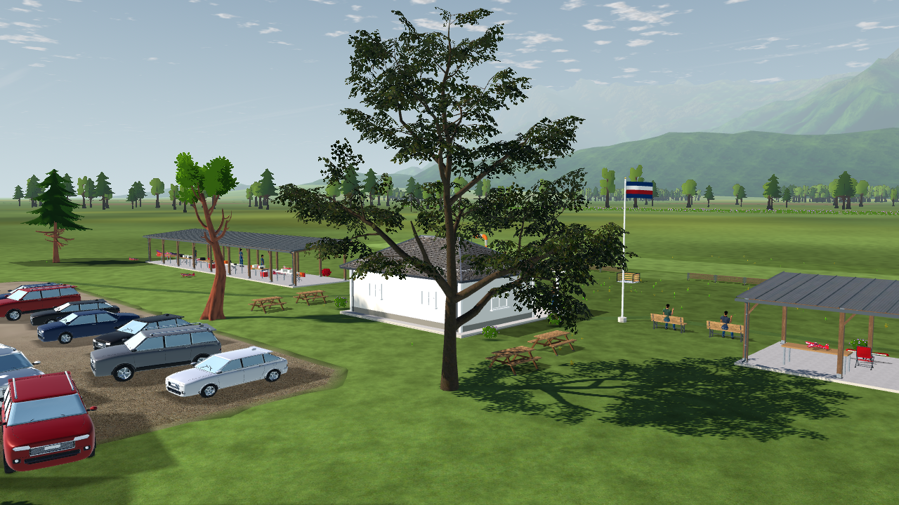
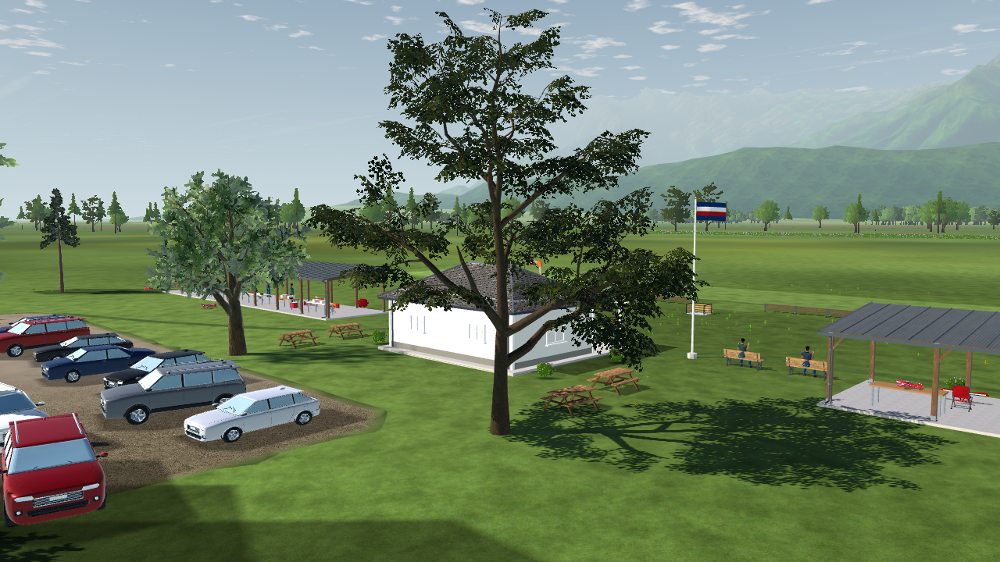
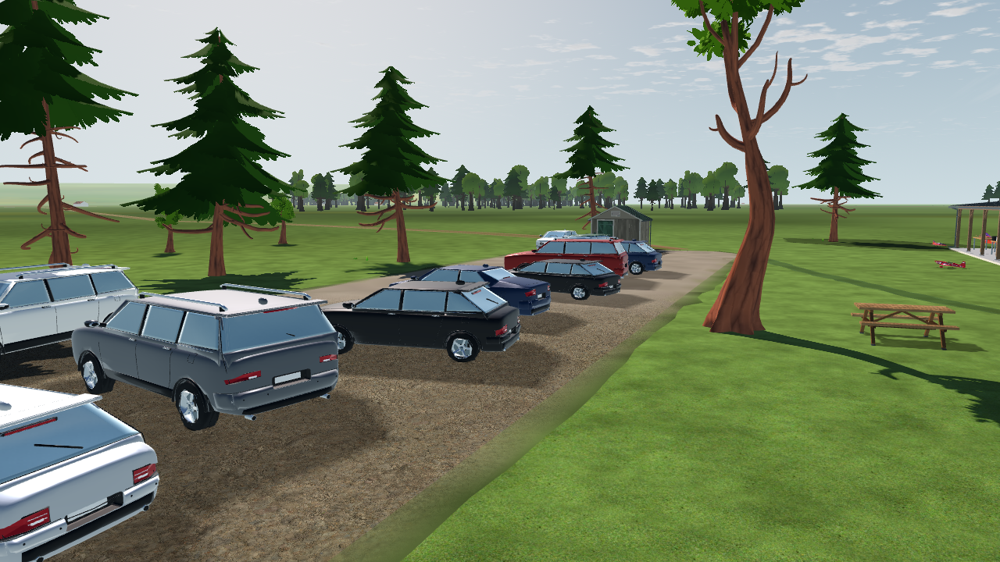
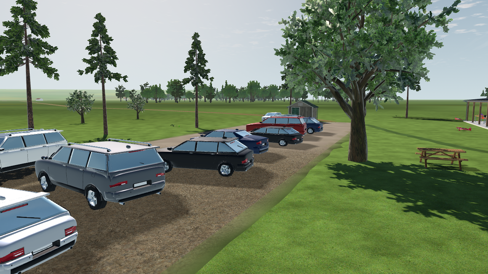
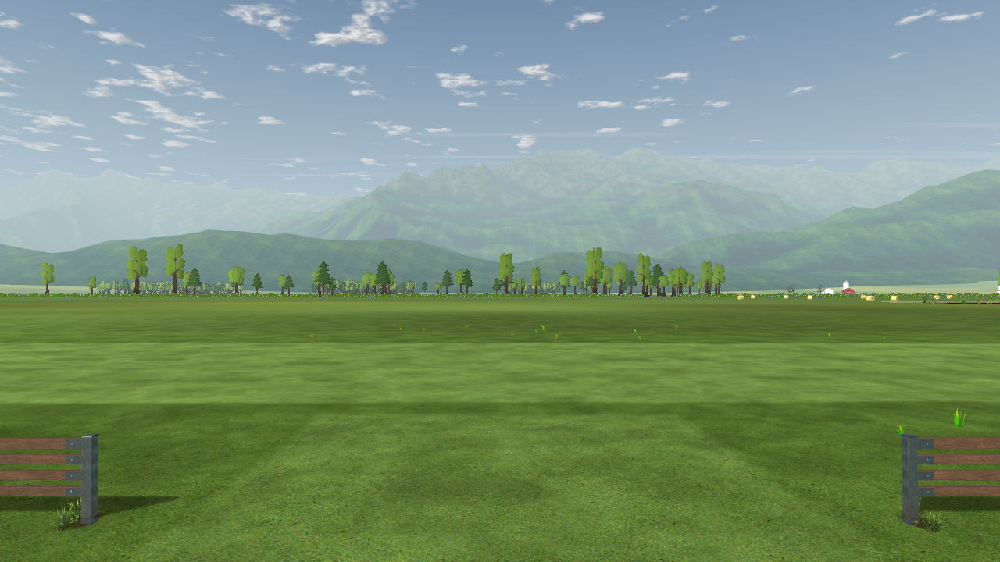
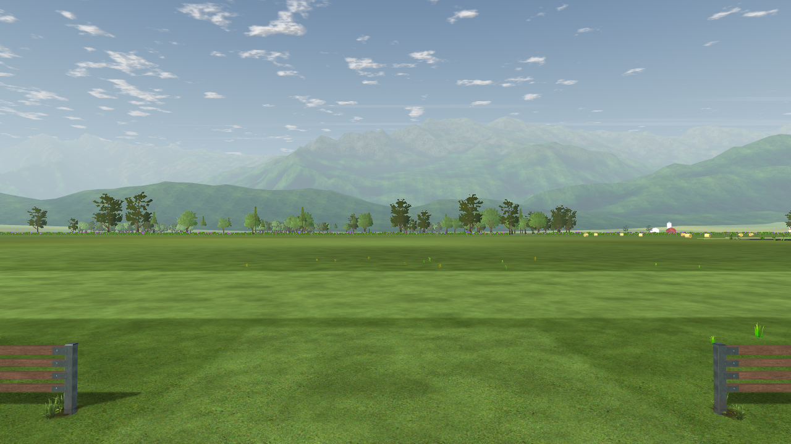

# Vegetation renewal implementation and evidence

2026-10-20–21 · L6c / L7 / L11b, with SC/LU collision coverage.

The production landscape now uses downloaded photographic oak and pine models around the club and farm, a new oak/maple/pine forest atlas, and photographic ferns and flowering Empodium accents. The clubhouse maple and the other three maples are preserved. This report records the implemented scope; the broader [research and acceptance plan](../../../vegetation-renewal-2026-10-20.md) includes work and hardware acceptance still outstanding.

## Matched views

The fixed cameras, atmosphere, resolution and lighting are identical. Original PNGs and capture metadata are retained in [before](before/report.json) and [after](after/report.json). These are native Godot 4.7.2 Compatibility captures at 1280 × 720, 4× MSAA. They are visual evidence, not flight timing.

| Before | Implemented candidate |
| --- | --- |
|  |  |
|  |  |
|  |  |

The comparison shows the main improvement in branching, textured bark, irregular crowns and the removal of conspicuous faceted silhouettes. The meadow, grass, good shrubs, lake plants, clearings and landscape zoning remain the existing composition. The very high aerial overview still exposes the limited depth of crossed cards; this work does not solve close forest overflight geometry.

## Implemented assets and rendering

| Layer | Implementation | Geometry / population |
| --- | --- | --- |
| Protected trees | LOLIPOP `maple_tree` remains in alias slot zero; no model, map, import, material, tint, height or placement change | Four maples; clubhouse seed `793949324`, N −32, E 10.5, heading 247.1°, height 14 m |
| Close trees | LandscapeLab Quercus and joined pine replace the 13 weaker non-maple trees one for one | Five Quercus, eight pine; all 17 trees total 91,212 source triangles |
| Field forest | Existing three atlas slots now use Quercus, the retained maple source, and pine | Same 1,680 trees, six triangles each, eight sector MultiMeshes; species counts 588 / 531 / 561 |
| Understory | Poly Haven Fern 02 A and open-bloom Flower Empodium A, mixed with retained grass and shrubs | 285 botanical placements; 11 ferns and seven Empodium; 89,655 / 90,000 source triangles; 14 / 24 batches |

The seven-slot mature alias preserves the modulo and maple selection. Weighted saplings reuse the two new sources; they are scaled mature assets, not newly modeled juvenile forms. Existing seeded positions, heights, rotations, exclusions, patches and open flight corridors remain deterministic. The forest retains the canonical `habitat-v1` distribution: twelve irregular woodland patches and the original near ring, with no density increase.

The two source GLBs are byte-faithful. Runtime rendering duplicates only their materials to correct the source metallic factor from 0.5 to 0.0; albedo, normal, roughness, alpha conventions and texture references are retained. Source resources remain unmodified. Both trees retain the fail-closed static PBR path because the existing wind shader cannot represent all their material features. Field cards retain their existing wind deformation. No simulation or aircraft model was tuned.

Meshes retain Godot-generated LODs and source-part MultiMesh batching. The forest uses the same mipmapped 1024² atlas, alpha-scissor surface, sector culling and instance identities. Shader crown normals and collision envelopes now use per-species measurements from the new material mask. Bark keeps its downloaded color. This is a separate close-mesh and field-card population, **not** a mesh-to-card LOD transition.

The flowering mesh was selected through a native gallery. The first Empodium D selection contained leaves without an open bloom and was rejected. The adopted A source has 758 triangles. Two duplicate flower slots were reassigned to the existing small LOLIPOP grass tuft to retain planted density within the botanical budget. No cap was raised.

## Source provenance and preservation

- [LandscapeLab Quercus](https://github.com/boku-ilen/landscapelab-assets/blob/dfdde034c3547f9876967653d98827bd5348e52e/Natural/Plants/Trees/Quercus/quercus.glb): 7,016 triangles, two surfaces, CC BY-SA 4.0.
- [LandscapeLab Pine](https://github.com/boku-ilen/landscapelab-assets/blob/dfdde034c3547f9876967653d98827bd5348e52e/Natural/Plants/Trees/Pine/pine_joined.glb): 4,246 triangles, two surfaces, CC BY-SA 4.0.
- [Poly Haven Fern 02](https://polyhaven.com/a/fern_02): selected fern A, 784 triangles, CC0.
- [Poly Haven Flower Empodium](https://polyhaven.com/a/flower_empodium): selected A LOD0, 758 triangles, CC0.
- Existing LOLIPOP maple: supplied `Acer_large_3_LOD1`, 5,541 triangles, CC BY 4.0; retained provenance and notice remain in the source library.

Actual files, download endpoints, upstream revision, dependency hashes, conversion disclosures and license evidence are in the [library catalog](../../../../../app/assets/landscape/vegetation/catalog.json) and [landscape provenance](../../../../../assets/landscape/PROVENANCE.json). The combined derived tree atlas/mask is distributed under CC BY-SA 4.0 with both LandscapeLab and LOLIPOP attribution. The aggregate notice and three slot notices are included by all export presets. The original Quaternius atlas record is retained as historical provenance.

The plant converter keeps selected supplied meshes and binary geometry, removes gallery placement, and derives RGBA from the supplied base-color and alpha maps. It scales 16-bit alpha correctly before converting to 8-bit. Empodium's BLEND source is explicitly adapted to MASK at 0.5; fern retains its supplied MASK convention. No plant geometry or texture artwork was authored from scratch.

[Protected-maple receipt](protected-maple.json): all 15 runtime geometry, texture and import files match their baseline SHA-256. The placement regression also retains the mature 14 m height, 5,541 triangles and asymmetric crown dimensions. Reusing the maple as an atlas source reads its original source files and does not modify the protected runtime tree.

## Bake and correctness evidence

Two independent native `--recipe realistic` bakes produced byte-identical atlas and foliage-mask files. [Repeat manifest](bake-manifest.json) and [source recipe](bake-source-recipe.json) retain inputs and diagnostics. Source/normalized silhouette IoU is 1.0 for every tree in both lit and albedo comparisons. Maximum reported mean RGB difference is below 0.0003 channel levels. Source geometry and transforms are retained through a normalization root wrapper.

| Runtime file | SHA-256 |
| --- | --- |
| Atlas | `6555b190842896867c8699e2c08294a396940ad8acdf3e90df1c9245b30e202e` |
| Foliage mask | `6ca74c2cf8f596d4fe127d7183c0250cf868e001f6dedda6fa08f0adb562619f` |
| Tree catalog | `797e2830d05efd715e60b3f964c7122e899792ffe209e39b38a62bd95394ab4e` |

Focused tests verify original source materials/triangles, preserved maple mapping, instancing, botanical exclusions/budgets, field identities, wind fallback, source-specific collision coverage and native GPU instance-buffer readback. The native tree test performs 31,991 checks with zero failures. The source converters and catalog regeneration checks pass; library tests: 9, atlas-processing tests: 15, recipe-adapter tests: 2, flight-runner tests: 6.

Validation records, export checks, final timings and remaining acceptance limits are completed below after the serial native measurement run. No full-app or lower-end hardware pass is implied by these focused results.

## Reproduction

Use the [vegetation pipeline guide](../../../../../tools/landscape/vegetation/README.md) for source conversions/catalog checks and the [tree guide](../../../../../tools/trees/README.md) for baking, captures and timing. Keep GPU jobs serial. The native flight probe selects the existing external-controller seam before scene initialization so a connected desktop gamepad cannot replace the recorded input tape; both builds use the same probe and normal input callback.

Timing uses frozen `baseline/app` and `candidate/app` snapshots under `D:/OpenRCsimulator-vegetation-renewal-2026-10-20/` during this session. The candidate was cloned from that baseline and overlaid with the vegetation changes only. Both retain the same simulation, frame logger, aircraft and input tape. The shared repository advanced independently, so current HEAD alone does not identify these measurements. Retained receipts distinguish them.

```powershell
python tools/trees/flight_quality.py --baseline <baseline-app> --candidate <candidate-app> --engine <native-godot> --out <new-evidence-folder> --pairs 5 --warmup 10 --sample 60 --width 1280 --height 720 --baseline-env OPENRC_TREE_WIND=on --candidate-env OPENRC_TREE_WIND=on
```

Repeat with 1920 × 1080. Each run uses an active airborne aircraft, the fixed pilot camera, calm noon lighting, 4× MSAA, disabled VSync and a 60 Hz software cap. GPU timing and submitted geometry are reported separately from frame pacing. A cap cannot establish uncapped throughput.
