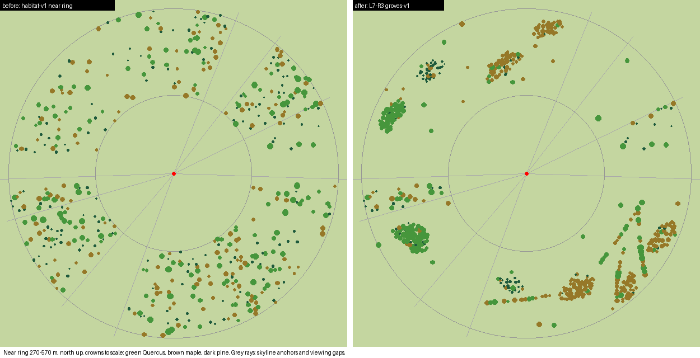
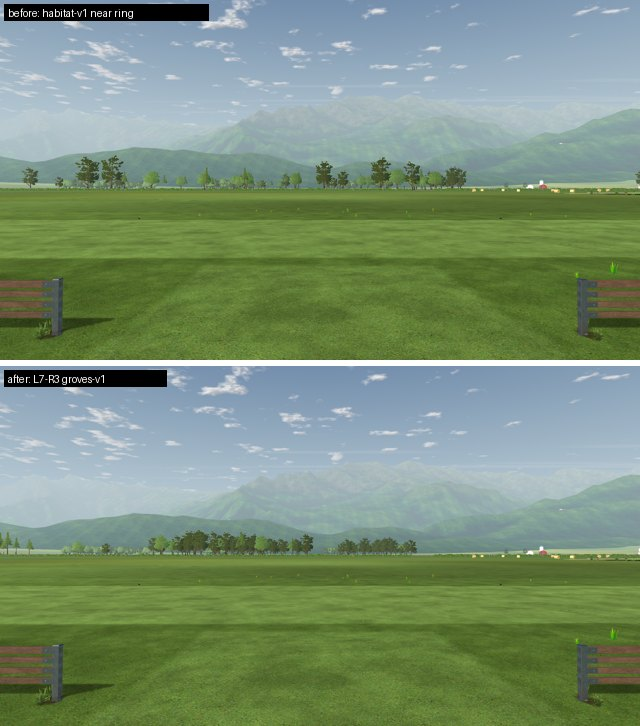
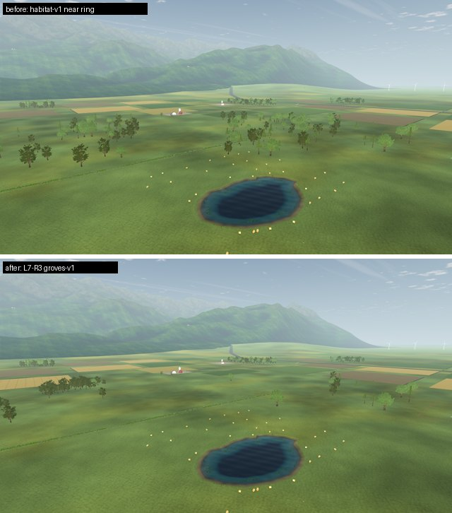
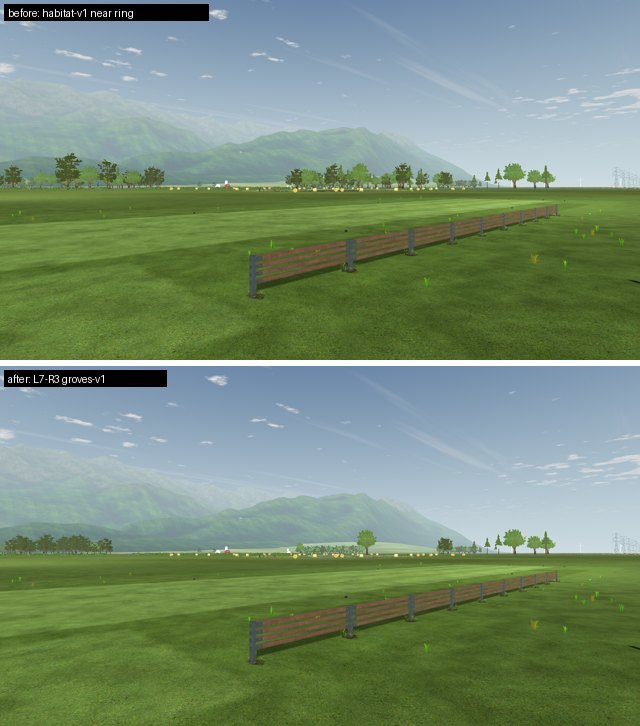

# L7-R3 near-ring woods, hedgerows and field trees

2026-10-22 · Landscape **L** (tree plan owner decision, approved by the owner on 2026-10-22) · The 480 near field trees are regrouped from an even scatter into woods, hedgerow lines and solitary field trees. The count, rendering, species hash and far ring are unchanged. Tree positions, and therefore the collision world identity, change.

## Why

Seen from the pilot station, the 1,680 field trees are the trees that frame every view, and the owner reported them as "old ugly trees". The [L6c-R1 audit](../L6c/species-variety/README.md#visual-audit) found two composition faults:

- The near ring (270–570 m) was an even scatter: median nearest neighbour 18.6 m, single trees about 40 m apart on average.
- From the air it read as a park, and the species hash mixed oak, maple and pine tree by tree.

The card representation and the 1,680-tree loader limit are separate follow-ups.

## Recipe `groves-v1`

`tools/trees/place.py` (now the default recipe; `habitat-v1` and `existing` remain explicit references):

| Group | Trees | Rule |
| --- | ---: | --- |
| Skyline anchors | 44 | Frozen L6b trees in 64–92° and 254–268°. `tools/scenery/place.py` puts the turbines/pylons and the village at the lowest skyline in those windows, so no other crown enters them. |
| Woods | 356 in 9 | Irregular lobed ellipses (the habitat-v1 outline), 160 m² per tree, spread evenly over the free arcs. Crown centres are at least 0.6 × the two crown radii apart. |
| Hedgerows | 4 × 14 | Broadleaf lines about 12 m apart, roughly along the ring as on a field boundary |
| Solitary | 24 | Broadleaf field trees, at least 2.5 × the crown radii from any crown |

Species and height remain the renderer's position hash (`tree_identity.gdshaderinc`). The generator accepts candidate positions by their hashed identity, so:

- Each wood has one dominant species: five maple woods, two oak woods and two pine stands, with measured shares 0.78–0.94.
- Woods are lower at the margin and taller inside.

The renderer, collision and CPU mirrors need no change.

Every tree keeps the ring, the two viewing gaps and the runway/mown flight corridor. New trees also keep 22 m from each committed scenery placement beyond 200 m. That keepout does not bind for this seed: disabling it leaves the output unchanged. It stays as a guard.

| Measure (near ring) | Before | After |
| --- | ---: | ---: |
| Nearest-neighbour median (p10–p90) | 18.6 m (10.7–33.3) | 10.1 m (7.1–17.3) |
| Horizon covered by near crowns | 74.2% | 58.1% |

The lower horizon coverage is the cost of keeping 480 trees: woods leave open farmland between them.

| View | Before / after |
| --- | --- |
| Pilot, north |  |
| From 80 m |  |
| Pilot, north-east · [low pass west](low-pass-west.jpg) · [aerial overview](aerial-overview.jpg) |  |

## Regenerated outputs

| Output | Result |
| --- | --- |
| `app/data/fields/default.json` | New near positions. The far positions are byte-identical to habitat-v1 (`c24d479e…`). Combined SHA-256 `a9667f05…`. The file is written CRLF on every OS, matching `.gitattributes`. |
| `app/data/scenery/default.json` | Unchanged (`tools/scenery/place.py --check`). Landmark azimuths are the same: village 265.5°, turbines 80°, pylons 87.5°, silo 30°, all visible. |
| `app/data/scenery/countryside.json` | 53 parcels instead of 50: three farm parcels no longer meet a scattered tree. Roads are unchanged, and the countryside tests pass. |
| `app/data/woodland_edges.json` | Regenerated; all four patches verified. |
| `app/data/ai/companions/fields/club-default.json` | Field pin updated to the canonical CRLF hash. |

The old raw-byte pins were CRLF hashes, but the Linux working copy held an LF field written by a generator. That is why the 8 `test_companions_*` tests failed only on Linux. They now pass here too.

## Checks

- Placement tests: 15 pass. They cover the historical and habitat-v1 references, plus groves-v1 counts, frozen anchors, ring/gap/corridor/scenery clearance, crown spacing, dominant shares, CRLF output and determinism.
- Mutations of the generator copy fail the property tests:
  - A narrowed anchor sector fails generation and the CLI check.
  - A weakened dominance fails the group test.
- Oracles ([`fixtures/field_oracles.py`](fixtures/field_oracles.py)): scenery layout byte-identical; countryside asserts hold.
- Godot tests pass: `test_far_forest`, `test_treeline`, `test_treeline_data`, `test_field_loader`, the landscape collision setup/world/coverage tests, `test_countryside`, `test_scenery_loader`, `test_scenery_build`, `test_woodland_edge_habitat`, `test_companions_profiles` and `test_companions_airspace`.

Captures use [`fixtures/world_capture.gd`](fixtures/world_capture.gd) with [`fixtures/views.json`](fixtures/views.json) (production `World.build`, Compatibility on llvmpipe).

## Limits and next steps

- Saved visual checkpoints and companion collision-world identities from before this change no longer match the field (expected for a world change).
- The far ring (600–1,500 m) kept its habitat-v1 patches in this step. [L7-R4](../L7-R4/README.md) turns them into single-species woods.
- With 480 trees, woods at canopy density leave much open land. More near trees are cheap (6 triangles each, no new draws) but need the loader's 1,680-position limit raised; that is a separate decision.
- `tools/trees/habitat_diagnostics.py` and its test describe the L7-R1 habitat-v1 comparison. They predate the 2026-10-20 vegetation renewal and do not apply to groves-v1.
