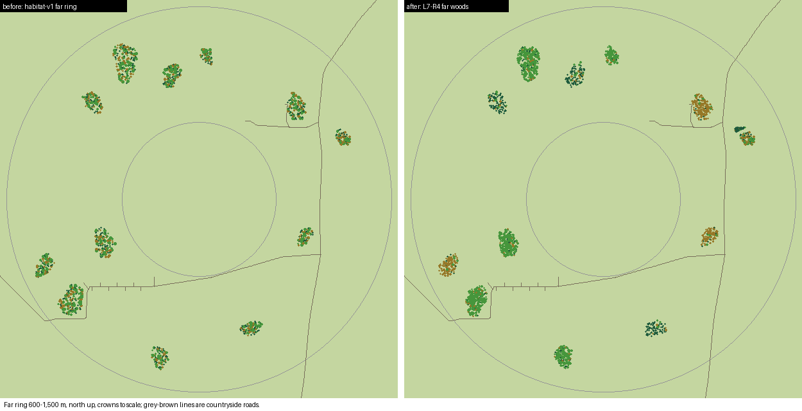
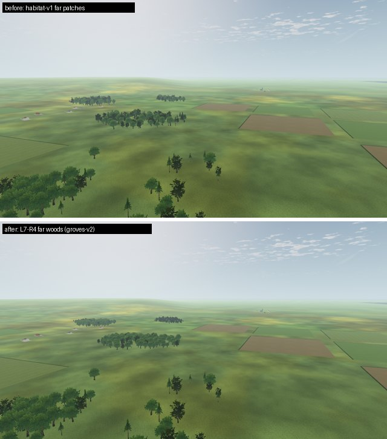
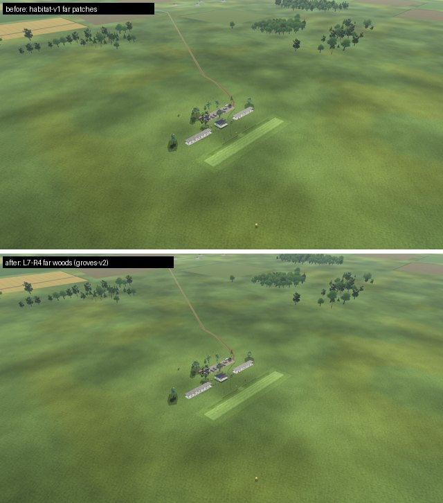

# L7-R4 single-species far woods

2026-10-22 · Landscape **L** (continuation of the owner-approved [L7-R3](../L7-R3/README.md) groves) · The 1,200 far field trees (600–1,500 m) keep the twelve habitat-v1 wood sites. Each site now becomes a single-species wood with a woodland height profile. Count, rendering and the species hash are unchanged. Tree positions, and therefore the collision world identity, change.

## What changed

`tools/trees/place.py` `groves-v2` (the default) keeps the groves-v1 near ring byte-for-byte and regenerates the far ring:

- **61 skyline-anchor trees:** the habitat-v1 trees in 64–92° and 254–268° stay frozen, as in L7-R3.
- **Twelve woods at the habitat-v1 centres and orientations:**
  - counts 52–164, scaled to the remaining 1,139 trees;
  - each at least 75% one species (measured shares 0.75–0.93): five oak woods, four pine stands and three maple woods;
  - lower at the margin and taller inside, as for the near woods.
- **Density:** normalized to 220 m² per tree. Habitat-v1 patches ranged from 163 to 259 m² per tree, so this is not a compaction: small patches grow slightly and large ones shrink. One wood widens to 383 m² per tree because constraints left too little room.
- **Clearances:** new far trees keep clear of features that do not depend on tree positions:
  - the countryside road centrelines (half-width + 9 m);
  - the two farm boxes that `bake_countryside.py` asserts (+14 m);
  - the woodland-edge floor templates (30 m);
  - the botanical farm crops and shrubs;
  - the committed scenery placements (22 m).

| View | Before / after |
| --- | --- |
| From 120 m, west |  |
| Aerial overview |  |

From 120 m the woods now read as single stands (dark pine, green oak, warm maple) rather than mixed clusters. From the pilot station the change is small, because these trees are at least 600 m away.

## Regenerated outputs

| Output | Result |
| --- | --- |
| `app/data/fields/default.json` | Far positions changed; near positions are identical to groves-v1. Combined SHA-256 `18801c31…`, written CRLF. |
| `app/data/scenery/default.json` | Unchanged; the landmark azimuths and visibility are the same as in L7-R3. |
| `app/data/scenery/countryside.json` | 54 parcels (L7-R3: 53). Roads are unchanged, and the countryside tests pass. |
| `app/data/woodland_edges.json` | Regenerated. It pins the normalized text of `place.py`, so regenerate it after every edit to `place.py`. |
| Companions field pin | Updated to the CRLF hash. |

**Scene budget (L7-R3 and L7-R4 together, 1280×720):** field cards still draw 6 triangles per tree. The worst views are pilot 451,177, ground 523,637 and aerial 436,073 primitives. Countryside ground draws rise from 8 to 11 because of the freed parcels; `scene_budget.json` allocates 12. All limits pass.

Generation takes 11 s. It was 23 s before road segments were indexed in 64 m cells; the output is byte-identical.

## Checks

- Placement tests: 17 pass (35 s, one generation per recipe shared across read-only tests). The new far tests check the 12 woods, dominant shares of at least 0.75, the frozen anchors, every non-anchor far tree against the site constraints, and the countryside contracts directly: road clearance of more than 3 m and the farm boxes.
- Mutations of a generator copy:
  - dropping the far anchors fails the far-group test;
  - removing the road margin changes the output but keeps trees more than 3 m from roads;
  - removing the farm-box margin does not bind for this seed (a guard).
- Godot tests pass: `test_far_forest`, `test_treeline`, `test_treeline_data`, `test_field_loader`, the landscape collision setup/world/coverage tests, `test_countryside`, `test_scenery_loader`, `test_scenery_build`, `test_woodland_edge_habitat`, `test_botanical_habitats` and both companion tests.
