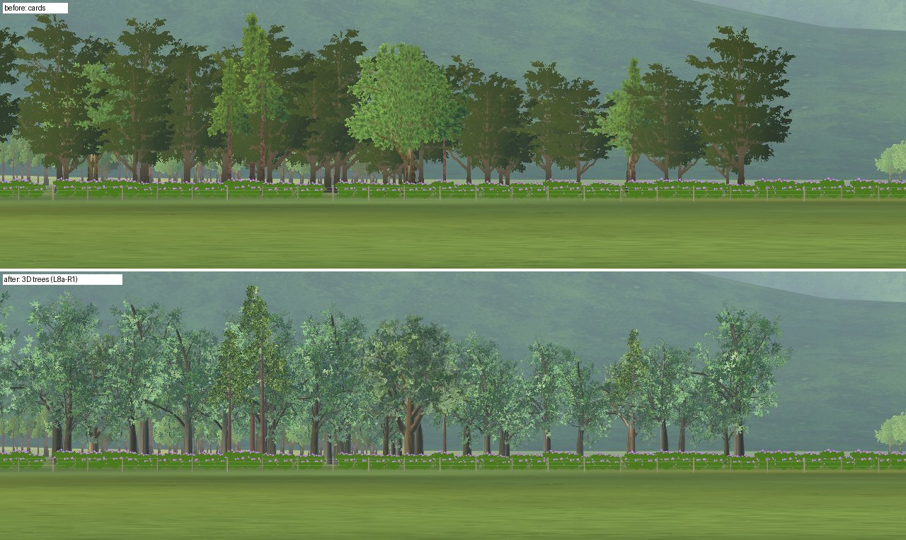
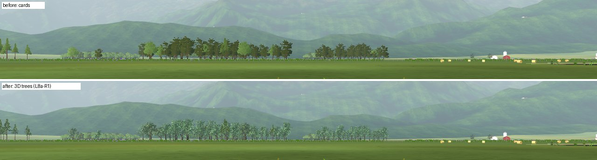
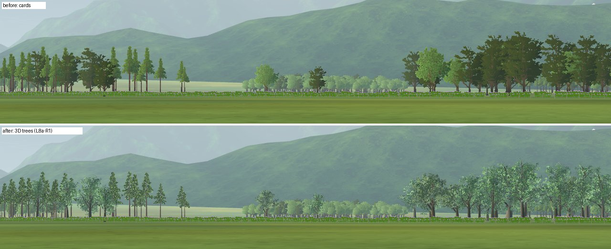
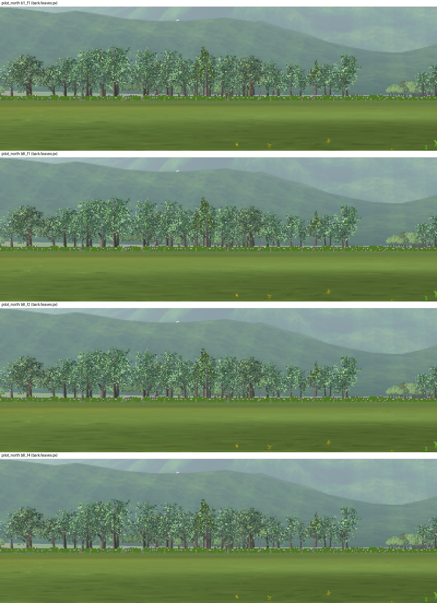

# L8a-R1 3D trees in front of the pilot

2026-10-22 · Landscape **L** ([tree plan](../../../plans/tree-forest-quality.md) L8a). The owner asked for real 3D trees closer in, then said: "focus on the trees in front, they are the most viewed trees." The 127 near-ring field trees in front of the pilot now render and collide as 3D LandscapeLab trees instead of cards. Positions, count and species hash are unchanged. Their collision envelopes change, and with them the collision world identity.

## Why

From the pilot station, the woods north of the runway are the most viewed trees, and the camera's zoom magnifies them behind a model. As cards, they repeated one flat silhouette per species. Maple cards dominate there (79 of 127), and the bright Quercus cards clashed with the dark maples. Under the same light, a card is also brighter and yellower than the 3D tree it was baked from: Quercus card RGB (0.35, 0.47, 0.21) against the 3D tree's (0.30, 0.38, 0.29) ([`fixtures/card_vs_3d_probe.gd`](fixtures/card_vs_3d_probe.gd)).

| View | Cards above, 3D trees below |
| --- | --- |
| Pilot view, 50° |  |
| 20° to the north-west |  |

## Rule

`render/treeline.gd` holds the shared rule:

- **Which trees:** a field tree renders in 3D when it is within 600 m (the near ring) and within ±60° of the runway centre as seen from the pilot (`front_azimuth_deg`; 0° in the default field). In the default field these 127 trees stand 313–600 m from the pilot.
- **Which model:** card species map to LandscapeLab models: Quercus to Quercus, pine to pine, and maple to beech (Fagus). The beech model has the qualified wind and distant-foliage path; the LOLIPOP maple would need its own.

| Part | Behaviour |
| --- | --- |
| `render/field_tree_detail.gd` | Builds the trees with ImportedVegetation in 256 m cells. They use the L15b-R2 tree wind (honouring `--tree_wind` / `OPENRC_TREE_WIND`) and the L6c-R1 world-unit LOD bias, foliage LOD floor and mip-6 foliage clamp. Bark may show 8 px of LOD error (below). They cast no real-time shadow, like the cards. |
| `render/treeline.gd` `build()` | Leaves these trees out of the eight card sectors. Called without an azimuth, it keeps all cards. |
| `scenery/collision_world.gd` | These trees collide with the club trees' imported envelope (`VegetationPlacement.asset_spec`): a trunk capsule and a crown box from the model bounds at the hashed height and heading. Card trees keep the card envelope. |
| `render/field.gd` | Adds `treelineDetail` beside the `treeline` cards. |
| `scenery/imported_vegetation.gd` | New build option `bark_lod_error_px` (1–16, default 1). Club trees do not pass it and are unchanged. |

`VegetationPlacement.asset_spec()` was extracted from `spec()` so that club and field trees share one envelope; club outputs are unchanged.

## Cost

The first build drew one MultiMesh per model. The scene budget read 49,570 primitives for it in every front view. The engine counter counts an instanced mesh with LODs once per draw, not per instance ([LU-34-R1](../../landscape-upgrade/LU-34/README.md#revision-lu-34-r1-instanced-lod-meshes-were-undercounted)). Counted per instance, the 127 trees drew 972,696 triangles in `runway_zoom_300`, their full source detail, for two reasons:

- **One batch, one LOD.** Godot selects a MultiMesh's LOD from the nearest point of its bounds, so trees 600 m away took the level of the nearest one.
- **The 1 px rule.** Godot switches level only below 1 px of geometric error. An 18 m tree at 400 m is about 35 px tall in the 50° pilot view. A beech is authored 1 m tall and scaled about 17.7×, so it keeps all 9,312 triangles to about 240 m, and 6,912 of them are bark.

Two changes fix the cost. Cells of 256 m let each group of trees take its own LOD and be culled. Bark surfaces switch at 8 px of error instead of 1 px: `_scale_bark_lod_error` divides the bark LOD errors of the per-build draw mesh, and the index data are unchanged. Foliage keeps the 1 px rule, so leaf levels switch only beyond about 800 m in the pilot view. The trees therefore never pop between leaf levels there, even while the camera zooms.

True drawn primitives of the 3D trees alone (every instance), 1280×720, [`fixtures/lod_variant_probe.gd`](fixtures/lod_variant_probe.gd) and [`fixtures/cell_variant_probe.gd`](fixtures/cell_variant_probe.gd):

| View | 256 m cells, 1 px | **Bark 8 px (shipped)** | Bark 8, leaves 2 px | Bark 8, leaves 4 px |
| --- | ---: | ---: | ---: | ---: |
| Pilot north, 50° | 595,362 | **379,224** | 321,516 | 207,528 |
| 20° north-west | 642,402 | **316,247** | 316,247 | 273,407 |
| 10° north | 417,182 | **265,737** | 265,737 | 265,737 |
| `runway_zoom_300`, 10° | 726,428 | **326,812** | 326,812 | 325,588 |

128 m cells saved another 5% (310,916 in `runway_zoom_300`) for 6 more draws; draws are the tighter limit in this renderer, so the step uses 256 m. Leaves are now most of the remaining cost: at full detail they total 304,700 triangles for all 127 trees.

Enlarged 3×, bark at 8 px cannot be told from full detail in the pilot view. Leaves at 2 px thin a few crowns slightly and would switch level around 410 m, where many of these trees stand. Leaves at 4 px visibly thin the crowns and the pines.

## Budget

Scene budget at 1280×720, primitives counted per instance ([run](budget/attribution-720.json), [summary](budget/summary-720.md)), against the same measurement of HEAD e51df687 ([summary](../../landscape-upgrade/LU-34/runs/summary-720-r1.md)):

| View class | HEAD worst view | With the 3D trees | 3D trees in the class's worst view for them |
| --- | ---: | ---: | ---: |
| Pilot | 964,183 / 336 draws | 1,295,621 / 350 draws (`runway_zoom_100`) | 379,224 / 22 draws (`pilot_north`) |
| Ground | 1,058,517 / 369 | 1,058,511 / 369 | 81,130 / 6 (`postcard_meadow`) |
| Aerial | 774,886 / 374 | 774,886 / 374 | 3,722 / 2 (`top_140_c`) |

Cells take the trees out of every aerial view but `top_140_c`. In the pilot class the step adds 331,438 primitives (+34%) to the worst view, a 10° telephoto of the runway in which the club trees and the front trees are legitimately at full detail. No matching reduction exists there, so this is a recorded owner-requested cost. `scene_budget.json` allocates `field_treelineDetail` its measured cost +10% (pilot 418,000 / 25 draws, ground 90,000 / 7, aerial 5,000 / 3). The pilot total rises from 973,000 to 1,307,000, at the ratio the pilot class already had. The Quercus leaves have no usable LOD and are a recorded full-detail exception, as at the club.

## Checks

`test_field_tree_detail.gd` checks:

- the 127 trees and their model mapping;
- cards plus 3D trees covering all 1,680 positions, with the eight-sector contract intact;
- no shadows, tree wind, world-unit LOD bias and cell batching;
- bark LOD errors divided by 8 and foliage chains identical to the club trees'; club builds keep the source bark errors, and an invalid option warns and falls back;
- the imported crown and trunk envelopes in the collision world, while card trees keep theirs;
- saturated sway of the smallest 3D tree of each model staying inside its crown box.

`test_treeline.gd` now expects the cards to exclude the 3D trees. `app/data/woodland_edges.json` was regenerated by `tools/trees/place_woodland_edges.py`; only the pinned source hashes changed.

Mutations on a disposable copy:

| Mutation | Caught by |
| --- | --- |
| No 3D trees | the count checks |
| Card collision for 3D trees | the envelope checks |
| Shadows on | the shadow check |
| Cards left in place | the cards + 3D = 1,680 check and the sector counts |
| No bark scaling | the bark check, for all three models |
| Foliage scaled too | the foliage check (beech, pine; Quercus leaves have no levels) |
| One batch per model | the cell check, after a fix: `get_slice()` returns the whole name when the delimiter is missing |
| Invalid value accepted | the fallback and warning checks |

Suite on the VM (Godot 4.7.2, headless): every script parses, and 13 offline vegetation, placement and budget checks pass, including `tools/scenery/test_attribution_report.py`. 651 of 661 unit scripts pass. The 10 failures do not involve this step:

- 8 `test_companions_*`: the companions profiles pin a solver hash that is already stale on main;
- `test_lake_geometry_bake`: commit 32a7cff0 changed `physics/lake_surface.gd` without re-baking the lake;
- `test_engine_audio`: a timing test that fails under load and passes on an idle re-run.

`test_scenery_build` passed in the suite, at 522 / 217 ms warm builds when re-run idle.

## Limits

- In the 50° pilot view the 3D woods read lighter, bluer and more even than the cards did; in zoomed views they read as trees rather than silhouettes. Review on the native GPU host.
- At 400–600 m, alpha-tested leaves can sparkle in motion. Alpha-to-coverage is not used in Compatibility.
- The maple slot shows beech, so the species mix differs slightly from the cards behind. Far woods remain cards.
- The club trees still use the 1 px bark rule. The same option would lower their cost, after a close-range visual check.
