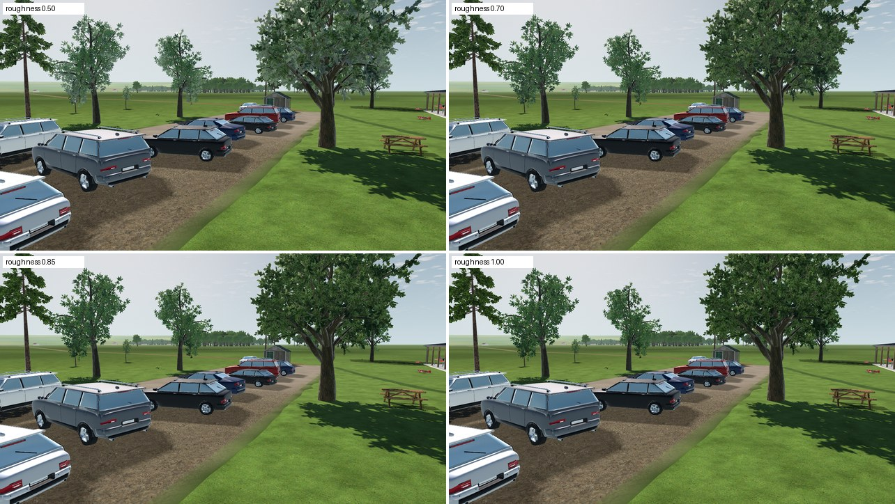
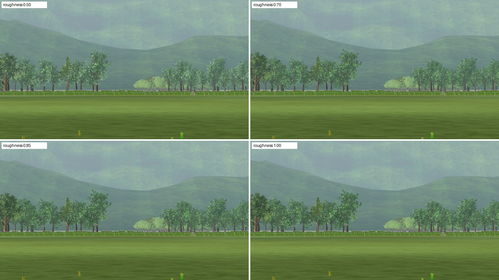
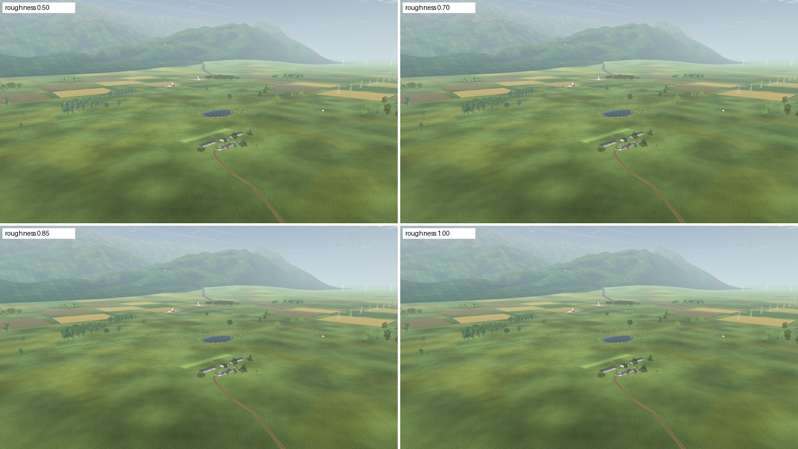

# L8a-R2 Matte LandscapeLab foliage

2026-10-22 · Landscape **L** ([tree plan](../../../plans/tree-forest-quality.md#follow-ups-2026-10-21)). The VQ-06b captures showed the 3D woods paler and bluer than the cards beside them. The plan assumed the cards were wrong. The measurement showed the opposite: the cards match the leaf textures, and the 3D foliage reflected the sky. LandscapeLab foliage now renders with roughness 0.85 instead of the supplier's placeholder 0.5. This changes the club's LandscapeLab trees and the 3D field trees, not the cards, the maples, placement or collision.

## Cause

Unlit, the leaf textures are yellow-green with little blue, like the cards: mean sRGB Quercus (0.376, 0.495, 0.213), beech (0.335, 0.474, 0.195), pine (0.352, 0.437, 0.161). Rendered, the 3D crowns carried far more blue ([`fixtures/card_vs_3d_specular_probe.gd`](fixtures/card_vs_3d_specular_probe.gd), same light, 150 m):

| Crown mean, sRGB | Card | 3D as imported | 3D, specular 0 | 3D, roughness 1 |
| --- | --- | --- | --- | --- |
| Quercus | 0.35, 0.47, 0.21 | 0.30, 0.38, 0.29 | 0.21, 0.28, 0.17 | 0.23, 0.31, 0.20 |
| Beech (maple card) | 0.23, 0.26, 0.11 | 0.30, 0.41, 0.32 | 0.21, 0.33, 0.21 | 0.24, 0.35, 0.24 |
| Pine | 0.33, 0.42, 0.17 | 0.30, 0.37, 0.23 | 0.25, 0.32, 0.16 | 0.27, 0.34, 0.19 |

Removing specular removed the blue cast, so the foliage was mirroring the sky. Every LandscapeLab GLB authors `roughnessFactor` 0.5 and `metallicFactor` 0.5 on its leaves; these are placeholder values. `ImportedVegetation` already resets the metallic factor to 0, but kept the roughness. Leaf cards facing every direction at roughness 0.5 reflect the bright sky across the crown.

Roughness 1 alone did nearly as much as removing specular. The fix therefore changes roughness only, and keeps specular 0.5, the dielectric reflectance of real leaves.

## Choice

Roughness 0.5, 0.7, 0.85 and 1.0 in the production world ([`fixtures/foliage_roughness_sweep.gd`](fixtures/foliage_roughness_sweep.gd), [views](fixtures/roughness_views.json)):

| View | 0.5 / 0.7 / 0.85 / 1.0 |
| --- | --- |
| Car park oak, close |  |
| Front woods, 10° |  |
| From 120 m |  |

At 0.5 the crowns look frosted; the car-park oak shows it most. 0.7 is greener. 0.85 reads as natural foliage with a slight sheen, and 1.0 is hardly different but fully matte. The step uses 0.85 (`ImportedVegetation.LANDSCAPELAB_FOLIAGE_ROUGHNESS`), set on the duplicated foliage material where the metallic reset already happens. The downloaded resources stay untouched, and the tree-wind shader mirrors the corrected material as before.

Blue/green ratio of the crowns at 150 m:

| | As imported | 0.85 | Card | Leaf texture |
| --- | ---: | ---: | ---: | ---: |
| Quercus | 0.78 | 0.66 | 0.44 | 0.43 |
| Beech | 0.78 | 0.68 | — | 0.41 |
| Pine | 0.63 | 0.57 | 0.40 | 0.37 |

The sheen is gone, but the 3D crowns remain bluer than the cards, probably from sky ambient light that the card shader's custom shading treats differently. That remaining gap is open.

## Checks

`test_imported_vegetation.gd`: every LandscapeLab foliage material renders with roughness 0.85 from the supplier's 0.5, and bark keeps its authored roughness and texture; supplier resources stay immutable. Mutations on a disposable copy, each caught: no foliage roughness; bark changed too. `test_imported_tree_rendering.gd` (material mirroring) and `test_field_tree_detail.gd` pass. `app/data/woodland_edges.json` was regenerated for the changed source.

## Open

- The remaining blue difference between 3D crowns and cards (ambient light).
- Native-GPU review of the club trees at 0.85.
