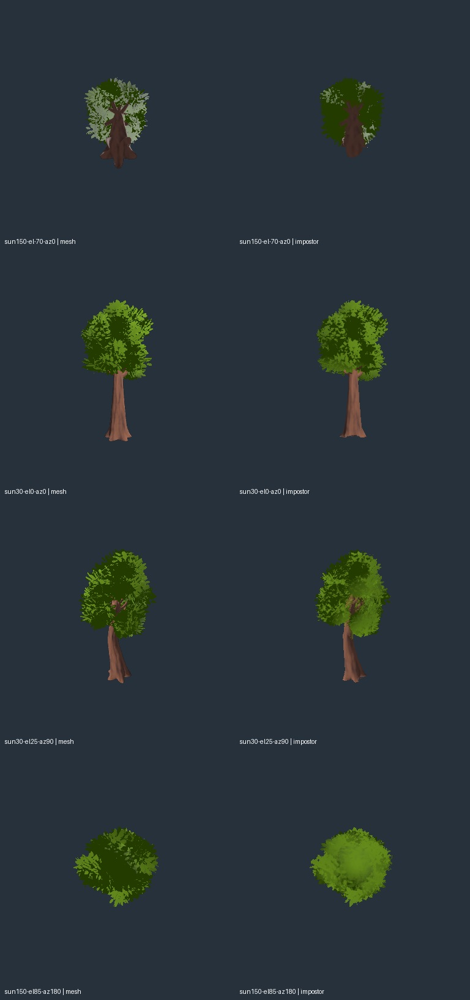

# L8b: bounded octahedral impostor evaluation

2026-10-18. **Do not adopt this candidate.** The existing baker successfully handles the downloaded source in native Godot 4.7.2 Compatibility, but its appearance screen fails and its additional texture cost is not justified. No plugin or baked impostor is installed in the production app.

Tool: [Octahedral Impostor LOD by hdrsniped](https://github.com/hdrsniped/octahedral-impostor-lod-godot), exact commit `0efe9e80a12e822b1250612e3e5c6be6afc67f13` (v3.0.0). Credit: **hdrsniped**. Its [custom permissive license](LICENSE-hdrsniped.txt) requires visible credit and preservation of the notice; it is not labeled MIT. The model and original maps are the already accepted Quaternius `CommonTree_1` CC0 assets. Neither tree geometry nor replacement source textures were authored.

The close aerial [card-orbit capture](../../L6c/tree-completion/motion/README.md) exposes the current crossed cards' flatness. This experiment tests an existing alternative against its own source mesh before attempting a production replacement. The isolated project copies the unchanged pinned addon and accepted tree files; [source receipt](source-receipt.json), setup recipe and command log retain their identities.

The fast preset uses High shader quality, 10×10 views and a maximum 2048 atlas. Overrides select full-sphere views (including undersides), lossless compression, no emission/ORM textures and no transition fade for the static comparison. Both source materials have constant metallic 0 and roughness 1; no ORM or emission maps are supplied. Original albedo, alpha and bark normal input remain present. The actual packed atlas is 2040×2040. This is one bounded configuration, not a rejection of every plugin preset.

## Native result

Godot `4.7.2.stable.official.ed1daf0bf`, Windows, OpenGL 3.3 Compatibility, RTX 3090 / NVIDIA 617.42. Both bake and evaluation exit zero without engine errors. The unmodified upstream eight-view quality checker reports:

| Metric | Result | Upstream screen |
| --- | ---: | ---: |
| Mean silhouette intersection-over-union | 0.92325 | Descriptive |
| Worst silhouette intersection-over-union | 0.87129 | At least 0.85 |
| Bad pixels | 24.75% | At most 10% |
| Combined `good` | false | true |

The separate 48-view matrix combines six elevations (−70°, −20°, 0°, 25°, 60°, 85°), four azimuths and two sun rotations. Mean/worst silhouette IoU is 0.92733/0.88333; mean/worst bad-pixel share is 29.42%/65.17%. Upstream bad pixels combine silhouette disagreement with mean RGB byte error above 38.25 in overlapping opaque pixels; this is a screening heuristic, not perceptual calibration or pilot acceptance. The underside example loses much of the source leaf/backface shading and trunk depth. [Full metrics](report.json), [summary](summary.json), selected original PNG pairs and a comparison sheet are retained.

Albedo and normal/depth each contain 22,193,872 image bytes including ten mip levels: **44,387,744 bytes / 42.331 MiB total** for one form. The `.res` file is 3,482,964 bytes; its small compressed file size is not texture residency. These are native image-data measurements, not vendor GPU-residency measurements.

## Disposition and reproduction

Reject this configuration before runtime integration. Increasing resolution, splitting source parts or using Ultra is conditional future work with a larger cost; the failed fast configuration does not justify that dependency. Native transitions, exported runtime integration and flight performance were not attempted after the appearance failure. The current three-form field atlas remains in production.

The pinned v3.0.0 README now documents Compatibility dither fades; older listing/research statements about unavailable fades do not describe this revision. This fixture deliberately disables fades and makes no transition-quality claim. Compatibility card self-shadowing remains an upstream limitation.

`prepare.py.txt`, `runner.py.txt`, `evaluate.gd.txt`, `project.godot.txt`, commands and hashes reproduce the isolated comparison. The setup recipe expects a checkout of the exact addon revision in its temporary source path and the existing accepted project assets. Run its native commands serially; the full 96 PNGs and generated atlas remain in `tmp/tree-completion/impostor-evaluation` and `tmp/tree-completion/impostor-prototype`, respectively. The saved scene is a generated artifact; source inputs and the pinned tool are the authoritative reproduction path.
