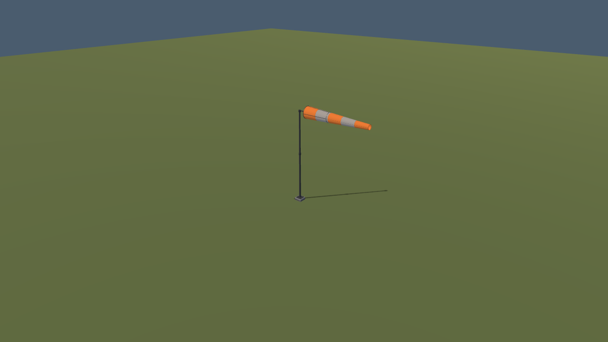
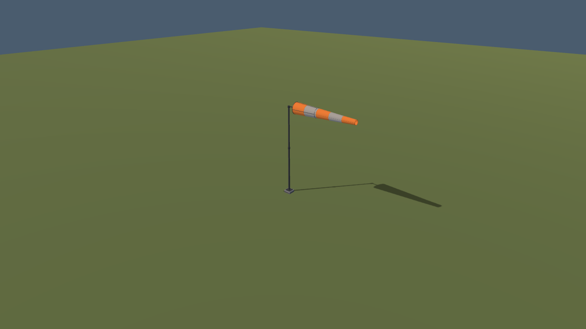

# VQ-04a-F2: moving windsock shadows

2026-10-19. Local follow-up to [projected field shadows](../README.md) and [windsock motion](../../../wind-implementation/M5-W04b-R1/README.md).

The previous field caster deliberately included only the fixed mast. This delivery adds the swivelling basket and deforming sleeve to that same ground shadow. It retains the existing Compatibility projection, opacity, height-based softness, lighting controls and flat-ground receiver.

## Implementation

`windsock_projected_shadow.gd` specializes the existing projector. One 512² coverage map contains the fixed support plus two mesh proxies sharing the actual fabric and basket mesh resources. The sleeve's vertex deformation is extracted into `windsock_deformation.gdshaderinc`; both the visible fabric and the coverage shader use it. The basket proxy uses the same bearing yaw. No CPU mesh rebuild or independent animation clock is introduced.

The projector reads the visible material's current centreline, yaw and inflation after the world upload (process priority 80). Current conservative visual bounds frame the mask, including gusts and direction changes. New poses or visible shader flutter request `UPDATE_ONCE`; pause holds the cached mask. Approximate pose comparison and an inflation threshold of 0.0001 avoid redraw for invisible settling and micrometre-scale flutter after wind decays. The full visible shader continues using its original inputs.

The map replaces the old 256² mast map, adding 196,608 target pixels without adding a projector. Existing limits of 16 maps and 8,388,608 target pixels remain enforced. The coverage pass has three mesh draws; their overlapping silhouettes form one mask instead of stacking dark receivers. Native windsock shadow casting stays disabled, avoiding duplicate shadows and preserving the same result with native engine shadows off.

The field lighting cache now includes `shadow_strength` as well as direction and light energy, so opacity-only changes refresh immediately.

## Verification

Native captures use pinned Godot 4.7.2, Compatibility/OpenGL 3.3 and an NVIDIA RTX 3090. The seven fixed cases cover calm, light and strong wind, reversal, 15°/75° sun, and zero shadow strength. Hiding the receiver yields **zero changed visible pixels** against the pre-change shader in all seven cases. The original projection's independent native GPU oracle also passes.

**320 focused assertions pass**: projected shadow 43, geometry collection 77, windsock geometry 17, windsock motion 35, legacy contact shadows 20, recorded audio 47, moving windsock shadow 22, and integrated field shadows 59. They cover moving uniforms and bounds, pause/cache reuse, calm residuals, root pose, source visibility, lighting strength, map budgets and teardown. The original independent projection GPU oracle also passes.

The [native windsock oracle](native.json) passes **39 checks**, including independent world-space ray/plane intersections at four unsupported sleeve stations in five wind/light cases, clear borders, repeated-pose equality, reversal, hiding and zero-strength restoration. A two-texel neighborhood allows raster edges and sub-centimetre flutter. A Windows resource pack mounted in an empty project loads the shared shader include and constructs its 512² caster successfully; this is resource qualification, not an installer test.

[Verification and source identities](verification.json) retain the image comparisons and timing summary; [capture metadata](capture.json) identifies the seven static cases. In the alternating dynamic/cached fixture, the moving mask's median GPU time is **0.070 ms**. The mask p95 is **1.806 ms**, with noisy GPU spikes also present in the cached controls; these samples do not establish an isolated GPU deadline. Wall p95 is 16.98 ms dynamic versus 17.02 ms cached at the requested 60 FPS cap. Raw main/mask CPU/GPU and wall samples remain in `native.json`; no full-flight performance gate is claimed.

| Previous mast-only shadow | Moving sleeve and basket |
| --- | --- |
|  |  |

[Calm sag](images/calm.png) · [Reversed wind](images/reverse.png) · [Low sun, full footprint](images/low-sun-wide.png) · [High sun](images/high-sun.png) · [Production field](images/field.png).

This is a flat-ground shadow. It does not add self-shadowing, cloth light transmission or shadows on other objects. Softness and opacity remain presentation estimates. Native timings on this desktop cannot establish complete flight frame budgets, minimum hardware or other platforms. A full application suite and owner playtest are separate checks.

## VQ-04a-F3: windsock upload CPU optimization

2026-10-19. `windsock.gd` now accumulates fabric extrema directly instead of allocating and scanning 104 corner points per upload. It reuses one yaw basis, caches the cue's immutable nodes/material/dimensions/hardware bounds, and transforms hardware corners directly into the combined bounds. Exact repeated poses skip CPU uploads; shared-clock GPU flutter still runs. Explicit reset forces an upload. The cache belongs to one cue and is released with it; runtime replacement of its meshes/materials is not supported by this renderer.

The fixed motion integrator, wind inputs, shaders, shadow resolution and refresh rules are unchanged. On an AMD Ryzen 9 5900X, pinned native Windows Godot 4.7.2 headless, 30 paired batches alternating baseline/candidate order gave:

| One-cue CPU workload | Baseline mean | Optimized mean | Reduction |
| --- | ---: | ---: | ---: |
| 240 wind/motion ticks and 60 render updates | 4.279 ms | 2.423 ms | 43.4% |
| 60 repeated updates at paused time | 2.770 ms | 0.221 ms | 92.0% |

The active workload uses changing wind; both sides include the same input generation and motion calls. These are elapsed CPU component batch times, not single-frame costs or complete flight FPS. [Raw paired batches and source identities](optimization/compare.json) retain every observation. The baseline renderer was frozen before editing from commit `8c77c36ab8abc7633d30b5dd143b58ecc7a9c1d2`; dependencies are shared with the candidate.

The comparison passes 2,400 exact motion-state cases, 600 exact rendered-state cases and six direct bounds cases at default/maximum dimensions. Calm, gust, turns, reversal and updrafts use the same 240 Hz tape. All **22 native images are pixel-exact** against the pre-optimization captures, including seven masks and shadow-hidden controls. The [native oracle](optimization/native.json) again passes 39 checks. **441 focused assertions pass**, including frame grouping at 30/60/144 FPS, committed session wind, resets, lighting/visibility, bounds, audio and data validation. Both changed scripts parse; a newly exported Windows resource pack mounts in an empty project and constructs the windsock and its 512² caster. [Verification](optimization/verification.json) records checks, warnings, capture identities and image hashes.

Full application tests and owner playtest were not repeated in this pass. No GPU saving or whole-flight frame-budget improvement is established. Reproduce the paired benchmark with [the ground tool instructions](../../../../../tools/ground/README.md#windsock-cpu-comparison-vq-04a-f3).

## VQ-04a-F4: faster cloth construction

2026-10-21. Implemented in `app/render/windsock.gd`: sample the cloth's 61×33 grid once per build and reuse points, normals and UVs when emitting the original triangles. This removes repeated finite-difference normal evaluation: 53,760 point evaluations become 10,065 (**81.3% fewer**). Both seam endpoints and the original intermediate Vector2 rounding are preserved. The temporary arrays are bounded to 2,013 entries each and released after construction; meshes, materials and motion models still belong to each cue. There is no persistent cache, new asset, physics change or deferred first-use work.

Baseline: clean `8b8086727b6fa543c6eed49d19fc695bc49c0df2`, pinned Godot 4.7.2, Ryzen 9 5900X / RTX 3090, Windows Compatibility. Ten alternating headless component pairs measure mean construction **73.323 → 23.213 ms (68.3% reduction)**. The existing comparator now checks every populated surface array byte-for-byte for Fabric, Support and Basket at default, minimum, maximum and non-round dimensions, in addition to its motion/render/bounds checks. All **3,010 cases pass**. A disposable UV mutation produces eight mismatches and a nonzero exit, confirming that the new geometry check rejects changed output. [Raw comparison](build-grid-2026-10-21/runs/geometry-and-build.json).

Actual release-template Home/Fly collectors compare the frozen renderer with the candidate; neither contains construction timers. Seven alternating process pairs were attempted, each with two Fly/return cycles. Pairs 1 and 6 contain focus-paused flight and are retained but excluded, leaving five active pairs. Native timing, exports, tests and captures were serialized. Caches/background host activity remain uncontrolled; process-fresh is not cache-cold. [All pairs and reduction](build-grid-2026-10-21/runs/loading-summary.json).

| Complete measured interval | Baseline median | Candidate median | Median paired reduction |
| --- | ---: | ---: | ---: |
| First Home, from resource load | 3,844 ms | 3,800 ms | 2.1% |
| First Fly draw | 2,148 ms | 2,113 ms | 2.1% |
| Return to Home after first flight | 844 ms | 787 ms | 6.5% |
| Second Fly draw | 1,440 ms | 1,389 ms | 3.6% |
| Return Home + second Fly | 2,286 ms | 2,170 ms | **5.1%** |
| First Home from load + first Fly | 6,022 ms | 5,949 ms | 1.6% |

The paired percentages are medians of per-pair ratios, not ratios of the two medians. Every eligible warm combined pair improves by 95–124 ms. Adopt this small arithmetic-reuse change for the recurring transition improvement and exact output preservation. The first-path >5% goal is **not** met; initial Home/Fly targets and native frame-pacing qualification remain open. These results do not establish a flight FPS gain or a physical-display qualification.

Verification after integration: all seven focused suites pass (windsock geometry/data/motion, moving/legacy cue shadows, field projected shadows and Home/Fly field integration). The latter confirms separate mutable resources, matching field geometry/materials and one active scene/session. All **18 native motion-view images are byte-identical** to the baseline; [image hashes](build-grid-2026-10-21/runs/visual-parity.json). All 14 loading processes complete bounded cleanup with zero reported orphan nodes and no ObjectDB exit warning; this does not close the prior ordinary-release shutdown issue or a long lifecycle gate. Full `app/test.sh`, other platforms, physical validation and owner pilot acceptance were not run.

[Verification](build-grid-2026-10-21/verification.json) and [artifact manifest](build-grid-2026-10-21/evidence-manifest.json) retain exact sources, checked logs, release hashes, source preservation, images' capture manifests and reduction recipes. Of 3,840 frozen source inputs, only the renderer, its geometry test, the comparison tool and its instructions change; aircraft, simulation and assets remain unchanged. Both exported native DLLs match the pinned build receipt. Large files use deterministic gzip. Binary exports and all raw images remain on the recorded D: scratch path. Recipes in `provenance/` derive the repository from their intended `<repo>/tmp/` location; the two release variants are named `collector` (baseline) and `diagnostic` (candidate).

## Reproduce and sources

Use the pinned engine from the repository root:

```powershell
godot --headless --path app --script res://tests/test_windsock_shadow.gd
godot --headless --path app --script res://tests/test_field_projected_shadows.gd
godot --path app --audio-driver Dummy --script tools/shadows/windsock_capture.gd -- --out=C:/absolute/new-directory
godot --path app --audio-driver Dummy --script tools/shadows/windsock_probe.gd -- --out=C:/absolute/native.json
```

Use an absolute `--script` path if the engine resolves it relative to `app/`. Captures require a real renderer; headless script checks cannot qualify silhouettes.

Godot documents [shared shader includes](https://docs.godotengine.org/en/4.7/tutorials/shaders/shader_reference/shader_preprocessor.html#include) and [one-shot SubViewport updates](https://docs.godotengine.org/en/4.7/classes/class_subviewport.html). Existing [projection research](../research.md) explains Compatibility constraints, clipping and the independent ray-plane oracle. No asset download or new dependency was needed for these shadows.
