# VQ-05 — propeller blur from the live rotor speed

**Status: delivered and locally verified, 2026-10-12.** Prefix VQ; the visual-quality plan's VQ-05 ("derive propeller blur from live RPM and the existing auxiliary source").

## Ownership and coordination

At the start the shared tree carried another track's uncommitted ground-effect work (`ROADMAP.md`, `app/physics/aero.gd`, a new `ground_effect.gd`); during this delivery that track grew to physics, data, schema, session and research files. This delivery touches none of them. It owns the new `app/render/propeller_blur.gd`, `app/tests/test_propeller_blur.gd`, `app/tests/capture_propeller_blur.gd` and this folder, and integrates through two lines in `app/main.gd` (a preload and one attach call beside the existing gear observer). Shared documents (`DECISIONS.md`, `docs/research/README.md`) received one row and one link each; the other track's hunks in those files were left unstaged.

## Why this improvement

A solid propeller drawn once per frame strobes: at flying speed the blades pass several times per frame and land at a random angle each time (the 2026-10-12 baseline captures show the Stik's blade frozen at 5,174 rpm and the P-51's four blades sharp at 3,546 rpm). Every powered flight of every propeller aircraft shows this, from takeoff to the close-up view. Human vision fuses blade passings into a translucent disc above roughly 15 Hz in dim light to about 60 Hz in bright light (flicker fusion), which is what flight simulators approximate with a "prop disc": X-Plane draws a translucent front disc and side billboard instead of the physical prop when the engine is running, and FlightGear aircraft swap or fade a disc object by engine rpm. The repository's smoke proposal (SM-00…09) was the other candidate; its own plan gates it behind an unrun Compatibility particle probe and an AUX-radio design, so it stays a research item.

## Design

- **Measured, not authored.** `profile()` reads the meshes under the aircraft's `propeller` node (the stable node every builder provides). Surfaces reaching past half the tip radius carry blades; their triangles are rasterized in polar space (36 rings × 240 angle bins) so that each ring's coverage is the share of a revolution a blade occupies there, which is the time-averaged occlusion an eye sees. The dominant blade material per ring gives the disc colour (the P-51's yellow tips become a yellow rim), runs of covered bins at 70 % radius give the blade count (Stik 2, Extra 2, P-51 4, Timber 3), rings fully covered from the axis outward are the opaque hub (the Timber's spinner, backplate and bell, 23 mm, share a mesh with its blades), and any other model mesh that cuts the blade plane (spinners of the Extra and P-51, the Stik's hub cylinder) sets where the disc starts.
- **Cross-fade by blade-passing frequency.** `blur_fraction()` is a smoothstep from 12 Hz to 48 Hz of blades × rev/s (perceptual estimates: below the rod fusion band to the bright-light cone band, with 60 fps rendering aliasing above 30 Hz). An idling glow engine (2,000 rpm, two blades, 67 Hz) is already a disc; an electric motor spinning down shows its blades return; a four-blade propeller blurs at half the speed of a two-blade one.
- **Disc.** One vertex-alpha annulus from the disc's inner radius to the tip, one surface per blade material, in the blade plane (mean blade z at the outer half). Opacity = measured coverage × gain, with gain 1.0 (an art control); the disc is lit by the standard material like any surface, culls nothing and casts no shadow.
- **Beside the model, never inside it.** The node is a child of the flight scene, copies the propeller's world transform each frame and holds the disc plus, while fading, an opaque hub copy and an alpha-faded blade copy split per triangle at the hub radius. The model's blade nodes are only shown or hidden. Consequences that were checked: the crash director's `duplicate()` of the model (made at configure time) stays pristine; the projected silhouette, which skips `propeller`, is unchanged; a stopped rotor renders byte-identically; the Home preview never attaches the blur.
- **Reads only `sim.aux[0]`**, the rotor speed `main.gd` already spins the propeller with. Pause freezes the speed and therefore the disc; reset, checkpoint seek and crash follow the state. The scripted preview route of an aircraft without flight data reports zero rotor speed, so there the propeller neither spins nor blurs.

## Renderer probes (Godot 4.7.2, Compatibility, llvmpipe)

A scratch scene rendered three questions before the design was fixed; the script is retained as [research/visual-quality/vq-05/compat_probe.gd](../../../../research/propeller-blur/compat_probe.gd) and its frame as [evidence/compat-probe.png](evidence/compat-probe.png):

| Question | Result | Consequence |
| --- | --- | --- |
| Does `GeometryInstance3D.transparency` fade a `StandardMaterial3D` quad? | No: 0.0, 0.5 and 0.9 rendered identically (0.949). The 4.7 class reference states it is ignored on Mobile and Compatibility. | Blade fading uses a duplicated material with `TRANSPARENCY_ALPHA`, on copies owned by the blur node. |
| Is the back face of a cull-disabled lit quad dark? | No: the quad turned 180° rendered at the same 0.761 as the front, while a quad wound the other way rendered at ambient only. The engine flips the normal on back faces; winding decides the lit side. | The disc is wound consistently with +Z normals and reads as lit from both sides without a custom shader. |
| Does vertex alpha blend through `vertex_color_use_as_albedo`? | Yes, linearly across a gradient strip. | The disc stores coverage in vertex alpha and scales it per frame through the material's albedo alpha. |

## Verification record

Everything below ran on this VM: Ubuntu 24.04, 12 cores, no GPU (llvmpipe under Xvfb). Software rendering establishes pixels and repeatability, not frame time on the target machine or how the disc reads on the pilot's monitor.

**Headless contract** — `app/tests/test_propeller_blur.gd`, run by `app/test.sh`: 114 checks, 0 failures. The complete `app/test.sh` passed twice on 2026-10-12/13: in a clean worktree at HEAD `db54ab8` with only this change (36 min) and in the shared tree that also carried the other track's uncommitted work (39 min). Per aircraft: tip radius equals an independent vertex scan; blade counts 2/2/4/3; coverage within [0, 1], higher at the root than at the tip, bounded by half a turn per blade; the P-51's tip rings carry the yellow material; the Timber's hub is 23 mm; attach adds nothing inside the model and leaves every mesh, transform, visibility and override untouched (snapshot equality); mid speed hides the model's blades and shows copies with alpha 1 − f and a disc with alpha f; full speed shows the disc only; the node follows an arbitrary model pose and spin phase; a hidden model hides everything and the stopped state restores the snapshot exactly; freeing the node restores the blades; the Avanti and an empty build get no node.

**Studio sweeps** — `app/tests/capture_propeller_blur.gd` (summaries in [evidence/](evidence/), images in [images/](images/)). Each run checks that attaching and updating at 0 rpm is byte-identical to the pristine render, that the mean change on blade pixels against a no-propeller reference falls with speed while pixels outside the blade silhouette change (the disc), and that a repeated frame is byte-identical. All six runs passed: Stik quarter and front, Extra front, P-51 front and rear, Timber quarter and side.

| Stik, front, 0 rpm | 800 rpm (fraction 0.36) | 6,000 rpm (disc) |
| --- | --- | --- |
| 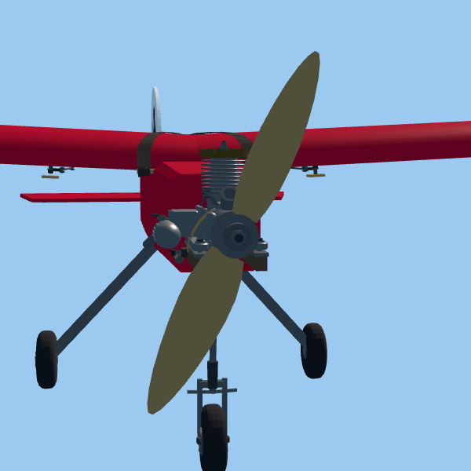 | 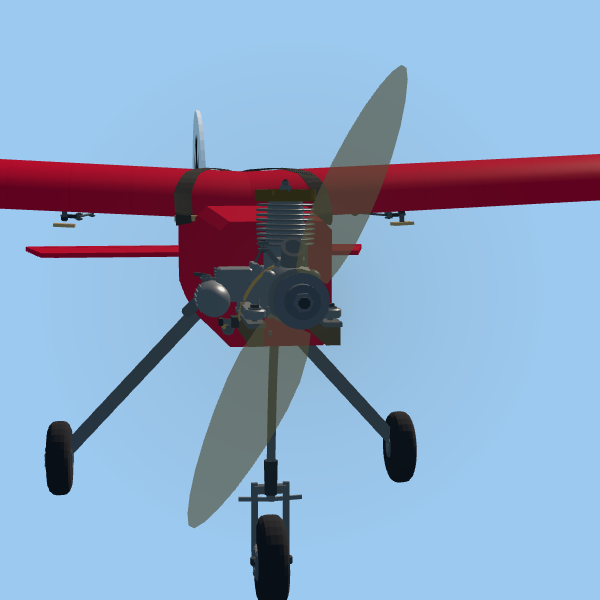 | 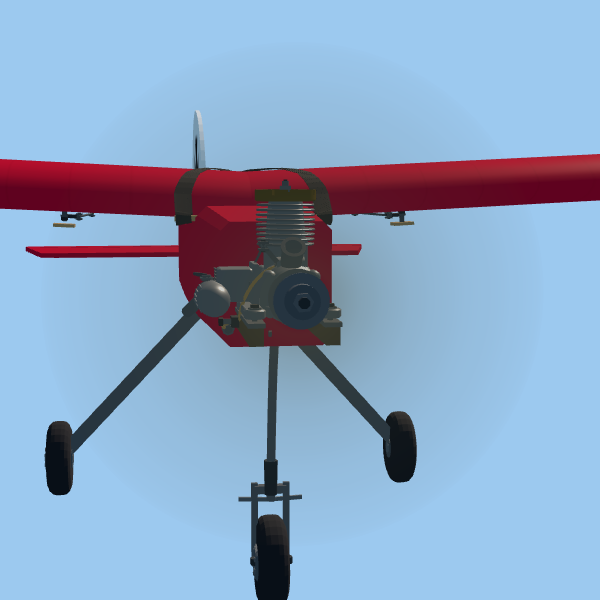 |

| P-51 front, 6,000 rpm (yellow rim) | Extra front, 6,000 rpm | Stik quarter, 6,000 rpm |
| --- | --- | --- |
| 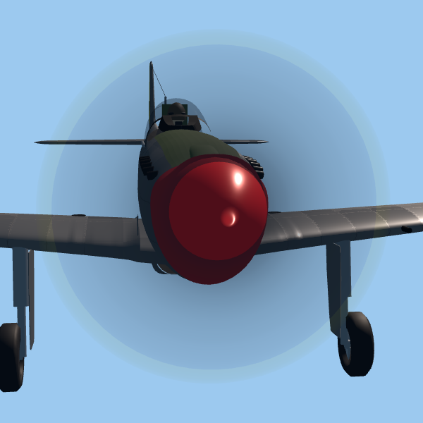 | 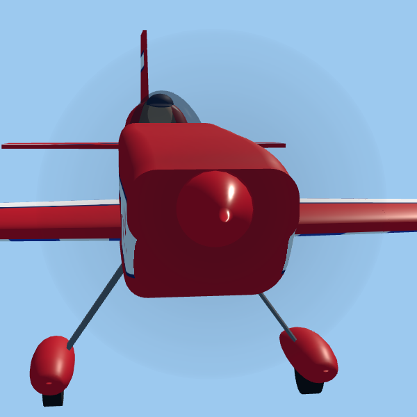 | 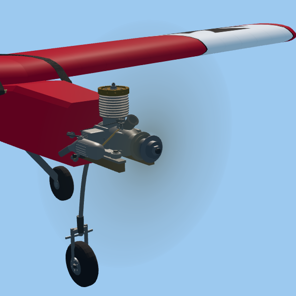 |

| Timber quarter, 900 rpm (spinner opaque, blades fading) | Timber quarter, 6,000 rpm | Timber side, 6,000 rpm (edge-on) |
| --- | --- | --- |
|  | 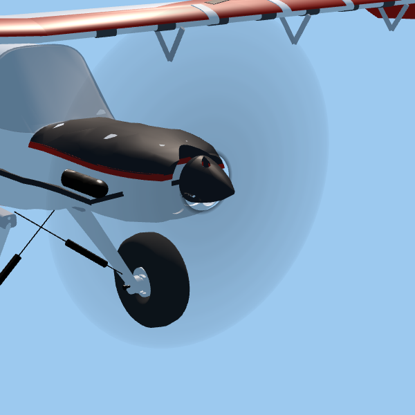 | 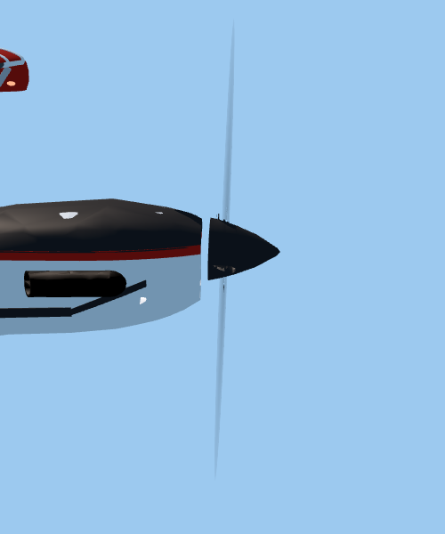 |

Stik front sweep, mean change on blade pixels against the no-propeller reference (lower is closer to "no blades") and pixels changed outside the blade silhouette (the disc):

| rpm | 0 | 400 | 600 | 800 | 1,000 | 1,200 | 1,500 | 2,400 | 6,000 |
| --- | --- | --- | --- | --- | --- | --- | --- | --- | --- |
| fraction | 0 | 0.004 | 0.126 | 0.363 | 0.637 | 0.874 | 1 | 1 | 1 |
| blade change | 0.367 | 0.366 | 0.324 | 0.246 | 0.164 | 0.101 | 0.070 | 0.070 | 0.070 |
| disc pixels | 0 | 0 | 6 | 19,812 | 60,994 | 95,540 | 104,319 | 104,319 | 104,319 |

**Production field captures** — the real app's `--capture` route (scenery, birds and engine shadows off, as `app/capture.sh` does) in two isolated worktrees at HEAD `db54ab8`: "before" unchanged, "after" with only this change applied, so the other track's in-progress physics could not move the aircraft between the pair. Facts, hashes and draw counters: [evidence/field-captures.json](evidence/field-captures.json).

| View | Before → after | Draw calls | Changed pixels (> 0.02) |
| --- | --- | --- | --- |
| Stik close-up, t = 1.5 s, 5,174 rpm | blade frozen → faint wood disc | 124 → 124 | 1,817, all inside the nose box |
| Stik close-up, 0.8 m low pass | same | 121 → 121 | 1,547, nose box |
| Extra close-up, t = 1.5 s | two blades → faint dark disc | 53 → 52 | 1,030 |
| P-51 close-up, t = 1.5 s, 3,546 rpm | four sharp blades → translucent disc with yellow rim | 160 → 154 | 13,486 (8,682 darker, 3,793 brighter) |
| Stik pilot view, 77 m | 2 px blade → 2 px smudge | 115 → 115 | 7 |
| Readability views, 30 m and 77 m (L0c) | — | unchanged | 2 and 3 |

| P-51 close-up before | P-51 close-up after |
| --- | --- |
| 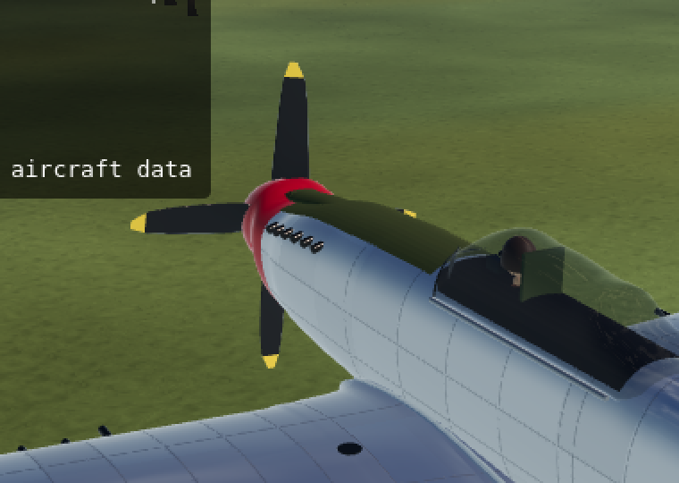 | 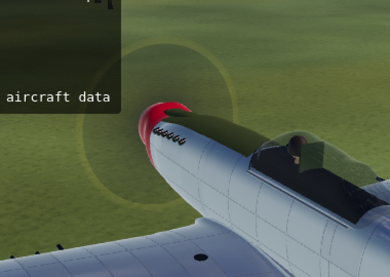 |

| Stik close-up before | Stik close-up after |
| --- | --- |
| 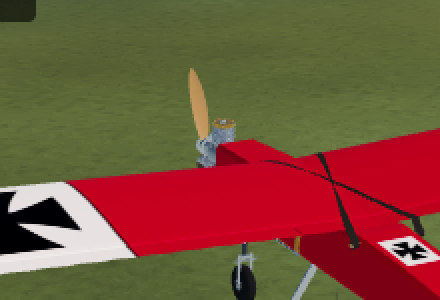 | 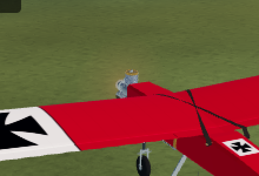 |

| Stik 0.8 m low pass before | after |
| --- | --- |
| 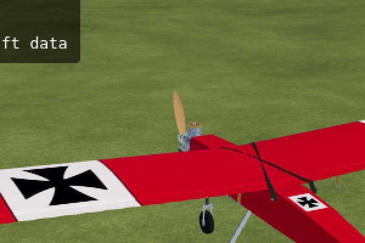 | 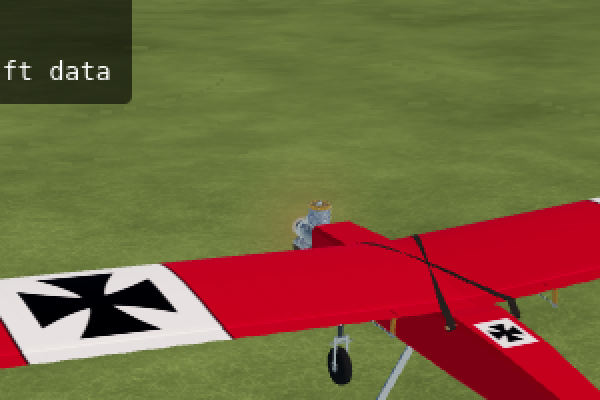 |

Full frames after: [P-51 close-up](images/field-p51-inspect-after.png), [Stik pilot view](images/field-stik-pilot-after.png) (scaled to 960 px).

**Readability (L0c metric, `compare_captures.py readability` with the capture.sh thresholds)** — the propeller is 2 px at these distances. 30 m: 65 → 67 airplane pixels, Weber contrast −0.426 → −0.416, nearly invisible 9.2 % → 10.4 %, ΔE 41.5 → 40.5; every requirement still passes. 77 m low pass: 52 → 51 pixels, contrast −0.339 → −0.341, nearly invisible 15.4 % → 17.6 % (8 → 9 pixels), ΔE 39.4 → 39.7. That view already fails the −0.40 contrast and 15 % requirements at HEAD before this change on this renderer; the blur neither causes nor fixes that, and it costs one nearly-invisible pixel where a blade pixel used to be. Both logs are in the evidence file.

**Frame-time logger (`--frametimes`, 8 s, Xvfb/llvmpipe, two runs each)** — p50 155/175 ms before, 154/174 ms after; p95 191/208 ms before, 198/208 ms after. Run-to-run spread exceeds any difference; software numbers are plumbing, not target-hardware performance.

**Late fixes** — after the sweeps and the pair were captured, two corrections were made without behavioural effect (the plane-cut scan's bounding-box prefilter for meshes straddling the axis, and a redundant normal write on the disc band): the Stik quarter sweep re-rendered with the final module gave identical image hashes and an identical profile, and the headless contract passed again (114/0).

**Cost** — `profile()` plus copies at attach, headless on an otherwise idle VM: Stik 11 ms, Extra 37 ms, P-51 73 ms, Timber 78 ms (one-off at flight start). Per frame: one transform copy and one comparison; material and visibility writes only when the fraction changes. Draw calls: +1 per disc material, −1 per hidden blade surface at full blur, blade copies only during the fade. Target-GPU frame time was not measured (no GPU on this VM).

## Limits

- Opacity, the 12–48 Hz band and the smoothstep are perceptual estimates; a pilot review on the target monitor decides the gain.
- The disc is flat and time-averaged: no ghost blades, no specular arc, no side billboard; from the side a running propeller is a thin line, as in life.
- The hub split is by radius; a rotor mesh whose blades begin inside a wide backplate keeps those root stubs opaque (consistent with full coverage there).
- The scripted route's synthetic propeller angle in `--capture` is a capture-only convention; the blur follows the simulation's rotor speed everywhere.

## Sources

- Godot 4.7 class reference, `GeometryInstance3D.transparency`: "Only supported when using the Forward+ rendering method. When using the Mobile or Compatibility rendering method, transparency is ignored" — <https://docs.godotengine.org/en/stable/classes/class_geometryinstance3d.html>
- Godot 4.7 class reference, `BaseMaterial3D` (`cull_mode`, `TRANSPARENCY_ALPHA`, `vertex_color_use_as_albedo`) — <https://docs.godotengine.org/en/stable/classes/class_basematerial3d.html>
- X-Plane developer documentation, "Custom prop discs": the front disc is a quad normal to the longitudinal axis, the physical prop is not drawn in disc mode, and translucency is interpolated by view angle — <https://developer.x-plane.com/article/custom-prop-discs/>
- FlightGear/JSBSim aircraft model XML: a `select` animation hides the solid propeller above 350–400 rpm and a material animation scales a disc's transparency by `rpm-norm-inv` — <https://gitlab.nps.edu/sasc/jsbsim/-/commit/a4adf05f4f88749ed648e99540c1c8996379fdee>
- Flicker fusion threshold (rods ≈ 15 Hz, cones ≈ 60 Hz at high illumination) — <https://en.wikipedia.org/wiki/Flicker_fusion_threshold>
- Rotor solidity (blade area over swept disc area; the local form cZ/2πr) — <https://en.wikipedia.org/wiki/Rotor_solidity>
