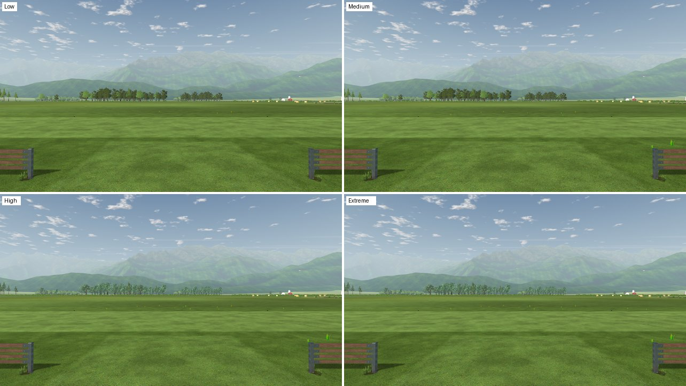
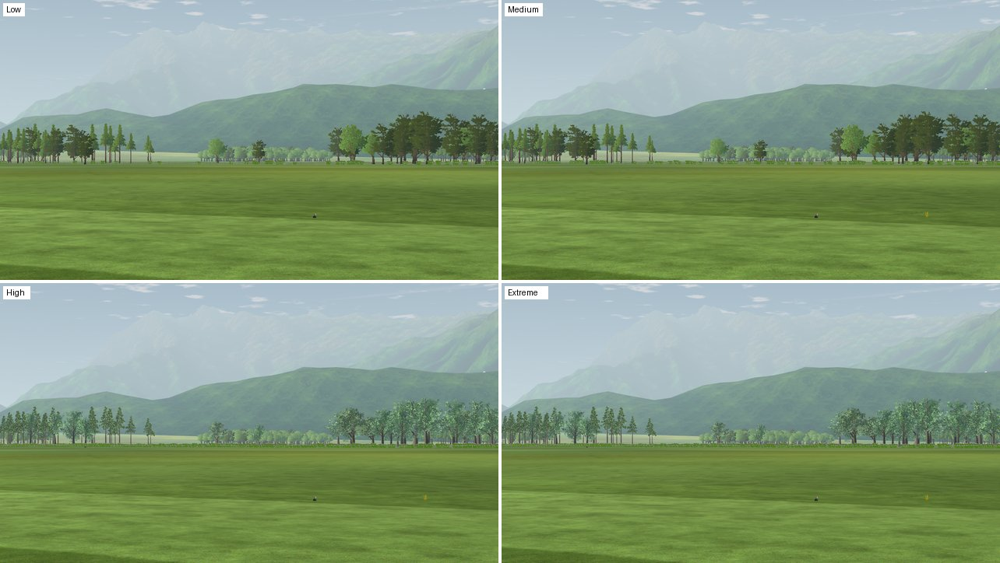
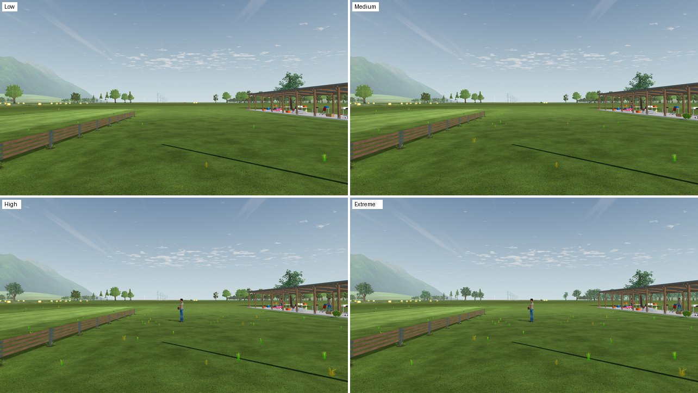
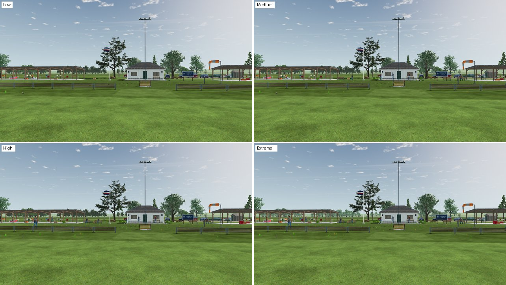
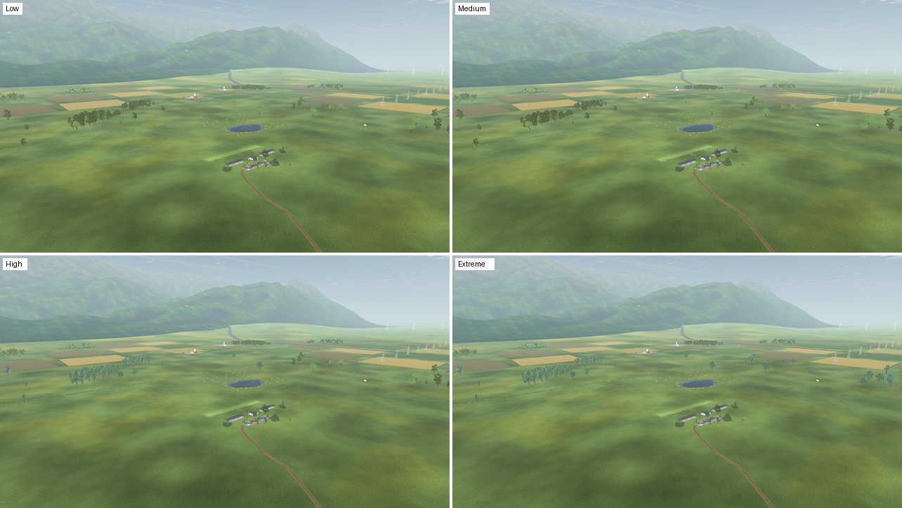

# VQ-06b Scene detail preset

2026-10-22 · Visual quality **VQ-06b**, with landscape **L** (trees) and scenery **SC-24**. The owner asked for graphics options in tiers ("Extreme, a bunch of tree detail; High a lot; Medium less") so that the scene budget becomes a choice. Settings > Graphics gains **Scene detail**: Low, Medium, High (default) or Extreme.

## Research

Twelve web searches, 2026-10-22, before design:

| Finding | Consequence here | Source |
| --- | --- | --- |
| Godot has no built-in quality presets; projects define their own bundle and store it in `user://` | One preset in the existing `display.cfg` store, not a second preferences system | [Godot forum](https://forum.godotengine.org/t/graphic-settings-in-godot-3-1/24483), [3D Graphics Settings demo](https://godotengine.org/asset-library/asset/2738), [ConfigFile](https://docs.godotengine.org/en/4.2/classes/class_configfile.html) |
| `mesh_lod_threshold` is the per-viewport LOD knob; 1 px is "perceptually lossless", higher values switch sooner | High and Extreme keep 1 px; Medium 2 px, Low 4 px | [Mesh LOD](https://docs.godotengine.org/en/4.2/tutorials/3d/mesh_lod.html) |
| `lod_bias` is the per-node counterpart | The L6c-R1 world-unit LOD bias stays | same |
| Visibility-range "Self" fades force transparency; "Disabled" uses hysteresis | No fades added to foliage here | [Visibility ranges](https://docs.godotengine.org/en/4.5/tutorials/3d/visibility_ranges.html) |
| A MultiMesh is culled whole; lowering `visible_instance_count` drops the last instances | Tiers choose trees by rule, never by truncating counts | [Using MultiMesh](https://docs.godotengine.org/zh-tw/4.3/tutorials/performance/using_multimesh.html), [forum](https://ask.godotengine.org/140712/set-multimesh-visible-instance-count) |
| Compatibility has no automatic instancing | MultiMesh batches remain the structure | [Optimizing 3D performance](https://docs.godotengine.org/es/4.5/tutorials/performance/optimizing_3d_performance.html) |
| Commercial practice: choose a preset, then fine-tune; foliage and view distance are separate knobs | One preset now; per-option overrides later | [Train Sim World](https://support.dovetailgames.com/hc/en-us/articles/29719662434962-Train-Sim-World-Graphical-Settings-Guide), [PUBG](https://support.pubg.com/hc/en-us/articles/115004170033-What-do-all-the-graphic-settings-mean) |
| No Godot GPU auto-detection; Unreal benchmarks (`scalability auto`) | Default stays High; a first-launch benchmark is later work | [Tom Looman](https://www.tomlooman.com/auto-detect-graphics-settings-ue4) |
| Shadow atlas and filter quality cost frame time steeply | A later tier knob, not in this step | [Lights and shadows](https://docs.godotengine.org/en/4.1/tutorials/3d/lights_and_shadows.html) |

## Presets

`app/render/scene_detail.gd` maps the level onto existing knobs:

| Level | Scenery tier (SC-24) | 3D field trees (L8a-R1) | Viewport LOD threshold |
| --- | --- | --- | --- |
| Low | `low`: landmarks and standard props | none, all cards | 4 px |
| Medium | `balanced`: half the ornaments, a fixed seeded half | none, all cards | 2 px |
| **High** (default) | `high` | the 127 trees within ±60° of the runway | 1 px |
| Extreme | `high` | the whole near ring, 480 trees | 1 px |

Precedence: `--scene_detail=<level>` after `--`, then `OPENRC_SCENE_DETAIL`, then the saved choice, then High. An explicit `--scenery_quality` still wins for the scenery tier. The LOD threshold applies at once; trees and props follow at the next flight.

**Collision.** Field-tree collision ignores the preset: every preset collides with the High rule, so a tree is never added or removed from the simulation. Ornament props follow the existing LU-05 rule that what is drawn is what collides, as `--scenery_quality` already did; an invisible obstacle would be worse. The flight log stores the collision world, so replays stay exact.

**Settings.** One row on the Graphics page, with Spanish text. It previews and is kept like text size, without the 15-second display trial, because it cannot blank the screen. Restore graphics defaults returns it to High. To fit the page at 1080p without scrolling (UI-23-R4), the "High is a temporary experiment" note moved from its own label into the Try High button's tooltip.

## Cost per level

Scene budget at 1280×720, primitives counted per instance ([LU-34-R1](../../landscape-upgrade/LU-34/README.md#revision-lu-34-r1-instanced-lod-meshes-were-undercounted)), one run per level with `OPENRC_SCENE_DETAIL=<level> tools/scenery/budget.sh` ([summaries](budget/); High is the [L8a-R1 run](../L8a-R1/budget/summary-720.md)). [`fixtures/preset_cost_table.py`](fixtures/preset_cost_table.py) builds the table and fails if a run was taken at another level or a level draws more than the one above it:

| Level | Pilot worst view: primitives / draws | Ground worst view | Aerial worst view | Pilot median | 3D field trees, pilot worst |
| --- | ---: | ---: | ---: | ---: | ---: |
| Low | 756,608 / 297 | 811,001 / 327 | 551,768 / 335 | 405,042 | 0 |
| Medium | 856,360 / 333 | 904,675 / 362 | 636,113 / 372 | 435,348 | 0 |
| **High** | 1,295,621 / 350 | 1,058,511 / 369 | 774,886 / 374 | 816,151 | 379,224 |
| Extreme | 1,321,436 / 349 | 1,624,964 / 388 | 1,288,039 / 403 | 817,912 | 481,986 |

- **Medium to High is the big step** (pilot worst +51%, median +87%): the 3D front trees. Medium is the setting for weaker GPUs.
- **Low saves 12% more than Medium** in the pilot worst view, through fewer props and a 4 px LOD threshold. The gain is modest because that view is a 10° telephoto: club trees (43%) and people and cars (25%) stay at full detail even at 4 px, and the ground (11%) and fence (10%) have no LODs. The proposed [L6c-R2](../../../plans/tree-forest-quality.md#follow-ups-2026-10-21) bark LOD error for club trees targets the largest share.
- **Extreme adds 2% in pilot views,** which already face the front trees, but 54% in ground views and 66% from the air, where the whole ring of 480 trees is in view.
- Draw calls change little (297–403), so the levels differ in geometry, not in submissions.

The budget in `scene_budget.json` guards High; the other levels are measured and reported, not capped. llvmpipe counts are workload, not frame time.

### What each level shows

[`fixtures/preset_capture.gd`](fixtures/preset_capture.gd) renders the production world at each level with the preset applied as in the app ([views](fixtures/preset_views.json)); each image shows Low, Medium, High and Extreme.

| View | Four levels |
| --- | --- |
| Pilot, 50° north |  |
| Pilot, 20° north-west |  |
| Pilot, 50° east |  |
| Club, from the flight line |  |
| From 120 m |  |

- Low drops people and ornament props, Medium a fixed seeded half of them (SC-24 tiers); landmarks, buildings, fences and tree positions stay.
- High turns the front woods 3D; Extreme also the side and rear woods (east view, aerial).
- From the air, the 3D woods read paler and bluer than the cards beside them. [L8a-R2](../L8a-R2/README.md) traced this to glossy 3D foliage, not the cards, and made it matte.

## Checks

`test_scene_detail.gd`: levels match the saved values; each level costs no less than the one below; precedence and fallback; the viewport threshold applies at once; save, reload, refusal and pre-existing files; the Settings row selects, keeps and restores; each level draws the expected 3D trees with all 1,680 positions; field-tree collision is identical across levels.

Mutations on a disposable copy, each caught: the field ignores the preset (Low, Medium and Extreme counts fail); the scenery ignores the preset; `apply` skips the LOD threshold; collision follows the preset.

Existing UI tests pass: `test_settings_ui` (pages fit at 1080p), `test_advanced_graphics_settings`, `test_ui_settings_integration`, `test_high_graphics_restart`, `test_ui_language`, `test_ui_pause`, `test_display_preferences`.

## Research: choosing the level automatically

Ten web searches and the engine source, 2026-10-22:

| Finding | Consequence here | Source |
| --- | --- | --- |
| `RenderingServer.get_video_adapter_type()` distinguishes integrated, discrete, virtual and CPU devices, but Godot 4.7.2's Compatibility driver hard-codes `DEVICE_TYPE_OTHER` (`drivers/gles3/storage/utilities.cpp`) | Only the adapter name and vendor strings (`GL_RENDERER`, `GL_VENDOR`) are available to classify the GPU | [PR #55790](https://git.objectionable.solutions/Sara/behaviour-tree-test/commit/b3174e7af93e9840698bba53a5d866a61c37d2da), [RenderingServer](https://docs.godotengine.org/en/4.2/classes/class_renderingserver.html) |
| Unreal's `scalability auto` runs a short CPU/GPU benchmark (index 100 = average) and maps it through per-project thresholds that QA tunes on real machines | A measured frame time is the reliable signal; its thresholds need the owner's GPU and a weak one | [Tom Looman](https://tomlooman.com/unreal-engine-optimal-graphics-settings/), [FSynthBenchmarkResults](https://docs.unrealengine.com/4.26/API/Runtime/ApplicationCore/GenericPlatform/FSynthBenchmarkResults/index.html) |
| World of Tanks detects on first launch and from a "Recommended" button; it uses CPU, GPU, RAM and VRAM | Detect once when nothing is saved, and offer a re-run; never override a saved choice | [Wargaming](https://wargaming.net/support/en/products/wot/article/16379/) |
| GeForce Experience used a server database and a frame-rate target; users disliked silent resets after updates | No online database; never change a saved setting silently | [Laptop Mag](https://www.laptopmag.com/articles/nvidia-geforce-experience-software-optimizes-your-game-settings) |
| Players expect a preset as a starting point with overrides; FFXV's benchmark without settings drew criticism | The recommendation pre-selects a level the player can change | [Gamers Nexus](https://gamersnexus.net/news/3248-ffxv-playable-demo-addresses-settings-customization-concerns), [Train Sim World](https://support.dovetailgames.com/hc/en-us/articles/29719662434962) |
| Unity Adaptive Performance adjusts quality at run time from thermal and bottleneck state (mobile) | Run-time switching would rebuild the scene; only the LOD threshold could adapt live | [Unity](https://docs.unity3d.com/Packages/com.unity.adaptiveperformance@5.1/manual/user-guide.html) |
| `Performance` monitors: `TIME_FPS` updates once per second, some monitors are zero in release builds | Time frames directly (`Time.get_ticks_usec`) rather than read FPS monitors | [Performance](https://docs.godotengine.org/en/4.2/classes/class_performance.html) |
| The MIT "Smart Graphics Settings" add-on adapts render scale, AA, shadows and reflections from FPS | Its knobs are Forward+ settings, not this project's scene detail; not adopted | [Asset Library](https://www.godotengine.org/asset-library/asset/edit/16085) |

## VQ-06b-R1 Automatic level

2026-10-22. Following the research above, **Automatic** is the new default choice. It shows as "Automatic (Medium)" and picks a level from the GPU at every launch, so a new GPU is followed without a stale saved guess. Choosing a level saves it, and a saved level always wins. Restore graphics defaults returns to Automatic. Tools and tests never load preferences and keep High.

`SceneDetail.recommend()` classifies the GL renderer and vendor strings:

| GPU name contains | Level | Reason shown |
| --- | --- | --- |
| llvmpipe, softpipe, lavapipe, SwiftShader, Microsoft Basic Render, GDI Generic | Low | software renderer |
| Adreno, Mali, PowerVR, Tegra | Low | mobile GPU |
| GeForce MX, GeForce GT, old GeForce 8/9 | Medium | entry-level GPU |
| GeForce, RTX, Quadro, Radeon RX/Pro/R9/R7, FirePro, Intel Arc | High | dedicated GPU |
| Intel (UHD, Iris, HD), Radeon(TM) Graphics, Radeon Vega, Apple M | Medium | integrated GPU |
| anything else, or no name | High | unrecognized GPU / no GPU reported |

Rules are checked in that order, so "Intel Arc" and "Radeon RX" never count as integrated. Extreme is never chosen automatically. The Settings tooltip names the detected GPU and the reason.

**Checks.** `test_scene_detail.gd` covers 14 driver strings, including ANGLE-wrapped names from macOS and Windows; a saved Automatic resolving through detection (llvmpipe → Low, then a different GPU → Medium); a saved level winning; and the menu entry, selection and restore. Mutations on a disposable copy, each caught: integrated checked before discrete ("Intel Arc" fell to Medium); Automatic never resolved; the caption ignoring Automatic. On this VM's real OpenGL driver Godot reports `llvmpipe (LLVM 20.1.2, 256 bits)` / `Mesa` with device type 0 (`DEVICE_TYPE_OTHER`), and Automatic picks Low; headless reports no GPU and keeps High.

**Limits.** Name lists only guess. A measured benchmark (render the pilot view at High for a few seconds and step down when frames are slow) is the reliable next step. Its thresholds need the owner's RTX 3090 and one weak GPU; llvmpipe cannot calibrate them.

## Open

- Frame time on native hardware for each level (VQ-06's acceptance); llvmpipe counts are workload, not timing.
- Per-option overrides (trees, props, LOD) under the preset, and a measured first-launch benchmark to refine Automatic.
- Shadow quality as a tier knob.
