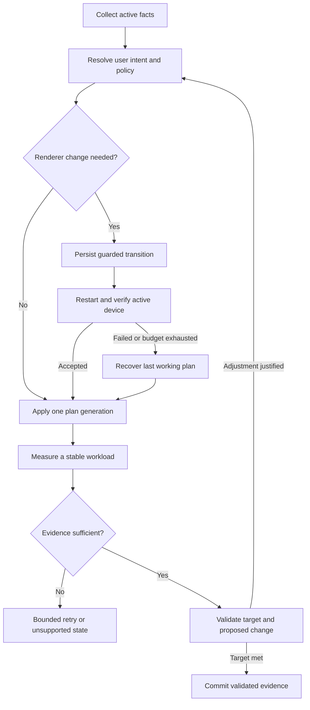

> Historical source audit at `57abea025f62b20233ca281d58d2acbee4ab8b8e`. Its finding IDs and evidence are retained. The [canonical implementation plan](../../../../plans/automatic-graphics.md) supersedes its original execution order and owns current status. The [follow-up receipt](README.md) identifies changes implemented after this audit.

# OpenRC Simulator GPU Detection and Automatic Graphics

## Senior engineering audit and phased improvement plan

**Audit date:** 21 November 2026\
**Repository:** [bultodepapas/OpenRCsimulator](https://github.com/bultodepapas/OpenRCsimulator)\
**Audited revision:** [`57abea025f62b20233ca281d58d2acbee4ab8b8e`](https://github.com/bultodepapas/OpenRCsimulator/commit/57abea025f62b20233ca281d58d2acbee4ab8b8e), verified as remote `main` during the audit\
**Engine:** official Godot `4.8.beta2.official.cafc17a19`\
**Owning track:** VQ-07h, coordinated with UI, PT, DT, the Apple/MetalFX track and the existing rendering owners\
**Deliverable:** evidence-backed audit and implementation proposal. No application-source changes are included.

## 1. Executive assessment

OpenRC Simulator has a useful automatic graphics foundation: a centralized policy, a generated GPU database, saved overrides, renderer recovery, workload-aware calibration, a timing-lease owner and a substantial regression snapshot. The highest-value next step is to make those components behave as one reliable decision system.

The principal weaknesses are **ambiguous hardware identity, unbounded renderer transitions, incomplete calibration state, and inconsistent settings transactions**. Adding more GPU names or increasing quality thresholds before repairing those boundaries would increase the number of machines exposed to uncertain decisions.

This audit records **20 findings**. Three receive P1 priority because they affect startup recovery or allow one adapter's performance verdict to govern another adapter. The remaining findings cover reproducible classification errors, settings defects, calibration gaps and evidence limitations. Priority is an implementation-order assessment, not a claim that every affected hardware configuration has been reproduced.

The most consequential results are:

- A supplied OpenGL/Vulkan name pair for an RX 6800M makes the production startup policy alternate **High → Standard → High → Standard**, requesting a restart every time. The state-machine failure is reproduced; the exact paired names still require confirmation on target hardware.
- Two distinct Mesa GPU descriptions normalize to the same persisted calibration key, even though the GPU lookup distinguishes their chips.
- The explicit High restart path sets an environment flag that causes the renderer guard to skip that restarted session.
- A stored incomplete calibration can suppress future measurement. A promoted level can also remain unvalidated, and a High veto can survive an incompatible internal resolution or MSAA setting.
- Restore/Revert handles draft values and the calibration-reset side effect differently. Restore can also reset an RC circuit setting that changes the physical scenario.
- Generic GPU rows supply unverified VRAM and performance values. A 6 GB-capable A2000 model family can pass an 8 GB Extreme gate; synthetic unknown RTX/RX names also qualify for Extreme.

The recommended sequence is: **repair launch and settings correctness; establish reliable identity and an explicit resolved plan; make calibration bounded and verifiable; then qualify better renderer and quality bundles on representative hardware**. Continue the existing [automatic graphics plan][plan] rather than creating a competing graphics track.

## 2. Audit scope, method and evidence strength

### 2.1 Instructions and implementation boundaries

The audit read the repository's root `AGENTS.md`, the subagent guide, documentation ownership conventions, rendering instructions, test instructions and relevant tool guides. Three bounded helpers inspected classification, lifecycle behavior and primary technical sources. The lead independently inspected material paths and executed the focused probes below.

The following project requirements govern the proposal:

- Simulation remains at a fixed 240 Hz. Graphics choices must preserve the simulation's numerical laws, accepted inputs and physical scenario.
- Saved explicit choices remain authoritative. Automatic optimization must not silently overwrite them.
- General display qualification starts at 1920 × 1080, followed by higher resolutions; 1280 × 720 is the last priority. Apple Silicon on Retina displays targets native output and the reconstructed internal 3D result under the owning Apple plan.
- Real hardware establishes performance and visual acceptance. Headless checks establish the software behavior they exercise.
- Generated GPU data is changed through its generator. The existing VQ-07h plan owns implementation status; dated research owns measurements. [Repository requirements][agents] [Rendering rules][renderAgents] [Verification scope][verification] [Documentation ownership][docMap]

### 2.2 What was inspected

| Boundary | Principal implementation and evidence |
| --- | --- |
| Adapter parsing and GPU knowledge | `gpu_capability.gd`, `capability.json`, `build_gpu_capability.py`, classification tests and Steam fixture |
| Initial renderer and quality choice | `auto_graphics_policy.gd`, `renderer_preference.gd`, `scene_detail.gd`, `high_graphics_profile.gd` |
| Display and reconstruction | `display_preferences.gd`, `reconstruction.gd`, `metalfx_policy.gd`, current project settings |
| Measurement and reuse | `auto_calibration.gd`, `render_timing_lease.gd`, calibration tests, timing/benchmark research |
| Lifecycle and UI | `app_root.gd`, `renderer_guard.gd`, `settings_screen.gd`, vehicle launch routes and RC circuit consumers |
| Explanations and observability | `auto_graphics_report.gd`, Settings tooltip, startup logging and existing debug-report integration |
| Existing direction | Automatic graphics, advanced graphics, Apple performance/MetalFX, renderer/resolution matrix and graphics-ladder evidence |

The current database contains **317 rows: 144 discrete, 72 laptop, 100 integrated and one software row**. Its provenance labels are **269 extrapolated, 46 benchmark-derived and two measured**. These are counts of the committed data, not counts of independently qualified devices. [GPU database][gpuData] [Generator and provenance][generatorProvenance]

### 2.3 Executed verification

Production modules and their dependencies were copied byte-for-byte from the audited Git revision into an isolated minimal project with a private user-data directory. The project omitted the production scene, autoloads, translations and editor plugins; it retained the relevant rendering defaults. This allowed the existing policy tests and additional probes to execute without altering a working checkout or the player's preferences. This is **module-level execution**, not a full exported-application or native-GPU test.

The Linux engine's SHA-512 matched the executable pin in `app/get-godot.sh`, and its reported version matched `4.8.beta2.official.cafc17a19`. The official release page independently identifies that engine commit. [Engine pin][enginePin] [Godot release][S01]

| Executed check | Result | Evidence limit |
| --- | --- | --- |
| Isolated project import | Passed; no engine/script errors | Minimal projection only |
| `test_gpu_capability.gd` | 173 checks, 0 failed | Table, parsing and policy assertions |
| `test_auto_calibration.gd` | 94 checks, 0 failed | One ObjectDB leak warning was reported at exit; no claim of a clean lifecycle/leak run |
| `test_auto_graphics_snapshot.gd` | 1,582 checks, 0 failed; 1,558 decisions | Preserves expected output; does not independently establish that output is desirable |
| Additional adversarial probes | 11 checks, 0 failed | The checks confirm the problematic current behavior described in Appendix A |

Thus, **1,849 existing assertions passed**, while **11 additional probes exposed behaviors the existing expectations do not reject**. No full CI, exported restart, real GPU, visual-quality or thermal campaign was executed in this audit. The report does not convert the existing historical benchmark results into new measurements.

Evidence labels used below:

- **Executed:** reproduced using unchanged production modules on the pinned engine.
- **Source-confirmed:** follows directly from the inspected implementation and callers; the full UI or process sequence was not executed.
- **Conditional:** the consequence depends on a named hardware, OS, storage or driver condition.
- **Design/evidence gap:** a missing capability or qualification, rather than a claim that an implemented contract always fails.

**Priority:** P1 means repair before expanding automatic rollout; P2 means schedule in the phased program. No security vulnerability or universal startup failure is asserted by these labels.

## 3. How the current system works

The engine chooses a renderer before application scripts run. Windows/Linux exports can consume a saved `user://renderer.cfg` override. Apple Silicon has a Mobile renderer project override; other ordinary desktop configurations start from Compatibility. AppRoot then runs recovery and automatic renderer selection, potentially saving an override and restarting. [Project settings][project] [Renderer preference][rendererPlan] [Startup integration][startup]

The policy looks up the active adapter's reported name in the generated database. Automatic High is limited to eligible Windows/Linux configurations, uses a model-derived VRAM floor, and estimates GPU cost at at least 1080p. The shipped formula is:

```text
predicted_high_ms = (0.40 + 0.325 × output_megapixels) / relative_throughput
Automatic High: predicted_high_ms ≤ 4.3 ms, plus platform/class/memory gates
Automatic Extreme: High eligible and running, estimated VRAM ≥ 8 GB,
                   logical CPU threads ≥ 8, and 1.25 × predicted_high_ms ≤ 4.3 ms
```

These are current policy constants and estimates, not measured service guarantees. Scene detail otherwise uses relative-throughput thresholds, with additional pixel treatment on Retina Macs. First-run choices adjust selected display values, notably MSAA for known integrated/software GPUs. [Policy][policy] [Cost calculation][gpuPredict]

An eligible airplane/helicopter flight can attach calibration. After 10 active seconds it collects 20 active seconds of root-viewport timing and requires at least 300 valid GPU samples. It can shift Automatic Scene detail by one level or reject Automatic High. It stores a result per normalized adapter name and renderer, with estimated viewport output pixels, nominal internal pixels and the viewport MSAA property. Those fields are not independent observations of backend allocation, drawable presentation or effective AA. Later decisions reuse the result when the current comparison rules allow it. [Measurement lifecycle][calLifecycle] [Verdict and persistence][calEvaluate] [Flight attachment][attachCalibration] [Dimension semantics][nominalDimensions]

This architecture is small enough to repair incrementally. A replacement framework is unnecessary. The missing abstraction is a **single, versioned resolved plan** that distinguishes requested, recommended, applied and verified settings, with one owner for each transition.

## 4. Findings register

| ID | Priority | Finding | Evidence |
| --- | --- | --- | --- |
| F01 | P1 | Renderer recommendations can alternate across restarts | Executed conditional state sequence |
| F02 | P1 | Explicit High restart skips the recovery guard | Source-confirmed; crash consequence conditional |
| F03 | P1 | Different adapters share a persisted calibration identity | Executed |
| F04 | P2 | Matching order overrides specific models and shadows Vega rows | Executed |
| F05 | P2 | Unknown family names qualify for High and Extreme | Executed |
| F06 | P2 | Model-derived memory is used as though it were device capacity | Executed plus manufacturer specifications |
| F07 | P2 | Incomplete calibration can suppress retries indefinitely | Executed |
| F08 | P2 | Calibration reuse and High veto lack sufficient invalidation | Executed and source-confirmed |
| F09 | P2 | A calibration adjustment is not validated at its resulting tier | Executed |
| F10 | P2 | A measurement window can span different graphics workloads | Source-confirmed conditional |
| F11 | P2 | Calibration can leave the applied LOD threshold inconsistent | Source-confirmed |
| F12 | P2 | CPU limits and high-refresh targets are not fully addressed | Design gap demonstrated by policy |
| F13 | P2 | Restore/Revert mishandles the calibration-reset transaction | Source-confirmed |
| F14 | P2 | Manual renderer selection has no supported return to Automatic | Source-confirmed |
| F15 | P2 | Persistence failures and platform limits are not consistently handled | Source-confirmed conditional |
| F16 | P2 | Graphics reset can change the next flight's physical scenario | Source-confirmed |
| F17 | P2 | Calibration coverage excludes other playable activity routes | Source-confirmed scope gap |
| F18 | P2 | The explanation can disagree with the effective automatic decision | Executed and source-confirmed |
| F19 | P2 | Diagnostic driver lookup can block startup | Source-confirmed call path; documented API risk |
| F20 | P2 | Policy confidence exceeds the available independent hardware evidence | Evidence gap |

### F01 — Renderer recommendations can alternate across restarts

**Trigger and evidence.** For the supplied name `AMD Radeon RX 6800M (radeonsi, navi22, LLVM 18.1.8)`, lookup selects `mesa_navi22`, class `discrete`, relative throughput 0.64 and 12 GB. Linux therefore permits Automatic High. For `AMD Radeon RX 6800M (RADV NAVI22)`, lookup selects the named laptop row, and Linux's laptop restriction chooses Standard. The production `RendererPreference.plan()` requested a restart on all four simulated launches, alternating the two profiles. [Lookup order][gpuLookup] [Mesa row attributes][mesaRows] [Linux gate][policyRenderer] [Restart decision][rendererPlan]

The real startup reruns this decision on each process launch and confirms deliberate restarts so they are not interpreted as crashes. That confirmation is reasonable for a successful transition, but there is no transition budget or convergence check. The crash guard therefore does not establish that this policy sequence terminates. [Startup restart handling][startup] [Renderer startup application][rendererApply]

**Impact.** On a machine exposing adapter facts that cross the policy boundary after each switch, a normal launch may repeatedly restart before reaching a usable Home screen. The exact adapter-name pairing has not been observed through this application on a native test machine; the four-step decision cycle is reproduced.

**Repair and acceptance.** Persist a renderer-transition transaction with its starting device facts, requested target, attempts and last known working renderer. Permit a bounded attempt and recovery, then remain on a safe result with a reason. Reconcile actual post-restart adapter/driver facts. Test alternating facts, one-device aliases, hybrid adapters, engine fallback, crashes between writes and a new-build/manual retry. Correct F04 as well; a general convergence guard must survive future classifier mistakes.

### F02 — Explicit High restart skips the recovery guard

**Evidence.** `_perform_graphics_restart()` saves the renderer choice, may clear a prior failure, sets `OPENRC_GRAPHICS_PROFILE=high`, and restarts with a Forward+ request. `RendererGuard.facts()` reads that profile; `decide()` expressly excludes `profile == "high"` from guarding. The comment that the guard re-arms does not describe this restarted session. [Explicit restart][explicitRestart] [Guard eligibility][guardDecision] [Profile request][highProfile]

**Impact.** For a restarted child that inherits the High environment flag, the guard exclusion is deterministic. If that production session initializes and then crashes or hangs, it does not leave the pending marker intended to detect the failure. An independent later launch without the environment override can try the saved High renderer again and only then arm. The inherited environment and full exported-process sequence still require native verification. Ordinary later saved-override launches can be guarded.

**Repair and acceptance.** Represent launch intent explicitly: production profile transition, normal production launch, isolated research launch and explicit technical CLI launch. Persist and verify the recovery record in the working parent **before** restarting; a guard first armed in the child cannot cover failure before GDScript starts. Preserve the isolation of tools and experiments. Test Settings → saved High → restarted process facts → forced unconfirmed failure → one subsequent recovery, including inherited environment, pre-script initialization failure and post-script exit. A still-hung process requires external supervision or termination/relaunch; a marker alone cannot recover it while it remains hung.

### F03 — Different adapters share a persisted calibration identity

**Evidence.** The normalizer strips parenthesized Mesa details. `AMD Radeon Graphics (radeonsi, navi23, …)` and `AMD Radeon Graphics (radeonsi, renoir, …)` resolve to different GPU rows but both produce the calibration key `radeon graphics`. Calibration sections use that key plus renderer, so a matching workload can reuse a different adapter's offset or High rejection. [Normalizer][gpuNormalize] [Distinct chip rows][mesaRows] [Calibration key and load][calIdentity] [Reuse and veto][calReuse]

**Impact.** Switching adapters, replacing hardware or encountering generic names can transfer an old slow or fast verdict to the wrong device. This is a correctness defect even if no crash occurs.

**Repair and acceptance.** Separate a human-readable normalized name, a model-match identity and an active-device identity. Use vendor/device/subsystem information and backend identity where available, with uncertainty represented explicitly. Backend UUID/LUID information can assist correlation, but must not be treated as a universally permanent identifier or assumed to be exposed by stock Godot. Ambiguous records should not be reused as device-specific proof. Test distinct generic Mesa names, aliases for the same device, same-model replacement, missing identifiers and migration from format 4. [Vulkan identity semantics][S13]

### F04 — Matching order overrides specific models and shadows Vega rows

**Evidence.** Mesa codename candidates precede normalized marketing names. A precise mobile name can therefore inherit a broader desktop chip row. Separately, the generator inserts the generic `^radeon rx vega\b` expression before Vega 64 and Vega 56. First-match lookup makes those specific rows unreachable for their ordinary names. The pinned-engine probe returned `rx_vega` for `AMD Radeon RX Vega 64`. [Lookup][gpuLookup] [Generated matching order][generatorOrder]

For Vega 64, the selected relative value is 0.31 instead of the intended 0.33. At the current 1080p Extreme boundary, the model yields about 4.330 ms versus 4.068 ms respectively. This changes a policy decision; it does not establish which estimate predicts the actual card's performance.

**Repair and acceptance.** Parse structured descriptors before ranking matches. Give an exact model/variant precedence over chip and family fallbacks; preserve a laptop suffix rather than replacing it with a chip-family class. Add a witness input for every row, overlap detection for broad patterns, explicit reachability assertions and equivalent-name cases across APIs. Generate and review the decision snapshot delta rather than accepting a blanket regeneration.

### F05 — Unknown family names qualify for High and Extreme

**Evidence.** Broad RTX and Radeon RX fallback rows are marked matched, discrete, 8 GB, and relative throughput 0.50 or 0.60. Synthetic `NVIDIA GeForce RTX 9999` and `AMD Radeon RX 9900` both selected High and passed Extreme at 1080p with 12 logical threads in the executed probes. These are intentionally synthetic names, not product claims. [Fallback rows][generatorOrder] [Policy gates][policyRenderer] [Extreme gate][policyExtreme]

**Impact.** The presence of a brand-family token is treated as sufficiently reliable performance and memory evidence. The claimed conservative unknown-GPU behavior does not cover this path. Calibration's F07/F09 limitations make a guaranteed later correction an unsafe assumption.

**Repair and acceptance.** Add match confidence and evidence scope: exact variant, exact model, chip family, marketing family, software or unknown. A broad-family match can seed a conservative estimate but must not satisfy a verified memory minimum or automatically unlock the top tier. Retain explicit player overrides. Test new-model strings, workstation and mobile suffixes, software adapters wrapped in API strings and unknown vendors.

### F06 — Model-derived memory is used as though it were device capacity

**Evidence.** All desktop RTX A-series/Quadro RTX names covered by the generic workstation expression receive 8 GB and relative throughput 0.50. The executed `NVIDIA RTX A2000` case passed Extreme's 8 GB gate. NVIDIA documents 6 GB and 12 GB A2000 versions. NVIDIA also lists 6 GB and 8 GB RTX 3050 variants, demonstrating that even a recognized consumer model name need not identify capacity. [Workstation fallback][generatorOrder] [Extreme memory gate][policyExtreme] [NVIDIA A2000][S08] [NVIDIA RTX 3050][S09]

**Impact.** A model-family estimate is presented to policy as actual device capacity. This can defeat the purpose of the memory gate. It does not prove that the chosen scene will exhaust memory on any particular 6 GB card.

**Repair and acceptance.** Distinguish dedicated capacity, shared/unified memory, current usage, OS budget and model-estimated range. Store units and provenance. Prefer actual active-device facts where an appropriate API exists; otherwise use a conservative lower bound or unknown status. Godot's `get_device_total_memory()` is a usage counter with restricted availability, not an installed-VRAM query. DXGI, Vulkan and Metal expose different concepts; do not add shared memory to dedicated capacity. [Godot memory API][S05] [DXGI capacity][S10] [DXGI budget][S11] [Vulkan budget][S12] [Apple unified memory][S14] [Apple working set][S15]

**Acceptance:** variants on both sides of a threshold cannot pass using invented capacity; unknown readings never become zero-capacity or unlimited-capacity facts; memory-pressure qualification records actual budget/usage separately from allocation estimates.

### F07 — Incomplete calibration can suppress retries indefinitely

**Evidence.** Fewer than 300 GPU samples produces `complete=false`, zero offset and no High rejection. The result is saved and the collector stops. `needed()` checks existence, dimensions, MSAA and level; it does not require a complete result. A probe with 250 samples at 80 ms saved an incomplete verdict, then returned `needed=false` for the same workload and level. [Collection completion][calLifecycle] [Incomplete verdict][calEvaluate] [Retry decision][calReuse]

**Impact.** A transient inability to collect enough samples can become a persistent neutral decision, including on a machine that needs correction. The current comment deliberately avoids endless retries, but unsupported timing and a temporary collection failure are different conditions. The probe establishes the insufficient-sample path; it is not a measured claim about how Godot's active-time accounting behaves at a particular low FPS.

**Repair and acceptance.** Persist a reasoned result state: valid, unsupported, insufficient, interrupted, stale or failed. Retry transient cases with bounded attempts/backoff and retain a conservative plan meanwhile. Do not label unknown CPU/GPU evidence as headroom. Test few samples, invalid timestamps, unsupported timing, focus/pause, interruption, failed save, restart and eventual retry exhaustion.

### F08 — Calibration reuse and High veto lack sufficient invalidation

**Evidence.** Persisted sections identify normalized name and renderer, but no driver, backend API, relevant engine/policy/content revision or measurement age. Workload matching adds estimated output and nominal internal pixel fields plus the viewport MSAA property; it does not include reconstruction provider, heavy effects, target or activity class. Missing/zero sizes and unknown MSAA deliberately count as matches. More directly, `rejects_high()` compares only output-size direction and does not use internal pixels or MSAA. The synthetic probe changed internal-pixel and MSAA fields, producing `workload_matches=false` while `rejects_high=true` remained. [Stored fields][calIdentity] [Persistence][calSave] [Workload matching and veto][calReuse] [Nominal field semantics][nominalDimensions]

**Impact.** A previous slow configuration can keep High blocked after a meaningful cost reduction or driver change. A stale favorable verdict can also be reused after an unrepresented workload increase. Reaching a renderer that could be remeasured may itself be prevented by its old veto.

**Repair and acceptance.** Use a versioned evidence key comprising active-device confidence, actual renderer/driver, relevant engine and policy versions, effective workload signature and target. Unknown required fields must produce unverified/retry status or a narrowly declared fallback, not silent equivalence. Separate renderer-start failure from measured performance rejection: they have different retry rules. Invalidate only on meaningful changes; a documentation-only app commit should not automatically require a benchmark. Test changes to driver/API, device, scaler provider, scale, MSAA, target, major content and conditions, unknown values, the 1.5× pixel-tolerance boundaries and unchanged-key reuse.

### F09 — A calibration adjustment is not validated at its resulting tier

**Evidence.** A fast Medium measurement can store `scene_offset=1`, causing `apply_verdict("medium", …)` to return High. `needed()` still receives the uncalibrated automatic level from AppRoot. With measured Medium and base Medium it returns false, despite the effective level being High. This was reproduced. A downgrade is likewise treated as a final cap without demonstrating that the cheaper level now meets the target. [Level-sensitive reuse][calReuse] [AppRoot inputs][attachCalibration]

**Impact.** The first measurement supports the old tier; the selected replacement is not qualified by that result. The current system is intentionally a one-shot correction, so this is a gap against the desired sustained-quality goal rather than evidence that every promotion performs badly.

**Repair and acceptance.** Distinguish measured plan, proposed plan and validated plan. Apply a bounded change at a safe boundary, warm the new workload, and verify it before recording final success. Keep hysteresis and a finite adjustment budget. Test Medium → High → missed target → rollback, Extreme → High still too slow, adequate unchanged results and explicit manual choices that remain untouched.

### F10 — A measurement window can span different graphics workloads

**Evidence.** The collector captures its Scene detail label at construction, retains samples through pauses/detachment, and obtains `current_workload()` only when it finishes. There is no start-to-end workload-generation comparison or buffer reset when the user changes resolution, reconstruction, MSAA or effects in Settings and resumes the same activity. [Collector state and sampling][calLifecycle] [Finished workload][calFinish] [Live presentation application][presentation]

**Impact.** A conditional settings-change sequence can combine samples from multiple workloads and label the aggregate with the last nominal pixel/MSAA fields and the original level. The resulting cache entry is then more precise-looking than its evidence. This sequence has been traced in source, not executed through the complete UI in this audit.

**Repair and acceptance.** Capture a workload generation and fingerprint before warmup. Revalidate it while collecting; any material change discards or separately segments samples and starts a new warmup. Record monotonic active wall time independently of simulation time. Test resize, fullscreen, display migration, scaler fallback, MSAA changes, effects toggles and Workshop detach/re-entry.

### F11 — Calibration can leave the applied LOD threshold inconsistent

**Evidence.** The calibration finished callback replaces `SceneDetail.calibration` and logs. It does not call the production root-viewport LOD setter, `SceneDetail.apply()`. That setter is invoked through `_apply_presentation()` at startup or a settings application. Ordinary return-to-Home and next-flight construction do not reapply it. New scene consumers can therefore read the shifted profile while the root viewport retains the previous threshold. [Finished callback][attachCalibration] [Scene detail resolution and LOD setter][sceneDetail] [Presentation owner][presentation]

**Impact.** A valid Low ↔ Medium ↔ High change can leave a mixed configuration until another presentation application or restart. High and Extreme both use the same 1 px threshold, so that pair does not demonstrate this particular mismatch. This is a source-confirmed lifecycle defect; no rendered next-flight test was performed.

**Repair and acceptance.** Commit one resolved plan at a declared boundary. Immediate viewport settings and next-world settings must carry the same plan generation, while any intentional deferral is visible. Test completion of a nonzero calibration, return Home, next flight and coherent LOD/scene/lens/flag values without opening Settings. Preserve physical collision inventory.

### F12 — CPU limits and high-refresh targets are not fully addressed

**Evidence.** Extreme admission uses at least eight logical CPU threads as its CPU condition. Calibration recognizes heavy render CPU or missed frame intervals, but uses CPU-bound status only to forbid an upgrade; a slow-CPU/fast-GPU initial tier has no CPU-driven reduction. Its GPU budget is fixed at 1000/60 ms, and the interval floor only increases for slower refresh/caps. [Extreme policy][policyExtreme] [Timing budget][policyTiming] [CPU classification][calEvaluate] [Interval floor][calFloor]

**Impact.** Logical thread count does not establish scene/main-thread throughput. The current check can evaluate a 60 Hz floor but cannot certify a 120 Hz target. These are known policy limitations, not evidence that the existing 60 Hz contract is internally inconsistent or that a named CPU always fails.

**Repair and acceptance.** Define an explicit target and separate CPU, GPU and presentation constraints. Instrument the active simulation backend, main-thread work, renderer work and frame pacing with non-overlapping meanings. Use measured CPU-sensitive controls such as geometry/draw-call detail for CPU pressure and resolution/effects for GPU pressure. Avoid lowering resolution as a universal remedy. Preserve 240 Hz simulation and exact same-tick behavior. Add synthetic CPU/GPU/mixed-bound cases, then native evidence before introducing CPU-based automatic downshifts or high-refresh defaults. [Godot timing meaning][S03] [Apple profiling guidance][S18]

### F13 — Restore/Revert mishandles the calibration-reset transaction

Two concrete defects share one cause: the reset side effect is outside the transaction's dirty/revert state.

1. Restore sets `_calibration_reset_pending=true`. Revert restores `_draft` but never clears that flag. In the same Settings instance, Restore → Revert → an unrelated change → Keep can delete production calibration even though the reset was cancelled.
2. If the draft already equals the recommended defaults, Restore sets the flag but leaves `_draft == _saved`. Keep is disabled because dirty state compares only those dictionaries. The promised remeasurement cannot be committed through that action unless the user changes another setting.

**Evidence:** [Restore][restoreAction] [Keep and Revert][settingsTransaction] [Dirty state][settingsDirty]. The first issue is scoped to the same live Settings instance; a discarded instance does not carry the flag into a fresh one.

Calibration deletion adds a conditional storage defect: `clear()` ignores the deletion result, while Keep immediately empties in-memory calibration and reports saved. A failed deletion can therefore leave the old verdict on disk for the next launch. This path was source-inspected, not fault-injected. [Unchecked deletion][calClear] [Post-save reset][settingsTransaction]

**Repair and acceptance.** Represent calibration reset as an explicit pending transaction operation. Include it in dirty state, clear it on Revert/appropriate cancellation, and execute it only after the corresponding committed save. Report a failed deletion and retain a retryable operation; do not claim an all-or-nothing rollback after display preferences have already committed. Test defaults-already-equal, Restore → Revert → unrelated Keep, failed Keep, failed deletion, Close and display-trial expiry. Verify disk and in-memory calibration agree.

### F14 — Manual renderer selection has no supported return to Automatic

**Evidence.** The persisted mode supports `auto`, `standard` and `high`, but `save_choice()` accepts only Standard/High. The Settings button requests the opposite fixed profile, while Restore writes display-preference keys and clears calibration; it does not reset renderer mode. No production UI path found in this audit restores `mode=auto`. [Saved mode and save choice][rendererChoice] [Settings renderer control][rendererButton] [Restore key list][resetKeys]

**Impact.** After manually selecting Standard or High, a player can restore graphics defaults yet remain in a fixed renderer mode. This differs from restoring Scene detail Automatic and makes “re-detect” incomplete.

**Repair and acceptance.** Offer explicit Automatic, Standard and High intent, with a separate supported renderer description. A re-detect operation should refresh evidence without requiring the loss of manual values; restoring defaults should state which automatic choices it restores. Test Auto → Standard → Auto and Auto → High → Auto, restart persistence, guard blocks and explicit CLI precedence.

### F15 — Persistence failures and platform limits are not consistently handled

**Evidence.** The High/Standard restart action is not gated by host persistence support. `save_choice()` refuses macOS/ARM and can fail on supported hosts; `_perform_graphics_restart()` still restarts using environment/CLI selection without surfacing whether the choice was saved. Separately, `RendererGuard.begin()` ignores the boolean returned when saving its marker. Display preferences overwrite through `ConfigFile.save()` without the readback used by the renderer guard to detect a short write. [Restart and save result][explicitRestart] [Supported hosts][rendererSupported] [Guard save and begin][guardStorage] [Display write][displaySave]

**Impact.** A restart may work for one process while the next independent launch loses the intended choice. A storage failure may leave recovery unarmed or repeatedly reliant on an old marker. Disk-full/short-write consequences depend on actual filesystem behavior; they were not fault-injected here. Future-schema refusal already exists and should be preserved.

**Repair and acceptance.** Return structured persistence outcomes: saved, session-only, unsupported and failed. Do not claim a durable profile change, completed calibration deletion or safe recovery marker without verification. Reuse a qualified staged-save/readback/replace mechanism with last-good recovery and platform-appropriate durability. Make recovery respond safely when marker storage is unavailable. Test unwritable paths, partial writes, failed deletion, interrupted replacement, future schemas and each supported exported platform. Keep the normal read-only/research profile protections.

### F16 — Graphics reset can change the next flight's physical scenario

**Evidence.** `graphics_default_keys()` includes `rc_track`, whose default is `auto`. `RcTrackOption.automatic()` is explicitly a scenario default and returns disabled on every GPU. An explicitly enabled circuit contributes terrain and the collision inventory. Restore therefore changes a saved `on` circuit into an absent circuit on the next applicable flight. [Reset keys][resetKeys] [Circuit semantics][rcTrack] [Circuit installation and collision][rcCollision] [Physical wheel-contact consumer][rcPhysics]

**Impact.** A graphics-only reset changes the physical environment. This is an unwanted boundary crossing, even though keeping a visible circuit and its collision geometry together is correct.

**Repair and acceptance.** Move scenario selection out of graphics reset and out of any hardware-driven optimization contract. Preserve the requested circuit across graphics defaults, re-detection and quality changes. Test physical terrain/obstacle identity before and after reset on airplane/FPV routes. Do not remove circuit collisions merely to maintain a visual option.

### F17 — Calibration coverage excludes other playable activity routes

**Evidence.** `_attach_graphics_calibration()` is called in the airplane/helicopter `flight` path and requires the production profile, supported timing and an automatic setting. The FPV quad, blimp and car routes are handled through separate activity launch paths without this attachment. Settings nevertheless says the next flight will measure the GPU whenever no complete value is displayed. [Calibration attachment and gates][attachCalibration] [Other activity routes][otherRoutes] [Tooltip promise][tooltip]

**Impact.** A player primarily using those activities can receive automatic initial settings without the advertised correction. Measuring one vehicle's light scene is also insufficient proof for every other activity.

**Repair and acceptance.** Define an activity-independent calibration service and named workload classes, then explicitly admit eligible activities. Until they are supported, show accurate availability and next-action text. Test each Home → activity path, fully manual settings, unsupported timing and interruptions. Share hardware facts across activities, but reuse performance evidence only where workload equivalence is established.

### F18 — The explanation can disagree with the effective automatic decision

**Evidence.** `player_summary()` selects its mode from the raw policy prediction. It does not resolve the saved mode, calibration veto or guard failure through `RendererPreference.plan()`. The executed summary probe reported High alongside a complete stored 22 ms High-rejection verdict. Settings labels this as Automatic's choice. The report also loads a calibration for display without demonstrating that its workload still matches the current one. [Summary and runtime report][autoReport] [Effective renderer decision][rendererPlan] [Tooltip][tooltip]

The `measured` provenance label also combines materially different evidence. The M1 correction derives from measured frame intervals against a different anchor workload and is appropriately qualified in its generator, while the short UI category says “measured on this GPU model.” [Provenance derivation][generatorProvenance]

**Repair and acceptance.** Display separately: saved intent, model recommendation, selected effective renderer/quality, applied settings and locally validated measurement. Explain blocking/fallback reasons. Show stale results as historical; show model-derived measurements with their scope. Generate UI and debug reports from the same resolved plan. Test a High-capable GPU with a calibration veto, guard failure, manual Standard, provider fallback, stale workload and missing hardware information.

### F19 — Diagnostic driver lookup can block startup

**Evidence.** AppRoot calls `AutoGraphicsReport.runtime()` synchronously during startup. That function calls `OS.get_video_adapter_driver_info()`. Godot documents that the first call can take several seconds, blocks the main thread when invoked there, and is not safe for concurrent calls. [Startup report][startup] [Report fields][autoReport] [Godot OS API][S06]

**Impact.** A diagnostic enrichment operation sits on the path to the first interactive screen. This is a documented latency risk, not a measured several-second delay in this audit. Moving every report call onto separate competing threads would introduce another problem.

**Repair and acceptance.** Capture cheap active-renderer facts immediately. Use one serialized background owner for the driver query, publish an immutable completed result to the main thread, and cache it for UI/reports. Permit a pending/unsupported state without blocking startup. Use the version only once available for evidence validity; do not re-use strong stale evidence while a material identity field is unresolved. Test slow/failing provider behavior, one concurrent owner, teardown and cold-start time on Windows/Linux.

### F20 — Policy confidence exceeds independent hardware evidence

**Evidence.** Most database rows are extrapolated. The 3090 anchor came from a specific Windows renderer/resolution campaign; its source states that root-viewport poll freshness was unverified and that its 1080p rows were not GPU-limited. The generator treats clean M1 frame intervals at approximately 98% reported GPU utilization as a proxy/upper bound on GPU work, using a different route and externally cooled conditions. That is a modeling assumption, not a direct per-frame GPU-time measurement or a universal timing guarantee. These are useful inputs with stated limits, not an independent validation set spanning the supported hardware fleet. [3090 source and method][anchorResearch] [Generator derivation][generatorProvenance] [Current plan's limitations][planEvidence]

The single throughput scalar divides both fixed and per-pixel cost. Extreme adds an eight-thread gate and a provisional 1.25 multiplier. Windows/Linux Scene detail does not receive the same resolution adjustment as the Retina path. The single model does not quantify driver/API, memory-bandwidth, power envelope, CPU scene cost or confidence intervals. [Prediction][gpuPredict] [Scene and Extreme policy][policy]

**Impact.** A broad name-coverage percentage and 1,558 stable snapshot decisions can obscure missing independent performance coverage. More table entries do not establish that automatic settings meet frame-time or image-quality goals.

**Repair and acceptance.** Retain the table as a prior. Measure representative native workloads, fit per-renderer/platform classes with uncertainty, and validate on held-out cases. Do not assume that moving only the per-pixel term through a ratio is already proven correct; test that alternative against data. Publish prediction errors and decision confusion near thresholds, with power, display and workload scope. Qualify integrated GPUs, laptops, AMD/Intel, Linux and native Retina separately before expanding defaults.

## 5. Strengths and suspicions that should not become regressions

Several existing protections are valuable and should remain part of acceptance:

- Policy thresholds have already been centralized. Repeating the older W1 claim as though this refactor had not shipped would be inaccurate. [Central policy][policy]
- The timing lease coordinates multiple consumers and avoids one observer disabling another's measurements. Separate-thread timing reads are already rate-limited. These are existing mitigations, not new recommendations. [Timing lease][timingLease] [Sampling rate limit][calLifecycle]
- Calibration format 4 already records estimated viewport output and nominal internal 3D pixels derived from the applied viewport scale, plus the MSAA property. These are useful workload fields, not backend allocation or independently verified presentation/AA measurements. Retina Scene detail already consults applied reconstruction scale where available. Preserve that work while repairing invalidation and lifecycle consistency. [Workload fields][calReuse] [Dimension semantics][nominalDimensions] [Applied Retina scale][sceneDetail]
- The policy already admits Automatic Extreme under stated conditions. The older “Automatic never selects Extreme” weakness is stale as a description of this revision. [Extreme implementation][policyExtreme]
- **Scene detail does not currently remove physical scenery collisions.** A header comment suggesting otherwise is stale. Current collision setup consumes the full physical layout, and existing tests assert physical placement retention across quality/GPU cases. This audit rejects that suspected defect. F16 concerns the separate circuit setting included in Restore. [Collision setup][collisionSetup] [Physical-layout tests][collisionTests]
- Stock Godot beta2 imposes renderer/scaler restrictions. The exact pinned viewport source confirms that Mobile falls back to bilinear for FSR/FSR2/MetalFX Temporal; Compatibility also falls back for advanced scaling. OpenRC's MetalFX policy already checks the actual Metal renderer/device capabilities and excludes Temporal from Mobile. Preserve those checks. [Pinned engine source][S02] [OpenRC MetalFX policy][metalfx]
- Engine responsiveness, a selected scaler enum and a positive capability flag are different evidence. A stock-engine path without execution receipts must remain honestly unverified. Do not invent a success signal to make the UI appear complete.

## 6. Target design

### 6.1 One immutable set of hardware facts

Introduce a small versioned hardware record without coupling it to simulation. Use the existing native preference where platform capabilities require it, but keep policy decisions pure and testable. A new C++/GDExtension component is justified only for a specific fact that stock Godot cannot expose and that changes a decision; it is not a prerequisite for the immediate fixes.

| Group | Required fields and meaning |
| --- | --- |
| Active context | Actual rendering method and driver, observed adapter/vendor names, device type with availability, OS/process architecture, engine identity |
| Identity | Model match, match specificity/confidence, active-device correlation fields where available, identity limitations, local cache key version |
| Memory | Dedicated capacity, shared/unified flag, usage and budget as distinct optional values; each has units, source, timestamp and unavailable reason |
| Display | Current display identifier, refresh/VRR facts if available, logical UI size, window/drawable output pixels, effective internal 3D pixels and scale |
| CPU and execution | Processor information, logical threads as a descriptor, actual simulation backend and measured main/render timing where available |
| Operating state | Cap/VSync, focus, power source/performance mode and thermal information where available; absence is explicit |
| Capabilities | Supported renderer/scaler/AA features from actual runtime checks, with requested/applied/verified states distinguished |

Use human-readable names for display and matching, not unique identity. Keep raw device identifiers local unless a deliberately scoped diagnostic export needs them. Capability absence, probe failure and an actual zero measurement must remain distinguishable. [Godot adapter APIs][S03] [Memory semantics][S05] [Platform identity][S13]

### 6.2 A pure policy that returns a resolved plan

Retain `AutoGraphicsPolicy`, but give it explicit inputs: hardware facts, user intent, valid calibration evidence, recovery constraints, product target and a versioned policy database. Return one `GraphicsPlan` with:

- Requested automatic/manual intent per setting.
- Recommended renderer, quality tier and independently scalable controls.
- Effective settings after capability and recovery constraints.
- The measured or estimated basis, uncertainty and reason for each decision.
- Settings that require a renderer restart, settings applied immediately, and settings deferred to the next scene.
- A plan generation/fingerprint, measurement state and last known working plan.

Settings, startup logging, debug reports and renderer application should consume that result. They should not each independently infer what “Automatic” means.

For any setting the player has explicitly chosen, automatic logic may provide an advisory recommendation but must preserve intent. An unavailable capability may require a temporary effective fallback; save the requested value and explain the fallback separately. Do not reinterpret “unknown GPU” as either a guaranteed weak GPU or a high-capability family member.

### 6.3 Bounded renderer and calibration transitions



The transition owner must enforce the budget across process boundaries. A proposed initial limit is one automatic renderer trial plus one fallback within a transaction, followed by a stable explained state. If no last-working record exists, try the qualified platform baseline where possible. If the fallback also cannot initialize, or no safe transition can be persisted, stop in a diagnosable state without another automatic restart. A later explicit retry is a new bounded transaction. Calibration may make a small, finite number of tier changes, each verified at the new workload. These are proposed implementation limits, to be fixed in tests before rollout; they are not claims about current behavior.

### 6.4 Separate measurement from adaptation

The measurement record should identify what actually ran: device, driver/API, engine, policy, activity/workload class, scene/effects signature, output/internal size, effective AA/scaler, target, cap/VSync, operating state, observation duration and valid sample counts.

Use a monotonic active-time clock and a stable workload generation. Retain per-frame intervals and fresh render timing with clearly documented lag. Include offscreen viewports where their timings can be paired and attributed; otherwise report total GPU work as incomplete and forbid claims that depend on the missing portion. Aggregate per-frame values before computing a percentile. Do not add CPU and GPU durations into a fictitious serial frame time when they overlap. [Timing semantics][S03] [Frame profiling][S18]

Keep the inexpensive first-flight check as opportunistic feedback. Use a controlled opt-in or lab benchmark for qualification. A cap can affect GPU clocks, so a capped run and an uncapped capacity run answer different questions. Do not silently disable VSync or demand maximum power during ordinary play merely to improve a benchmark.

### 6.5 Optimize the limiting resource

| Diagnosed limit | First candidates to evaluate | Changes that need particular caution |
| --- | --- | --- |
| Main/render CPU | Draw-call/instance detail, scenery scheduling, measured renderer choice, unnecessary disabled-feature work | Lowering internal resolution alone; reducing physics frequency or changing physical collision inventories |
| GPU pixel/fill cost | Effective 3D scale, suitable reconstruction, AA, shadow/effect quality, reflections | Image stability, small aircraft readability, unsupported scaler combinations, extra offscreen passes |
| GPU geometry cost | Mesh LOD and visible detail under a coherent plan | Physical scenery ownership and temporal popping |
| Memory pressure | Resource residency, atlas sizes, resolution-dependent buffers, optional effects | Treating shared/unified memory as dedicated VRAM or treating allocation counters as OS residency/budget |
| Thermal/power limits | Sustainable cap and quality envelope, measured lower-cost renderer/settings | Interpreting a short cooled run as sustained laptop performance |
| Presentation pacing | Target/cap/VSync/VRR policy, queue and loading behavior under platform ownership | Using average FPS or generated-frame FPS as proof of simulation/render/input cadence |

An Efficient Mobile-based bundle is a worthwhile candidate on selected GPUs, subject to renderer parity and hardware qualification. It is not justified for every integrated GPU by a 3090 comparison. Similarly, top-end Ultra/Extreme should combine independently priced controls; a GPU model number alone does not qualify planar reflections, maximum shadows or expensive weather.

Dynamic resolution should be a later, bounded option only when the workload is demonstrably GPU-bound and aircraft readability is preserved. Frame generation, external SDKs and experimental threading remain with their existing tracks; they must not conceal a missed real-render or simulation target.

## 7. Phased implementation plan

The phases below reuse A0–A7 in the existing VQ-07h plan. The phase labels and F-numbers are local to this audit and do not create a new repository track. Each implementation PR should state the relevant owning step, affected boundaries, source revision and exact verification scope.

### Phase 0 — Establish the authoritative baseline

**Owners:** rendering lead, documentation owner and test owner.\
**Existing plan alignment:** A0 and A7.\
**Dependency:** none.

1. Reconcile this audit against the then-current main revision before implementation. Preserve the pinned evidence and distinguish any intervening fixes.
2. Add independently expected classifier, transition and transaction cases. Preserve the existing snapshot as a compatibility baseline, with reviewed deltas for deliberate repairs.
3. Document current saved-file formats and ownership for display preferences, renderer preference, guard state and calibration.
4. Record existing native evidence with its engine/backend, route, pixels and thermal limits. Remove stale “unimplemented” descriptions from the current plan while retaining the historical source evidence.

**Exit evidence:** a current architecture/ownership map; reproducible cases for F01–F19 where software execution is possible; clear hardware-dependent hypotheses; no implementation success claimed from a passing frozen snapshot alone.

### Phase 1 — Repair startup, recovery and user intent

**Owners:** rendering lead with UI/persistence owner; independent review by a developer who did not author the patch.\
**Existing plan alignment:** A2 recovery and A7 player controls.\
**Primary findings:** F01, F02, F13–F16.\
**Dependency:** Phase 0 transition and transaction expectations.

Work in small reviewable changes:

1. Add a persistent bounded renderer-transition owner and guard production High restarts. Verify the recovery record in the parent before starting the risky child; cover first-install, no-last-good and failed-fallback cases. Preserve technical CLI/research isolation.
2. Handle marker-save and renderer-preference failures before promising a safe/persistent transition. Retain the last working state and explain session-only outcomes.
3. Make Restore/Revert/Keep coherent at the application-transaction level, including pending calibration deletion and an explicit retryable outcome when deletion fails after display-save commit.
4. Provide a supported return to renderer Automatic. Separate “re-detect hardware,” “measure again,” and “restore graphics defaults” semantics.
5. Exclude `rc_track` and other physical-scenario controls from graphics reset. Audit the reset key set for the same boundary.

**Exit evidence:** alternating adapter facts cannot create an unbounded restart; one failed trial recovers without repeated blind attempts; cancelled resets have no committed side effect; default-equal remeasurement is actionable; manual → Automatic survives restart; physical scenario identity remains unchanged by graphics actions. Qualify the exported process flow on Windows/Linux and the supported Apple behavior rather than relying only on editor-binary tests.

### Phase 2 — Make hardware classification and plan resolution trustworthy

**Owners:** rendering/policy owner and platform maintainers.\
**Existing plan alignment:** A3 evidence, A4 policy/bundles and A7 explanations; amend the existing plan for these follow-ups. A1's output-identical centralization is already complete and is not being claimed as new work.\
**Primary findings:** F03–F06, F18–F19.\
**Dependency:** the Phase 1 safe transition path.

1. Introduce active-device identity and explicit availability/confidence. Separate stable display labels from cache keys.
2. Fix marketing-model/codename precedence and Vega reachability. Add row witnesses, overlap checks and unknown-family cases in the generator/test layer.
3. Represent memory estimates as ranges/provenance; use platform capacity/budget facts only where correctly queried. Keep a safe unknown path.
4. Create the resolved plan result and make reporting consume it. Show requested, recommended, applied and verified states separately.
5. Move slow driver enrichment to one serialized asynchronous owner. Make startup tolerate pending identity enrichment without reusing invalid evidence.

**Exit evidence:** no known identity collisions in the adversarial corpus; known aliases agree where they should; generic matches do not impersonate measured hardware; memory-threshold cases are conservative; every generated specific row is reachable; report output agrees with effective decisions; cold-start enrichment cannot block first interaction.

### Phase 3 — Complete the calibration contract

**Owners:** rendering instrumentation and performance owners, with UI/session owners for lifecycle boundaries.\
**Existing plan alignment:** A5 and the measurement portion of A4.\
**Primary findings:** F07–F12 and F17.\
**Dependency:** Phase 2 identity and plan generation.

1. Introduce reasoned measurement states and bounded retry. Migrate ambiguous format-4 evidence conservatively.
2. Define valid evidence keys, including actual backend and relevant policy/workload versions. Give renderer crashes and performance misses separate expiry/retry behavior.
3. Detect workload changes during warmup/sampling and discard mixed windows. Record correct active wall time, missing timing and offscreen scope.
4. Revalidate adjusted tiers and cap the number/rate of changes. Apply the entire effective plan at a documented safe boundary, including LOD.
5. Add explicit target semantics. Retain the currently supported 60 Hz baseline until higher targets are independently qualified. Develop CPU-aware changes from controlled measurements.
6. Admit airplane, helicopter, FPV, blimp and car activity classes deliberately; otherwise surface clear calibration availability.

**Exit evidence:** incomplete measurements do not masquerade as final decisions; stale evidence is not applied; High can be fairly retried after a relevant change; promoted/downgraded settings receive follow-up validation; all consumers agree on plan generation; activity coverage and wording match; physics and manual overrides remain unchanged.

### Phase 4 — Qualify better quality and efficiency bundles

**Owners:** performance lead, native platform owners and visual/readability reviewers.\
**Existing plan alignment:** A2 renderer comparison, A3 evidence, A4 bundles, A5 lab and A6 platform coverage.\
**Primary finding:** F20, with measured closure of F06/F12/F17.\
**Dependency:** Phase 3 reliable measurement; real target machines.

1. Freeze the campaign's numeric acceptance contract before collecting promotion evidence, preserving the existing project gates in Section 8.3. Run the matrix in Section 8, starting with 1080p and the Apple Retina exception, then higher resolutions. Record observed dimensions and distinguish nominal fields from backend/drawable proof.
2. Compare Compatibility, Mobile and Forward+ only on eligible systems. Separate renderer cost from effects/profile differences so a faster but visibly different image is not mislabelled an equivalent improvement.
3. Fit candidate per-renderer/family models, holding out devices or workloads from fitting. Report error bands and wrong-tier decisions near thresholds.
4. Price independent controls under CPU, GPU, memory and thermal pressure. Qualify an Efficient bundle and top-end enhancements incrementally.
5. Validate native Apple panel operation and sustained fanless performance separately from cooled external-display evidence. Preserve the Apple plan's short-comparison and three-run, 30-minute sustained qualification requirements. Confirm optional scaler support and effective fallback under the pinned build. [Apple campaign gates][appleGates]

**Exit evidence:** a named machine/workload/display matrix with reproducible configuration, held-out prediction results, frame-time and visual/readability acceptance, sustainable thermal behavior and memory evidence. No tier is promoted solely because its model or snapshot predicts success.

### Phase 5 — Ship with explanations, rollback and controlled expansion

**Owners:** rendering lead, UI/i18n, release and support/reporting owners.\
**Existing plan alignment:** A7 plus DT/release integration.\
**Dependency:** Phases 1–3 for correctness; Phase 4 for each newly promoted default.

1. Finish the concise Settings explanation and a full diagnostic export reachable from Help/Support. Include reasons, evidence validity and whether settings are session-only or pending restart.
2. Review translations and layout at 1080p and applicable native Mac display targets. Preserve accessibility and independent manual controls.
3. Roll out policy/table changes under versioned identities. Prefer a local or build-scoped rollback mechanism already compatible with the release architecture; do not require a new online service.
4. Keep improvements for unqualified hardware conservative. Use opt-in diagnostic reports with explicit scope; a local graphics optimizer should function without telemetry or network access.
5. Review the required CI and native/exported acceptance results for the candidate. Record unresolved platform gates, and avoid presenting partial coverage as a fleet-wide guarantee.

**Exit evidence:** required software gates pass for the final candidate, qualified target configurations have native evidence, rollback is tested, the UI explains the actual result and support can distinguish a model estimate from a verified local measurement.

### Dependency and delivery guidance

Phase 1 fixes should ship without waiting for the full hardware campaign. Phase 4 research can begin after baseline instrumentation is usable, but its promotion decisions depend on Phases 2–3. Keep policy/data changes separate from unrelated rendering optimization and engine upgrades so regressions can be attributed and reverted.

Staff by responsibility rather than a promised calendar date: one accountable rendering lead; UI/persistence support; platform owners for native Windows, Linux and Apple work; and an independent reviewer. Hardware access and exported-process qualification are the major scheduling dependencies. Estimate delivery dates only after those resources are confirmed and the then-current code delta is reconciled.

## 8. Verification and hardware qualification

### 8.1 Regression matrix

| Area | Required cases | Proof to retain |
| --- | --- | --- |
| Identity | Generic Mesa names on different chips; same-device GL/Vulkan aliases; unknown fields; replacement adapter; driver change | Distinct/consistent keys as appropriate, confidence and migration outcomes |
| Classification | Vega 56/64; specific laptop plus codename; workstation memory variants; unknown RTX/RX; software paths | Expected row/class independent of generated snapshot; row reachability and reviewed output delta |
| Restart | Automatic convergence; explicit High; engine fallback; unconfirmed child; changed build; persistent environment/CLI | Complete multi-process state sequence and bounded attempt count |
| Persistence | Save failure, short write, failed calibration deletion, interrupted replace, future schema, unsupported persistence | Last-good data retained; UI and in-memory state agree with verified disk state; partial commit is explicit and recoverable |
| Restore transaction | Defaults already equal; Restore/Revert/unrelated Keep; Close; failed Keep; display trial expiry | No uncommitted calibration deletion; pending operations participate in dirty state |
| Evidence reuse | Estimated/observed output and internal size, MSAA, missing fields, 1.5× boundaries, provider, target, effects class, driver/backend, policy/content revision | Stale or uncertain results ignored with reason; unchanged valid evidence reused |
| Sampling | Too few/invalid/stale timestamps; focus loss; pause; viewport added/removed; separate render thread; settings change | Valid counts, freshness/coverage, bounded retries and no mixed-workload result |
| Adaptation | CPU-bound, GPU-bound, mixed and cap-limited cases; up/down verification; oscillation prevention | Selected settings meet a declared target or explicitly remain unverified |
| Effective application | Calibration completion → Home → next flight; resize; provider fallback | One plan generation across viewport and scene consumers |
| Activity scope | Airplane, helicopter, FPV quad, blimp and car; fully manual choices | Deliberate admission/unsupported state and workload-specific evidence |
| Simulation boundary | Identical physical scenario, backend, initial state and accepted input tape across graphics presets | Same-tick state/replay and collision inventory checks on matching engine/backend; real-time pacing measured separately |
| Reporting | Guard block, calibration veto, manual override, missing/slow driver query, stale local result | UI/debug/export agree about intent, applied state and evidence validity |

### 8.2 Native matrix

The following are proposed coverage classes, not claims that these machines were tested in this audit. Use already available qualified lab hosts first, and record exact models/variants when booked.

| Class | Required emphasis |
| --- | --- |
| Windows NVIDIA desktop, including the retained RTX 3090 anchor | Vulkan/D3D12, 1080p then 1440p/4K, profile/effects equivalence, native backend and frame pacing |
| Lower-memory NVIDIA variant, such as a 6 GB/8 GB boundary case | Correct capacity confidence, no false Extreme admission, memory pressure and fallback |
| Windows hybrid laptop | Adapter identity before/after restart, explicit OS GPU preference, AC/battery and sustained power envelope |
| AMD desktop on Windows | Vendor-independent prediction, actual API/driver choice, scaler and memory behavior |
| Intel integrated/Arc class | Shared-memory budget, CPU/GPU competition, Mobile/Compatibility comparison and conservative unknowns |
| Linux Mesa AMD, including a mobile chip/name case | GL/RADV aliases, laptop classification, restart convergence, actual Vulkan/OpenGL behavior |
| Linux integrated GPU | Existing PRIMIS-class route where available, renderer support/fallback and native performance at 1080p |
| Apple Silicon fanless M1-class machine | Built-in Retina output/internal pixels, Metal/Spatial behavior, thermal soak; external 1080p recorded separately |
| Newer Apple Silicon ProMotion class | 60 Hz baseline versus separately qualified higher-refresh target; actual display/scaler state |
| Intel Mac and software/unsupported paths | Conservative Compatibility behavior, unavailable timing/type semantics, usable recovery and honest status |

A complete first campaign need not own every class simultaneously. Its release claim must name the covered classes and leave the others conservative. Never substitute a software renderer for a hardware-performance result.

### 8.3 Measurement protocol and proposed acceptance

Use the existing graphics ladder, frame diagnosis and checked tools under their admission rules. Preserve source, engine executable/template, OS, driver, adapter, active native simulation backend, scene and settings identities. [Tool routing][toolIndex] [Existing graphics-ladder method][ladder]

For each relevant tier:

1. Run Home, a ground-filling pilot view, representative live flight, dense scenery, weather/night/reflection cases where enabled, and loading/crash transitions. Include the activity-specific workload where its evidence will be reused.
2. Preserve the general project's minimum of 10 seconds warmup plus 60 seconds measured, with at least three alternating baseline/candidate pairs under controlled conditions. Apple short-candidate comparisons use the owning plan's stronger minimum of five independent alternating pairs, initially 30 seconds warmup plus 120 seconds measured. Short first-flight calibration remains a separate product behavior. Retain both cold-start and warm-cache results where compilation/loading matters. [General gates][graphicsGates] [Apple gates][appleGates]
3. Record p50/p95/p99 frame intervals, deadline misses and hitch clusters; renderer GPU/CPU scope and freshness; main-thread/simulation work; memory usage/budget and operating state. Record capped sustainable experience separately from uncapped throughput.
4. Add sustained laptop/fanless runs long enough to observe thermal behavior. A 15-minute run may serve as an early screen; it does not satisfy the Apple acceptance campaign. Apple baseline/finalist sustained qualification requires three independent 30-minute active-flight runs per role, each excluding 30 seconds of warmup, with complete evidence and comparable initial conditions. AC and battery claims remain separate. [Apple sustained gate][appleGates]
5. Inspect aircraft readability and temporal stability under camera movement, thin geometry, propellers, wires, shadows and vegetation. A frame-time gain does not authorize a visually unacceptable preset.

The initial product baseline should remain **60 FPS where supported**, whose frame period is 16.67 ms. A separately selected 120 FPS target has an 8.33 ms period. These are calculated budgets, not measured results.

The existing general graphics acceptance contract remains authoritative: process-loop p95 ≤18 ms and p99 ≤25 ms at the 60 Hz gate; simulation/wall ratio 0.99–1.01; attribution of recurring gameplay intervals above 50 ms; and the active Compatibility delivery's **combined +0.5 ms frame-p95 cost ceiling** against its frozen baseline. Do not reset that allowance on each merge. Retain the accompanying loading, lifecycle, exact/tolerance simulation, visual/readability and exported-platform requirements. The process-loop gate does not imply that every frame meets a 16.67 ms deadline. [Existing acceptance table][graphicsGates]

Before a campaign begins, record any additional workload-specific p95/p99 limits, deadline-miss rate, hitch limit, required headroom, acceptable regression relative to observed variation and held-out model-error tolerance. Preserve the existing minimum gates while specifying stricter or higher-refresh targets separately. **No default promotion is qualified while these additional decision criteria are unspecified.** Do not allow an average-FPS pass to conceal repeated misses.

For repairs, require no regression beyond baseline run-to-run uncertainty in the relevant scope. For optimizations, require a repeatable improvement in the limiting metric with accepted image quality and memory behavior. Fit-data agreement is insufficient: retain held-out measurements and prediction error near policy boundaries. Report headless, native, visual and exported-process results separately.

## 9. Technical research and applicability

The sources below are primary engine, standards or vendor sources. They inform API semantics and design constraints; they do not establish OpenRC performance on unmeasured hardware. Current documentation is corroborating material. Where behavior depends on the engine version, the exact pinned source takes precedence.

| Source | Verified point used in this proposal |
| --- | --- |
| [S01 — Godot 4.8 beta 2 release][S01] | Identifies the pinned engine commit; this is a prerelease build |
| [S02 — Pinned viewport implementation][S02] | Exact scaler fallback rules, temporal limits and internal MSAA behavior for beta2 |
| [S03 — RenderingServer][S03] | Active renderer/driver APIs, adapter type limitations, viewport timing scope and clock-state caveat |
| [S04 — Renderer overview][S04] | Forward+/Mobile/Compatibility feature and fallback differences |
| [S05 — RenderingDevice][S05] | Capability APIs and the distinction between memory tracking and physical capacity |
| [S06 — OS driver information][S06] | Platform limitations, potentially slow first call and serialized-thread requirement |
| [S07 — Godot command line][S07] | `--gpu-index` applies to Forward+/Mobile; an explicit request must still be checked against the active result |
| [S08 — NVIDIA A2000][S08] | 6 GB/12 GB variants contradict the generic 8 GB capacity assumption |
| [S09 — NVIDIA RTX 3050][S09] | Same model family includes 6 GB and 8 GB variants |
| [S10 — DXGI adapter description][S10] | Dedicated/shared memory and adapter identifiers are distinct fields |
| [S11 — DXGI memory budget][S11] | OS-provided budget differs from capacity and current usage; exceeding it can hurt performance |
| [S12 — Vulkan memory budget][S12] | Optional per-heap budget and usage are estimates that can change |
| [S13 — Vulkan device identifiers][S13] | Device/driver identity and cross-API LUID correlation have defined semantics and persistence caveats |
| [S14 — Apple unified memory][S14] | Shared CPU/GPU memory topology is a separate fact from a discrete VRAM quantity |
| [S15 — Apple working-set recommendation][S15] | Recommended working set is an approximate budget concept |
| [S16 — MetalFX Spatial descriptor][S16] | Device support query and scaler creation are separate operations |
| [S17 — MetalFX Temporal descriptor][S17] | Device support, supported scale range and successful creation require checks |
| [S18 — Apple game profiling and settings][S18] | Measure representative CPU/GPU behavior and choose settings from application-specific evidence |

Three practical conclusions follow from those sources:

- **Discover capability from the running context.** Renderer names, API names, adapters and driver versions describe different layers. A startup probe in one backend is not proof of which adapter a later backend selected.
- **Treat memory and measurements according to their actual meaning.** Installed capacity, shared memory, OS budget and allocation usage are not interchangeable. Missing timing is not zero cost, and the root viewport alone is not always the entire GPU workload.
- **Separate eligibility from effective execution.** Renderer or scaler support permits an attempt. Initialization, fallback, resource creation, execution and observed presentation need their own evidence. Preserve unknown states when stock beta2 does not expose the required receipt.

## 10. Definition of done

The system is ready to claim reliable automatic graphics for a qualified configuration when it:

1. Identifies the active device and its uncertainty without conflating adapters.
2. Starts or recovers in bounded transitions, including after an explicit High choice.
3. Preserves manual intent and makes return to Automatic discoverable and persistent where supported.
4. Applies one coherent plan and leaves the physical scenario and simulation contracts unchanged.
5. Distinguishes complete, stale, unsupported and failed measurements, with bounded follow-up after changes.
6. Validates the resulting tier against numeric criteria fixed before the campaign, preserving existing project gates and declaring any stricter frame/presentation target on the relevant workload.
7. Uses capacity, usage and budget honestly, with conservative behavior when facts are missing.
8. Explains the effective decision and its evidence to both the player and support.
9. Passes the required candidate software gates and the native/exported/visual checks for the configurations it claims.
10. Can roll back a policy change without losing the player's settings or silently transferring stale evidence.

The immediate release priority is the launch/recovery and settings work in Phase 1. Better renderer selection, richer top-end quality and efficient integrated-GPU bundles become much safer to pursue once identity, plan application and measurement have reliable contracts.

## Appendix A. Executed adversarial evidence

The following results came from unchanged production modules, with synthetic inputs where stated. A “confirmed” result means the current problematic behavior was reproduced, not that a repair passed.

| Probe | Observed result |
| --- | --- |
| Mesa RX 6800M versus RADV-style RX 6800M | `mesa_navi22/discrete/0.64/12 GB` versus `rx_6800m/laptop/0.60/12 GB` |
| Four sequential renderer decisions using those names | High/restart, Standard/restart, High/restart, Standard/restart |
| Radeon Graphics on Navi23 versus Renoir | Different lookup IDs; identical calibration key `radeon graphics` |
| `NVIDIA RTX A2000` | Generic workstation row, 8 GB estimate, Automatic Extreme eligible |
| Synthetic `NVIDIA GeForce RTX 9999` | Generic unlisted row, Automatic Extreme eligible |
| Synthetic `AMD Radeon RX 9900` | Generic unlisted row, Automatic Extreme eligible |
| `AMD Radeon RX Vega 64` | Selected generic `rx_vega`, relative throughput 0.31 |
| 250 positive samples at 80 ms | Incomplete neutral result saved; same-workload `needed=false` |
| Fast Medium verdict with offset +1 | Effective High; no new measurement required for the base Medium policy |
| High veto with changed internal pixels/MSAA | Workload mismatch, but High veto still true |
| Player summary with raw High recommendation and a 22 ms High veto | Summary still reports High |

For the restart case, the script's predicate checks all four restart flags. The recorded details were also inspected and contain the exact profile sequence below; an implementation regression test should assert that sequence directly as well as the flags. This distinction preserves the original executed script and its log digest.

```json
[
  {"profile": "high", "restart": true},
  {"profile": "standard", "restart": true},
  {"profile": "high", "restart": true},
  {"profile": "standard", "restart": true}
]
```

### Reproduction scope

The baseline engine executable's verified SHA-512 was:

```text
428dca05774fb1b163d13a362bb00d0eb82a447634bf717d24fca9944d9f10e75a8bca30222b648ec87da7125339895d8c6985de0a8767b4df5a44d00de35dc9
```

Use a disposable checkout or the isolated projection described above, preserve the pinned revision, use a private `user://` directory, import it once and follow the repository's checked-runner/admission guide. The three existing test entry points are unchanged. Do not run the reproduction against a player's real calibration file.

The complete extra probe script is included below so the software evidence does not depend on retaining this session's temporary workspace.

```gdscript
extends SceneTree

const GPU := preload("res://render/gpu_capability.gd")
const Policy := preload("res://render/auto_graphics_policy.gd")
const Cal := preload("res://render/auto_calibration.gd")
const Pref := preload("res://app_state/renderer_preference.gd")
const Report := preload("res://render/auto_graphics_report.gd")

var checks := 0
var failed := 0

func record(id: String, confirmed: bool, details: Variant) -> void:
	checks += 1
	if not confirmed:
		failed += 1
	print(JSON.stringify({"probe": id, "current_behavior_confirmed": confirmed, "details": details}))

func samples(value: float, count: int = 400) -> PackedFloat64Array:
	var out := PackedFloat64Array()
	out.resize(count)
	out.fill(value)
	return out

func _initialize() -> void:
	Cal.calibration_path = "user://audit-probes-calibration.cfg"
	Cal.clear()
	var mesa_6800 := "AMD Radeon RX 6800M (radeonsi, navi22, LLVM 18.1.8)"
	var radv_6800 := "AMD Radeon RX 6800M (RADV NAVI22)"
	var mesa_row := GPU.lookup(mesa_6800)
	var radv_row := GPU.lookup(radv_6800)
	record("mesa_overrides_specific_laptop", mesa_row["class"] == "discrete" and radv_row["class"] == "laptop", {"opengl": mesa_row, "vulkan": radv_row})
	var state := {"mode": "auto", "renderer": "", "standard_method": "", "high_blocked_build": ""}
	var sequence: Array = []
	for i in range(4):
		var in_high := str(state.renderer) == "forward_plus"
		var decision := Pref.plan({"os": "Linux", "arm64": false, "headless": false, "template": true,
			"cli_renderer": false, "session_method": "forward_plus" if in_high else "gl_compatibility",
			"project_standard": "gl_compatibility", "build": "audit-build", "pixels": 1920 * 1080,
			"adapter": radv_6800 if in_high else mesa_6800}, state)
		sequence.append({"profile": decision.profile, "restart": decision.restart, "adapter": radv_6800 if in_high else mesa_6800})
		state = decision.state
	record("conditional_restart_cycle", sequence.all(func(v: Dictionary) -> bool: return v.restart), sequence)
	var name_a := "AMD Radeon Graphics (radeonsi, navi23, LLVM 18.1.8)"
	var name_b := "AMD Radeon Graphics (radeonsi, renoir, LLVM 18.1.8)"
	record("different_chip_same_calibration_key", GPU.lookup(name_a).id != GPU.lookup(name_b).id and Cal.adapter_key(name_a) == Cal.adapter_key(name_b), {"a": GPU.lookup(name_a).id, "b": GPU.lookup(name_b).id, "key": Cal.adapter_key(name_a)})
	var facts := {"os": "Windows", "arm64": false, "pixels": 1920 * 1080, "cpu_threads": 12, "forward_plus": true}
	for adapter: String in ["NVIDIA RTX A2000", "NVIDIA GeForce RTX 9999", "AMD Radeon RX 9900"]:
		facts.adapter = adapter
		var extreme := Policy.extreme(facts)
		record("generic_memory_or_unknown_" + adapter, bool(extreme.extreme), {"gpu": GPU.lookup(adapter), "renderer": Policy.renderer(facts), "extreme": extreme})
	var vega := GPU.lookup("AMD Radeon RX Vega 64")
	record("vega_specific_shadowed", vega.id == "rx_vega", vega)
	var adapter := "Audit Measurement GPU"
	var workload := {"pixels": 2073600, "render_pixels": 2073600, "msaa_3d": 2}
	var incomplete := Cal.evaluate(samples(80.0, 250), true, "forward_plus")
	incomplete.merge({"adapter": adapter, "method": "forward_plus", "level": "high"}, true)
	incomplete.merge(workload, true)
	var saved := Cal.save_result(incomplete)
	var needs := Cal.needed(adapter, "forward_plus", 2073600, "high", workload)
	record("incomplete_measurement_suppresses_retry", saved and not incomplete.complete and not needs, {"result": incomplete, "needed": needs})
	var promoted := Cal.evaluate(samples(3.0), true, "gl_compatibility", samples(1.0), samples(16.67))
	promoted.merge({"adapter": adapter, "method": "gl_compatibility", "level": "medium"}, true)
	promoted.merge(workload, true)
	Cal.save_result(promoted)
	var effective := Cal.apply_verdict("medium", Cal.load_result(adapter, "gl_compatibility"))
	record("promoted_level_never_revalidated", effective == "high" and not Cal.needed(adapter, "gl_compatibility", 2073600, "medium", workload), {"measured_level": "medium", "effective_level": effective, "needed": Cal.needed(adapter, "gl_compatibility", 2073600, "medium", workload)})
	var veto := {"adapter": adapter, "method": "forward_plus", "level": "high", "complete": true,
		"pixels": 2073600, "render_pixels": 2073600, "msaa_3d": 3, "reject_high": true, "gpu_p95_ms": 22.0}
	Cal.save_result(veto)
	var changed := {"pixels": 2073600, "render_pixels": 921600, "msaa_3d": 0}
	record("incompatible_workload_still_vetoes_high", not Cal.workload_matches(veto, changed) and Cal.rejects_high(adapter, 2073600), {"workload_matches": Cal.workload_matches(veto, changed), "rejects_high": Cal.rejects_high(adapter, 2073600), "would_need_remeasure_in_high": Cal.needed(adapter, "forward_plus", 2073600, "high", changed)})
	var summary := Report.player_summary({"inputs": {"gpu": {"matched": true, "provenance": "extrapolated"}},
		"decisions": {"renderer": "high", "scene_detail": "high"},
		"applied": {"saved_renderer_mode": {"mode": "auto", "renderer": ""}, "calibration": veto}})
	record("summary_ignores_automatic_high_veto", summary.mode == "high", summary)
	Cal.clear()
	print("audit probes: %d checks, %d failed" % [checks, failed])
	quit(1 if failed > 0 else 0)
```

### Evidence digests

These SHA-256 digests identify the collected engine logs. They are identifiers of the audit artifacts, not signatures or proof of hardware qualification.

| Log | SHA-256 |
| --- | --- |
| GPU capability suite | `60688d2e2dde1cfcd5340a55c971c1a2f0c40bf15e79be29170f77e376902312` |
| Calibration suite | `a7955dcac7d01e384b9b549258d9ae4465d88d23b79cecb5c507aa60409b1fc2` |
| Decision snapshot suite | `7485c0b7a7a476e30a0dc7b519f85230ddffdf876f317e68a020a158fdd64ec8` |
| Additional probes | `e1d1bbe693ca39ae508d7d6bd0696275de1e26735449005da28b6a649c73fe0a` |

## Appendix B. Evidence references

All repository references below are pinned to the audited revision. The implementation file links identify the exact lines supporting the findings; external technical sources were checked on 21 November 2026.

[agents]: https://github.com/bultodepapas/OpenRCsimulator/blob/57abea025f62b20233ca281d58d2acbee4ab8b8e/AGENTS.md
[renderAgents]: https://github.com/bultodepapas/OpenRCsimulator/blob/57abea025f62b20233ca281d58d2acbee4ab8b8e/app/render/AGENTS.md
[verification]: https://github.com/bultodepapas/OpenRCsimulator/blob/57abea025f62b20233ca281d58d2acbee4ab8b8e/docs/tools/shared.md#L17-L55
[docMap]: https://github.com/bultodepapas/OpenRCsimulator/blob/57abea025f62b20233ca281d58d2acbee4ab8b8e/docs/README.md#L153-L164
[plan]: https://github.com/bultodepapas/OpenRCsimulator/blob/57abea025f62b20233ca281d58d2acbee4ab8b8e/docs/plans/automatic-graphics.md
[gpuData]: https://github.com/bultodepapas/OpenRCsimulator/blob/57abea025f62b20233ca281d58d2acbee4ab8b8e/app/data/gpu/capability.json
[generatorProvenance]: https://github.com/bultodepapas/OpenRCsimulator/blob/57abea025f62b20233ca281d58d2acbee4ab8b8e/tools/graphics/build_gpu_capability.py#L224-L280
[enginePin]: https://github.com/bultodepapas/OpenRCsimulator/blob/57abea025f62b20233ca281d58d2acbee4ab8b8e/app/get-godot.sh#L1-L14
[project]: https://github.com/bultodepapas/OpenRCsimulator/blob/57abea025f62b20233ca281d58d2acbee4ab8b8e/app/project.godot#L1-L89
[rendererPlan]: https://github.com/bultodepapas/OpenRCsimulator/blob/57abea025f62b20233ca281d58d2acbee4ab8b8e/app/app_state/renderer_preference.gd#L83-L128
[startup]: https://github.com/bultodepapas/OpenRCsimulator/blob/57abea025f62b20233ca281d58d2acbee4ab8b8e/app/app_root.gd#L416-L447
[policy]: https://github.com/bultodepapas/OpenRCsimulator/blob/57abea025f62b20233ca281d58d2acbee4ab8b8e/app/render/auto_graphics_policy.gd#L10-L186
[gpuPredict]: https://github.com/bultodepapas/OpenRCsimulator/blob/57abea025f62b20233ca281d58d2acbee4ab8b8e/app/render/gpu_capability.gd#L133-L140
[calLifecycle]: https://github.com/bultodepapas/OpenRCsimulator/blob/57abea025f62b20233ca281d58d2acbee4ab8b8e/app/render/auto_calibration.gd#L23-L137
[calEvaluate]: https://github.com/bultodepapas/OpenRCsimulator/blob/57abea025f62b20233ca281d58d2acbee4ab8b8e/app/render/auto_calibration.gd#L216-L241
[attachCalibration]: https://github.com/bultodepapas/OpenRCsimulator/blob/57abea025f62b20233ca281d58d2acbee4ab8b8e/app/app_root.gd#L1753-L1774
[gpuLookup]: https://github.com/bultodepapas/OpenRCsimulator/blob/57abea025f62b20233ca281d58d2acbee4ab8b8e/app/render/gpu_capability.gd#L86-L129
[policyRenderer]: https://github.com/bultodepapas/OpenRCsimulator/blob/57abea025f62b20233ca281d58d2acbee4ab8b8e/app/render/auto_graphics_policy.gd#L62-L83
[rendererApply]: https://github.com/bultodepapas/OpenRCsimulator/blob/57abea025f62b20233ca281d58d2acbee4ab8b8e/app/app_state/renderer_preference.gd#L137-L175
[explicitRestart]: https://github.com/bultodepapas/OpenRCsimulator/blob/57abea025f62b20233ca281d58d2acbee4ab8b8e/app/app_root.gd#L2005-L2032
[guardDecision]: https://github.com/bultodepapas/OpenRCsimulator/blob/57abea025f62b20233ca281d58d2acbee4ab8b8e/app/app_state/renderer_guard.gd#L33-L69
[highProfile]: https://github.com/bultodepapas/OpenRCsimulator/blob/57abea025f62b20233ca281d58d2acbee4ab8b8e/app/render/high_graphics_profile.gd#L8-L89
[gpuNormalize]: https://github.com/bultodepapas/OpenRCsimulator/blob/57abea025f62b20233ca281d58d2acbee4ab8b8e/app/render/gpu_capability.gd#L8-L66
[calIdentity]: https://github.com/bultodepapas/OpenRCsimulator/blob/57abea025f62b20233ca281d58d2acbee4ab8b8e/app/render/auto_calibration.gd#L244-L276
[calReuse]: https://github.com/bultodepapas/OpenRCsimulator/blob/57abea025f62b20233ca281d58d2acbee4ab8b8e/app/render/auto_calibration.gd#L303-L382
[generatorOrder]: https://github.com/bultodepapas/OpenRCsimulator/blob/57abea025f62b20233ca281d58d2acbee4ab8b8e/tools/graphics/build_gpu_capability.py#L29-L133
[policyExtreme]: https://github.com/bultodepapas/OpenRCsimulator/blob/57abea025f62b20233ca281d58d2acbee4ab8b8e/app/render/auto_graphics_policy.gd#L23-L102
[calSave]: https://github.com/bultodepapas/OpenRCsimulator/blob/57abea025f62b20233ca281d58d2acbee4ab8b8e/app/render/auto_calibration.gd#L279-L300
[calFinish]: https://github.com/bultodepapas/OpenRCsimulator/blob/57abea025f62b20233ca281d58d2acbee4ab8b8e/app/render/auto_calibration.gd#L100-L137
[presentation]: https://github.com/bultodepapas/OpenRCsimulator/blob/57abea025f62b20233ca281d58d2acbee4ab8b8e/app/app_root.gd#L2089-L2120
[sceneDetail]: https://github.com/bultodepapas/OpenRCsimulator/blob/57abea025f62b20233ca281d58d2acbee4ab8b8e/app/render/scene_detail.gd#L49-L164
[policyTiming]: https://github.com/bultodepapas/OpenRCsimulator/blob/57abea025f62b20233ca281d58d2acbee4ab8b8e/app/render/auto_graphics_policy.gd#L47-L59
[calFloor]: https://github.com/bultodepapas/OpenRCsimulator/blob/57abea025f62b20233ca281d58d2acbee4ab8b8e/app/render/auto_calibration.gd#L189-L197
[restoreAction]: https://github.com/bultodepapas/OpenRCsimulator/blob/57abea025f62b20233ca281d58d2acbee4ab8b8e/app/ui/settings_screen.gd#L1105-L1110
[settingsTransaction]: https://github.com/bultodepapas/OpenRCsimulator/blob/57abea025f62b20233ca281d58d2acbee4ab8b8e/app/ui/settings_screen.gd#L1344-L1381
[settingsDirty]: https://github.com/bultodepapas/OpenRCsimulator/blob/57abea025f62b20233ca281d58d2acbee4ab8b8e/app/ui/settings_screen.gd#L1612-L1627
[rendererChoice]: https://github.com/bultodepapas/OpenRCsimulator/blob/57abea025f62b20233ca281d58d2acbee4ab8b8e/app/app_state/renderer_preference.gd#L14-L191
[rendererButton]: https://github.com/bultodepapas/OpenRCsimulator/blob/57abea025f62b20233ca281d58d2acbee4ab8b8e/app/ui/settings_screen.gd#L463-L475
[resetKeys]: https://github.com/bultodepapas/OpenRCsimulator/blob/57abea025f62b20233ca281d58d2acbee4ab8b8e/app/app_state/display_preferences.gd#L177-L195
[rendererSupported]: https://github.com/bultodepapas/OpenRCsimulator/blob/57abea025f62b20233ca281d58d2acbee4ab8b8e/app/app_state/renderer_preference.gd#L131-L155
[guardStorage]: https://github.com/bultodepapas/OpenRCsimulator/blob/57abea025f62b20233ca281d58d2acbee4ab8b8e/app/app_state/renderer_guard.gd#L84-L135
[displaySave]: https://github.com/bultodepapas/OpenRCsimulator/blob/57abea025f62b20233ca281d58d2acbee4ab8b8e/app/app_state/display_preferences.gd#L306-L347
[rcTrack]: https://github.com/bultodepapas/OpenRCsimulator/blob/57abea025f62b20233ca281d58d2acbee4ab8b8e/app/scenery/rc_track_option.gd#L1-L67
[rcCollision]: https://github.com/bultodepapas/OpenRCsimulator/blob/57abea025f62b20233ca281d58d2acbee4ab8b8e/app/main.gd#L1100-L1116
[otherRoutes]: https://github.com/bultodepapas/OpenRCsimulator/blob/57abea025f62b20233ca281d58d2acbee4ab8b8e/app/app_root.gd#L893-L1076
[tooltip]: https://github.com/bultodepapas/OpenRCsimulator/blob/57abea025f62b20233ca281d58d2acbee4ab8b8e/app/ui/settings_screen.gd#L1212-L1225
[autoReport]: https://github.com/bultodepapas/OpenRCsimulator/blob/57abea025f62b20233ca281d58d2acbee4ab8b8e/app/render/auto_graphics_report.gd#L30-L84
[anchorResearch]: https://github.com/bultodepapas/OpenRCsimulator/blob/57abea025f62b20233ca281d58d2acbee4ab8b8e/docs/research/visual-quality-implementation/VQ-07/rtx3090-matrix-2026-11-17/README.md#L3-L69
[planEvidence]: https://github.com/bultodepapas/OpenRCsimulator/blob/57abea025f62b20233ca281d58d2acbee4ab8b8e/docs/plans/automatic-graphics.md#L98-L186
[timingLease]: https://github.com/bultodepapas/OpenRCsimulator/blob/57abea025f62b20233ca281d58d2acbee4ab8b8e/app/render/render_timing_lease.gd#L1-L67
[collisionSetup]: https://github.com/bultodepapas/OpenRCsimulator/blob/57abea025f62b20233ca281d58d2acbee4ab8b8e/app/scenery/collision_setup.gd#L10-L25
[collisionTests]: https://github.com/bultodepapas/OpenRCsimulator/blob/57abea025f62b20233ca281d58d2acbee4ab8b8e/app/tests/test_landscape_collision_setup.gd#L112-L162
[metalfx]: https://github.com/bultodepapas/OpenRCsimulator/blob/57abea025f62b20233ca281d58d2acbee4ab8b8e/app/render/metalfx_policy.gd#L1-L76
[toolIndex]: https://github.com/bultodepapas/OpenRCsimulator/blob/57abea025f62b20233ca281d58d2acbee4ab8b8e/docs/tools/README.md
[ladder]: https://github.com/bultodepapas/OpenRCsimulator/blob/57abea025f62b20233ca281d58d2acbee4ab8b8e/research/performance/graphics_ladder/README.md
[mesaRows]: https://github.com/bultodepapas/OpenRCsimulator/blob/57abea025f62b20233ca281d58d2acbee4ab8b8e/tools/graphics/build_gpu_capability.py#L200-L214
[nominalDimensions]: https://github.com/bultodepapas/OpenRCsimulator/blob/57abea025f62b20233ca281d58d2acbee4ab8b8e/app/render/reconstruction.gd#L657-L709
[calClear]: https://github.com/bultodepapas/OpenRCsimulator/blob/57abea025f62b20233ca281d58d2acbee4ab8b8e/app/render/auto_calibration.gd#L385-L388
[rcPhysics]: https://github.com/bultodepapas/OpenRCsimulator/blob/57abea025f62b20233ca281d58d2acbee4ab8b8e/app/sim/flight_session.gd#L3350-L3370
[graphicsGates]: https://github.com/bultodepapas/OpenRCsimulator/blob/57abea025f62b20233ca281d58d2acbee4ab8b8e/docs/plans/advanced-graphics.md#L319-L334
[appleGates]: https://github.com/bultodepapas/OpenRCsimulator/blob/57abea025f62b20233ca281d58d2acbee4ab8b8e/docs/plans/apple-silicon-performance.md#L197-L205

[S01]: https://godotengine.org/article/dev-snapshot-godot-4-8-beta-2/
[S02]: https://github.com/godotengine/godot/blob/cafc17a192acf67903910a68aeb3c076c0907a4b/servers/rendering/renderer_viewport.cpp#L126-L213
[S03]: https://docs.godotengine.org/en/stable/classes/class_renderingserver.html
[S04]: https://docs.godotengine.org/en/stable/tutorials/rendering/renderers.html
[S05]: https://docs.godotengine.org/en/stable/classes/class_renderingdevice.html
[S06]: https://docs.godotengine.org/en/4.6/classes/class_os.html#class-os-method-get-video-adapter-driver-info
[S07]: https://docs.godotengine.org/en/latest/tutorials/editor/command_line_tutorial.html
[S08]: https://www.nvidia.com/en-us/products/workstations/rtx-a2000/
[S09]: https://www.nvidia.com/en-us/geforce/graphics-cards/30-series/rtx-3050/
[S10]: https://learn.microsoft.com/en-us/windows/win32/api/dxgi/ns-dxgi-dxgi_adapter_desc1
[S11]: https://learn.microsoft.com/en-us/windows/win32/api/dxgi1_4/ns-dxgi1_4-dxgi_query_video_memory_info
[S12]: https://docs.vulkan.org/refpages/latest/refpages/source/VkPhysicalDeviceMemoryBudgetPropertiesEXT.html
[S13]: https://docs.vulkan.org/refpages/latest/refpages/source/VkPhysicalDeviceIDProperties.html
[S14]: https://developer.apple.com/documentation/metal/mtldevice/hasunifiedmemory.md
[S15]: https://developer.apple.com/documentation/metal/mtldevice/recommendedmaxworkingsetsize.md
[S16]: https://developer.apple.com/documentation/metalfx/mtlfxspatialscalerdescriptor.md
[S17]: https://developer.apple.com/documentation/metalfx/mtlfxtemporalscalerdescriptor.md
[S18]: https://developer.apple.com/documentation/metal/improving-your-games-graphics-performance-and-settings.md
