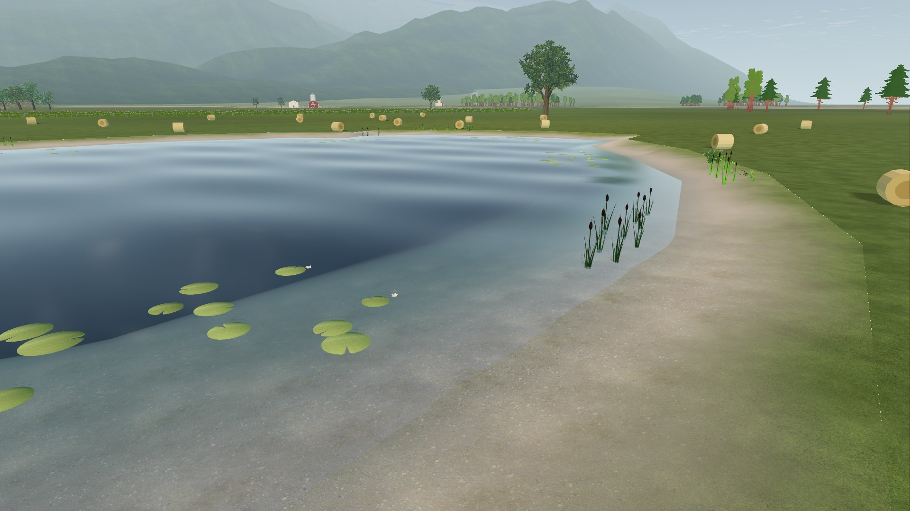
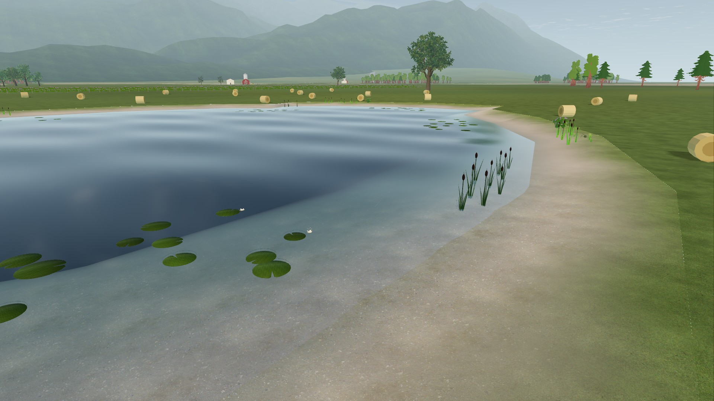

# VQ-07b: lake lily color correction

2026-10-22. Native Windows, Godot 4.7.2 `ed1daf0bf`, RTX 3090, driver
617.42. GPU oracle and scene viewports are 1920×1080.

The leaf shader assigned its authored sRGB palette/tint product directly to
Forward+'s linear ALBEDO input. Decode the combined product using the existing
renderer-aware helper. This restores dark green leaves instead of washed-out
yellow-green foliage. Flower uniforms already use `source_color` and remain
unchanged, as do geometry, distribution, wave motion and physical state.

## Proof and scope

[Native oracle](../../../../../tools/graphics/test_lily_color.gd): three UVs
at both production tint endpoints plus two flower colors, compared against
StandardMaterial3D references with lighting isolated. MultiMesh panels reproduce
the generator's instance-color path. The production source GLB has no vertex
colors. Reference anchors reject background-only comparisons; tolerance is
2/255 per RGB channel.

| Renderer | Before | After |
| --- | --- | --- |
| High | Six leaf cases fail, 71–73/255 error; two flowers pass | 8/8 pass, zero sampled error |
| Standard | 8/8 pass | 8/8 pass |

Independent Luna Max review checked the generator, imported mesh color contract,
shader diff and oracle reports; it found no blocker. The reference test isolates
albedo transfer and is not a physical-lighting validation.

Five paired production lake captures cover the shore, bank, overview, lily
detail and the same detail at a three-second wave pose. All complete. Standard
has 88–642 changed pixels per view at maximum 1/255; **not exact parity**.
[Comparison and raw PNG hashes](comparison.json). These static views do not
qualify continuous motion, night, FPS or full High-mode promotion.

| High before | High corrected |
| --- | --- |
|  |  |

JPEGs are viewing derivatives; raw PNGs remain in local `tmp/lily-color/` and
are reproducible. Capture JSON records actual fixture resolution and shader hash.
The existing lake-plant contract passes (`Lake plant checks: PASS`). An initial
checked-runner invocation expected the wrong completion text (`0 failed`),
so its receipt failed despite process exit 0; the corrected invocation is retained.

Both High scene runs retain the known seven leaked Texture RIDs on shutdown,
already attributed to the pinned engine's reflection probe. Final GPU oracles
pass with warnings treated as errors. The two baseline scene launches may have
briefly overlapped after the first call yielded; these captures make no timing
or performance claim. Candidate captures and oracles ran sequentially.

## Reproduce

Use new absolute output directories. Repeat each command with Standard:

```powershell
python tools/graphics/launch.py --profile high --resolution 1920x1080 --audio-driver Dummy --script ../tools/graphics/test_lily_color.gd -- --out=C:/captures/lily-oracle-high
python tools/graphics/launch.py --profile high --resolution 1920x1080 --audio-driver Dummy --script ../docs/research/visual-quality-implementation/VQ-07/lily-color-2026-10-22/capture.gd -- --out=C:/captures/lily-scene-high
```

Require `lily color GPU oracle: 8 cases, 0 failed` or `lily capture complete`
through `tools/godot/run_checked.py`. The fixture reuses the existing lake-bank
capture at 1080p. Retained [baseline.gdshader](baseline.gdshader) reproduces the
six failing High cases when substituted in a disposable checkout only.
