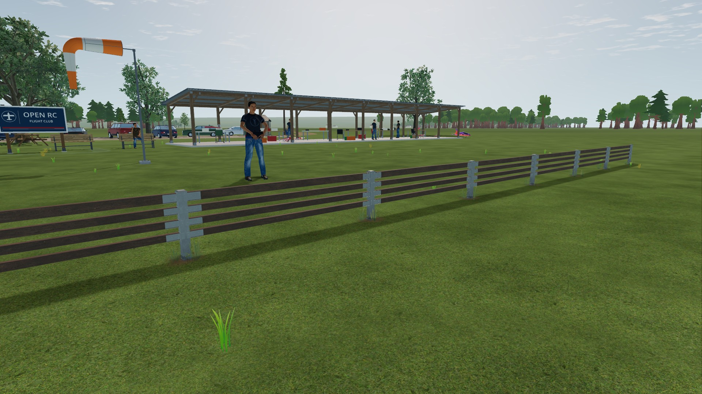
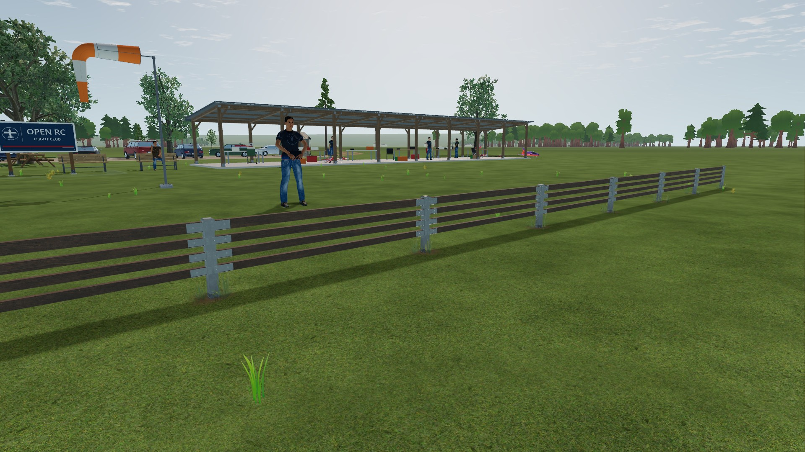
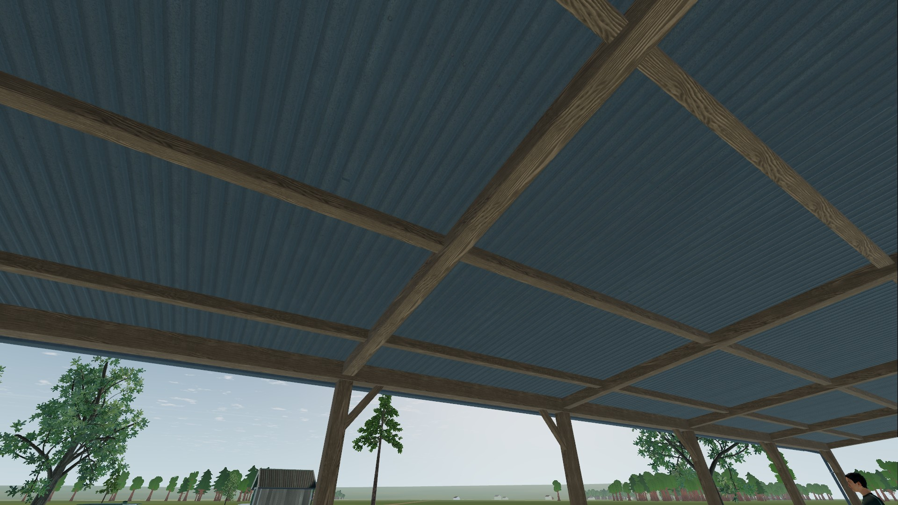

# VQ-07b: preserve raw material metadata

2026-10-22. Godot 4.7.2 `ed1daf0bf`, Windows, RTX 3090, driver 617.42.
Native GPU work was serialized at 1920×1080. Source hashes: [identity.json](identity.json).

## Correction

The flightline barrier and pit shelter used an sRGB color transfer on vertex
values that encode material data. Both renderers supply raw packed vertex data
to `vertex()`. The conversion collapsed much of High's board variation and
fitting tone and changed shelter wood seeds, shifting grain offsets and tones.
Use `COLOR.rgb` directly for those calculations. Actual fragment color decoding
stays in place. The shared helper comment now distinguishes color from metadata.

This corrects the metadata portion of the earlier
[field-cue change](../high-followup-2026-10-21/README.md), not its fixed-palette
correction. Current production tags still selected the right material and grain
axis before this fix: the hypothesized lost-wood classification was rejected.
Geometry, texture assets, physical state and graphical settings are unchanged.

## Decisive test

[test_material_tags.gd](../../../../../tools/graphics/test_material_tags.gd)
keeps the production vertex stages and replaces fragment shading with a view of
their metadata. Byte-exact representative tags enter through `ARRAY_COLOR`.
Independent reference panels express the raw-data contract in the same viewport;
output-color anchors reject background-only comparisons. The acceptance limit
is 2/255 per channel. This is a metadata test, not a PBR or physical-lighting oracle.

| Renderer | Before | After |
| --- | --- | --- |
| Standard | 15/15 pass | 15/15 pass |
| High | 6/15 pass | 15/15 pass |

All reference anchors resolve. Nine High failures cover three board variations,
two fitting tones and four shelter seeds. For example, the middle board's
visualized variation differs by 189/255 before correction, and the bolt's tone
by 255/255. These are diagnostic channel errors, not scene brightness errors.
Material classification, shelter axes, roof/slab flags and diagonal braces pass.
The Luna Max reviewer independently checked the oracle and these limits; no
additional GPU run was delegated. JSON verdicts and checked-runner logs are retained.

## Production views and regressions

The retained [capture fixture](capture.gd) reuses the production field, scenery,
lighting and material builders with frozen shader time. Four before/after views
cover the shelter front, underside, eave and flightline. Three Standard PNGs are
byte-identical; flightline differs at **one pixel, maximum 1/255**. Do not claim
full exact Standard parity. [Comparison and PNG hashes](comparison.json).

| High before | High corrected |
| --- | --- |
|  |  |
|  |  |

JPEGs are viewing derivatives, not pixel-test inputs. Full PNGs remain locally
under `tmp/material-tags/` and can be regenerated. Scene results establish the
bounded daytime appearance change, not full cross-renderer lighting equality.

- Barrier contract: **216 checks, 0 failed**.
- Scenery build contract: **134 checks, all passed**.
- Final native metadata oracle: **30 cases, 0 failed**, both renderers.
- Accepted native runs have no engine errors; final oracle runs also require
  zero warnings. High scene captures print the existing informational
  `OpVectorExtractDynamic is not supported yet.` message.

An initial, separate Stik propeller screen used the existing
`app/tests/capture_propeller_blur.gd`, front view at 0/600/1200/6000 rpm.
High passed all five checks. Standard passed four but failed strict repeated-frame
identity; its failure is retained in `propeller-standard-exploratory.json`, not
counted as qualification. No propeller implementation or test was changed.
The report does not retain the two repeat images, so that failure remains
unattributed. Full motion, night, repeated flight performance and platform gates
remain open; High remains experimental.

## Reproduce

Use a new absolute output directory for each native run. Repeat with Standard.

```powershell
python tools/graphics/launch.py --profile high --resolution 1920x1080 --audio-driver Dummy --script ../tools/graphics/test_material_tags.gd -- --out=C:/captures/tags-high
python tools/graphics/launch.py --profile high --resolution 1920x1080 --audio-driver Dummy --script ../docs/research/visual-quality-implementation/VQ-07/material-tags-2026-10-22/capture.gd -- --out=C:/captures/tags-scene-high
```

Wrap with `tools/godot/run_checked.py`, requiring `material tag GPU oracle: 15
cases, 0 failed` or `material tag capture complete`, respectively. Baseline
shaders are retained as `barrier-before.gdshader` and `shelter-before.gdshader`;
substitute them only in a disposable checkout to reproduce the nine High
failures. Do not mutate the active working tree for negative tests.
