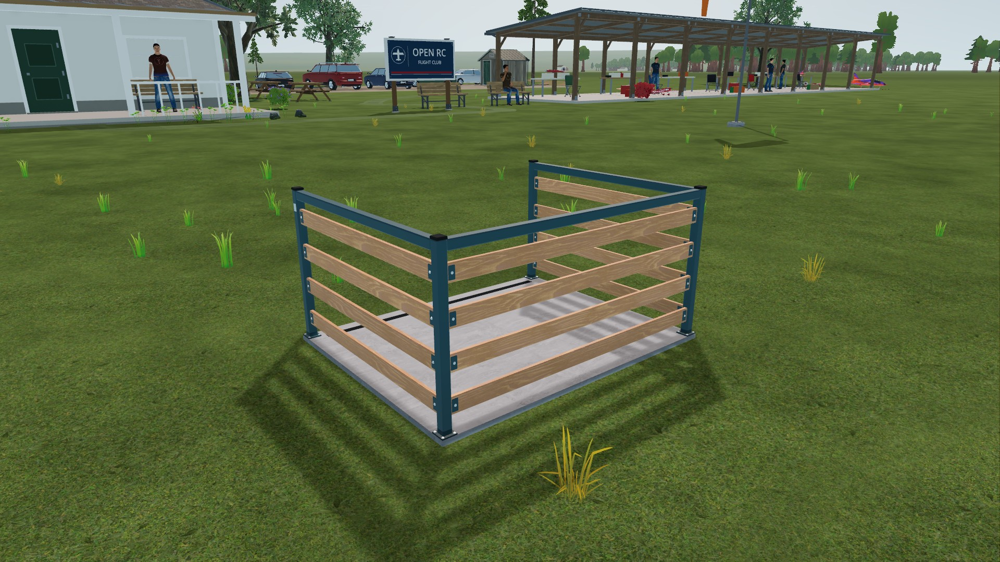
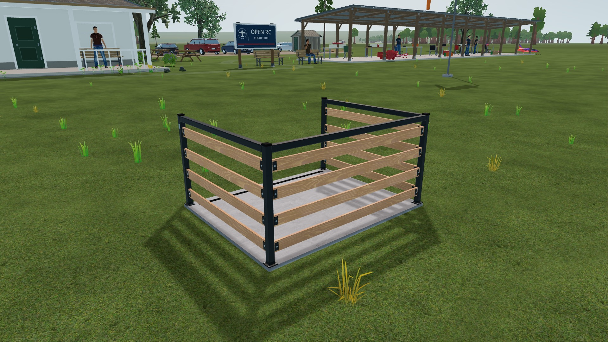

# VQ-07b pilot-station palette correction

2026-10-22. Native Godot 4.7.2, RTX 3090, 1920×1080. High's fixed
frame, rubber and stainless-steel colors were interpreted as linear values,
making them too bright. Decode these three authored sRGB colors with the
existing renderer-aware helper. Standard's path remains unchanged.

The initial vertex-tag hypothesis was rejected: all six material-tag cases
pass in both renderers before the correction. Keep raw vertex tags and texture
decoding unchanged. Independent read-only review confirmed the distinction in
[Compatibility source](https://github.com/godotengine/godot/blob/4.7.2-stable/drivers/gles3/shaders/scene.glsl)
and [Forward+ source](https://github.com/godotengine/godot/blob/4.7.2-stable/servers/rendering/renderer_rd/shaders/forward_clustered/scene_forward_clustered.glsl).

## Evidence

The native oracle isolates lighting and compares the production palette path
with StandardMaterial3D. High's baseline errors were 56/255 (steel), 37/255
(rubber) and 67/255 (frame). After correction, all nine cases pass in each
renderer with zero sampled channel error. The limit is 2/255. Final checks also
anchor reference colors to reject empty/background samples; baseline reports
precede that additional guard. Six cases check material identity, three palette
colors; this does not validate textured wood, roughness or lighting accuracy.
Compatibility's near-black rubber samples as black on both panels. This proves
agreement with its standard material, not exact authored-color reproduction or
visible rubber detail. Independent final review found no shader issue and noted
this limit of the reference-anchor tolerance.

Four production-station views use fixed lighting, cameras and shader time.
All four Standard before/after PNGs are byte-identical. High changes are recorded
in [comparison.json](comparison.json); JPEGs below are viewing derivatives, not
pixel-comparison inputs. Raw PNGs remain in local `tmp/station-color/` and can be
regenerated. Capture reports retain camera, builder and shader identities.

| High before | High corrected |
| --- | --- |
|  |  |

Headless station structure: **39 checks, 0 failed**. Station data: **163 checks,
0 failed**. Native oracle: **18 cases, 0 failed** across both renderers.
The checked runner found no runtime errors in accepted captures or oracle runs.
These static daytime checks do not qualify night scenes, active-flight pacing,
other GPUs, or the complete High profile. High remains experimental.

## Reproduce

Run native GPU work serially from the repository root, with a new absolute
output directory each time. Repeat with `--profile standard`:

```powershell
python tools/graphics/launch.py --profile high --resolution 1920x1080 --audio-driver Dummy --script ../tools/graphics/test_pilot_station_color.gd -- --out=C:/captures/station-oracle-high
python tools/graphics/launch.py --profile high --resolution 1920x1080 --audio-driver Dummy --script ../docs/research/visual-quality-implementation/VQ-07/pilot-station-color-2026-10-22/capture.gd -- --out=C:/captures/station-high
```

Use `tools/godot/run_checked.py` with the completion markers `pilot station GPU
oracle: 9 cases, 0 failed` and `pilot station capture complete`, respectively.
For the baseline, substitute the retained [baseline shader](baseline.gdshader)
for `app/render/pilot_station.gdshader` in a disposable checkout only. Baseline
High must fail the three palette cases. Never replace the active working copy
to perform a regression mutation.
