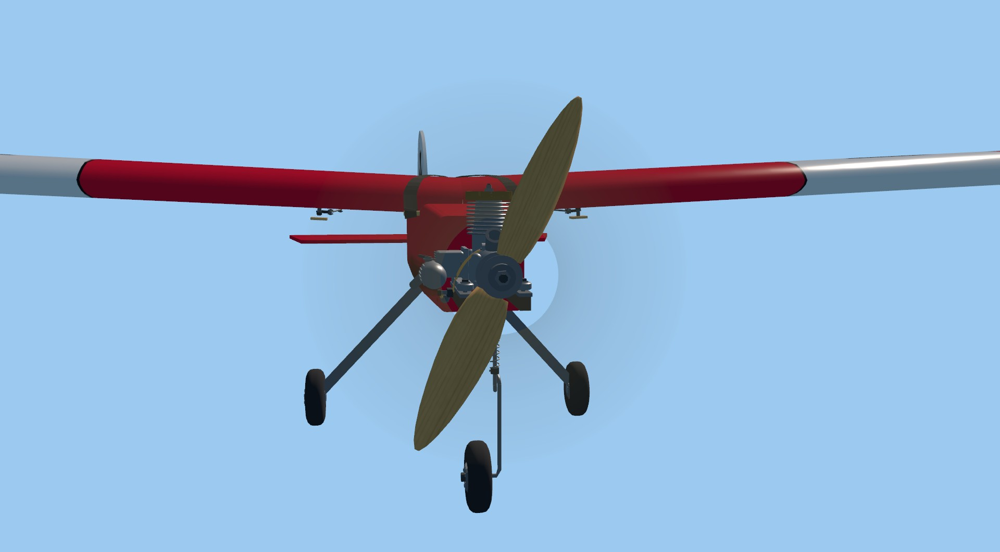
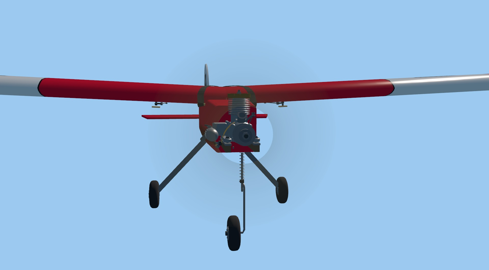

# VQ-07 / VQ-05: propeller observer reattachment

Latest follow-up: [source-first destruction](#source-first-destruction) also
retires the observer safely when its aircraft has already been freed.

2026-10-23. Windows, Godot 4.7.2, RTX 3090. This repairs a presentation lifecycle
contract: detach an active propeller-blur observer, reattach it, then update at
the same RPM. Previously the original blades appeared over the active disc.

`_exit_tree()` restores the original blades. Its cached `_applied` flag remained
true, so the next unchanged-RPM update skipped restoring the blur's visibility
state. Invalidate that flag on tree exit. This leaves measurement, materials,
RPM thresholds, physical state and detached-blade restoration unchanged.
The trigger is reproduced directly through the public attach/update lifecycle;
no claim is made that an ordinary Home/Fly menu sequence currently triggers it.

## Verification

- Original suite: 114 checks. Adding detach/reattach at stopped, partial and full
  blur adds 24 checks: **138 checks, eight failures before the fix**, covering
  partial/full blur on Stik, Extra, P-51 and Timber.
- Eight additional broken/repair checks bring the final suite to **146 checks,
  zero failures**. A temporary test type-inference error was corrected before
  this final run; its failed receipt is retained, not counted as verification.
- The native capture now checks original-blade visibility after reattachment
  and saves the before/after PNGs. High initially shows 48,607 changed pixels,
  maximum 209/255, after the lifecycle transition; the corrected same-size
  pair is exact. These initial views are 1920×1061 because the desktop clipped
  the requested window. Borderless retries also remained 1920×1061.
- The retained [1080p wrapper](capture_1080.gd) fixes the internal render size
  independently of the window. At actual **1920×1080**, High passes all six
  capture checks and has zero changed pixels across reattachment. Standard
  passes the lifecycle/appearance checks but still fails its existing strict
  repeat test. Its reattachment pair differs at 175 pixels, maximum 1/255;
  this is not exact Standard parity or a fully passing Standard capture.
- Luna Max independently confirmed the stale-cache cause and reviewed the
  final runtime/test diff without finding a code issue. Its initial count
  concern was resolved by distinguishing the original 114-check suite from
  the intermediate 138-check reproduction.

| Defect after reattachment | Corrected after reattachment |
| --- | --- |
|  |  |

These JPEGs show the matched 1920×1061 diagnostic. Lossless fixed-1080 before/after
PNGs, report identities and [comparison.json](comparison.json) retain the primary
resolution evidence. Checked-runner logs include expected baseline failures and
the unresolved Standard repeat failures. All GPU runs were sequential. No flight
performance, physical display, full pilot-motion or High qualification is claimed.

## Reproduce

```powershell
python tools/godot/run_checked.py --label propeller-contract --timeout 120 --require-text "0 failures" -- .tools/Godot_v4.7.2-stable_win64_console.exe --headless --path app --script tests/test_propeller_blur.gd
python tools/graphics/launch.py --profile high --resolution 1920x1080 --audio-driver Dummy --script ../docs/research/visual-quality-implementation/VQ-07/propeller-reattach-2026-10-23/capture_1080.gd -- --out=C:/captures/prop-reattach --view=front --rpm=0,600,1200,6000
```

Use a new absolute directory; repeat with Standard to retain its strict failure.
The parent capture script and runtime hashes are in [identity.json](identity.json).
For the negative control, remove only `_applied = false` from `_exit_tree()` in a
disposable checkout. Never mutate the active working copy for a regression probe.

## Source-first destruction

2026-10-23. A second lifetime edge was reproduced: free the aircraft while its
sibling blur observer remains, then update at the same RPM. Although `update()`
already checked whether the propeller was valid, it wrote visibility to freed
original meshes. That error interrupted cleanup before hiding the owned disc,
blade copies and hub copies. Its cache then allowed later updates to return
early, leaving a persistent ghost.

Guard writes to the borrowed original meshes with `is_instance_valid` and
continue updating the observer's owned presentation. No guards are added to
owned children that remain valid for the observer's lifetime. This preserves
the existing reattachment correction and does not change flight dynamics.

- The expanded source-first contract fails eight assertions and emits four
  invalid-object errors before the repair, across Stik, Extra, P-51 and Timber.
  Afterward **154 checks pass with zero warnings or errors**. Tests include
  partial blur (owned blades and hub as applicable), initial retirement and a
  repeated update; the existing tests retain observer-first destruction.
- Native Stik High at actual **1920×1080** has 407,416 ghost pixels (maximum
  30/255) against an explicitly hidden observer before repair, and **zero**
  afterward. The normal 6000-rpm image is pixel-identical before/after repair.
- Standard also has **zero ghost pixels** at 1080p after repair. Its separate
  strict repeated-frame check still fails, so the Standard capture as a whole
  remains failed; the retirement assertion passes. High passes all seven
  capture checks with warnings treated as errors. GPU runs were sequential.
- Independent Luna Max review found no issue in the runtime/test diff. This is
  a directly exercised observer lifetime contract, not evidence that a specific
  ordinary menu sequence frees the aircraft first. Full pilot-motion and High
  qualification remain open.

[Comparisons and PNG identities](source-retirement/comparison.json),
[source identities](source-retirement/identity.json), native reports and logs
are retained under `source-retirement/`. Reuse the commands above with new output
directories: the capture now also saves `-source-retired.png` and
`-empty-reference.png`. The new native check compares those exact image buffers.
For a negative control, remove only the original-mesh validity guard in a
disposable checkout. The existing cache invalidation must remain in place.
