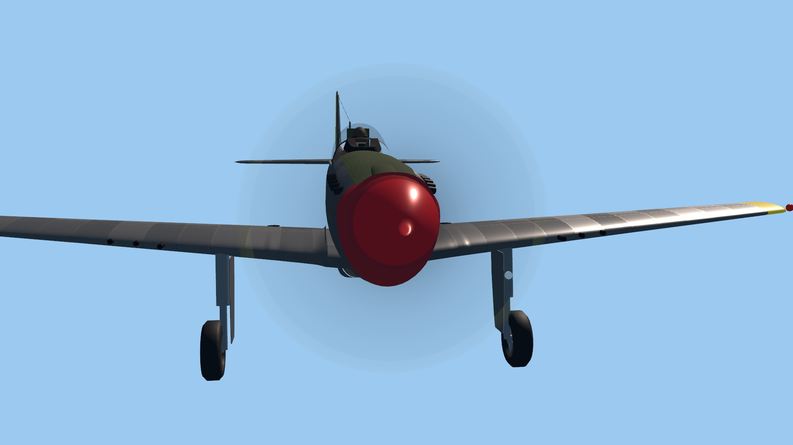
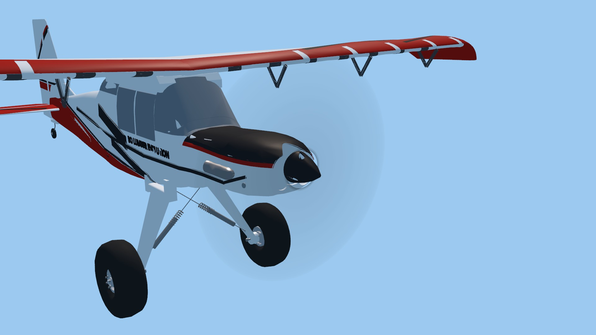

# VQ-07b / VQ-05: propeller repeat diagnosis

2026-10-22. Native Windows, Godot 4.7.2 `ed1daf0bf`, RTX 3090,
NVIDIA 617.42, actual 1920×1080. GPU runs were serialized.

## Outcome

The earlier Standard repeat failure is reproduced and bounded, not fixed or
waived. Three Stik front-view runs with 4× MSAA each differ at **208 pixels,
maximum 1/255 per RGB channel**, with unchanged alpha. Bounds are
`[624,219,1266,898)` in the 1920×1080 frame. The two repeat images are identical
across those runs. Two disposable controls disabling only MSAA have exact
repetition. This implicates the tested Compatibility/MSAA path; it does not
identify the engine/driver mechanism, establish visible flicker, or justify
disabling the game's antialiasing. Runtime rendering and physics are unchanged.

The existing studio capture now retains both repeat images and hashes, actual
viewport size, MSAA mode, script/blur identities, process ID and UTC capture time.
It rejects headless execution, existing output paths and failed directory
creation. The strict image-buffer equality assertion and exit failure remain.
This improves the AAA verification workflow rather than claiming a visual fix.

## Evidence

[comparison.json](comparison.json) records all nine runs, including failures.
Checked-runner process receipts and logs are under `checks/`; these distinguish
separate launches. Early reports predate the final additive identity fields;
`final-high.json` exercises the completed capture script. Script hashes identify
each revision. The retained no-MSAA control predates the final path guards and
process/time fields; its only rendering change is `root.msaa_3d = MSAA_DISABLED`.

| Run | Appearance/visibility checks | Exact repeat |
| --- | --- | --- |
| Standard Stik, 4× MSAA, three runs | 4/4 each | Fail: 208 pixels, max 1/255 |
| Standard Stik, MSAA disabled, two controls | 4/4 each | Pass |
| High Stik, 4× MSAA, two runs | 4/4 each | Pass |
| High P-51 front, 4× MSAA | 4/4 | Pass |
| High Timber quarter, 4× MSAA | 4/4 | Pass |

Stik speeds are 0/600/1200/6000 rpm; P-51 and Timber use 0/300/600/6000.
Checks cover stopped-rotor identity, hidden-propeller behavior, fading blade
contribution, disc pixels outside the original blades, and repeat identity.
These static studio results do not qualify ordinary pilot motion, full aircraft
appearance, transparency ordering against water/smoke, or flight performance.
High remains experimental. Headless rejection was also exercised.

| High P-51 at 6000 rpm | High Timber at 6000 rpm |
| --- | --- |
|  |  |

Native repeat PNG pairs for Standard, the no-MSAA control and final High are
retained losslessly. JPEGs above are viewing derivatives. Other raw captures
remain in local `tmp/prop-repeat/` and are reproducible.

Independent Luna Max review confirmed the 208-pixel result, unchanged alpha and
strict comparator. Its output-path concern was fixed. A useful next control is
an exact stopped-rotor repeat with the same 4× MSAA path, followed by a minimal
transparent-disc reproduction if needed. No broad tolerance relaxation is adopted.

## Reproduce

From the repository root, use a new absolute output directory:

```powershell
python tools/graphics/launch.py --profile standard --resolution 1920x1080 --audio-driver Dummy --script res://tests/capture_propeller_blur.gd -- --out=C:/captures/prop-standard --view=front --rpm=0,600,1200,6000
```

Use High for the passing renderer control. For the no-MSAA diagnostic, use
`--script ../docs/research/visual-quality-implementation/VQ-07/propeller-repeat-2026-10-22/no_msaa_control.gd`.
This fixture does not change project settings. A failing repeat exits nonzero;
do not count the presence of a JSON report as success. Production source is
[capture_propeller_blur.gd](../../../../../app/tests/capture_propeller_blur.gd).
