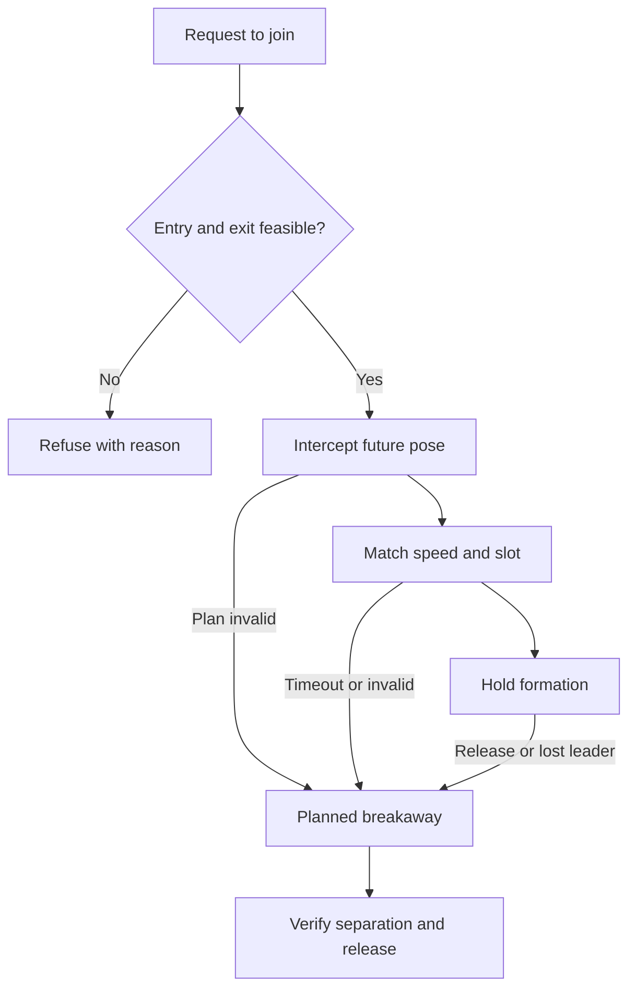

I reviewed the actual companion implementation in **`bultodepapas/OpenRCsimulator`**, its existing research and qualification records, and relevant flight-control and Godot projects.

**My recommendation is to evolve the existing architecture through three coordinated tracks: correct the flight decisions and lifecycle, reduce measured runtime cost, and add enjoyable activities and personality.** The project already has a substantial foundation. The highest-value work is to close specific gaps and connect components that already exist.

## Deliverables

The full report contains approximately **9,800 words across 24 pages**, including findings, source links, architecture, code examples, phased delivery, a **14-PR implementation sequence**, and a detailed test matrix.

[OpenRC_AI_Flight_Companion_Engineering_Plan.pdf](https://chatgpt.com/library?file_id=libfile_fde3_f-0b6d7b85903c8191aeeba660278f12a9_ac5d15b10f548191b3cb750779cf7c10&account_id=personal)

The accompanying bundle contains complete GDScript prototypes, counterexample tests, an isolated-project preparation script, source hashes, and verification records.

[OpenRC_Companion_Review_Bundle.zip](https://chatgpt.com/library?file_id=libfile_fde3_f-d4ca28ff51388191966ebf1a7148c739_ac5d15b10f548191b3cb750779cf7c10&account_id=personal)

**Audit baseline:** commit `ca529cb88476a22fbb1c8edf957d6917ab9b6042`.

**Verification:** 501 focused checks passed. Some of those checks deliberately reproduce weaknesses in the current code; they do not mean those weaknesses have been fixed. Production source and GitHub were not modified.

---

## 1. What the project already does well

At the audited commit, companions are an experimental feature supporting **one to three experienced Ugly Stik aircraft flying circuits at the qualified Club field**, with incidents disabled. The implementation already has separate sessions, deterministic scheduling, source qualification, presentation controls, and research for more advanced capabilities. This is a much stronger starting point than a collection of aircraft following arbitrary waypoints. See the [current companion guide](https://github.com/bultodepapas/OpenRCsimulator/blob/ca529cb88476a22fbb1c8edf957d6917ab9b6042/docs/AI-FLIGHT-COMPANIONS.md) and [existing AFC roadmap](https://github.com/bultodepapas/OpenRCsimulator/blob/ca529cb88476a22f8?short_path=unused).

The architecture has several properties I would preserve:

- **One real `FlightSession` per aircraft.** Companions use the simulator’s actual dynamics and weather. Equipment and failure mechanisms can be used when explicitly configured and qualified.
- **240 Hz physics with 60 Hz controller commands.** The timing contract is explicit.
- **A common observation boundary.** The manager prepares every agent before advancing any of them, preventing an aircraft from reacting to another aircraft’s already-updated state.
- **Float64 simulation state.** Future controllers should retain the project’s scalar and `PackedFloat64Array` conventions.
- **Qualification tied to source and data.** Unsupported combinations can be rejected with a concrete reason.
- **Existing reusable research.** A traffic index, continuous static-path checker, runway coordinator, activity quotas, incident scheduling, and checkpoint experiments already exist. See [manager.gd](https://github.com/bultodepapas/OpenRCsimulator/blob/ca529cb88476a22fbb1c8edf957d6917ab9b6042/app/ai/companions/manager.gd), [agent.gd](https://github.com/bultodepapas/OpenRCsimulator/blob/ca529cb88476a22fbb1c8edf957d6917ab9b6042/app/ai/companions/agent.gd), and the [canonical plan](https://github.com/bultodepapas/OpenRCsimulator/blob/ca529cb88476a22fbb1c8edf957d6917ab9b6042/docs/plans/ai-flight-companions.md).

That leads to the first architectural decision: **keep the simulation foundation and improve the guidance, prediction, constraints, scheduling, and activities around it.**

## 2. The corrections I would prioritize

The report separates executed counterexamples from source-traced risks and issues already documented by the project.

| Priority | Finding | Evidence | Recommended correction |
|---|---|---|---|
| High | Traffic scoring can miss a separation-margin violation between samples | Reproduced using production threat preparation and scoring | Continuous closest approach over synchronized intervals |
| High | The nominal bank used by prediction can differ from the bank actually commanded | Reproduced through a real scorer call and controller command | Calculate one nominal guidance demand and share it |
| High | Static checks do not cover every runtime control path | Source inspection and retained research | Assess nominal, held, retargeted, release, and fallback paths |
| High | Combined scoring can obscure separate terrain and traffic constraints | Source inspection and retained research | Hard feasibility checks before preference ranking |
| High | A player checkpoint restore can enter the companion restart path | Traced integration path; live regression still required | Explicit transition reasons and deferred-callback generations |
| High | Qualification omits some behavior-affecting orchestration | Source inspection | A versioned behavior dependency manifest |
| Medium | Valid companion seeds can alias the player turbulence seed | Reproduced with actual turbulence code | Domain-separated streams with persisted resolved seeds |
| Medium | UI status can confuse active and pending configurations | Traced UI/manager state | Separate active, admitted, and pending values |
| Medium | The runtime timing metric excludes observation work | Direct inspection | Complete callback timing with exclusive cost buckets |

### A. Check what happens between prediction samples

The current predictor evaluates an eight-second horizon at **0.25-second intervals**. Its traffic-distance checks can report a clear margin even when the relative paths violate that margin between samples. The affected logic is in [pilot.gd](https://github.com/bultodepapas/OpenRCsimulator/blob/ca529cb88476a22fbb1c8edf957d6917ab9b6042/app/ai/companions/pilot.gd#L357-L425).

I constructed a small counterexample:

- Own aircraft moves north at **15 m/s**.
- A stationary peer is offset by **1.875 m north and 31.49 m east**.
- Production threat preparation calculates a required separation of **31.5 m**.
- Production sampled scoring reports **+0.04577 m** of clearance.
- Continuous linear closest approach reaches **−0.01 m** against the requirement at **0.125 seconds**.

This demonstrates a false-clear result for the **padded requirement**. It does not demonstrate an aircraft collision: the actual distance remains much larger than the unpadded 15 m peer distance.

The correction is to evaluate the minimum distance over each synchronized time interval. The tested helper uses the following calculation after validating the inputs:

```gdscript
# r0 and r1 are relative NED positions at the same two times.
var dn: float = r1[0] - r0[0]
var de: float = r1[1] - r0[1]
var dd: float = r1[2] - r0[2]

var motion_squared: float = dn * dn + de * de + dd * dd
var fraction := 0.0

if motion_squared > 0.0:
    fraction = clampf(
        -(r0[0] * dn + r0[1] * de + r0[2] * dd)
        / motion_squared,
        0.0,
        1.0
    )

var north: float = r0[0] + fraction * dn
var east: float = r0[1] + fraction * de
var down: float = r0[2] + fraction * dd

var distance_squared: float = (
    north * north + east * east + down * down
)

return {
    ok = true,
    fraction = fraction,
    distance_m = sqrt(distance_squared),
    distance_squared_m2 = distance_squared
}
```

This solves the linear interpolation problem. Physical clearance also requires justified prediction error, curvature allowance, aligned timestamps, and a conservative floating-point tolerance. Increasing the sample frequency alone leaves the same class of error at a smaller scale.

### B. Make prediction describe the command that will be flown

The base circuit controller adds a heading correction to its feedforward bank. The predictor’s nominal bank uses the feedforward term alone.

The strengthened test supplies a distant stationary peer, captures the arguments to the real `_score_bank` call, executes that scorer unchanged, and compares the result with the unsaturated controller command:

| Value | Observed result |
|---|---:|
| Nominal bank passed to the scorer | 16.002636° |
| Bank target implied by the command | 20.586299° |
| Difference | **4.583662°** |

This is a demonstrated inconsistency in that fixture. Its effect on an actual flight path remains to be measured. The relevant equations are in [circuit_controller.gd](https://github.com/bultodepapas/OpenRCsimulator/blob/ca529cb88476a22fbb1c8edf957d6917ab9b6042/app/ai/companions/circuit_controller.gd#L195-L230) and [pilot.gd](https://github.com/bultodepapas/OpenRCsimulator/blob/ca529cb88476a22fbb1c8edf957d6917ab9b6042/app/ai/companions/pilot.gd#L170-L205).

I would expose a single nominal-demand structure containing the effective target speed, bank, vertical or energy intent, and controller mode. Guidance computes it once; prediction consumes it; the normal controller applies the selected demand.

The implementation should have two reviewable steps: first extract the calculation while preserving existing commands, then deliberately correct prediction and retain before-and-after encounter evidence.

### C. Separate feasibility from preference

The repository already documents a wall-between-samples failure and already contains a continuous static-path checker. The important next step is integrating that checker throughout the live decision flow. A clear nominal circuit at admission does not establish that an avoidance turn is clear. See [AFC-04-R5](https://github.com/bultodepapas/OpenRCsimulator/blob/ca529cb88476a22fbb1c8edf957d6917ab9b6042/docs/research/ai-companions/AFC-04-R5/README.md) and [static_trajectory.gd](https://github.com/bultodepapas/OpenRCsimulator/blob/ca529cb88476a22fbb1c8edf957d6917ab9b6042/app/ai/companions/static_trajectory.gd).

The earlier bug where terrain alone manufactured a traffic conflict was already corrected. That work should be preserved. The remaining ranking still combines terrain and traffic scores in a way that can conceal meaningful differences between candidate turns. See [AFC-04-R8](https://github.com/bultodepapas/OpenRCsimulator/blob/ca529cb88476a22fbb1c8edf957d6917ab9b6042/docs/research/ai-companions/AFC-04-R8/README.md).

I would give every candidate separate assessments:

- Aircraft-envelope feasibility.
- Static-world feasibility.
- Traffic feasibility.
- Prediction freshness and world revision.
- Progress, smoothness, and commitment preferences.

Only feasible candidates enter preference ranking. If every candidate is infeasible, the system must enter an explicit, qualified recovery mode and report the conflict.

This also needs an **unassessed** state. Missing bounds or stale world data must not be interpreted as clearance.

### D. Correct lifecycle and seed behavior

Two less visible issues deserve early attention.

**Checkpoint transitions need an explicit reason.** The traced path allows Remove now to leave an empty manager with enabled preferences; a subsequent player checkpoint restore emits resetting; Main schedules a companion restart; a restored tick of zero can pass that restart condition. The restart method also calls `session.resume()`, subject to other active holds. This needs a real integration regression, but the source path is concrete. See [Main’s lifecycle code](https://github.com/bultodepapas/OpenRCsimulator/blob/ca529cb88476a22fbb1c8edf957d6917ab9b6042/app/main.gd#L2888-L3010).

Use accepted transition reasons such as `NEW_FLIGHT`, `RESTART_FLIGHT`, and `RESTORE_PLAYER_CHECKPOINT`, plus a transition generation for deferred callbacks. A numerical tick value is insufficient to identify the operation.

**Seed allocation needs explicit domains.** The current formula is:

```gdscript
(player_weather_seed + traffic_seed + slot * 104729) & 0xffffffff
```

With traffic seed zero and slot zero, the companion receives the player seed. A valid wraparound input can do the same at another slot. The test reproduces **240 identical transitions** using the actual turbulence module. See [agent.gd](https://github.com/bultodepapas/OpenRCsimulator/blob/ca529cb88476a22fbb1c8edf957d6917ab9b6042/app/ai/companions/agent.gd#L45-L65).

The supplied seed prototype uses versioned domains, stable actor identities, collision handling, and persisted nonces. It includes a forced hash-collision test. Its guarantee is limited to a fixed roster: live allocations must be retained when the roster changes, and distinct seeds alone do not prove statistical independence.

## 3. Improve realism through attainable motion

The greatest realism gains will come from coherent guidance and energy management.

I would separate:

1. **Activity:** circuit, approach, go-around, demonstration, formation.
2. **Guidance:** route, target speed, bank, and vertical intent.
3. **Aircraft envelope:** what the current aircraft can physically achieve.
4. **Prediction and constraints:** whether the proposed trajectory is usable.
5. **Control:** bounded actuator commands through the existing simulation.
6. **Presentation:** labels, radio, personality, and challenge feedback.

PX4 provides useful examples of separating lateral guidance from altitude and airspeed control. Its NPFG and TECS work are appropriate references for architecture and control principles, followed by OpenRC-specific implementation and qualification. [PX4 Guide (main)](https://docs.px4.io/main/en/config_fw/position_tuning_guide_fixedwing?utm_source=chatgpt.com)

### Aircraft profiles need measured limits

Each supported aircraft should have evidence for trim, usable speed range, bank and roll response, climb and sink capability, underspeed recovery, equipment transitions, energy reserve, and prediction error.

A simple calculation illustrates why profiles matter. In a coordinated, level, still-air turn:

\[
R \approx \frac{V^2}{g\tan(\phi)}
\]

At 25° bank, a speed of 15 m/s gives a turn radius of approximately **49 m**; 25 m/s gives approximately **137 m**. These are illustrative calculations, not qualified OpenRC limits. A faster aircraft needs a different circuit and earlier avoidance decisions.

Bank and airspeed also belong together. Increased load factor raises the speed required to avoid a stall in a level turn. ArduPilot’s stall-prevention guidance is a useful reference for this relationship. [Plane documentation](https://ardupilot.org/plane/docs/stall-prevention.html?utm_source=chatgpt.com)

### Prediction uncertainty must come from evidence

The project’s retained prediction-error research observed horizontal residuals of **3.4666 m at six seconds** and **5.0468 m at eight seconds** in one flight while the bank target remained unchanged. That already exceeds the current 3 m engineering allowance for that case. Replacing the constant with 5.1 m would only fit one retained run. See [AFC-04-R6](https://github.com/bultodepapas/OpenRCsimulator/blob/ca529cb88476a22fbb1c8edf957d6917ab9b6042/docs/research/ai-companions/AFC-04-R6/README.md).

Build a residual dataset indexed by aircraft, speed, bank, roll rate, wind, turbulence, mode, horizon, and observation age. Separate calibration flights from held-out verification. Overlapping prediction windows from one flight are not independent trials.

That evidence must precede claims that the static checker or traffic index conservatively contains actual aircraft motion.

## 4. Make them more efficient before raising the count

### Measure complete cost at 1080p

The current `last_tick_usec` begins after observation construction, so it does not represent the complete companion callback cost. Add exclusive buckets for observation, prediction, control, session stepping, world publication, recording, and presentation. Timing should remain diagnostic and should never influence deterministic flight decisions. See [manager.gd](https://github.com/bultodepapas/OpenRCsimulator/blob/ca529cb88476a22fbb1c8edf957d6917ab9b6042/app/ai/companions/manager.gd#L135-L205).

The historical Windows baseline reported p95 frame times of:

- **5.686 ms:** zero companions.
- **8.186 ms:** one companion.
- **17.175 ms:** two companions.
- **52.017 ms:** three companions.

That workload used Godot 4.7.2 at **1280 × 720**, on the documented 5900X/RTX 3090 host. Those results justify investigation, but they are not a current-engine 1080p benchmark or a causal comparison with this audit. See [AFC-00-R4](https://github.com/bultodepapas/OpenRCsimulator/blob/ca529cb88476a22fbb1c8edf957d6917ab9b6042/docs/research/ai-companions/AFC-00-R4/README.md).

For a new named reference configuration, I propose these acceptance targets:

| Metric | Proposed target |
|---|---:|
| Primary render resolution | 1920 × 1080 |
| Frame time p95 | ≤16.67 ms |
| Frame time p99 | ≤25 ms |
| Complete fleet callback p95 | ≤2 ms |
| Complete fleet callback p99 | ≤3 ms |
| Simulated time / wall time | 0.99–1.01 |

These are targets to measure, not achieved results.

### Optimize in a deliberate order

**First, reuse data and remove repeated work.** Reuse observation and trajectory buffers, avoid repeated conversions, and share forecasts when their inputs are genuinely identical.

There is a subtle cache hazard: the player snapshot currently lacks wind, and threat prediction can fall back to the observing aircraft’s wind. A cache keyed only by actor ID and tick can therefore change behavior. The key must include resolved wind, intent, horizon, model, and observation generation—or the observation semantics must be intentionally corrected and requalified. See [threat preparation](https://github.com/bultodepapas/OpenRCsimulator/blob/ca529cb88476a22fbb1c8edf957d6917ab9b6042/app/ai/companions/pilot.gd#L283-L354).

**Second, integrate the existing traffic index.** It should eliminate actors proven irrelevant to the candidate trajectories. Its runtime bounds must cover turning motion, uncertainty, and closure-dependent separation. Stopped aircraft need an explicit adapter; feeding their stale moving state would invalidate the optimization. Overflow or invalid bounds should retain the full scan. See [traffic_index.gd](https://github.com/bultodepapas/OpenRCsimulator/blob/ca529cb88476a22fbb1c8edf957d6917ab9b6042/app/ai/companions/traffic_index.gd).

**Third, separate control frequency from tactical planning frequency.** Preserve 240 Hz physics and the common 60 Hz observation/control boundary. Experiment with expensive tactical decisions at 20 Hz, distributed over existing planning ticks:

```gdscript
# Proposed experiment; not an accepted production rate.
# Control remains every four physics ticks.
func tactical_due(tick: int, stable_slot: int) -> bool:
    assert(tick % 4 == 0)

    var phase := (stable_slot % 3) * 4
    return tick % 12 == phase
```

Naively distributing agents across four different command phases would cause observation work on every physics tick, potentially increasing snapshot frequency fourfold.

Held plans need validity checks on every control tick. Sudden threats, stale forecasts, changed runway occupancy, or envelope changes must trigger qualified urgent handling.

**Fourth, optimize presentation independently.** Share suitable resources and bound shadows, smoke, labels, wreck effects, and audio voices. MultiMesh can reduce compatible rendering work; it does not reduce flight dynamics or avoidance cost. [Godot Engine (stable) documentation in English](https://docs.godotengine.org/en/stable/classes/class_multimesh.html?utm_source=chatgpt.com)

**Finally, evaluate workers or native execution only if measurements justify them.** Worker jobs should receive immutable numeric snapshots and return numeric decisions. SceneTree mutation stays with its proper owner, and decisions commit in deterministic order. Godot’s thread-safety guidance is directly relevant here. [Godot Engine (stable) documentation in English](https://docs.godotengine.org/en/stable/tutorials/performance/thread_safe_apis.html?utm_source=chatgpt.com)

The population ladder should be **current cap → four → eight → investigated higher counts**, with separate limits for CPU capacity, airspace, and simultaneous activities.

## 5. Make them interesting and fun early

Gameplay does not need to wait for a large fleet.

### Separate skill, personality, and activity

| Dimension | Controls | Example |
|---|---|---|
| Skill | Tracking accuracy, reaction behavior, conservatism | Experienced pilot or qualified learner behavior |
| Personality | Callsign, preferences, communication style | Quiet mentor or dry comedian |
| Activity | Current task and route | Circuit, approach, demonstration, formation |

A funny expert can fly accurately. A quiet learner can use a wider pattern. These dimensions should not be bundled into one difficulty slider.

I would avoid independent random actuator noise as the main simulation of inexperience. Later skill variation should use bounded, correlated observation error, delayed high-level decisions, route tolerance, and recovery choices. Those changes need their own flight evidence.

### First gameplay release

The first release can add value while observing the existing qualified circuits:

- A recognizable callsign and visual identity for each companion.
- A pace aircraft for lap consistency.
- A shared clean-circuit challenge.
- Optional circuit-position and intent notices.
- Concise encouragement after a verified event.
- Radio and humor controls that do not change flight state.

This provides companionship and goals with limited controller risk.

### Useful commands

Add a small vocabulary as supporting routes become qualified:

- “Give me room.”
- “Show a circuit.”
- “Fly a wider pattern.”
- “Follow this route.”
- “Return and land.”

Each command needs eligibility, acknowledgement, a queued state when appropriate, and an observable completion condition. “Give me room” requires a checked outer route; an arbitrary lateral offset is not enough.

For cooperative flying, start with a shared route and loose trail following. Then add join, maintain, breakaway, and rejoin states. Following a known route is a more manageable first target than following every unpredictable maneuver of the player.

### Contextual humor

Use authored lines triggered by accepted events, with expiry, cooldowns, repetition limits, and one foreground radio line at a time.

Examples:

- After a completed go-around: “The runway and I are still negotiating.”
- After a timing miss: “That lap included a scenic detour.”
- After an uneventful landing: “All the important pieces came back.”

The last line should never trigger after damage. Runway and safety messages take priority, and stale jokes are dropped.

A small localized content library is sufficient; this feature does not require a runtime language model. It also keeps behavior reproducible and makes repetition easy to test.

Valve’s AI-director work offers useful inspiration for alternating activity with quiet periods. In OpenRC, a director could defer optional displays and chatter while the player is approaching, handling nearby traffic, or completing a lesson. That should use observable workload and explicit user preferences. [cdn.fastly.steamstatic.com](https://cdn.fastly.steamstatic.com/apps/valve/2009/ai_systems_of_l4d_mike_booth.pdf?utm_source=chatgpt.com)

## 6. Configuration should explain the active result

The basic screen should expose companions, supported density, activity preset, radio, humor, labels, and seed. Advanced controls can expose qualified aircraft weights, skill mixes, activity quotas, and optional incident opportunities.

The state model should distinguish:

- **Requested configuration:** what the user wants.
- **Admitted configuration:** what this flight accepted.
- **Active population:** what is flying now.
- **Pending configuration:** what will apply at the next restart.

A useful status message is:

> **3 flying · 2 after restart**

This addresses an ambiguity in the current apply/status path without introducing hot admission prematurely. See [Main’s configuration handling](https://github.com/bultodepapas/OpenRCsimulator/blob/ca529cb88476a22fbb1c8edf957d6917ab9b6042/app/main.gd#L2940-L2975).

The report includes a proposed future schema with independently configurable population, aircraft weights, activities, skills, presentation, incidents, and challenges. It is explicitly a proposal: the current strict validator does not accept those new fields.

## 7. Delivery phases

The following estimates assume an experienced simulation engineer with part-time gameplay/UI and test support. They are planning ranges, with progress governed by evidence.

| Phase | Main outcome | Exit gate | Planning range |
|---|---|---|---|
| **0 — State and evidence** | Full timing, 1080p baseline, lifecycle correction, status model, behavior manifest, seed version | Restore/restart regressions and identity checks pass | 1–2 engineering weeks |
| **1 — Prediction and constraints** | Shared nominal demand, continuous separation, error evidence, static integration, explicit recovery | Counterexamples become regressions; actual-flight evidence supports the admitted domain | 2–4 weeks |
| **2 — Measured optimization** | Reused data, forecast cache, conservative runtime index | Decision parity where promised and measured workload improvement | 1–3 weeks |
| **2A — Early social gameplay** | Identities, radio, humor, circuit challenges | Flight fingerprints unchanged; usability and queue limits pass | 1–2 weeks in parallel |
| **3 — Complete sorties** | Runway coordination, taxi, takeoff, landing, go-around, reserve | Full directional/weather campaign and 50 complete sorties | 3–6 weeks |
| **4 — Fleet state and diversity** | Live fixed-roster restore, additional qualified aircraft, four then eight | Atomic continuation, per-model evidence, mixed-fleet endurance | 3–6 weeks in slices |
| **5 — Displays and incidents** | Maneuvers, richer skill behavior, optional incidents and aftermath | Entry/abort/recovery, journal coverage, resource budgets, pilot review | Separate feature campaigns |
| **6 — Busy skies and release** | Higher-count investigations, platform exports, compatibility matrix | Complete advertised workloads pass | Driven by measurements |

The existing sortie failures should remain acceptance fixtures. The retained campaign accepts four of eight full cases; three have end-corridor problems, and west headwind exceeds the speed ceiling by 0.0343 m/s. A separate earlier-arrival trial improves one case but does not replace the complete qualification campaign. See [AFC-09-R2](https://github.com/bultodepapas/OpenRCsimulator/blob/ca529cb88476a22fbb1c8edf957d6917ab9b6042/docs/research/ai-companions/AFC-09-R2/README.md) and [AFC-08-R1](https://github.com/bultodepapas/OpenRCsimulator/blob/ca529cb88476a22fbb1c8edf957d6917ab9b6042/docs/research/ai-companions/AFC-08-R1/README.md).

## 8. The next fourteen PRs

The report maps each PR to the existing AFC ownership and includes dependencies, file targets, acceptance tests, and rollback conditions.

| PR | Concrete scope | Essential proof |
|---:|---|---|
| 1 | Complete timing and current 1080p baseline | Instrumentation preserves state; repeated workload evidence |
| 2 | Explicit reset/restore reasons and deferred generations | No unintended respawn, resume, or partial restore |
| 3 | Active, admitted, and pending UI status | Apply/Cancel/Remove/Restart/save-failure matrix |
| 4 | Behavior dependency manifest | Relevant mutations invalidate admission; cosmetic edits do not |
| 5 | Versioned seed-domain resolution | Zero/wrap cases, forced collisions, stored allocations, old replay compatibility |
| 6 | Shared nominal guidance demand | Extraction parity followed by measured prediction correction |
| 7 | Continuous interval traffic distance | Independent analytic cases and the reproduced midpoint fixture |
| 8 | Prediction-error qualification | Explicit domain, horizon coverage, held-out cases, exceedance reporting |
| 9 | Static integration and feasibility ranking | Every exit path checked; all-infeasible behavior explicit |
| 10 | Shared forecast cache | Correct wind/intent/generation keys; equality to corrected reference |
| 11 | Runtime traffic index | No omitted relevant threats; stable ordering and conservative fallback |
| 12 | Early personality, event radio, and circuit challenges | Presentation and scoring do not change flight |
| 13 | Narrow complete-sortie promotion | Existing failures resolved; runway/lease/transition events recorded |
| 14 | Live fixed-roster checkpoint and decision replay | Atomic continuation and semantic validation |

PRs 5–9 deliberately change behavior. PRs 10–11 optimize the corrected reference. Keeping those categories separate makes both correctness claims and performance claims easier to trust.

## 9. Research worth adapting

| Reference | Useful contribution | Recommended role |
|---|---|---|
| PX4 NPFG / TECS | Wind-aware guidance and coordinated energy control | Adapt principles into qualified OpenRC controllers |
| ArduPilot L1 | Fixed-wing path following and speed-aware lookahead | Compare a focused guidance experiment |
| PicaSim | RC-specific AI behavior and per-aircraft control choices | Behavioral reference |
| Godot NavigationAgent | Local velocity avoidance | Ground-traffic experiments where appropriate |
| Constrained flying-agent avoidance research | Aircraft-style kinematic constraints | Future comparison for reachable maneuver selection |
| LimboAI / Beehave | Behavior authoring and debugging | Optional high-level activity tooling |
| Valve AI director work | Pacing and quiet periods | Optional club activity and radio scheduling |

Godot’s avoidance system operates separately from the actual physics and terrain. Its returned velocity can be physically unattainable for an aircraft with finite roll response and minimum airspeed. It therefore needs a constrained dynamics layer to be useful here. [Godot Engine (stable) documentation in English](https://docs.godotengine.org/en/stable/tutorials/navigation/navigation_using_navigationagents.html?utm_source=chatgpt.com)

LimboAI and Beehave can help organize mission choices, but they do not supply aerodynamic realism or solve a flight-simulation bottleneck. I would begin with small serializable state machines and introduce a behavior-tree dependency when authoring complexity justifies it. [GitHub](https://github.com/limbonaut/limboai?utm_source=chatgpt.com)

I also checked reuse constraints. The current PicaSim README describes PolyForm Noncommercial licensing and separate asset permissions, so it should remain an inspiration source unless compatible permission is established. [GitHub](https://github.com/Rowlhouse/PicaSim/blob/main/README.md?utm_source=chatgpt.com)

## 10. What was verified and what remains for implementation

The executed checks used **13 unchanged upstream source/data files** in a minimal headless project under the pinned official Godot build.

| Executed group | Checks |
|---|---:|
| Upstream pilot | 24 |
| Upstream clearance | 20 |
| Upstream encounters | 191 |
| Upstream terrain/traffic | 60 |
| Upstream traffic index | 102 |
| Review geometry, seed, and counterexample tests | 99 |
| Instrumented nominal-alignment test | 5 |
| **Total** | **501** |

The selected runs reported zero engine errors and warnings. The encounter suite exercises the legacy base controller, so its passing result does not establish continuous-clearance correctness for the production scorer.

The review also included independent scrutiny of the helpers and report, source-integrity checks, and visual inspection of the completed PDF.

The implementation phases still need integrated FlightSession scenarios, native rendering and performance measurements, live fleet restore tests, broader flight envelopes, and independent RC pilot assessment. Exact input replay, decision replay, physical realism, and performance are separate acceptance questions.

**The first release I would target is a small, demonstrably reliable fleet with clear status, recognizable identities, useful circuit challenges, and restrained contextual radio.** From there, complete sorties and mixed aircraft make the field feel alive; measured optimization then supports larger populations without weakening the simulator’s existing contracts.I continued the audit against the newer repository snapshot, **`300dc4e82cc6975b6f4e808cb4b2b845a0240ded`**, and found **four additional issues worth addressing before expanding companion behavior**. I also inspected more flight-planning, formation, verification, and Godot implementations, then turned the useful mechanisms into concrete integration proposals.

The strongest direction is to give companions **clear intentions, believable cooperation, and reliable recovery**: joining you, taking turns, abandoning an unsuitable maneuver, explaining a refusal, and returning to an activity after an interruption.

Both updated deliverables are ready:

- **[OpenRC_AI_Flight_Companion_Engineering_Plan.pdf](https://chatgpt.com/library?file_id=libfile_fde3_f-0b6d7b85903c8191aeeba660278f12a9_ac5d15b10f548191b3cb750779cf7c10&account_id=personal)** — now **37 pages**. The new investigation begins at **Section 15, page 25**.
- **[OpenRC_Companion_Review_Bundle.zip](https://chatgpt.com/library?file_id=libfile_fde3_f-d4ca28ff51388191966ebf1a7148c739_ac5d15b10f548191b3cb750779cf7c10&account_id=personal)** — includes the analytic turn prototype, four focused test programs, source identities, execution evidence, and builders that reconstruct the fixtures from the pinned checkout.

The production repository remains unchanged. The code additions are isolated review prototypes and reproducible counterexamples.

## 1. New findings from the code

| Finding | What I established | Why it matters |
|---|---|---|
| **F11 — Turn prediction accumulates avoidable numerical error** | The actual prediction methods produce an endpoint **3.521 m** away from the exact solution of the same constant-turn model in the tested case. | Prediction uncertainty currently includes error that can be removed mathematically. |
| **F12 — Rejected steps can expose attempted controls** | Exact session-method excerpts, executed with mocked collaborators, retain attempted commands after rejection. | Commands, checkpoints, and presentation need a clear distinction between attempted and accepted input. |
| **F13 — Player occupancy can strand a runway grant** | The actual research coordinator can enter a state that its own checkpoint restore rejects. | Runway integration needs a coherent transition from permission to physical occupancy. |
| **F14 — Activity completions can exceed their state limit** | The actual research scheduler accepts a sequence that grows cooldown history from **511 to 513 entries**, beyond its limit of **512**. | Admission must reserve the bookkeeping capacity that completion will require. |

The first two concern production code or its API boundary. The last two are defects in **research modules awaiting integration**, so they are promotion blockers rather than claims about failures already occurring in the current airborne companion feature.

### F11: improve the mathematics inside the predictor

In [`pilot.gd`](https://github.com/bultodepapas/OpenRCsimulator/blob/300dc4e82cc6975b6f4e808cb4b2b845a0240ded/app/ai/companions/pilot.gd), both the own-aircraft predictor and threat predictor update heading before adding the displacement for each forecast interval.

That treats the whole interval as travel along its **final heading**. Repeated over the forecast horizon, this introduces a systematic geometric difference.

I tested the unchanged methods under these deliberately simple conditions:

- Horizontal air-relative speed: **15 m/s**.
- Constant bank: **25°**.
- Wind: **zero**.
- Altitude: **constant**.
- Prediction horizon: **8 seconds**.
- Forecast integration interval: **0.25 seconds**.

The result was:

| Quantity | North | East |
|---|---:|---:|
| Actual production prediction endpoint | 28.4777 m | 87.9190 m |
| Analytic endpoint for the same model | 31.7989 m | 86.7492 m |

The endpoint difference is **3.521189984 m**. The own-aircraft result was observed through real distance traces from the scorer, rather than by duplicating its loop in the test.

This is **numerical model error**, not a measured flown-path error or a demonstrated separation violation. Own and peer errors may cancel or reinforce depending on the encounter. Nevertheless, it is a concrete error source that can be removed before estimating the remaining uncertainty.

The appropriate segment displacement is:

\[
\Delta p_{\text{air}}
=
V_h\Delta t\,
\operatorname{sinc}\left(\frac{\omega\Delta t}{2}\right)
\begin{bmatrix}
\cos\left(\psi+\frac{\omega\Delta t}{2}\right)\\
\sin\left(\psi+\frac{\omega\Delta t}{2}\right)
\end{bmatrix},
\]

followed by the horizontal wind displacement. Here \(V_h\) is **horizontal air-relative speed**, and \(\operatorname{sinc}(x)=\sin(x)/x\), with its continuous limit at zero.

The tested prototype uses this central calculation:

```gdscript
var half_turn: float = 0.5 * turn_rate * dt
var middle_heading: float = heading + half_turn
var scale: float = airspeed * dt * _sinc(half_turn)

var result := PackedFloat64Array([
    north + scale * Math64.cos_(middle_heading) + wind_north * dt,
    east + scale * Math64.sin_(middle_heading) + wind_east * dt,
    wrapf(heading + 2.0 * half_turn, -PI, PI),
])
```

The complete helper includes finite-input checks and a stable small-angle implementation of `sinc`. Its **20 checks passed**, including independent straight-line and circular-arc cases, mirrored turns, wind drift, near-zero turn rate, segmentation consistency, and calls to the actual production predictor.

**Implementation recommendation:** put the segment mathematics in one shared helper and use it in both prediction loops. Then requalify the corrected predictor against actual trajectories.

This still needs the earlier continuous separation and nominal-demand corrections. Exact endpoints do not automatically detect a conflict between samples, and an exact integration of a simplified model does not make that model physically exact.

Also, this is initially a **correctness change**. The straightforward formula performs additional mathematics; I have not measured a speed improvement.

### F12: make rejected-input behavior explicit

[`FlightSession.step_external_tick()`](https://github.com/bultodepapas/OpenRCsimulator/blob/300dc4e82cc6975b6f4e808cb4b2b845a0240ded/app/sim/flight_session.gd#L3034-L3058) assigns commands, raw controls, optional equipment requests, and kernel inputs before checking some later rejection conditions.

The isolated fixture accepted one packet, then attempted a clearly different packet while paused:

```text
Accepted A: [ 0.1, 0.0, 0.0, 0.2 ]
Attempted B: [-0.6, 0.4, 0.2, 0.8 ]
```

The attempted step returned false without advancing the tick, but B remained visible in commands and inputs. In a separately mocked kernel rejection, the kernel inputs returned to A while session-owned command fields retained B.

The **14 checks passed**, with an important boundary: the fixture executes exact method excerpts with fake collaborators. It does not instantiate the full `FlightSession` or verify actual checkpoint serialization.

The correction needs care. An unconditional early `sim.paused` guard would break the existing crash auto-restart countdown, which intentionally advances through paused external calls. That behavior has an explicit [session regression test](https://github.com/bultodepapas/OpenRCsimulator/blob/300dc4e82cc6975b6f4e808cb4b2b845a0240ded/app/tests/test_companions_session.gd#L363-L372).

I would implement this in two parts:

1. Reject an **ordinary paused** input before publishing attempted controls, while preserving the distinct crash-countdown/reset path.
2. Define whether exposed commands mean **last accepted controls** or **last attempted controls**. If both are useful, store them separately.

A rollback implementation must account for every affected field, including equipment requests and anything mutated by the input/session guard path. Restoring only the four stick values would be incomplete.

The acceptance test should use a real session and compare packet A, rejected B, and resumed C, including checkpoint state, command fields, supported equipment, kernel failure, and crash auto-restart.

### F13: physical runway entry must consume or invalidate the reservation

The actual [`runway_coordinator.gd`](https://github.com/bultodepapas/OpenRCsimulator/blob/300dc4e82cc6975b6f4e808cb4b2b845a0240ded/research/ai-companions/traffic/runway_coordinator.gd) reproducer performs this sequence:

1. Submit a player landing request.
2. Grant the request.
3. Observe the player physically entering the runway before an explicit `enter_runway()` call.
4. Snapshot the coordinator.
5. Attempt to restore that snapshot.

The coordinator becomes `occupied`, installs a physical blocker, and retains the grant. Its own restore rejects the snapshot with **`grant_mode_mismatch`**. A subsequent explicit entry attempt returns **`stale_grant`**.

The fix should make observed entry an authoritative transition. A matching reservation must be consumed into occupancy or explicitly revoked under the chosen policy. A different actor or generation must not consume it.

Both callback orders need to work:

```text
grant → explicit entry → physical observation
grant → physical observation → explicit entry
```

Repeated observations should also remain coherent.

This distinction becomes especially important when the player behaves unexpectedly: **a reservation describes permission; occupancy describes physical reality**. Expiring a ticket cannot make an aircraft disappear from the runway.

### F14: reserve capacity for work already promised

The actual [`activity_quota_scheduler.gd`](https://github.com/bultodepapas/OpenRCsimulator/blob/300dc4e82cc6975b6f4e808cb4b2b845a0240ded/research/ai-companions/traffic/activity_quota_scheduler.gd) checks cooldown capacity when requests arrive, but inserts cooldown records when activities finish.

The reproducer starts from a constructed **511-entry checkpoint that the real validator accepts**. It then grants two activities with distinct new cooldown keys. Both complete successfully, producing **513 entries**, and the resulting checkpoint fails restore with **`state_bound_exceeded`**.

The correction is to account for:

```text
existing live cooldown keys
    UNION
cooldown keys promised by outstanding activity grants
```

Granting an activity reserves its future completion capacity. Completion converts that reservation into cooldown history. Retirement and safety preemption must follow the same accounting policy.

Expired entries can be pruned at a defined tick boundary. Live cooldowns should remain intact, because silently evicting them changes behavior.

These two scheduler findings suggest a broader regression property:

> Every accepted public transition from a valid state should produce a state that the same schema can restore and continue equivalently.

That property catches combinations of events which isolated happy-path tests miss.

## 2. The most useful new inspirations

### A. Rendezvous with a future pose

I inspected additional geometry implementations, including **OMPL’s Dubins-airplane state space**, **CASTacks’ constant-wind trochoid planner**, and a smaller **Godot Dubins-path implementation**. They provide useful references for constrained route generation at different levels. [ompl.kavrakilab.org](https://ompl.kavrakilab.org/VanaOwenStateSpace_8cpp_source.html?utm_source=chatgpt.com)

For OpenRC, I would make a joining companion aim for a **future entry position, heading, and arrival interval**.

A useful activity would have this structure:



This gives joining a purpose and an end condition. It also gives failure a believable response.

The turn geometry matters. Under a calm, coordinated level-turn approximation,

\[
R=\frac{V^2}{g\tan\phi}.
\]

At **15 m/s and 25° bank**, that is about **49.2 m**. A route designer should not ask this aircraft to follow a decorative 10 m corner and expect higher controller gains to make it possible.

I would begin with a small, bounded set of constant-altitude approach candidates. Each candidate needs an admissible entry, a planned exit, and physical tracking evidence.

There are adoption limits:

- The inspected trochoids wrapper uses horizontal wind and interpolates altitude; it does not establish climb capability or terrain clearance.
- The Godot implementation uses `Vector2` and 2-D geometry, so its conventions need an explicit adaptation to OpenRC’s float64 NED simulation boundary.
- A geometric solution still needs bank-entry, energy, wind, and real-controller qualification.

The report includes the exact inspected revisions and licensing notes.

### B. Formation slots need velocity, freshness, and feasibility

Paparazzi’s formation module is useful inspiration for assignments, leader lookahead, and stale-leader handling. Its implementation conventions should be evaluated carefully before adaptation. [docs.paparazziuav.org](https://docs.paparazziuav.org/latest/formation_8c_source.html?utm_source=chatgpt.com)

The important extension for OpenRC is to treat a slot as **a moving reference**, not just an offset position.

For fixed along-track offset \(a\), rightward offset \(b\), and leader ground course \(\chi\), the derived horizontal velocity is:

\[
v_{\text{slot},N}
=
v_{\text{leader},N}
+
\dot\chi(-a\sin\chi-b\cos\chi),
\]

\[
v_{\text{slot},E}
=
v_{\text{leader},E}
+
\dot\chi(a\cos\chi-b\sin\chi).
\]

If the offsets themselves change during joining or reconfiguration, their derivatives must also be included.

This exposes a common pursuit-controller problem: an outside formation slot may require substantially more speed and bank than the follower can sustain.

For illustration, a slot **20 m outside** the 49.2 m turn above would require roughly **21.1 m/s** to maintain the leader’s angular rate. That is a geometric example, not an approved formation spacing.

The controller should therefore ask:

- Can the follower reach the entry pose?
- Can it sustain the slot’s required air-relative velocity?
- Can it maintain the required turn?
- Is there enough separation and a usable breakaway path?
- Is the leader’s intent still fresh?
- Does the leader ID still refer to the same flight generation?

When the answer changes, the companion should reconfigure or break away. That produces much more convincing behavior than persistent, visibly impossible pursuit.

### C. Separate detection, maneuver choice, and explanation

NASA DAIDALUS separates detection, maneuver guidance, and alerting, and explicitly states the assumptions its guidance makes about aircraft motion. That separation is a useful architectural reference. [nasa.github.io](https://nasa.github.io/daidalus/?utm_source=chatgpt.com)

For OpenRC, each candidate maneuver should retain separate results for:

- Dynamic traffic clearance.
- Terrain clearance.
- Protected-volume clearance.
- Controllability and energy.
- Validity of the prediction assumptions.

Activity preferences should rank candidates **after** those constraints have been evaluated.

This supports useful companion responses:

> “I can join after the turn.”

> “That approach is too tight for me.”

> “Runway occupied. Extending the circuit.”

The reason should come from the accepted decision. The same reason code can support a developer trace, a player-facing status, and a short radio response.

It also makes debugging far easier: a developer can see whether a refusal came from traffic, terrain, speed, stale information, or an unavailable route.

### D. Use scheduled shared space for cooperative activities

NASA ICAROUS provides a useful reference for merging through shared airspace using scheduling and arrival constraints. Its formal work also makes the limits of bounded verification explicit. [NASA Technical Reports Server (NTRS)](https://ntrs.nasa.gov/citations/20210020643?utm_source=chatgpt.com)

OpenRC can apply the scheduling idea with a small central coordinator.

A request for a display lane or circuit-entry gate could contain:

```text
actor identity and generation
earliest attainable entry tick
latest acceptable entry tick
expected occupancy duration
route revision
planned exit
```

A reservation allows an aircraft to attempt the activity during that window. Live clearance still governs execution.

The important fixed-wing constraint is that waiting must itself be flyable. An aircraft cannot stop in the air while the scheduler resolves a queue. It needs an admissible loiter, alternate circuit, or refusal before commitment.

I would also give one operation owner responsibility for related resources. Otherwise, one activity can hold a lane while waiting for a runway, while another holds the runway while waiting for that lane.

This is a practical foundation for alternating passes, courteous runway handoffs, and coordinated rejoining.

### E. Give developers a decision history

Godot StateCharts offers useful transition and inspection ideas. The inspected code also contains a timing trap: delayed transitions advance in `_process(delta)`, while manual stepping does not itself advance those delays. Manual stepping alone would therefore not preserve OpenRC’s simulation-clock behavior. [GitHub](https://github.com/derkork/godot-statecharts/blob/main/addons/godot_state_charts/state_chart_state.gd?utm_source=chatgpt.com)

My first deliverable here would be a bounded inspector over the existing pilot and activity state.

A trace entry should explain:

```text
observation tick and generation
activity before and after
accepted intent
selected maneuver
rejected alternatives and reasons
leader/target generation
plan expiry
resource claims
```

The visual inspector could draw the proposed path, actual path, forecast allowance, and occupied corridor.

This improves both engineering and game design. When a companion feels indecisive or dull, the trace can reveal whether it is repeatedly losing a route, receiving stale intent, oscillating between preferences, or correctly refusing an impossible request.

### F. Search for difficult cases deliberately

VerifAI provides a useful workflow for separating scenario sampling, simulation, monitoring, and retained counterexamples. [GitHub](https://github.com/BerkeleyLearnVerify/VerifAI/blob/main/docs/tutorial.md?utm_source=chatgpt.com)

I would apply that workflow around OpenRC’s existing headless and recording tools.

The first experiment can be small:

1. Select an existing encounter.
2. Vary only lateral offset and relative arrival time.
3. Run a fixed evaluation budget.
4. Retain the worst observed margin.
5. Minimize that case into a compact regression.
6. Replay it through actual physics.

Then add one dimension at a time: wind, initial bank, leader intent age, speed, or airframe.

The monitor must also evaluate useful completion. An aircraft that refuses every feasible request or circles indefinitely should not pass merely because it avoids collisions.

Adaptive searches help discover defects. They should remain separate from any attempt to estimate an operational failure rate.

## 3. Make the companions interesting through complete activities

I would use four small playable experiments to turn these mechanisms into something the player can feel.

### Experiment 1: a wingman who can join and leave deliberately

The player requests a loose wingman. The companion chooses a feasible approach, announces the accepted side, matches the slot, and stays there.

If the player outruns it or turns beyond the follower’s qualified capability, it explains the problem and takes a planned separation route.

The first version needs only:

- Two identical qualified aircraft.
- Calm air.
- One loose slot.
- One joining approach.
- One planned breakaway.
- Clear success, refusal, timeout, and interruption outcomes.

Personality can affect permitted route preferences and communication. A dry-humored pilot might say:

> “Joining left. Keeping the paint to myself.”

The underlying accepted event remains the same in quiet mode.

### Experiment 2: a club circuit that takes turns

One companion flies circuits while another prepares an approach. The player enters the approach area or requests priority, and the companion yields through a qualified alternate.

This gives the field believable social behavior.

The existing runway coordinator is a useful starting point after its invariant is repaired. However, the approach-readiness research helper is a **classifier**; it does not establish a working go-around controller. That boundary is explicit in the [readiness implementation](https://github.com/bultodepapas/OpenRCsimulator/blob/300dc4e82cc6975b6f4e808cb4b2b845a0240ded/research/ai-companions/sorties/approach_entry_readiness.gd).

An inexpensive earlier teaching feature could explain why an approach is becoming unsuitable. Automatic go-around flight should follow only after the actual climb, energy, path, and rejoin behavior are qualified.

### Experiment 3: a cooperative precision-pass session

The player and companion alternate a moderate pass through a shared lane.

Score the **actual trajectory** for line accuracy, height consistency, and smoothness. The next participant waits until the previous aircraft and its protected exit are clear.

This supports both a mentor mode and friendly competition.

Difficulty can change target tolerances and select among qualified routes. It should preserve the aircraft’s actual performance and clearance requirements.

A late or interrupted pass is recorded as late or interrupted. The companion should never force an unsuitable entry to satisfy the game schedule.

### Experiment 4: a thermal buddy with imperfect knowledge

The Stuttgart updraft estimator provides concrete inspiration for learning lift from local observations. Its default particle count is **2,000**, so that implementation should not become an assumed per-companion runtime cost. [GitHub](https://github.com/ifrunistuttgart/ParticleFilter_UpdraftEstimator?utm_source=chatgpt.com) [Inspected parameters](https://github.com/ifrunistuttgart/ParticleFilter_UpdraftEstimator/blob/6dc62cee43a29aa8d48cd14737ea90a8c33da27c/particle_filter/particle_filter_params.py).

A future OpenRC experiment could use one qualified glider, one hidden seeded thermal, and a small deterministic estimator.

The companion searches, detects plausible lift, confirms it, centers, and eventually leaves when confidence or energy conditions require it. Shared reports have an age and confidence.

That creates useful cooperation:

> “Possible lift east of me.”

Later:

> “It’s weakening. I’m moving on.”

The pilot should not read hidden thermal centers directly. Ground truth belongs to the test oracle.

This remains a separate capability with prerequisites: a qualified glider, sink behavior, atmosphere model, estimator, and centering controller.

## 4. Contracts that will make these features efficient and reliable

### Preserve the player’s accepted-step boundary

The current [manager](https://github.com/bultodepapas/OpenRCsimulator/blob/300dc4e82cc6975b6f4e808cb4b2b845a0240ded/app/ai/companions/manager.gd#L135-L177) observes tick N and advances companions after the player accepts N-to-N+1.

New scheduling must preserve that ownership. A rejected player step must not advance authoritative activity state, random streams, leases, or journals.

The plan now distinguishes observation time, decision time, and commit time. It also distinguishes **intent accepted** from **maneuver physically started**. Those events are not interchangeable when a companion step fails.

### Include both actor and target generations

A future formation intent needs more than `leader_id`:

```json
{
  "actor_id": "companion-0",
  "generation": 7,
  "sequence": 41,
  "issued_tick": 2400,
  "valid_until_tick": 2640,
  "mode": "join_formation",
  "leader_id": "player",
  "leader_generation": 3,
  "slot_id": "loose_left",
  "route_id": "join-candidate-3"
}
```

This is a proposed interface, not a currently accepted configuration.

The actor generation protects the follower from stale commands. The leader generation prevents an old intent from binding to a replacement flight that reuses the same leader ID.

### Keep exact deadlines separate from ordinary planning frequency

The research incident scheduler requires a fresh eligibility snapshot at its exact opportunity deadline. It rejects late delivery. Its deadlines do not necessarily align with the current command cadence. [Source](https://github.com/bultodepapas/OpenRCsimulator/blob/300dc4e82cc6975b6f4e808cb4b2b845a0240ded/research/ai-companions/traffic/fleet_incident_scheduler.gd).

Therefore, moving ordinary activity selection to an experimental 10 Hz or 5 Hz cadence must preserve exact-due event processing.

This is where efficiency should come from: build only the small fresh facts needed for a due event, rather than rebuilding every trajectory forecast.

### Reuse corrected geometry and retain valid plans

After establishing the corrected predictor, I would evaluate:

- One shared forecast per resolved threat state and observation generation.
- Separate observer-specific clearance requirements from reusable trajectory geometry.
- Retained rendezvous plans with explicit invalidation.
- Less frequent ordinary preference selection.
- Bounded diagnostic formatting and presentation work.

A plan should be invalidated by meaningful changes: stale intent, changed leader generation, lost capability, occupied corridor, materially changed wind, or predicted constraint failure.

These are optimization experiments, not established performance improvements. The complete workload still needs paired measurements at **1080p**, with the same corrected behavior and scenario.

### Treat events as one authoritative stream

The research incident API can return events that also remain available through its drain operation. Handling both as independent effect channels risks duplicate activation.

Use one collector, sequence checks, and immutable fan-out to recording and presentation. A slow UI should not consume events needed by the recorder, and a diagnostic overflow should not silently become a claim of complete replay.

## 5. Revised implementation order

I would fold these additions into the existing AFC roadmap in this order:

| Phase | Concrete deliverable | Gate before widening |
|---|---|---|
| **1. Correct the foundations** | F11–F14, alongside the earlier continuous-clearance and nominal-demand corrections | Real-session regressions, valid scheduler continuation, analytic and actual-flight predictor evidence |
| **2. Make decisions observable** | Intent records, expiry, generations, stable event order, bounded inspector | Render-independent decisions and clear rejection/interruption traces |
| **3. Ship one complete cooperative activity** | Loose wingman or shared precision pass | Admitted requests complete; impossible requests refuse; interruptions release claims and recover |
| **4. Optimize the real workload** | Shared forecasts, retained plans, scheduled preferences | Equivalent decisions where promised and complete 1080p performance evidence |
| **5. Expand supported variety** | More aircraft, wind conditions, activities, and population | New capability evidence for each changed operating envelope |

For player configuration, I would expose useful choices such as activity, communication style, verbosity, and supported formation arrangement. The UI should also distinguish a request from its actual outcome: **requested, waiting, active, refused, or interrupted**.

More aircraft should be admitted through a capability record tied to the tested airframe, controller, field, weather, activity, and count. That gives the project a defensible path toward larger fleets without turning one successful demonstration into a broad support claim.

## 6. What this pass actually verified

The new executed evidence consists of:

- **20 predictor checks**, including real production prediction calls and an isolated analytic helper.
- **14 session-method excerpt checks**, with explicitly mocked collaborators.
- **One actual-module runway reproducer**, checking eight conditions.
- **One actual-module activity-capacity reproducer**, checking six conditions.
- Source and byte verification for the reconstructed harnesses.

All four programs completed through the checked runner on the pinned Godot build with **zero engine errors or warnings**.

The first pass’s **501 assertions retain their original baseline**. This continuation does not claim a new full-app pass, a physical-flight validation, an integrated formation test, or a measured FPS gain.

My next implementation target would be **the corrected prediction reference and scheduler invariants, followed by one loose-wingman activity with explicit joining, refusal, and breakaway**. That combination would improve realism, debugging, cooperation, and personality while creating a meaningful workload to optimize for larger fleets.