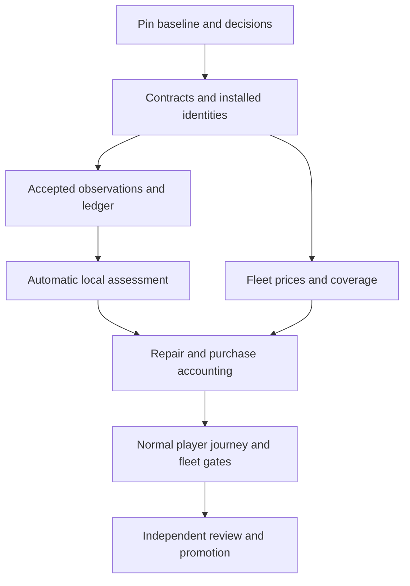

# 01 — Senior developer execution plan

**Project:** OPEN RC SIMULATOR · **Prepared:** 2026-11-09 · **Status:** proposed implementation backlog, with separately retained historical audit evidence.

**Decision requested from the development owner:** adopt the product boundary and sequence below, reconcile them with the target branch, and implement in small reviewable changes. This package does not change the game, certify a release, or authorize a production deployment. It gives the developer concrete work, existing reuse points, research inputs, failure cases and acceptance gates.

The source baseline is `f47d1dc6cccb141936407d0217eafdc465558190`. A subsequent GitHub review found `main` at `f7b58bd830d4a5eb78901d00514ce1fc18286477`, nine commits ahead. All 13 economics GDScript files have identical Git blobs between those revisions, but surrounding flight and presentation code moved. Read [06_RESEARCH_AND_BASELINE_NOTES.md](06_RESEARCH_AND_BASELINE_NOTES.md) before choosing a working base. Historical passing tests apply to the pinned audit harness, not automatically to the newer branch.

## 1. Build this player experience

A player should finish a relevant accident and receive a short, believable repair estimate: what was affected, what can be reused under the game's stated assessment policy, which parts or packages must be purchased, labor or DIY assumptions, and the resulting cost. A broken propeller should normally lead to a local propeller action and any justified powertrain checks. A damaged wing should not automatically replace an unrelated engine, receiver and battery. A severe concentrated impact may make many items unrecoverable. The explanation must follow the accepted incident evidence and the installed aircraft.

Use **automatic deterministic game assessment** as the first useful interaction. At settlement or a terminal boundary, the game applies a reviewed, versioned policy to its supported observations, produces a versioned assessment, and calculates the bill. The details disclose which outcomes and prices are game assumptions. A basic useful result must not depend on a developer injecting an inspection receipt, a player performing a long workshop ritual, or an external price request. Existing receipt and inspection machinery remains the audit trail for supported resolutions; an optional player inspection/re-quote interaction can follow after the automatic path works.

The default label should describe a **game repair estimate**. Reserve numerical confidence probabilities and physical qualification for work supported by independent validation. A stable feature can use declared, bounded game assumptions. Ordinary uneventful flights do not need an accident card merely because the simulation does not instrument every possible microscopic failure. Once a relevant incident is opened, missing inputs needed by its declared policy must remain visible and must not be silently interpreted as healthy parts.

### Required end state for the existing airplanes

The current catalog contains eight selectable fixed-wing aircraft, three retained glow variants, and a separately scoped research helicopter. The fixed-wing delivery is complete only when all 11 airplane routes have compatible identities, financial component coverage, game damage profiles, usable automatic assessment, and the applicable regression fixtures. Each selectable airplane must exercise the actual normal player route. The hidden variants must also pass inventory, profile and incident fixtures; test their normal route whenever they can be selected through the supported launcher. X-Cell requires its own inventory and rotorcraft work before the product can advertise the entire 12-route catalog as cost-supported.

For every airplane, acceptance must include a mapped local structure/body event, its applicable ground/gear behavior, an appropriate propulsion event or explicit absence of a propeller, and a numeric local bill. Before removing the fixed-wing experimental label, **all essential purchasable groups for the common supported incident classes** must have a supported offer or an explicitly reviewed game allowance. One priced propeller beside an otherwise unusable aircraft does not satisfy the end state. Rare unsupported channels may remain clearly bounded; blanket unavailable labels cannot satisfy fleet completion. The per-aircraft checklist in file 04 defines the outstanding coverage.

### Explicit first-release scope

| Included | Deferred unless separately required by an existing contract |
| --- | --- |
| Accepted contact facts; bounded per-component evidence; local deterministic assessment; normal/hard landing discrimination using a supported channel or reviewed proxy | Finite-element fracture, measured structural strength, universal survival probabilities |
| Propeller, ordinary local structure, gear, powertrain exposure, water facts and honest unsupported-hazard status | Continued flight with arbitrary structurally broken aircraft; new flight dynamics solely to animate cost outcomes |
| Per-component or package repair/replacement/reuse decisions, scoped known totals, bounded pair/surplus purchases, labor modes and frozen sources | Persistent campaign wallet, real purchases, shop marketplace, persistent spare inventory, sale-credit economy |
| English and Spanish report strings, 1080p usability, archive/checkpoint consistency and existing required CI | A new report design system, all-resolution optimization before 1080p, broad graphics redevelopment |
| Deterministic pending/disclosure for unmodeled delayed consequences | A new thermal aftermath clock and propagation law, unless delayed fire is advertised as cost-affecting |

Surplus can be retained as an unvalued informational quantity within one quote. A persistent inventory system is not required. Similarly, first release can use an offline USD game price book with declared tax/shipping exclusions. The research workbook preserves EUR and UAH observations; mixed-currency arithmetic is blocked until an explicit offline conversion policy exists. A live currency service is unnecessary.

## 2. What is already valuable, and what must change

The audit does not support a wholesale rewrite. The existing research-to-runtime generator, strict catalog validation, integer-cent accounting, inspection receipts, bounded incident owner, view-only archives, paired checkpoint integration, settlement gate, and focused economics tests provide substantial reusable work. The isolated `impact_budget.gd`, `component_resolver.gd`, and `thermal_budget.gd` are useful helpers within their documented assumptions. They do not by themselves constitute an integrated damage model.

| Existing asset | Reuse | Required change or caution |
| --- | --- | --- |
| `research/crash-economics/build_catalog.py`, `build_runtime.py`, source JSON and tests | Keep the generation and review workflow | Add new versioned source/schema support through generators; never hand-edit generated runtime data |
| `app/economy/catalog.gd` | Strict IDs, coverage and input validation | Current closed v1 and physical-ID allocation rules cannot accept financial child fields by silently relaxing validation |
| `app/economy/incident.gd` | One incident owner, deferred calculation, frozen source/report behavior, archive boundaries | Persistent contacts, mapped overflow summaries, condition progression, receipts after reimpact, source-qualified water mapping and automatic assessment need work |
| `calculator.gd`, `replacement_quote.gd` | Pure money calculations and explicit unknowns | Separate incident completeness from whole-build completeness; reconcile all applicable fees and explanation of ranges |
| `inspection.gd`, `repair_planner.gd`, `repair_details.gd` | Validated partial/full receipts and repair alternatives | Connect usable production assessment; scope clearance explicitly; retain v1 full-row semantics during migration |
| `package_optimizer.gd` | Bounded deterministic search in its supported domain | Current exact-cover domain rejects extra unrequired coverage; represent surplus explicitly before claiming pair/PNP support |
| `settlement.gd` | Stable accepted-tick ground dwell for nonterminal report presentation | Preserve cadence independence; presentation settling is not evidence of damage or component strength |
| Crash renderer | Existing effects and presentation | Effects remain consumers. Graphics quality, camera distance or cosmetic destruction cannot author the bill |

Sources for this map are the [pinned economics tree](https://github.com/bultodepapas/OpenRCsimulator/tree/f47d1dc6cccb141936407d0217eafdc465558190/app/economy), [research pipeline](https://github.com/bultodepapas/OpenRCsimulator/tree/f47d1dc6cccb141936407d0217eafdc465558190/research/crash-economics), and the exact call graph in [file 02](02_RUNTIME_IMPLEMENTATION_SPEC.md). Existing project plans and investigation records are indexed in file 06; their planned capabilities must be checked against actual callers.

## 3. Ownership, dependencies and review discipline

Assign one integration owner to `main.gd`, `flight_session.gd`, incident lifecycle and checkpoint boundaries. Assign an economics/data owner to money, coverage and catalog generation. A physics/contact owner reviews observation provenance and bounded proxies; a QA reviewer owns discriminating fixtures and the normal-route proof. The same senior developer can fill several roles, but the final Good Enemy review should independently challenge assumptions and inspect the evidence.

The work-package IDs `CC-00` through `CC-18` are **handoff identifiers**, not newly claimed repository track IDs. Map each package to the current crash/economics track step after reading `docs/README.md`, `docs/plans/crash-damage-economics.md` and its owner. Keep one authoritative plan after incorporation; do not leave this external package as a competing permanent roadmap.

The critical path is baseline → contracts → accepted observations → bounded incident state → automatic assessment → correct accounting → full fleet → normal-route release proof. Price investigation and independent fixtures can progress alongside runtime work after identity and coverage boundaries are agreed. Do not parallelize conflicting edits to shared runtime files.

## 4. Implementation work packages

Each package needs a small candidate diff, its affected tests, explicit exclusions, and a retained evidence record. “Done” below is an observable boundary, not merely code compilation.

### CC-00 — Pin the implementation base and accepted scope

**Owner:** senior/integration. **Depends on:** none. **Inspect:** `AGENTS.md`, `docs/SUBAGENTS.md`, `docs/STACK.md`, tool index, current track ownership and Git status.

Record the target commit, dirty diff if any, engine executable/version, platform, backend, physical tick rate, selectable and hidden catalog routes, data hashes and the newer graphics guidance. Compare the relevant paths against both revisions recorded in this package. Resolve whether any later work has already changed a finding before opening duplicate fixes. Create an isolated worktree if the shared checkout contains parallel changes; preserve unrelated work. Establish the release claims, common incident classes, USD pricing basis, automatic-assessment default and rotorcraft boundary in a short decision record.

**Done:** the work branch and source identities are reproducible; all owners know which observations and game assumptions are in scope; no historical harness result is relabeled as a new-head result. **Evidence:** baseline manifest, current scope checklist and links to assigned track steps. No flight golden is re-recorded for this administrative step.

### CC-01 — Convert findings into discriminating regression fixtures

**Owner:** QA with integration. **Depends on:** CC-00. **Inspect:** `app/tests/test_economy_*.gd`, `test_accident_integration.gd`, `test_accident_settlement.gd`, `test_accident_report.gd`, existing checked runner.

Start with the ten retained audit probes and source-linked findings. Add a desired-behavior fixture for late mapped contact after 128 retained events, persistent-contact escalation, reuse followed by reimpact, replace followed by prop inspection, same-tick terminal/prop ordering, source-qualified lake mapping, scoped catalog incompleteness and omitted incurred fees. Use independent hand-calculated cents and constructed accepted observations. Keep a record of which fixture fails on the baseline and why. An expected-failure baseline run must not count as a fixed regression.

Add an integration sentinel proving whether the normal launch creates the incident owner; deliberately excluded capture/trace/scripted launches are controls. A direct call to `Calculator.calculate` cannot substitute for this boundary. Extend the existing tests where the behavior belongs, introducing a new test file only for a coherent new contract.

**Done:** each issue has a test that distinguishes the faulty and corrected behaviors without duplicating the production algorithm. **Cases:** STATE-01–09, ECON-01/06/07, PROP-03, HAZARD-03, AC-44. Preserve the original historical tests as a baseline, not as a comprehensive acceptance oracle.

### CC-02 — Introduce the versioned identity and financial component contract

**Owner:** economics/data. **Depends on:** CC-00; agrees interfaces before CC-03/04. **Inspect:** `catalog.gd`, `inspection.gd`, `checkpoint.gd`, `app/app_state/aircraft_catalog.gd`, research schemas and aircraft authoring contract.

Implement the companion profile and explicit mapping specified in file 05. Separate installed physical mass items, independently assessable financial children, damage regions, sale packages and labor/service tasks. Current catalog validation allocates each physical inventory ID at most once; do not repeat one mass ID across new v1 component rows. The new versioned crosswalk must account for that many-to-one financial relationship outside the existing rule, with a deliberate migration. No extra physical mass is created to make a bill itemizable.

Normalize stock/variant origin into a proposed source-reference adapter; `SourceRef` in this plan is a design name, not an existing repository type. Bind profile, contact map, propulsion/battery configuration and price revision to the installed configuration. Define hash semantics and defaults explicitly. A cosmetic edit and a financial/physical edit need different compatibility treatment. Preserve existing closed-schema readers and archives with clear version negotiation.

**Done:** valid companion examples round-trip; wrong aircraft, duplicate child IDs, orphan mappings, zero/negative quantities, unsupported fields, stale material configuration and incompatible variants fail atomically. **Cases:** ECON-02/04/05, AC-45. **Deliverable:** schema, migration decision, generated examples, negative validation fixtures and ownership of each source field.

### CC-03 — Preserve accepted contact observations and finalize each tick

**Owner:** contact/integration. **Depends on:** CC-02. **Inspect:** `flight_session.gd`, `aircraft_contact_events.gd`, `hull_contact.gd`, `impact_snapshot.gd`, `scenery_collision.gd` and the accepted-step transaction.

Add a versioned observation envelope or adapter with stable identity, qualified source/probe IDs, accepted tick, lifecycle, state stage, optional contact fraction, units/frames and truthful measurement provenance. Capture pre-contact information at the producer when available. A detected endpoint or post-response velocity cannot be renamed incoming velocity. Gear-limit data omits deforming wheel velocity; preserve that absence.

Define the seal point for accepted-step contacts plus same-tick endpoint guards, including a terminal event when no next step occurs. Use staged batches or bounded idempotent amendments as specified in file 02. Rejected solver candidates must not enter the ledger or archives. A manifold shares one coherent energy budget when an energy-allocated rule is used; use supported independent local predicates when no such budget is needed. Do not block every game assessment on unavailable joules, and do not invent them.

**Done:** input order and duplicate notification do not change canonical facts; rejected candidates leave state unchanged; same-tick terminal and evidenced prop facts survive. **Cases:** STATE-02/03/04/10, PROP-03, STRUCT-06. **Evidence:** accepted-event fixture, producer provenance audit and a trace of commit/seal/publication ownership.

### CC-04 — Make the incident ledger bounded, cumulative and revision-safe

**Owner:** integration. **Depends on:** CC-02/03. **Inspect:** `incident.gd`, `checkpoint.gd`, `inspection.gd`.

Retain the diagnostic event journal but create authoritative bounded summaries for each installed economic component. Consume relevant persistent updates, retain later peaks or qualified accumulation, and preserve late mapped prop/water/gear/structure facts after journal overflow. Declare per-tick, per-episode, per-component and byte limits. Overflow must retain already confirmed facts and report the affected loss of coverage.

Persist a bounded recent ID-to-payload-digest window and the open-tick/episode cursor. Exact duplicates inside the window are no-ops; conflicting payloads are rejected atomically. Events older than retained proof are explicitly stale/unverifiable and rejected without modifying value, condition or revision. A high-water mark alone cannot prove that an old payload matches. Store diagnostics separately from financial truth.

Separate observed/modelled condition, recommended disposition, receipt confirmation and evidence revision. A later supported impact reopens relevant reuse/repair clearance while preserving unrelated confirmations. An inspection request cannot downgrade confirmed replacement. Condition evidence progresses under the declared policy; the cheapest feasible bill may decrease when a package becomes the better purchase. Do not enforce monotonicity on the optimal total.

**Done:** STATE-01–07 pass with bounded memory, duplicate receipt/event checks and malformed/oversized input controls. Old checkpoint behavior remains explicitly handled until CC-13 migrates it. **Deliverable:** state invariants, capacity decisions, rollback proof and diagnostic examples.

### CC-05 — Complete the minimum propeller, gear and water producer seams

**Owner:** contact/physics. **Depends on:** CC-03/04. **Inspect:** prop-strike guard order, terrain/scenery sweep paths, gear support/limit evaluation and lake source identity.

The current powered prop envelope is a game-confirmed envelope contact, not proof of an individual blade phase. Preserve its known rule while adding terminal-coincident evidence and explicit capability for stopped blades and scenery. Implement the advertised modes with matched clear-envelope controls; if a narrow mode remains unsupported, name it in the capability record and do not claim universal prop detection.

Add the first-release ordinary-gear observation or reviewed proxy: bounded accepted-tick support/compression/load information, relevant normal/sink and lateral evidence, installed gear role and side. Review what the physics actually supplies before selecting inputs. Normal and hard-sink fixtures must exercise that producer. A missing `gear_limit` event alone cannot certify clearance. High forward speed by itself is not the gear-damage law; use the appropriate supported local channel and policy.

Use `(probe_source, probe_id)` in water mapping. Separate lake entry, bank contact, affected component and recovery policy. Do not convert a water-touch fact automatically into blade fracture or global electronics destruction. Preserve water facts through summary, assessment and restore.

**Done:** applicable LAND-01–06, PROP-01–04 and HAZARD-03/04 pass. Evidence records exactly which stopped/scenery prop and lateral gear modes are supported. An ordinary player landing still feels like a normal game action and does not open a permanent pending-cost flow.

### CC-06 — Implement deterministic local game damage assessment

**Owner:** economics with physics review. **Depends on:** CC-02–05; can develop pure rules against fixtures earlier. **Proposed seam:** profile validator and pure damage assessment alongside existing economy helpers.

Author class-based policy with per-aircraft overrides only where supported by installation or construction evidence. Distinguish balsa/plywood, foam and composite economic repair behavior; keep uncertainty and assumptions visible. Apply local contact role, supported exposure, side, load path and independently declared hazard evidence. Infer which installed regions were outside a supported local event only within the policy's actual coverage. Low severity at one wingtip does not prove every radio component physically healthy.

Define stable discrete candidates such as unaffected-within-assessed-scope, inspect, repair-candidate, replace-candidate and lost, with explanatory reason codes. Use automatic scenario-assumption assessment to resolve common game cases into a costable state. Do not apply every resolver candidate as simultaneous damage. A local predicate may work without an energy budget; a rule allocating energy across contacts requires one coherent bounded budget with truthful provenance.

For the user's 40/500 km/h examples, write matched scenarios specifying direction, normal speed, contact region, surface, propulsion/thermal evidence and recovery. Do not encode one universal speed switch. Severe direct collision should yield correspondingly extensive game losses when its declared inputs warrant them; a mild local jet impact can preserve a turbine/receiver under a supported game assessment. Keep severe global loss and economic total loss distinct.

**Done:** applicable STRUCT, POWER, TURBINE and HAZARD cases produce repeatable local outcomes and meaningful explanations; unseen software scenarios challenge the fitted thresholds. **Deliverable:** versioned parameter table, source/assumption labels, known limits and route-by-route profile coverage. No measured-strength or survival-probability claim follows from these tests.

### CC-07 — Connect assessment, receipts and revision updates to normal play

**Owner:** integration/economics. **Depends on:** CC-04/06. **Inspect:** production callers of `apply_inspection`, `apply_repair_choice`, report construction and settlement flow.

Connect the automatic game assessment through an owner-controlled versioned resolution, preserving its `scenario_assumption` basis. A debug-only call is insufficient. Preserve current partial inspection support; current v1 full inspection still requires all economic rows, including labor, and controls total-loss changes. Add explicit scoped clearance in a versioned adapter/schema instead of weakening v1 or fabricating inspection of every row.

Reject stale expected revisions, incompatible aircraft/profile IDs, conflicting receipt IDs and malformed input without partial mutation. Reassessment after new evidence must update the current report once. Retain earlier immutable report/receipt provenance within bounded retention rules. Optional manual inspection choices need simple supported actions and tests only if actually exposed; they are not a prerequisite for the default automatic path.

**Done:** a player-created incident reaches a numeric local estimate without an injected final receipt, then later relevant evidence invalidates the affected resolution correctly. **Cases:** AC-44, STATE-02/06/07, ECON-01. **Evidence:** normal-route contact → assessment → resolution/revision → calculator → visible report, with identifiers and displayed amounts reconciled.

### CC-08 — Fix scoped completeness, range semantics and monetary reconciliation

**Owner:** economics. **Depends on:** CC-02/04/07. **Inspect:** `calculator.gd`, `replacement_quote.gd`, report totals and unknown reasons.

Compute incident scope before checking whether its required parts, actions and prices are complete. An unrelated missing whole-build offer must not poison a known propeller or wing repair. Conversely, a missing relevant price remains unknown. Show known subtotal, unresolved items, basis/exclusions and completeness separately. Zero is a real assessed result; null is missing/unavailable. Do not replace null with zero or an arbitrary aircraft-price percentage.

Separate damage alternatives, offer-price variation and coverage gaps. Prefer one deterministic game estimate for resolved common cases and named repair/replacement alternatives when the choice differs. A range needs explicit endpoints and causes; do not label minimum/maximum arithmetic as a statistical confidence interval. Keep terminal replacement as an alternative, not a synthetic finite upper bound when unresolved fees/components remain.

Use integer minor units with checked arithmetic and explicit currency. Include applicable incurred inspection/retrieval/setup fees exactly once in every incident alternative that shares them, including whole replacement. Show future alternative-dependent costs separately. Decide quote inclusions before making completeness claims: an offline game estimate can explicitly exclude destination taxes and freight; a checkout-total claim cannot.

**Done:** ECON-01/07 and AC-46 plus the numeric fixtures in file 03 pass; totals reconcile to lines exactly; unknowns remain scoped and visible. Existing broad ranges are replaced by a clear breakdown, not cosmetically narrowed constants.

### CC-09 — Implement bounded purchases, repairs and labor without double counting

**Owner:** economics/data. **Depends on:** CC-02/08. **Inspect:** `package_optimizer.gd`, `repair_planner.gd`, `repair_details.gd`, `repair-recipes.json`.

Represent required installed units separately from the units a supplier sells. A pair purchased for one failed wheel leaves one unvalued spare. A wing set, ARF or PNP may cover several required components and also supply extras. Model overlap, compatibility and surplus explicitly; the existing exact-cover solver does not already support this larger domain. Search a bounded candidate set, return a feasible result with honest completeness/optimality status, and use independent exhaustive enumeration only for small test fixtures. Exceeding a bound cannot become a claim of a global optimum.

Add compatible repair recipes with prerequisites, consumed material, cash purchase quantity, labor time and shared operations. A covering patch requires a supported intact-structure assessment; a structural replacement and a cosmetic patch cannot both be billed as if they repair the same loss. Share access/removal/reinstallation/setup once across adjacent tasks. Price DIY cash separately from time spent; shop rates and durations remain explicitly sourced or authored.

**Done:** ECON-06/07, STRUCT-02, small pair/overlap/surplus fixtures and the Timber wing examples pass. Support the bounded pair case in the first release; defer only genuinely larger solver domains. No persistent wallet/inventory work is needed to explain unvalued surplus.

### CC-10 — Complete the smaller-aircraft and variant price/profile data

**Owner:** data/research. **Depends on:** CC-02; imports require CC-08/09 contracts. **Routes:** four glow Stiks, Electric Stik, Extra, Lumber and MoonRunner.

Use file 04's exact component IDs and counts. Correct prop binding by route: LP12060 for Jensen/61FX/Extra, LP12070 for 55AX, Master Airscrew K14×6 for FS-64V, LP12080E for Electric Stik. Split lumped financial parts through the companion mapping; do not alter mass inventories for accounting. Bind Electric Stik's four named researched products only after package review; three generic servos and its receiver need chosen analogue/allowance or positive installation identity.

Separate Lumber's bare wing from its four wing servos, the two tail servos, and PNP alternatives. Resolve MoonRunner's structure/PNP overlap and missing airframe/wiring/camera costs with explicit offers or bounded allowances. Keep obsolete or ambiguous kit evidence as leads. Complete essential structural and installation allowances for Stik/Extra rather than inheriting one whole-airframe amount for every contact.

**Done:** generated identity/coverage/quantity checks and one local repair plus severe comparison per relevant construction class pass; all essential common-incident groups are priceable under declared policy. **Cases:** ECON-02/04/05/06, aircraft-applicable local/prop/gear cases. **Evidence:** reviewed source-to-price crosswalk, readable generated diff, source dates and rationale for every allowance.

### CC-11 — Resolve and price large warbird and turbine configurations

**Owner:** data/research with aircraft owner. **Depends on:** CC-02; CC-09 for packages. **Routes:** P-51, F4U, Avanti/P100-RX.

P-51 is a plans/short-kit class, not an identified exact retail airframe. Preserve that distinction; resolve two canisters, dual batteries and installed retract requirements. For Corsair, stop exact wing import until plug-in versus folding provenance and center/outer/control-surface coverage are resolved. The current unpriced wings are not proof of an existing wrong charge. Review Moki core/ignition/exhaust/mount grouping, pneumatic versus current electric gear references, wheel pairs and complete ARF overlap.

For Avanti, resolve the current A200 spare-list revision against the authored dimensions, electric versus pneumatic gear, turbine/ECU/pump/accessory membership and the correct A200-13 P100RX pipe. Preserve EUR prices and VAT basis; do not substitute the different A200-14 pipe. Choose local economic children so a wing loss does not force repurchase of a surviving turbine. A service authorization threshold is not a flat crash-inspection fee.

**Done:** AC-45/46 and variant/package negative tests pass; common local and severe game scenarios yield appropriately scoped estimates using approved offers/allowances. **Evidence:** installation decision, package membership crosswalk, unresolved narrow limits and independent price review. Exact foreign pricing is optional; honest, sourced class allowances can close a game model when exact product identity is unavailable.

### CC-12 — Make the report concise, explanatory and usable

**Owner:** UI with economics. **Depends on:** CC-07–11 for representative reports. **Inspect:** current accident-report component, translations, archive viewer and `main.gd` integration.

Lead with the game estimate or a known subtotal with a specific unresolved scope. Show affected parts, reuse/repair/replace result, parts/labor/fees, source-date basis and the reason for any material range. Present local repair and replacement as comparable alternatives only when both are feasible and their inclusions align. A whole-build reference may appear in details without becoming the headline for a small accident.

Use established components and strings. Avoid making technical provenance IDs, hash names, solver qualification or schema fields the player's normal workflow. Details can expose readable assumptions and price sources. Normal uneventful flights should remain quiet. A partial assessment should name what is missing and what the player can conclude, without a misleading $0 or infinite-looking range.

**Done:** English and Spanish normal-route cards, complex detail, unknown item, priced local incident and archive are legible at actual 1920×1080; keyboard/controller navigation works. **Cases:** AC-44, ECON-01/07, normal-route gates. Changing effects, camera or graphic settings does not change facts or cost. Preserve existing visual quality work on the target branch.

### CC-13 — Finish checkpoint, archive and price-version migration

**Owner:** integration. **Depends on:** CC-04/07/08. **Inspect:** economy checkpoint, main restore transaction and archive schema.

Persist the compatible physical/economic binding, incident revision, fixed summaries, open episode, recent dedup proof, frozen prices, receipts and settlement state. Validate the candidate before committing. Define refusal before physics commit and honest partial-success semantics after a physical commit when a separate visual restore fails. Preserve correct paired restore; a physics-only restore must visibly mark prior economic history unknown, including an ended brush with no currently active contact.

Keep old archives view-only with their old labels and source snapshot. Never reinterpret a historical price with today's catalog or silently load old incomplete state as a clean current incident. Immutable snapshot behavior is P0. Optional user-driven re-quote is P1 and creates a distinct version without changing damage history.

**Done:** STATE-08/09, snapshot immutability subset of ECON-08, malformed/oversized/version-mismatch controls and restart/archive journeys pass. **Evidence:** uninterrupted versus restored canonical comparison, migration fixtures and a rollback plan that does not require destructively rewriting player files.

### CC-14 — Bound hazard aftermath and cosmetic independence

**Owner:** integration/physics. **Depends on:** CC-03/04/06/13.

First release must preserve accepted pack/water/thermal facts and report unsupported later consequences deterministically. A damaged pack need not imply a fire; fuel presence need not imply ignition. Receiver, turbine and other reuse can remain pending when a relevant unresolved hazard blocks that conclusion. Cosmetic smoke/flames do not establish a financial event.

If timed aftermath is advertised, introduce a bounded authoritative game clock and event schedule that advances independently of rendering after primary motion stops; version, deduplicate and checkpoint it. Test delayed evidence invalidating affected reuse and bounded propagation. If that extension is deferred, exercise the deterministic pending/disclosure branch and label the unsupported capability; do not simulate a random fire only to generate a bill.

**Done:** HAZARD applicable P0 controls and effects/camera invariance pass; timed HAZARD-02 and corresponding STATE-10 clock tests are required whenever the capability is enabled. **Evidence:** identical accepted-input outcomes with effects on/off and recorded aftermath capability. This package may be split into mandatory boundary work and a separately gated timed extension.

### CC-15 — Close fleet acceptance and normal-route integration

**Owner:** QA/integration. **Depends on:** CC-05–14 and completed data imports.

Discover routes from the actual candidate catalog. Execute the 46-case matrix against applicable capabilities, recording nonempty selector resolution and explicit exceptions. Run a normal launch for each of the eight selectable fixed-wing routes and the supported variants; prove owner creation, contact delivery, automatic assessment, revision, visible amount, settlement and archive/restart. Add the paired/unpaired checkpoint journey in the full app. Tests that start with final dispositions or inject the completed receipt cannot satisfy the automatic-assessment player gate.

Exercise accepted tapes across 30/60/144 publication cadences, the same engine/solver/configuration, sustained contacts, duplicate events, overflow and effects changes. Distinguish equal accepted-input economics from different physics trajectories produced by changed solver versions. Establish frame/physics and memory budgets on the nominated release hardware before comparing measured results; do not invent a performance qualification from a headless harness.

**Done:** all applicable mandatory cases and GATE-01–08 are satisfied for the promised fixed-wing scope, every common incident class is useful, and required repository CI is green for the exact candidate. Failed or unavailable evidence cannot be renamed passed. Necessary full-suite/native gates occur here after focused checks, not on every documentation or price edit.

### CC-16 — Independent critique, staged enablement and label removal

**Owner:** senior with independent Good Enemy. **Depends on:** CC-15.

Review the implementation against the adversarial questions in file 03. Inspect actual code and retained outputs, not just screenshots. Require fixes for duplicate spend, unsupported health/salvage assumptions, pricing wrong variants, schema bypasses, range concealment, stale receipt reuse, unbounded history or excluded launch routes. Record tradeoffs and residual narrow limits in the owning decision/track documents.

Enable the new path through an existing appropriate product configuration or a small reviewed capability selector. A shadow comparison can help during development, but a flag alone does not prove correctness. Initially qualify a complete Jensen vertical slice, then foam/electric and large-aircraft families, then all fixed-wing routes. Keep rollback to the previous view-only reporting path compatible with stored data. Remove the economics experimental label only for the configurations and behavior whose gates passed; unrelated aircraft-physics experimental labels require their own owners' evidence.

**Done:** candidate identity, release checklist, independent review, rollback proof and user-facing scope are consistent. Preserve failures and fixes in the evidence record. Do not advertise “all aircraft standard” while X-Cell remains unsupported or while essential airplane repair groups remain unpriceable.

### CC-17 — Establish the future-aircraft intake and maintenance loop

**Owner:** data/QA. **Depends on:** CC-02/15; can author alongside them.

Make file 05's authoring checklist part of adding a new catalog route. A new aircraft must declare installed financial inventory, contact/zone crosswalk, compatible game profile, units/quantities/package alternatives, source/allowance provenance, normal local/severe fixtures, restore identity and player report evidence. An explicit class fallback is a reviewed binding, not automatic inheritance from an arbitrary existing aircraft. Adding a selectable route must surface missing support in CI before release.

Run price checks when source inputs change and before releases; record freshness/availability separately. Keep historical offers and frozen reports. Review large price deltas, changed sold sets, discontinued variants and material scope changes. Use an opt-in bounded diagnostic fixture or established local evidence workflow for bug reports; this plan does not require adding remote telemetry or sending player data. Track unexplained-range frequency, unresolved common incidents, duplicate-billing regressions and invalid-price bindings in development evidence.

**Done:** one intentionally new test aircraft/profile can be authored through the same contract with no kernel branch and fails clearly when a required mapping is omitted. Maintenance instructions have one canonical repository home and a named owner.

### CC-18 — Complete the separate X-Cell economics extension

**Owner:** rotorcraft owner with economics. **Depends on:** common contracts and a validated rotorcraft inventory/contact design.

The existing `xcell-60-research` has zero financial rows. Establish the intended X-Cell physical installation; its HX-700 visual surrogate does not identify purchasable parts. Author rotor/head/mast/tail/drivetrain/frame/engine or motor/radio/servo/gear groups, quantities and installed configurations. Define rotorcraft-appropriate accepted contacts, running/stopped rotor behavior, local repair alternatives and profile assumptions through its vehicle adapter. Keep the shared simulation kernel vehicle-agnostic.

**Done:** the rotorcraft's own inventory, contact, damage, money, persistence and normal-route gates pass, with numeric useful outcomes. Until then the complete fixed-wing release must explicitly exclude rotorcraft economics from its claim. **Cases:** ECON-03 and newly authored rotorcraft fixtures. This extension does not block an honestly scoped airplane release, but it is necessary for a later claim covering every current catalog route.

## 5. Merge sequence and practical workload control

Use the following review sequence, splitting further where a diff would mix unrelated responsibilities:

| Review slice | Required outcome | Main packages |
| --- | --- | --- |
| A: baseline and contract | Agreed claims, tests, schema/migration and identities | CC-00–02 |
| B: evidence correctness | Accepted batching, summaries, dedup, reimpact and minimum producer seams | CC-03–05 |
| C: one useful vertical slice | Automatic local assessment and reconciled Jensen bill through normal play | CC-06–08, limited CC-12/13 |
| D: real purchase economics | Pair/surplus packages, repair/labor, scoped ranges and immutable sources | CC-08/09/13 |
| E: complete fixed-wing data | All 11 profiles, essential groups, variants and source/allowance decisions | CC-10/11 |
| F: release candidate | All normal routes, hazards boundary, UI, required CI and independent review | CC-12–16 |
| G: sustained standard | Future intake/maintenance; separately gated rotorcraft | CC-17/18 |

Do not quote a precise delivery date before CC-00/02 expose producer and migration work. The largest uncertainty is the accepted telemetry/identity boundary, followed by package and configuration research. A developer can demonstrate value early with slice C while continuing the complete fixed-wing plan. A simple prop-price correction is small; a complete incident model, persistent state contract and all-fleet rollout is a multi-change project. Count acceptance evidence and completed behavior, not file count or removed labels, as progress.

## 6. First developer session

Read this document and file 02, then the existing repository instructions and tool index. Inspect Git status, pin the implementation revision, compare current economics/integration paths and record drift. Read the baseline verification scope before attempting reproduction. Use the portable helper described in file 03 for the historical isolated harness only; use the repository's documented checked runner and debug bridge for the candidate. The historical manifest is not a shipping-project manifest.

Select one concrete defect and its discriminating fixture first: replace-to-inspect downgrade, reimpact after reuse, or mapped overflow are good bounded starting points. In parallel, decide the companion financial identity contract and the Corsair source conflict with the relevant owner. Establish the minimum gear observation producer and the normal-route automatic-assessment seam before designing attractive new report cards. These decisions determine whether the planned local estimates can exist in the actual game.

### Definition of a complete implementation handoff back to the project owner

Return the exact candidate and branch/PR, a behavior-focused change summary, the per-route supported matrix, the researched/assumed price book, executed case results with missing cases called out, normal-route evidence, 1080p/performance observations, migration/rollback behavior and unresolved narrow limitations. State which release gates passed and which remain. The owner should be able to reproduce a small prop strike, a local wing repair, a hard landing and a severe turbine scenario and understand every monetary line without reading the implementation.
