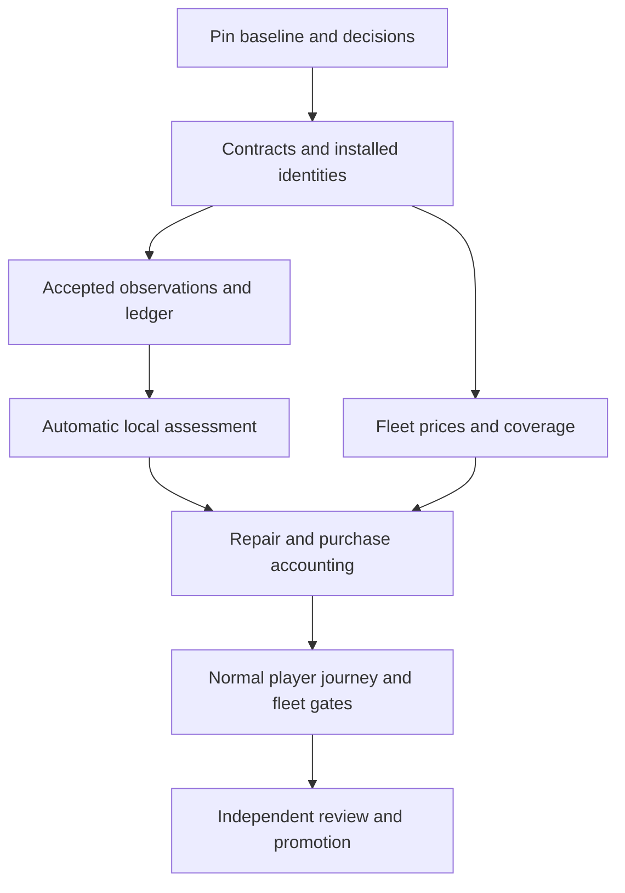

<a id="handoff-overview"></a>
# OPEN RC SIMULATOR — complete senior developer handoff

Prepared 2026-11-09. Combined reading copy of the seven modular Markdown documents. Runtime changes, schema examples and 46 acceptance cases remain proposed; executed baseline evidence is explicitly identified. The ZIP includes the research JSON, reproducibility tool and retained reports.

## Contents

- [README.md](#document-readme)
- [01_EXECUTION_PLAN.md](#document-01)
- [02_RUNTIME_IMPLEMENTATION_SPEC.md](#document-02)
- [03_TEST_AND_RELEASE_SPEC.md](#document-03)
- [04_FLEET_AND_PRICE_WORKBOOK.md](#document-04)
- [05_DATA_CONTRACT_AND_AUTHORING_STANDARD.md](#document-05)
- [06_RESEARCH_AND_BASELINE_NOTES.md](#document-06)

---

<a id="document-readme"></a>


<a id="document-readme-open-rc-simulator--crash-cost-implementation-handoff"></a>

## OPEN RC SIMULATOR — crash-cost implementation handoff

**For:** the senior developer responsible for game implementation. **Prepared:** 2026-11-09. **Purpose:** turn the external crash-cost audit into a concrete, bounded engineering plan that works across the existing airplane fleet and establishes a standard for future aircraft.

Start with [01_EXECUTION_PLAN.md](#document-01). The package contains 19 sequenced work packages, source-linked runtime and data specifications, a per-aircraft price workbook, 46 proposed acceptance cases, eight release gates, dated research and a verified portable reproduction tool. The combined reading copy is [OPENRC_CRASH_COST_SENIOR_HANDOFF.md](#handoff-overview). The modular documents are the editing homes; regenerate the combined copy after changing them.

**Main recommendation:** retain the useful economics foundation and finish the path from accepted local contact to automatic game assessment, compatible repair/purchase choices and an explainable cost. Preserve surviving components where the declared policy supports them. Keep missing facts and prices explicit. Remove the economics experimental label only after useful common-incident coverage and the actual player flow pass for the promised configurations.


<a id="document-readme-files-and-reading-order"></a>

### Files and reading order

| File | Use |
| --- | --- |
| [01_EXECUTION_PLAN.md](#document-01) | Product boundary, existing reuse, 19 work packages CC-00–18, owners, dependencies, exact done conditions, merge order and first developer session |
| [02_RUNTIME_IMPLEMENTATION_SPEC.md](#document-02) | Current call graph; accepted observations, batching, bounded summaries, damage assessment, component progression, receipts, aftermath and restore boundaries |
| [05_DATA_CONTRACT_AND_AUTHORING_STANDARD.md](#document-05) | Closed v1 constraints; proposed companion profile, physical/financial identities, zones, fingerprints, prices/packages/recipes, migration and future authoring rules |
| [04_FLEET_AND_PRICE_WORKBOOK.md](#document-04) | All 12 catalog routes, actual component IDs and quantities, 27 reviewed observations, 17 additional/rechecked observations, two unpriced leads and source-specific blockers |
| [03_TEST_AND_RELEASE_SPEC.md](#document-03) | 46 proposed cases, independent arithmetic, real player journey, checked commands, eight gates, independent-review objections and portable baseline reproduction |
| [06_RESEARCH_AND_BASELINE_NOTES.md](#document-06) | GitHub drift, existing project documents, why ranges widen, new findings, research queue, 40/500 km/h reasoning and exact verification limits |
| [data/acceptance_matrix_proposed.json](data/acceptance_matrix_proposed.json) | Machine-readable cases and handoff clarifications; every case remains proposed/unexecuted |
| [data/price_observations_reviewed_2026-11-09.json](data/price_observations_reviewed_2026-11-09.json) and [data/additional_price_research.json](data/additional_price_research.json) | Prospective import evidence; keep native currencies, sold quantities, compatibility limits and correction history |
| [tools/reproduce_baseline.py](tools/reproduce_baseline.py) | Verified portable reconstruction and execution of the historical focused economics tests; requires the exact repository revision and engine |
| [evidence/verification_scope.json](evidence/verification_scope.json), [evidence/reproducer_verification/summary.json](evidence/reproducer_verification/summary.json) and retained reports | Distinguish historical execution, fresh isolated reproduction and unexecuted future acceptance |

Repository paths in prose are relative to the repository checkout. Handoff links are relative to this folder. Pinned GitHub links retain audit line locations even when current `main` moves. Generated JSON/schema fragments in files 02/05 are **proposed interfaces**, not production-ready files that can be pasted into closed v1 data.


<a id="document-readme-source-baseline-and-limits"></a>

### Source baseline and limits

The audited source is `f47d1dc6cccb141936407d0217eafdc465558190`. During preparation, GitHub `main` was observed at `f7b58bd830d4a5eb78901d00514ce1fc18286477`, nine commits ahead. The reviewed comparison contains 217 changed paths; all 13 economics GDScript blobs match the audit commit. Nearby flight/session/graphics changes mean the implementation base and integration evidence still require a fresh explicit choice. File 06 explains this distinction.

Production source was not changed for this handoff. No new game implementation, PR, deployment, normal graphical flight or release qualification is claimed. The portable reproducer did execute a fresh isolated import, 12 existing scripts with 674 assertions, and ten current-behavior probes successfully at the pinned old commit. Those probes include demonstrations of defects; passing them does not mean those defects were fixed. The 46 proposed acceptance cases are separate work for the developer.

The delivery goal is all 11 fixed-wing configurations, including three retained glow variants. Every essential affected group for the declared common incident classes must have an applicable price or reviewed game allowance, along with a working assessment path. One propeller bill per route is an early vertical-slice demonstration, not completion. The X-Cell research helicopter is separately gated; it cannot inherit prices from its visual surrogate or be reported as free because its inventory is empty.


<a id="document-readme-decisions-already-made-in-this-handoff"></a>

### Decisions already made in this handoff

- Use an automatic deterministic game assessment as the minimum normal-player experience. Receipts preserve provenance and revision control; a debug-injected final inspection is not an acceptable implementation of that experience.
- Preserve physical inventory and generated physics. Use versioned companion financial children and coverage mappings where a lump contains separately assessable purchasable parts.
- Use accepted local evidence, bounded episode summaries and supported proxies. A terminal flight flag or forward speed alone cannot identify every destroyed part. The first release must add the ordinary gear observation/proxy needed by its own normal/hard landing claims.
- Keep incident completeness separate from the whole-build price book. Explain unresolved damage, source-price variation and alternate repair plans separately.
- Support bounded package pairs, surplus and overlap without a persistent inventory or cash-sale system. Charge a supplied unit once; reuse and unvalued surplus are different facts.
- Preserve frozen historical prices at P0. A new quote is a separate optional version. Timed thermal aftermath is conditional on a declared capability; deterministic pending/disclosure and accepted-hazard preservation are mandatory.
- Review the Corsair wing source conflict before exact import. The reviewed price JSON corrects eight overstrong variant/coverage labels across P16–P22 and P24, including Corsair gear/fuselage and the A200 commercial-package revision.
- Require actual normal-route owner/assessment/report/archive evidence, 1080p usability, candidate-specific required CI and independent critique before removing the relevant experimental label.

These decisions bound the first release. They do not require a finite-element model, universal real-world survival percentages, a shopping service, a campaign wallet or flying arbitrarily damaged aircraft. Useful, consistent local game outcomes with disclosed assumptions are the intended result.


<a id="document-readme-evidence-and-correction-policy"></a>

### Evidence and correction policy

The original audit evidence is retained under `evidence/`. Its price observations and 43-case matrix remain historical. Current prospective price research is under `data/`, with explicit variant and package-coverage corrections. The current acceptance matrix retains all original IDs and adds AC-44–46; its labeled handoff clarifications resolve release-scope and priority details without asserting execution.

The reproducibility record includes manifests, logs, checked reports and probe output. Generated copies of repository source/data, Godot imports and an isolated user profile are omitted from the deliverable; reconstruct them from the exact repository with the included tool. Do not execute the historical path-specific runner as though it were portable. No engine binary is bundled.

Use the module owning each topic as authoritative: file 01 for promised product scope and sequence, 02 for runtime flow, 05 for data/validation, 04 for research, and 03 for acceptance. If a future change creates a contradiction, resolve it in all affected homes and record the decision before implementing. Existing production code remains the authority for what is implemented; the handoff specifies what should change.


<a id="document-readme-suggested-handoff-note"></a>

### Suggested handoff note

Please implement the crash-cost work in the order defined in file 01, beginning with baseline reconciliation, the companion identity contract and discriminating regression fixtures. Preserve the useful existing economics code and the repository's generated-data, transaction and verification boundaries. Deliver a complete normal-player automatic assessment path for each supported airplane, with localized parts/labor costs, compatible packages, appropriate component reuse and visible assumptions. Return the candidate commit, per-route coverage ledger, executed test/gate evidence, price-source decisions, migration/rollback behavior and remaining limits. Do not mark the model standard solely by removing a label or making a range look narrower.

---

<a id="document-01"></a>


<a id="document-01-01--senior-developer-execution-plan"></a>

## 01 — Senior developer execution plan

**Project:** OPEN RC SIMULATOR · **Prepared:** 2026-11-09 · **Status:** proposed implementation backlog, with separately retained historical audit evidence.

**Decision requested from the development owner:** adopt the product boundary and sequence below, reconcile them with the target branch, and implement in small reviewable changes. This package does not change the game, certify a release, or authorize a production deployment. It gives the developer concrete work, existing reuse points, research inputs, failure cases and acceptance gates.

The source baseline is `f47d1dc6cccb141936407d0217eafdc465558190`. A subsequent GitHub review found `main` at `f7b58bd830d4a5eb78901d00514ce1fc18286477`, nine commits ahead. All 13 economics GDScript files have identical Git blobs between those revisions, but surrounding flight and presentation code moved. Read [06_RESEARCH_AND_BASELINE_NOTES.md](#document-06) before choosing a working base. Historical passing tests apply to the pinned audit harness, not automatically to the newer branch.


<a id="document-01-1-build-this-player-experience"></a>

### 1. Build this player experience

A player should finish a relevant accident and receive a short, believable repair estimate: what was affected, what can be reused under the game's stated assessment policy, which parts or packages must be purchased, labor or DIY assumptions, and the resulting cost. A broken propeller should normally lead to a local propeller action and any justified powertrain checks. A damaged wing should not automatically replace an unrelated engine, receiver and battery. A severe concentrated impact may make many items unrecoverable. The explanation must follow the accepted incident evidence and the installed aircraft.

Use **automatic deterministic game assessment** as the first useful interaction. At settlement or a terminal boundary, the game applies a reviewed, versioned policy to its supported observations, produces a versioned assessment, and calculates the bill. The details disclose which outcomes and prices are game assumptions. A basic useful result must not depend on a developer injecting an inspection receipt, a player performing a long workshop ritual, or an external price request. Existing receipt and inspection machinery remains the audit trail for supported resolutions; an optional player inspection/re-quote interaction can follow after the automatic path works.

The default label should describe a **game repair estimate**. Reserve numerical confidence probabilities and physical qualification for work supported by independent validation. A stable feature can use declared, bounded game assumptions. Ordinary uneventful flights do not need an accident card merely because the simulation does not instrument every possible microscopic failure. Once a relevant incident is opened, missing inputs needed by its declared policy must remain visible and must not be silently interpreted as healthy parts.


<a id="document-01-required-end-state-for-the-existing-airplanes"></a>

#### Required end state for the existing airplanes

The current catalog contains eight selectable fixed-wing aircraft, three retained glow variants, and a separately scoped research helicopter. The fixed-wing delivery is complete only when all 11 airplane routes have compatible identities, financial component coverage, game damage profiles, usable automatic assessment, and the applicable regression fixtures. Each selectable airplane must exercise the actual normal player route. The hidden variants must also pass inventory, profile and incident fixtures; test their normal route whenever they can be selected through the supported launcher. X-Cell requires its own inventory and rotorcraft work before the product can advertise the entire 12-route catalog as cost-supported.

For every airplane, acceptance must include a mapped local structure/body event, its applicable ground/gear behavior, an appropriate propulsion event or explicit absence of a propeller, and a numeric local bill. Before removing the fixed-wing experimental label, **all essential purchasable groups for the common supported incident classes** must have a supported offer or an explicitly reviewed game allowance. One priced propeller beside an otherwise unusable aircraft does not satisfy the end state. Rare unsupported channels may remain clearly bounded; blanket unavailable labels cannot satisfy fleet completion. The per-aircraft checklist in file 04 defines the outstanding coverage.


<a id="document-01-explicit-first-release-scope"></a>

#### Explicit first-release scope

| Included | Deferred unless separately required by an existing contract |
| --- | --- |
| Accepted contact facts; bounded per-component evidence; local deterministic assessment; normal/hard landing discrimination using a supported channel or reviewed proxy | Finite-element fracture, measured structural strength, universal survival probabilities |
| Propeller, ordinary local structure, gear, powertrain exposure, water facts and honest unsupported-hazard status | Continued flight with arbitrary structurally broken aircraft; new flight dynamics solely to animate cost outcomes |
| Per-component or package repair/replacement/reuse decisions, scoped known totals, bounded pair/surplus purchases, labor modes and frozen sources | Persistent campaign wallet, real purchases, shop marketplace, persistent spare inventory, sale-credit economy |
| English and Spanish report strings, 1080p usability, archive/checkpoint consistency and existing required CI | A new report design system, all-resolution optimization before 1080p, broad graphics redevelopment |
| Deterministic pending/disclosure for unmodeled delayed consequences | A new thermal aftermath clock and propagation law, unless delayed fire is advertised as cost-affecting |

Surplus can be retained as an unvalued informational quantity within one quote. A persistent inventory system is not required. Similarly, first release can use an offline USD game price book with declared tax/shipping exclusions. The research workbook preserves EUR and UAH observations; mixed-currency arithmetic is blocked until an explicit offline conversion policy exists. A live currency service is unnecessary.


<a id="document-01-2-what-is-already-valuable-and-what-must-change"></a>

### 2. What is already valuable, and what must change

The audit does not support a wholesale rewrite. The existing research-to-runtime generator, strict catalog validation, integer-cent accounting, inspection receipts, bounded incident owner, view-only archives, paired checkpoint integration, settlement gate, and focused economics tests provide substantial reusable work. The isolated `impact_budget.gd`, `component_resolver.gd`, and `thermal_budget.gd` are useful helpers within their documented assumptions. They do not by themselves constitute an integrated damage model.

| Existing asset | Reuse | Required change or caution |
| --- | --- | --- |
| `research/crash-economics/build_catalog.py`, `build_runtime.py`, source JSON and tests | Keep the generation and review workflow | Add new versioned source/schema support through generators; never hand-edit generated runtime data |
| `app/economy/catalog.gd` | Strict IDs, coverage and input validation | Current closed v1 and physical-ID allocation rules cannot accept financial child fields by silently relaxing validation |
| `app/economy/incident.gd` | One incident owner, deferred calculation, frozen source/report behavior, archive boundaries | Persistent contacts, mapped overflow summaries, condition progression, receipts after reimpact, source-qualified water mapping and automatic assessment need work |
| `calculator.gd`, `replacement_quote.gd` | Pure money calculations and explicit unknowns | Separate incident completeness from whole-build completeness; reconcile all applicable fees and explanation of ranges |
| `inspection.gd`, `repair_planner.gd`, `repair_details.gd` | Validated partial/full receipts and repair alternatives | Connect usable production assessment; scope clearance explicitly; retain v1 full-row semantics during migration |
| `package_optimizer.gd` | Bounded deterministic search in its supported domain | Current exact-cover domain rejects extra unrequired coverage; represent surplus explicitly before claiming pair/PNP support |
| `settlement.gd` | Stable accepted-tick ground dwell for nonterminal report presentation | Preserve cadence independence; presentation settling is not evidence of damage or component strength |
| Crash renderer | Existing effects and presentation | Effects remain consumers. Graphics quality, camera distance or cosmetic destruction cannot author the bill |

Sources for this map are the [pinned economics tree](https://github.com/bultodepapas/OpenRCsimulator/tree/f47d1dc6cccb141936407d0217eafdc465558190/app/economy), [research pipeline](https://github.com/bultodepapas/OpenRCsimulator/tree/f47d1dc6cccb141936407d0217eafdc465558190/research/crash-economics), and the exact call graph in [file 02](#document-02). Existing project plans and investigation records are indexed in file 06; their planned capabilities must be checked against actual callers.


<a id="document-01-3-ownership-dependencies-and-review-discipline"></a>

### 3. Ownership, dependencies and review discipline

Assign one integration owner to `main.gd`, `flight_session.gd`, incident lifecycle and checkpoint boundaries. Assign an economics/data owner to money, coverage and catalog generation. A physics/contact owner reviews observation provenance and bounded proxies; a QA reviewer owns discriminating fixtures and the normal-route proof. The same senior developer can fill several roles, but the final Good Enemy review should independently challenge assumptions and inspect the evidence.

The work-package IDs `CC-00` through `CC-18` are **handoff identifiers**, not newly claimed repository track IDs. Map each package to the current crash/economics track step after reading `docs/README.md`, `docs/plans/crash-damage-economics.md` and its owner. Keep one authoritative plan after incorporation; do not leave this external package as a competing permanent roadmap.

The critical path is baseline → contracts → accepted observations → bounded incident state → automatic assessment → correct accounting → full fleet → normal-route release proof. Price investigation and independent fixtures can progress alongside runtime work after identity and coverage boundaries are agreed. Do not parallelize conflicting edits to shared runtime files.




<a id="document-01-4-implementation-work-packages"></a>

### 4. Implementation work packages

Each package needs a small candidate diff, its affected tests, explicit exclusions, and a retained evidence record. “Done” below is an observable boundary, not merely code compilation.


<a id="document-01-cc-00--pin-the-implementation-base-and-accepted-scope"></a>

#### CC-00 — Pin the implementation base and accepted scope

**Owner:** senior/integration. **Depends on:** none. **Inspect:** `AGENTS.md`, `docs/SUBAGENTS.md`, `docs/STACK.md`, tool index, current track ownership and Git status.

Record the target commit, dirty diff if any, engine executable/version, platform, backend, physical tick rate, selectable and hidden catalog routes, data hashes and the newer graphics guidance. Compare the relevant paths against both revisions recorded in this package. Resolve whether any later work has already changed a finding before opening duplicate fixes. Create an isolated worktree if the shared checkout contains parallel changes; preserve unrelated work. Establish the release claims, common incident classes, USD pricing basis, automatic-assessment default and rotorcraft boundary in a short decision record.

**Done:** the work branch and source identities are reproducible; all owners know which observations and game assumptions are in scope; no historical harness result is relabeled as a new-head result. **Evidence:** baseline manifest, current scope checklist and links to assigned track steps. No flight golden is re-recorded for this administrative step.


<a id="document-01-cc-01--convert-findings-into-discriminating-regression-fixtures"></a>

#### CC-01 — Convert findings into discriminating regression fixtures

**Owner:** QA with integration. **Depends on:** CC-00. **Inspect:** `app/tests/test_economy_*.gd`, `test_accident_integration.gd`, `test_accident_settlement.gd`, `test_accident_report.gd`, existing checked runner.

Start with the ten retained audit probes and source-linked findings. Add a desired-behavior fixture for late mapped contact after 128 retained events, persistent-contact escalation, reuse followed by reimpact, replace followed by prop inspection, same-tick terminal/prop ordering, source-qualified lake mapping, scoped catalog incompleteness and omitted incurred fees. Use independent hand-calculated cents and constructed accepted observations. Keep a record of which fixture fails on the baseline and why. An expected-failure baseline run must not count as a fixed regression.

Add an integration sentinel proving whether the normal launch creates the incident owner; deliberately excluded capture/trace/scripted launches are controls. A direct call to `Calculator.calculate` cannot substitute for this boundary. Extend the existing tests where the behavior belongs, introducing a new test file only for a coherent new contract.

**Done:** each issue has a test that distinguishes the faulty and corrected behaviors without duplicating the production algorithm. **Cases:** STATE-01–09, ECON-01/06/07, PROP-03, HAZARD-03, AC-44. Preserve the original historical tests as a baseline, not as a comprehensive acceptance oracle.


<a id="document-01-cc-02--introduce-the-versioned-identity-and-financial-component-contract"></a>

#### CC-02 — Introduce the versioned identity and financial component contract

**Owner:** economics/data. **Depends on:** CC-00; agrees interfaces before CC-03/04. **Inspect:** `catalog.gd`, `inspection.gd`, `checkpoint.gd`, `app/app_state/aircraft_catalog.gd`, research schemas and aircraft authoring contract.

Implement the companion profile and explicit mapping specified in file 05. Separate installed physical mass items, independently assessable financial children, damage regions, sale packages and labor/service tasks. Current catalog validation allocates each physical inventory ID at most once; do not repeat one mass ID across new v1 component rows. The new versioned crosswalk must account for that many-to-one financial relationship outside the existing rule, with a deliberate migration. No extra physical mass is created to make a bill itemizable.

Normalize stock/variant origin into a proposed source-reference adapter; `SourceRef` in this plan is a design name, not an existing repository type. Bind profile, contact map, propulsion/battery configuration and price revision to the installed configuration. Define hash semantics and defaults explicitly. A cosmetic edit and a financial/physical edit need different compatibility treatment. Preserve existing closed-schema readers and archives with clear version negotiation.

**Done:** valid companion examples round-trip; wrong aircraft, duplicate child IDs, orphan mappings, zero/negative quantities, unsupported fields, stale material configuration and incompatible variants fail atomically. **Cases:** ECON-02/04/05, AC-45. **Deliverable:** schema, migration decision, generated examples, negative validation fixtures and ownership of each source field.


<a id="document-01-cc-03--preserve-accepted-contact-observations-and-finalize-each-tick"></a>

#### CC-03 — Preserve accepted contact observations and finalize each tick

**Owner:** contact/integration. **Depends on:** CC-02. **Inspect:** `flight_session.gd`, `aircraft_contact_events.gd`, `hull_contact.gd`, `impact_snapshot.gd`, `scenery_collision.gd` and the accepted-step transaction.

Add a versioned observation envelope or adapter with stable identity, qualified source/probe IDs, accepted tick, lifecycle, state stage, optional contact fraction, units/frames and truthful measurement provenance. Capture pre-contact information at the producer when available. A detected endpoint or post-response velocity cannot be renamed incoming velocity. Gear-limit data omits deforming wheel velocity; preserve that absence.

Define the seal point for accepted-step contacts plus same-tick endpoint guards, including a terminal event when no next step occurs. Use staged batches or bounded idempotent amendments as specified in file 02. Rejected solver candidates must not enter the ledger or archives. A manifold shares one coherent energy budget when an energy-allocated rule is used; use supported independent local predicates when no such budget is needed. Do not block every game assessment on unavailable joules, and do not invent them.

**Done:** input order and duplicate notification do not change canonical facts; rejected candidates leave state unchanged; same-tick terminal and evidenced prop facts survive. **Cases:** STATE-02/03/04/10, PROP-03, STRUCT-06. **Evidence:** accepted-event fixture, producer provenance audit and a trace of commit/seal/publication ownership.


<a id="document-01-cc-04--make-the-incident-ledger-bounded-cumulative-and-revision-safe"></a>

#### CC-04 — Make the incident ledger bounded, cumulative and revision-safe

**Owner:** integration. **Depends on:** CC-02/03. **Inspect:** `incident.gd`, `checkpoint.gd`, `inspection.gd`.

Retain the diagnostic event journal but create authoritative bounded summaries for each installed economic component. Consume relevant persistent updates, retain later peaks or qualified accumulation, and preserve late mapped prop/water/gear/structure facts after journal overflow. Declare per-tick, per-episode, per-component and byte limits. Overflow must retain already confirmed facts and report the affected loss of coverage.

Persist a bounded recent ID-to-payload-digest window and the open-tick/episode cursor. Exact duplicates inside the window are no-ops; conflicting payloads are rejected atomically. Events older than retained proof are explicitly stale/unverifiable and rejected without modifying value, condition or revision. A high-water mark alone cannot prove that an old payload matches. Store diagnostics separately from financial truth.

Separate observed/modelled condition, recommended disposition, receipt confirmation and evidence revision. A later supported impact reopens relevant reuse/repair clearance while preserving unrelated confirmations. An inspection request cannot downgrade confirmed replacement. Condition evidence progresses under the declared policy; the cheapest feasible bill may decrease when a package becomes the better purchase. Do not enforce monotonicity on the optimal total.

**Done:** STATE-01–07 pass with bounded memory, duplicate receipt/event checks and malformed/oversized input controls. Old checkpoint behavior remains explicitly handled until CC-13 migrates it. **Deliverable:** state invariants, capacity decisions, rollback proof and diagnostic examples.


<a id="document-01-cc-05--complete-the-minimum-propeller-gear-and-water-producer-seams"></a>

#### CC-05 — Complete the minimum propeller, gear and water producer seams

**Owner:** contact/physics. **Depends on:** CC-03/04. **Inspect:** prop-strike guard order, terrain/scenery sweep paths, gear support/limit evaluation and lake source identity.

The current powered prop envelope is a game-confirmed envelope contact, not proof of an individual blade phase. Preserve its known rule while adding terminal-coincident evidence and explicit capability for stopped blades and scenery. Implement the advertised modes with matched clear-envelope controls; if a narrow mode remains unsupported, name it in the capability record and do not claim universal prop detection.

Add the first-release ordinary-gear observation or reviewed proxy: bounded accepted-tick support/compression/load information, relevant normal/sink and lateral evidence, installed gear role and side. Review what the physics actually supplies before selecting inputs. Normal and hard-sink fixtures must exercise that producer. A missing `gear_limit` event alone cannot certify clearance. High forward speed by itself is not the gear-damage law; use the appropriate supported local channel and policy.

Use `(probe_source, probe_id)` in water mapping. Separate lake entry, bank contact, affected component and recovery policy. Do not convert a water-touch fact automatically into blade fracture or global electronics destruction. Preserve water facts through summary, assessment and restore.

**Done:** applicable LAND-01–06, PROP-01–04 and HAZARD-03/04 pass. Evidence records exactly which stopped/scenery prop and lateral gear modes are supported. An ordinary player landing still feels like a normal game action and does not open a permanent pending-cost flow.


<a id="document-01-cc-06--implement-deterministic-local-game-damage-assessment"></a>

#### CC-06 — Implement deterministic local game damage assessment

**Owner:** economics with physics review. **Depends on:** CC-02–05; can develop pure rules against fixtures earlier. **Proposed seam:** profile validator and pure damage assessment alongside existing economy helpers.

Author class-based policy with per-aircraft overrides only where supported by installation or construction evidence. Distinguish balsa/plywood, foam and composite economic repair behavior; keep uncertainty and assumptions visible. Apply local contact role, supported exposure, side, load path and independently declared hazard evidence. Infer which installed regions were outside a supported local event only within the policy's actual coverage. Low severity at one wingtip does not prove every radio component physically healthy.

Define stable discrete candidates such as unaffected-within-assessed-scope, inspect, repair-candidate, replace-candidate and lost, with explanatory reason codes. Use automatic scenario-assumption assessment to resolve common game cases into a costable state. Do not apply every resolver candidate as simultaneous damage. A local predicate may work without an energy budget; a rule allocating energy across contacts requires one coherent bounded budget with truthful provenance.

For the user's 40/500 km/h examples, write matched scenarios specifying direction, normal speed, contact region, surface, propulsion/thermal evidence and recovery. Do not encode one universal speed switch. Severe direct collision should yield correspondingly extensive game losses when its declared inputs warrant them; a mild local jet impact can preserve a turbine/receiver under a supported game assessment. Keep severe global loss and economic total loss distinct.

**Done:** applicable STRUCT, POWER, TURBINE and HAZARD cases produce repeatable local outcomes and meaningful explanations; unseen software scenarios challenge the fitted thresholds. **Deliverable:** versioned parameter table, source/assumption labels, known limits and route-by-route profile coverage. No measured-strength or survival-probability claim follows from these tests.


<a id="document-01-cc-07--connect-assessment-receipts-and-revision-updates-to-normal-play"></a>

#### CC-07 — Connect assessment, receipts and revision updates to normal play

**Owner:** integration/economics. **Depends on:** CC-04/06. **Inspect:** production callers of `apply_inspection`, `apply_repair_choice`, report construction and settlement flow.

Connect the automatic game assessment through an owner-controlled versioned resolution, preserving its `scenario_assumption` basis. A debug-only call is insufficient. Preserve current partial inspection support; current v1 full inspection still requires all economic rows, including labor, and controls total-loss changes. Add explicit scoped clearance in a versioned adapter/schema instead of weakening v1 or fabricating inspection of every row.

Reject stale expected revisions, incompatible aircraft/profile IDs, conflicting receipt IDs and malformed input without partial mutation. Reassessment after new evidence must update the current report once. Retain earlier immutable report/receipt provenance within bounded retention rules. Optional manual inspection choices need simple supported actions and tests only if actually exposed; they are not a prerequisite for the default automatic path.

**Done:** a player-created incident reaches a numeric local estimate without an injected final receipt, then later relevant evidence invalidates the affected resolution correctly. **Cases:** AC-44, STATE-02/06/07, ECON-01. **Evidence:** normal-route contact → assessment → resolution/revision → calculator → visible report, with identifiers and displayed amounts reconciled.


<a id="document-01-cc-08--fix-scoped-completeness-range-semantics-and-monetary-reconciliation"></a>

#### CC-08 — Fix scoped completeness, range semantics and monetary reconciliation

**Owner:** economics. **Depends on:** CC-02/04/07. **Inspect:** `calculator.gd`, `replacement_quote.gd`, report totals and unknown reasons.

Compute incident scope before checking whether its required parts, actions and prices are complete. An unrelated missing whole-build offer must not poison a known propeller or wing repair. Conversely, a missing relevant price remains unknown. Show known subtotal, unresolved items, basis/exclusions and completeness separately. Zero is a real assessed result; null is missing/unavailable. Do not replace null with zero or an arbitrary aircraft-price percentage.

Separate damage alternatives, offer-price variation and coverage gaps. Prefer one deterministic game estimate for resolved common cases and named repair/replacement alternatives when the choice differs. A range needs explicit endpoints and causes; do not label minimum/maximum arithmetic as a statistical confidence interval. Keep terminal replacement as an alternative, not a synthetic finite upper bound when unresolved fees/components remain.

Use integer minor units with checked arithmetic and explicit currency. Include applicable incurred inspection/retrieval/setup fees exactly once in every incident alternative that shares them, including whole replacement. Show future alternative-dependent costs separately. Decide quote inclusions before making completeness claims: an offline game estimate can explicitly exclude destination taxes and freight; a checkout-total claim cannot.

**Done:** ECON-01/07 and AC-46 plus the numeric fixtures in file 03 pass; totals reconcile to lines exactly; unknowns remain scoped and visible. Existing broad ranges are replaced by a clear breakdown, not cosmetically narrowed constants.


<a id="document-01-cc-09--implement-bounded-purchases-repairs-and-labor-without-double-counting"></a>

#### CC-09 — Implement bounded purchases, repairs and labor without double counting

**Owner:** economics/data. **Depends on:** CC-02/08. **Inspect:** `package_optimizer.gd`, `repair_planner.gd`, `repair_details.gd`, `repair-recipes.json`.

Represent required installed units separately from the units a supplier sells. A pair purchased for one failed wheel leaves one unvalued spare. A wing set, ARF or PNP may cover several required components and also supply extras. Model overlap, compatibility and surplus explicitly; the existing exact-cover solver does not already support this larger domain. Search a bounded candidate set, return a feasible result with honest completeness/optimality status, and use independent exhaustive enumeration only for small test fixtures. Exceeding a bound cannot become a claim of a global optimum.

Add compatible repair recipes with prerequisites, consumed material, cash purchase quantity, labor time and shared operations. A covering patch requires a supported intact-structure assessment; a structural replacement and a cosmetic patch cannot both be billed as if they repair the same loss. Share access/removal/reinstallation/setup once across adjacent tasks. Price DIY cash separately from time spent; shop rates and durations remain explicitly sourced or authored.

**Done:** ECON-06/07, STRUCT-02, small pair/overlap/surplus fixtures and the Timber wing examples pass. Support the bounded pair case in the first release; defer only genuinely larger solver domains. No persistent wallet/inventory work is needed to explain unvalued surplus.


<a id="document-01-cc-10--complete-the-smaller-aircraft-and-variant-priceprofile-data"></a>

#### CC-10 — Complete the smaller-aircraft and variant price/profile data

**Owner:** data/research. **Depends on:** CC-02; imports require CC-08/09 contracts. **Routes:** four glow Stiks, Electric Stik, Extra, Lumber and MoonRunner.

Use file 04's exact component IDs and counts. Correct prop binding by route: LP12060 for Jensen/61FX/Extra, LP12070 for 55AX, Master Airscrew K14×6 for FS-64V, LP12080E for Electric Stik. Split lumped financial parts through the companion mapping; do not alter mass inventories for accounting. Bind Electric Stik's four named researched products only after package review; three generic servos and its receiver need chosen analogue/allowance or positive installation identity.

Separate Lumber's bare wing from its four wing servos, the two tail servos, and PNP alternatives. Resolve MoonRunner's structure/PNP overlap and missing airframe/wiring/camera costs with explicit offers or bounded allowances. Keep obsolete or ambiguous kit evidence as leads. Complete essential structural and installation allowances for Stik/Extra rather than inheriting one whole-airframe amount for every contact.

**Done:** generated identity/coverage/quantity checks and one local repair plus severe comparison per relevant construction class pass; all essential common-incident groups are priceable under declared policy. **Cases:** ECON-02/04/05/06, aircraft-applicable local/prop/gear cases. **Evidence:** reviewed source-to-price crosswalk, readable generated diff, source dates and rationale for every allowance.


<a id="document-01-cc-11--resolve-and-price-large-warbird-and-turbine-configurations"></a>

#### CC-11 — Resolve and price large warbird and turbine configurations

**Owner:** data/research with aircraft owner. **Depends on:** CC-02; CC-09 for packages. **Routes:** P-51, F4U, Avanti/P100-RX.

P-51 is a plans/short-kit class, not an identified exact retail airframe. Preserve that distinction; resolve two canisters, dual batteries and installed retract requirements. For Corsair, stop exact wing import until plug-in versus folding provenance and center/outer/control-surface coverage are resolved. The current unpriced wings are not proof of an existing wrong charge. Review Moki core/ignition/exhaust/mount grouping, pneumatic versus current electric gear references, wheel pairs and complete ARF overlap.

For Avanti, resolve the current A200 spare-list revision against the authored dimensions, electric versus pneumatic gear, turbine/ECU/pump/accessory membership and the correct A200-13 P100RX pipe. Preserve EUR prices and VAT basis; do not substitute the different A200-14 pipe. Choose local economic children so a wing loss does not force repurchase of a surviving turbine. A service authorization threshold is not a flat crash-inspection fee.

**Done:** AC-45/46 and variant/package negative tests pass; common local and severe game scenarios yield appropriately scoped estimates using approved offers/allowances. **Evidence:** installation decision, package membership crosswalk, unresolved narrow limits and independent price review. Exact foreign pricing is optional; honest, sourced class allowances can close a game model when exact product identity is unavailable.


<a id="document-01-cc-12--make-the-report-concise-explanatory-and-usable"></a>

#### CC-12 — Make the report concise, explanatory and usable

**Owner:** UI with economics. **Depends on:** CC-07–11 for representative reports. **Inspect:** current accident-report component, translations, archive viewer and `main.gd` integration.

Lead with the game estimate or a known subtotal with a specific unresolved scope. Show affected parts, reuse/repair/replace result, parts/labor/fees, source-date basis and the reason for any material range. Present local repair and replacement as comparable alternatives only when both are feasible and their inclusions align. A whole-build reference may appear in details without becoming the headline for a small accident.

Use established components and strings. Avoid making technical provenance IDs, hash names, solver qualification or schema fields the player's normal workflow. Details can expose readable assumptions and price sources. Normal uneventful flights should remain quiet. A partial assessment should name what is missing and what the player can conclude, without a misleading $0 or infinite-looking range.

**Done:** English and Spanish normal-route cards, complex detail, unknown item, priced local incident and archive are legible at actual 1920×1080; keyboard/controller navigation works. **Cases:** AC-44, ECON-01/07, normal-route gates. Changing effects, camera or graphic settings does not change facts or cost. Preserve existing visual quality work on the target branch.


<a id="document-01-cc-13--finish-checkpoint-archive-and-price-version-migration"></a>

#### CC-13 — Finish checkpoint, archive and price-version migration

**Owner:** integration. **Depends on:** CC-04/07/08. **Inspect:** economy checkpoint, main restore transaction and archive schema.

Persist the compatible physical/economic binding, incident revision, fixed summaries, open episode, recent dedup proof, frozen prices, receipts and settlement state. Validate the candidate before committing. Define refusal before physics commit and honest partial-success semantics after a physical commit when a separate visual restore fails. Preserve correct paired restore; a physics-only restore must visibly mark prior economic history unknown, including an ended brush with no currently active contact.

Keep old archives view-only with their old labels and source snapshot. Never reinterpret a historical price with today's catalog or silently load old incomplete state as a clean current incident. Immutable snapshot behavior is P0. Optional user-driven re-quote is P1 and creates a distinct version without changing damage history.

**Done:** STATE-08/09, snapshot immutability subset of ECON-08, malformed/oversized/version-mismatch controls and restart/archive journeys pass. **Evidence:** uninterrupted versus restored canonical comparison, migration fixtures and a rollback plan that does not require destructively rewriting player files.


<a id="document-01-cc-14--bound-hazard-aftermath-and-cosmetic-independence"></a>

#### CC-14 — Bound hazard aftermath and cosmetic independence

**Owner:** integration/physics. **Depends on:** CC-03/04/06/13.

First release must preserve accepted pack/water/thermal facts and report unsupported later consequences deterministically. A damaged pack need not imply a fire; fuel presence need not imply ignition. Receiver, turbine and other reuse can remain pending when a relevant unresolved hazard blocks that conclusion. Cosmetic smoke/flames do not establish a financial event.

If timed aftermath is advertised, introduce a bounded authoritative game clock and event schedule that advances independently of rendering after primary motion stops; version, deduplicate and checkpoint it. Test delayed evidence invalidating affected reuse and bounded propagation. If that extension is deferred, exercise the deterministic pending/disclosure branch and label the unsupported capability; do not simulate a random fire only to generate a bill.

**Done:** HAZARD applicable P0 controls and effects/camera invariance pass; timed HAZARD-02 and corresponding STATE-10 clock tests are required whenever the capability is enabled. **Evidence:** identical accepted-input outcomes with effects on/off and recorded aftermath capability. This package may be split into mandatory boundary work and a separately gated timed extension.


<a id="document-01-cc-15--close-fleet-acceptance-and-normal-route-integration"></a>

#### CC-15 — Close fleet acceptance and normal-route integration

**Owner:** QA/integration. **Depends on:** CC-05–14 and completed data imports.

Discover routes from the actual candidate catalog. Execute the 46-case matrix against applicable capabilities, recording nonempty selector resolution and explicit exceptions. Run a normal launch for each of the eight selectable fixed-wing routes and the supported variants; prove owner creation, contact delivery, automatic assessment, revision, visible amount, settlement and archive/restart. Add the paired/unpaired checkpoint journey in the full app. Tests that start with final dispositions or inject the completed receipt cannot satisfy the automatic-assessment player gate.

Exercise accepted tapes across 30/60/144 publication cadences, the same engine/solver/configuration, sustained contacts, duplicate events, overflow and effects changes. Distinguish equal accepted-input economics from different physics trajectories produced by changed solver versions. Establish frame/physics and memory budgets on the nominated release hardware before comparing measured results; do not invent a performance qualification from a headless harness.

**Done:** all applicable mandatory cases and GATE-01–08 are satisfied for the promised fixed-wing scope, every common incident class is useful, and required repository CI is green for the exact candidate. Failed or unavailable evidence cannot be renamed passed. Necessary full-suite/native gates occur here after focused checks, not on every documentation or price edit.


<a id="document-01-cc-16--independent-critique-staged-enablement-and-label-removal"></a>

#### CC-16 — Independent critique, staged enablement and label removal

**Owner:** senior with independent Good Enemy. **Depends on:** CC-15.

Review the implementation against the adversarial questions in file 03. Inspect actual code and retained outputs, not just screenshots. Require fixes for duplicate spend, unsupported health/salvage assumptions, pricing wrong variants, schema bypasses, range concealment, stale receipt reuse, unbounded history or excluded launch routes. Record tradeoffs and residual narrow limits in the owning decision/track documents.

Enable the new path through an existing appropriate product configuration or a small reviewed capability selector. A shadow comparison can help during development, but a flag alone does not prove correctness. Initially qualify a complete Jensen vertical slice, then foam/electric and large-aircraft families, then all fixed-wing routes. Keep rollback to the previous view-only reporting path compatible with stored data. Remove the economics experimental label only for the configurations and behavior whose gates passed; unrelated aircraft-physics experimental labels require their own owners' evidence.

**Done:** candidate identity, release checklist, independent review, rollback proof and user-facing scope are consistent. Preserve failures and fixes in the evidence record. Do not advertise “all aircraft standard” while X-Cell remains unsupported or while essential airplane repair groups remain unpriceable.


<a id="document-01-cc-17--establish-the-future-aircraft-intake-and-maintenance-loop"></a>

#### CC-17 — Establish the future-aircraft intake and maintenance loop

**Owner:** data/QA. **Depends on:** CC-02/15; can author alongside them.

Make file 05's authoring checklist part of adding a new catalog route. A new aircraft must declare installed financial inventory, contact/zone crosswalk, compatible game profile, units/quantities/package alternatives, source/allowance provenance, normal local/severe fixtures, restore identity and player report evidence. An explicit class fallback is a reviewed binding, not automatic inheritance from an arbitrary existing aircraft. Adding a selectable route must surface missing support in CI before release.

Run price checks when source inputs change and before releases; record freshness/availability separately. Keep historical offers and frozen reports. Review large price deltas, changed sold sets, discontinued variants and material scope changes. Use an opt-in bounded diagnostic fixture or established local evidence workflow for bug reports; this plan does not require adding remote telemetry or sending player data. Track unexplained-range frequency, unresolved common incidents, duplicate-billing regressions and invalid-price bindings in development evidence.

**Done:** one intentionally new test aircraft/profile can be authored through the same contract with no kernel branch and fails clearly when a required mapping is omitted. Maintenance instructions have one canonical repository home and a named owner.


<a id="document-01-cc-18--complete-the-separate-x-cell-economics-extension"></a>

#### CC-18 — Complete the separate X-Cell economics extension

**Owner:** rotorcraft owner with economics. **Depends on:** common contracts and a validated rotorcraft inventory/contact design.

The existing `xcell-60-research` has zero financial rows. Establish the intended X-Cell physical installation; its HX-700 visual surrogate does not identify purchasable parts. Author rotor/head/mast/tail/drivetrain/frame/engine or motor/radio/servo/gear groups, quantities and installed configurations. Define rotorcraft-appropriate accepted contacts, running/stopped rotor behavior, local repair alternatives and profile assumptions through its vehicle adapter. Keep the shared simulation kernel vehicle-agnostic.

**Done:** the rotorcraft's own inventory, contact, damage, money, persistence and normal-route gates pass, with numeric useful outcomes. Until then the complete fixed-wing release must explicitly exclude rotorcraft economics from its claim. **Cases:** ECON-03 and newly authored rotorcraft fixtures. This extension does not block an honestly scoped airplane release, but it is necessary for a later claim covering every current catalog route.


<a id="document-01-5-merge-sequence-and-practical-workload-control"></a>

### 5. Merge sequence and practical workload control

Use the following review sequence, splitting further where a diff would mix unrelated responsibilities:

| Review slice | Required outcome | Main packages |
| --- | --- | --- |
| A: baseline and contract | Agreed claims, tests, schema/migration and identities | CC-00–02 |
| B: evidence correctness | Accepted batching, summaries, dedup, reimpact and minimum producer seams | CC-03–05 |
| C: one useful vertical slice | Automatic local assessment and reconciled Jensen bill through normal play | CC-06–08, limited CC-12/13 |
| D: real purchase economics | Pair/surplus packages, repair/labor, scoped ranges and immutable sources | CC-08/09/13 |
| E: complete fixed-wing data | All 11 profiles, essential groups, variants and source/allowance decisions | CC-10/11 |
| F: release candidate | All normal routes, hazards boundary, UI, required CI and independent review | CC-12–16 |
| G: sustained standard | Future intake/maintenance; separately gated rotorcraft | CC-17/18 |

Do not quote a precise delivery date before CC-00/02 expose producer and migration work. The largest uncertainty is the accepted telemetry/identity boundary, followed by package and configuration research. A developer can demonstrate value early with slice C while continuing the complete fixed-wing plan. A simple prop-price correction is small; a complete incident model, persistent state contract and all-fleet rollout is a multi-change project. Count acceptance evidence and completed behavior, not file count or removed labels, as progress.


<a id="document-01-6-first-developer-session"></a>

### 6. First developer session

Read this document and file 02, then the existing repository instructions and tool index. Inspect Git status, pin the implementation revision, compare current economics/integration paths and record drift. Read the baseline verification scope before attempting reproduction. Use the portable helper described in file 03 for the historical isolated harness only; use the repository's documented checked runner and debug bridge for the candidate. The historical manifest is not a shipping-project manifest.

Select one concrete defect and its discriminating fixture first: replace-to-inspect downgrade, reimpact after reuse, or mapped overflow are good bounded starting points. In parallel, decide the companion financial identity contract and the Corsair source conflict with the relevant owner. Establish the minimum gear observation producer and the normal-route automatic-assessment seam before designing attractive new report cards. These decisions determine whether the planned local estimates can exist in the actual game.


<a id="document-01-definition-of-a-complete-implementation-handoff-back-to-the-project-owner"></a>

#### Definition of a complete implementation handoff back to the project owner

Return the exact candidate and branch/PR, a behavior-focused change summary, the per-route supported matrix, the researched/assumed price book, executed case results with missing cases called out, normal-route evidence, 1080p/performance observations, migration/rollback behavior and unresolved narrow limitations. State which release gates passed and which remain. The owner should be able to reproduce a small prop strike, a local wing repair, a hard landing and a severe turbine scenario and understand every monetary line without reading the implementation.

---

<a id="document-02"></a>


<a id="document-02-02--runtime-implementation-specification"></a>

## 02 — Runtime implementation specification

**Baseline:** `f47d1dc6cccb141936407d0217eafdc465558190` of `bultodepapas/OpenRCsimulator`. Source descriptions below are limited to that tree. This is a proposed engineering design, not a claim that its APIs, modeled failures, prices or tests already exist. All linked source lines are pinned to that commit. Before implementation, reconcile the plan with the actual target revision and its applicable repository instructions. The source walkthrough did not execute new tests.

**Objective:** produce a deterministic, explainable, incident-scoped game estimate for supported aircraft after accepted collisions. It should distinguish an individual local damage candidate, an inspection or repair action, and a sold replacement package. It must carry unresolved facts when source telemetry, aircraft mapping, repair options or prices are insufficient. A software-stable game estimate is a product classification; it is not a measured prediction of structural failure or a physically qualified simulation. Existing exact prop-strike behavior remains available while broader assessment is introduced in independently reviewable stages.

**Early vertical-slice minimum:** every one of the eight selectable fixed-wing routes must create the normal interactive ledger/report and demonstrate a mapped local structural/body scenario, a ground/gear scenario appropriate to its configuration, and its propeller or no-propeller powertrain outcome. Each route must yield at least one meaningful numeric local bill through the normal automatic assessment flow, based on a sourced price or an approved authored game allowance and a disclosed cost scope. Label this limited coverage as preview/partial. The three hidden fixed-wing configurations require their own data and probe coverage.

**All-airplanes release gate:** before removing the experimental label or claiming complete all-airplanes coverage, maintain a route × declared-common-incident-class × essential-affected-purchasable-group ledger for **all 11 fixed-wing routes**. Every essential group in each declared common supported class needs an applicable sourced price or approved game allowance, a valid mapping and a supported path to the normal report. One numeric prop bill is only an early vertical slice: a route with a priced prop but an unpriced required wing or gear group fails the completion gate. Unrelated narrow or rare channels may remain explicitly unknown without being misrepresented as complete.

This file owns runtime behavior and ownership boundaries. The delivery order belongs in [01_EXECUTION_PLAN.md](#document-01); executable scenarios and release gates belong in [03_TEST_AND_RELEASE_SPEC.md](#document-03); fleet and money inputs belong in [04_FLEET_AND_PRICE_WORKBOOK.md](#document-04); exact authoring fields, schema and migrations belong in [05_DATA_CONTRACT_AND_AUTHORING_STANDARD.md](#document-05). Names and sample interfaces below are recommendations for alignment with that contract, not a second authoritative schema. Use a separately versioned companion profile and mappings instead of silently adding unknown keys to the closed current catalog, contact-event or inspection-receipt schemas. No wallet, payment, inventory debit, finite-element analysis or damaged-flight simulation is required to ship the first cost release.


<a id="document-02-1-current-call-graph-and-real-boundaries"></a>

### 1. Current call graph and real boundaries

The fixed-wing production path is:

1. `Simulation` accepts or rejects a step. In [`FlightSession._on_sim_stepped`](https://github.com/bultodepapas/OpenRCsimulator/blob/f47d1dc6cccb141936407d0217eafdc465558190/app/sim/flight_session.gd#L2395-L2421), the session commits failure and contact facts for an accepted tick, commits staged scenery state, and emits `contact_events_changed`; fault handling discards pending data at [lines 2386–2392](https://github.com/bultodepapas/OpenRCsimulator/blob/f47d1dc6cccb141936407d0217eafdc465558190/app/sim/flight_session.gd#L2386-L2392). `_session_after_input` also evaluates already accepted endpoint conditions before the next step, and `_append_contact_event` can notify on that same tick outside the commit callback. The design must handle both paths; it cannot assume one notification per tick. See [session guards](https://github.com/bultodepapas/OpenRCsimulator/blob/f47d1dc6cccb141936407d0217eafdc465558190/app/sim/flight_session.gd#L2929-L2961) and [contact append](https://github.com/bultodepapas/OpenRCsimulator/blob/f47d1dc6cccb141936407d0217eafdc465558190/app/sim/flight_session.gd#L2581-L2594).
2. `aircraft_contact_events.gd` normalizes the observations and validates the closed `openrc-aircraft-contact-events v1` records. Source, ID, lifecycle, tick, response and policy are mandatory; measures and vectors are optional, and absence means unknown. An event ID includes event type, source, tick, lifecycle and contact ID. Strict validation rejects unknown fields and duplicate source/contact pairs in an array. See [schema](https://github.com/bultodepapas/OpenRCsimulator/blob/f47d1dc6cccb141936407d0217eafdc465558190/app/sim/aircraft_contact_events.gd#L9-L29), [validation](https://github.com/bultodepapas/OpenRCsimulator/blob/f47d1dc6cccb141936407d0217eafdc465558190/app/sim/aircraft_contact_events.gd#L190-L242), and [ID construction](https://github.com/bultodepapas/OpenRCsimulator/blob/f47d1dc6cccb141936407d0217eafdc465558190/app/sim/aircraft_contact_events.gd#L418-L434). `contact_events()` is a current-tick snapshot, not a complete collision history ([source](https://github.com/bultodepapas/OpenRCsimulator/blob/f47d1dc6cccb141936407d0217eafdc465558190/app/sim/flight_session.gd#L2489-L2492)).
3. Interactive, non-scripted report-enabled startup creates `AccidentIncident`, `AccidentSettlement`, and the report UI and subscribes to the contact signal ([`main.gd`](https://github.com/bultodepapas/OpenRCsimulator/blob/f47d1dc6cccb141936407d0217eafdc465558190/app/main.gd#L1169-L1184)). `_on_accident_contacts()` checks source identity, calls `observe(snapshot, bindings, crashed, restored)`, and feeds the stable-rest presentation gate. Catalog reload and archive I/O are deferred to the frame boundary ([source](https://github.com/bultodepapas/OpenRCsimulator/blob/f47d1dc6cccb141936407d0217eafdc465558190/app/main.gd#L2786-L2846)). This handoff does not assert that an experimental helicopter or another vehicle runs the same fixed-wing flow.
4. [`incident.gd`](https://github.com/bultodepapas/OpenRCsimulator/blob/f47d1dc6cccb141936407d0217eafdc465558190/app/economy/incident.gd#L225-L285) records new events in a bounded diagnostic journal. A modeled propeller strike forces one propeller replacement and powertrain inspection; other mapped contacts open inspections, not automatic replacement. Its mapping searches contact and probe IDs; see [lines 306–344](https://github.com/bultodepapas/OpenRCsimulator/blob/f47d1dc6cccb141936407d0217eafdc465558190/app/economy/incident.gd#L306-L344). Water and prop facts are retained separately when the journal fills. Currently mapped inspections are derived only from retained non-prop events; later mapped contacts after overflow can lose their individual inspection scope, although a general unresolved notice remains. A future checkpoint validator also reconstructs contact inspections from that journal ([source](https://github.com/bultodepapas/OpenRCsimulator/blob/f47d1dc6cccb141936407d0217eafdc465558190/app/economy/checkpoint.gd#L137-L193)).
5. The frame-boundary `evaluate_pending()`/`_recalculate()` calls `Calculator.calculate`, decorates the report with frozen price provenance and a replacements-only comparison, emits it, and eventually flushes the latest archive. Archive writing uses a bounded temporary file and rename; disk archives are view-only, not a new flight ledger ([calculation](https://github.com/bultodepapas/OpenRCsimulator/blob/f47d1dc6cccb141936407d0217eafdc465558190/app/economy/incident.gd#L298-L303), [report](https://github.com/bultodepapas/OpenRCsimulator/blob/f47d1dc6cccb141936407d0217eafdc465558190/app/economy/incident.gd#L359-L410), [persistence](https://github.com/bultodepapas/OpenRCsimulator/blob/f47d1dc6cccb141936407d0217eafdc465558190/app/economy/incident.gd#L413-L465)). `settlement.gd` is a grounded, low-motion dwell policy for presenting a nonterminal card; its thresholds do not establish damage or physical landing quality ([source](https://github.com/bultodepapas/OpenRCsimulator/blob/f47d1dc6cccb141936407d0217eafdc465558190/app/economy/settlement.gd#L5-L8), [observation](https://github.com/bultodepapas/OpenRCsimulator/blob/f47d1dc6cccb141936407d0217eafdc465558190/app/economy/settlement.gd#L50-L90)).

The existing [`ImpactBudget.estimate_contact` and `allocate_episode`](https://github.com/bultodepapas/OpenRCsimulator/blob/f47d1dc6cccb141936407d0217eafdc465558190/app/economy/impact_budget.gd#L1-L15) are isolated estimates; a caller-supplied budget is not proof of accepted solver work ([allocation](https://github.com/bultodepapas/OpenRCsimulator/blob/f47d1dc6cccb141936407d0217eafdc465558190/app/economy/impact_budget.gd#L92-L150)). [`ComponentResolver.resolve`](https://github.com/bultodepapas/OpenRCsimulator/blob/f47d1dc6cccb141936407d0217eafdc465558190/app/economy/component_resolver.gd#L21-L33) returns candidates, not a disposition, cost or qualification. The [`ThermalBudget`](https://github.com/bultodepapas/OpenRCsimulator/blob/f47d1dc6cccb141936407d0217eafdc465558190/app/economy/thermal_budget.gd#L38-L63) is a separate bounded helper. They are useful foundations, not already-connected production damage laws.


<a id="document-02-2-proposed-ownership-and-interfaces"></a>

### 2. Proposed ownership and interfaces

Keep `Simulation` and the session/vehicle adapter responsible for accepted physics and contact facts. Keep the economics incident owner responsible for causal aggregation, proposed component conditions, inspection state, and costing. The UI consumes an immutable report snapshot. The crash renderer may consume accepted facts and assessment presentation hints, but it cannot author condition, salvage, charges or economic total-loss decisions.

Possible new filenames below are **proposals**, subject to the owning track's review:

| Owner / proposed seam | Input and output | Allowed side effects |
|---|---|---|
| Session adapter, extending existing `app/sim/flight_session.gd` and `app/sim/aircraft_contact_events.gd` | Accepted, versioned observation batch with stable IDs, explicit state provenance and optional measurements | Stage while sampling; commit only after accepted physics or an already accepted endpoint guard. No prices, UI or disk. |
| `app/economy/contact_episodes.gd` | Pure canonicalization of one finalized accepted-tick batch against bounded open episodes and previously summarized facts | Returns candidate next state; no solver write, I/O, VFX, or unbounded event history. |
| `app/economy/damage_profile.gd` and `app/economy/damage_assessment.gd` | Frozen, validated game-profile revision plus per-component evidence summaries | Produce deterministic **game candidates**, assumptions and unknowns; do not claim physical validation. |
| Existing `incident.gd` | Commit validated episode and assessment changes by revision; enforce inspection and checkpoint contracts | Own one incident's bounded state and frozen identities. Defer valuation, display and archive to existing frame/reset/exit boundaries. |
| Existing `calculator.gd`, `repair_planner.gd`, `replacement_quote.gd` and package optimizer, extended only where required | Condition/disposition and explicit package coverage, scoped price and recipe snapshots | Pure bounded integer-cent comparisons; no purchase, hidden sale credit, physical state mutation or external request. |

A suggested conceptual interface is `prepare_observation(accepted_batch, incident_state, profile) -> {ok, candidate_state, errors}` followed by a single `commit_observation(candidate_state)` at the owner boundary. Both names are new proposals, not current APIs. A frame publication operation reads one committed revision and creates a pure valuation snapshot. A failed prepare, rejected simulation candidate, invalid binding or overflow cannot partially change the ledger. Profiling must establish per-tick budget before release; keep arrays and dictionaries bounded to the verified installed configuration and use 64-bit simulation scalars and packed float64 data in simulation/physics code, as required by the repository. Avoid vehicle-specific branches inside the shared kernel: the aircraft adapter provides declared data through the installed model.


<a id="document-02-3-accepted-observation-manifold-and-provenance"></a>

### 3. Accepted observation, manifold and provenance


<a id="document-02-31-preserve-what-was-actually-observed"></a>

#### 3.1 Preserve what was actually observed

Define a versioned batch with `session_generation`, accepted tick, optional time-of-impact fraction, contact episode/causal identifiers, source and binding identities, event phase (`onset`, `persistent`, `end`, `terminal`, or explicit prop contact), source law/revision, and measurement provenance. Each quantity must name unit, coordinate frame, state stage and basis. Suggested stages are `pre_contact_accepted`, `interpolated_contact_estimate`, `accepted_endpoint`, and `post_response_accepted`; a source may supply only the stages it truly has. Record whether an obstacle is fixed or moving and any obstacle velocity if actually known. Do not fill missing values with zero. The exact contract is coordinated in file 05.

This distinction is necessary in the current tree. `HullContact.terminal(previous, s, ...)` evaluates incoming normal velocity at `previous`, while `ImpactSnapshot.hull_point(s, ...)` serializes detected-state kinematics and an optional crossing interpolation. `gear_limit` deliberately omits deforming wheel velocity. See [hull terminal](https://github.com/bultodepapas/OpenRCsimulator/blob/f47d1dc6cccb141936407d0217eafdc465558190/app/physics/hull_contact.gd#L421-L466) and [snapshot](https://github.com/bultodepapas/OpenRCsimulator/blob/f47d1dc6cccb141936407d0217eafdc465558190/app/physics/impact_snapshot.gd#L65-L98). The current event's `velocity_ned` is not automatically an incoming velocity. A scenery event does have a sweep fraction, a contact state and estimated normal energy; nonterminal response reports a modeled dissipated energy. Its mass sample may be interpolated to the same fraction, which is not event-substep integration ([scenery event](https://github.com/bultodepapas/OpenRCsimulator/blob/f47d1dc6cccb141936407d0217eafdc465558190/app/sim/scenery_collision.gd#L28-L45), [sweep](https://github.com/bultodepapas/OpenRCsimulator/blob/f47d1dc6cccb141936407d0217eafdc465558190/app/sim/scenery_collision.gd#L62-L66), [fuel sampling boundary](https://github.com/bultodepapas/OpenRCsimulator/blob/f47d1dc6cccb141936407d0217eafdc465558190/app/sim/flight_session.gd#L3138-L3147)).

Version the event/batch and checkpoint interfaces instead of adding fields to the strict v1 dictionary. Preserve v1 readers and produce explicit compatibility behavior. If no valid pre-contact sample exists, an endpoint contact can still support an `observed contact / inspect` result. It cannot support an invented incoming speed, impulse, fracture energy or peak load. For state-derived estimates, preserve the source tick, law, parameter revision and the fact that the result is an estimate.


<a id="document-02-32-aggregate-simultaneous-contacts-once"></a>

#### 3.2 Aggregate simultaneous contacts once

At an accepted boundary, group observations sharing a collision cause and time-of-impact interval into a deterministic manifold; multiple probes, a prop hit and the associated hull terminal event can describe one encounter. Canonicalize by a stable key such as `(session_generation, accepted_tick, causal_episode, source, qualified_contact_id, event_kind)` before assessment. A source-specific tie policy must be explicit; sorting IDs is for reproducibility, not evidence of physical contact order. Multiple actual impacts at distinct, supported fractions or after a documented separation remain distinct episodes. If causality or order cannot be established, retain the ambiguity and use a conservative unknown, rather than multiplying the same impact.

The session currently emits after its accepted step, yet a guard can append a terminal or strike fact for the same tick later. The adapter must therefore define a **seal** point that includes both commit and subsequent accepted-endpoint guard observations before the next simulation tick, reset, checkpoint capture or terminal presentation. A same-tick amendment before sealing merges into a staged batch. If the implementation cannot provide a reliable seal without changing scheduling, use versioned, idempotent amendments and recompute that tick from a bounded pre-tick snapshot before publishing; it must never spend an initial batch and then spend its amendment again. There must be no dependency on render-frame count or signal order. Document which owner seals a terminal guard when no next step occurs.

For a coupled solver with a qualified manifold work measurement, allocate at most the available accepted work once. Otherwise, an optional conservative **game budget** may be derived from one named, bounded estimate of pre-impact energy and shared across the manifold. Its basis is `scenario_assumption` or `isolated_estimate`, never `accepted_work_observed`. The sum of allocations must not exceed that budget and each component's share must be deterministic under reordered input. A missing budget blocks only rules that require allocated energy; an independently supported local predicate can still yield a deterministic game assessment with its own `scenario_assumption` provenance. Otherwise that rule returns inspection/unknown. Avoid independently spending full rigid-body kinetic energy at every probe. Do not add an anticipated slapdown and later charge its realized contact again. A later actual collision gets a new episode using its then-current evidence; if its incoming state is unavailable, do not infer remaining energy from the earlier outcome. Shaft energy, friction work and other channels are separate only if their independent inputs and energy boundaries are available.

`ImpactBudget.allocate_episode()` sorts and caps isolated estimates against the caller's supplied total, but cannot validate the source of that total. Reuse it only with a coherent shared sample, matching tick, body/normal frames and explicit budget provenance; its `accepted_tick` input label does not prove that a sample was measured before contact or that the supplied budget is solver work ([estimator](https://github.com/bultodepapas/OpenRCsimulator/blob/f47d1dc6cccb141936407d0217eafdc465558190/app/economy/impact_budget.gd#L10-L15), [calculation and limitations](https://github.com/bultodepapas/OpenRCsimulator/blob/f47d1dc6cccb141936407d0217eafdc465558190/app/economy/impact_budget.gd#L45-L86)). A per-contact effective-mass estimate is not a calibrated load or component strength. A known contact duration is needed before even discussing an average force; the simulation step is not the physical contact duration.


<a id="document-02-33-bounded-summaries-and-overflow"></a>

#### 3.3 Bounded summaries and overflow

The bounded journal is a diagnostic sample, not the authoritative damage ledger. Allocate one fixed summary per validated, uniquely identified installed component or declared group. Store at least: affected flag; qualified contact/episode classes represented; first and latest accepted tick; greatest supported game-risk candidate and its basis; required inspection flags; confirmed facts; receipt/evidence revision; and completeness/overflow status. Store bounded channel maxima or explicitly qualified cumulative intervals only where their aggregation rule and independent causal accounting are valid. No growing per-event array or ever-growing deduplication map is allowed. Unmapped contact evidence goes into a fixed `unmapped/unknown` summary, never disappears or creates a guessed component.

Deduplicate using a monotone accepted-tick high-water mark, capped open-tick/episode keys, and a bounded persisted recent event-ID → canonical-payload-digest replay window. On sealing, commit summaries once and persist the cursor, open episode and window with the ledger. A retained ID and matching digest is an idempotent no-op; a retained ID with a different digest is an atomic rejection with no ledger, value or revision mutation. Once an ID has fallen outside the retained window, reject its replay as `stale_unverifiable` without mutating those states; do not claim its payload was checked or call it an exact duplicate. A diagnostic outside the ledger may record rejections. Match session/generation and restore cursor; a new generation must not be silently discarded. If maximum contacts per tick, identities, arithmetic, episode state, or byte limits are exceeded, preserve already confirmed summaries, mark the affected scope or entire incident incomplete, and prevent a falsely complete low or high cost. Do not quietly truncate. If validation cannot fit even the installed component map, refuse the new assessment path for that configuration rather than claiming success. The diagnostic journal may retain its first 128 current events or another documented bounded policy; truncation must not prevent later confirmed prop, water or mapped-component facts from updating their fixed summaries.

Numbers must be finite and range checked before addition/multiplication, including aggregate counts and integer cents. On overflow return an explicit `out_of_range`/unknown result, never wrap, clamp to a credible bill or substitute zero. Bound provenance strings, candidates, receipt history and archive bytes as well as row counts. Define invariants and deterministic saturation semantics for diagnostic counters separately from economic amounts. Checkpoint validation must validate summaries, cursors and receipts directly; it cannot assume the diagnostic journal is complete or reconstruct every required inspection from it.


<a id="document-02-4-source-specific-observation-contracts"></a>

### 4. Source-specific observation contracts


<a id="document-02-propeller-powered-stationary-and-scenery"></a>

#### Propeller: powered, stationary and scenery

Current `_check_prop_strike()` runs only when soft contacts are enabled, the engine is running, RPM is at least `STRIKE_MIN_RPM`, the disc reaches the field and the crash guard has not already selected a crash. It latches one strike, stops the engine and emits `engine_stop_continue`. The event validator requires its RPM threshold. The generic scenery sweep uses the authored **hull** points and chooses the first hit; it does not by itself sweep a propeller disc against scenery. See [guard order and strike](https://github.com/bultodepapas/OpenRCsimulator/blob/f47d1dc6cccb141936407d0217eafdc465558190/app/sim/flight_session.gd#L2941-L2959), [strike](https://github.com/bultodepapas/OpenRCsimulator/blob/f47d1dc6cccb141936407d0217eafdc465558190/app/sim/flight_session.gd#L3056-L3068), [v1 validator](https://github.com/bultodepapas/OpenRCsimulator/blob/f47d1dc6cccb141936407d0217eafdc465558190/app/sim/aircraft_contact_events.gd#L252-L262), and [scenery sweep](https://github.com/bultodepapas/OpenRCsimulator/blob/f47d1dc6cccb141936407d0217eafdc465558190/app/sim/scenery_collision.gd#L124-L173).

Add an observation-only, bounded sweep of the declared installed propeller geometry against supported ground, lake/bank and scenery proxies, under the session/physics owner. Carry installed rotor ID, obstacle/ground ID, contact phase, fraction if supported, geometry identity, current/previous accepted shaft state if available, and powered/stationary/unknown classification. A powered disc sweep can use the disc as a declared collision envelope; a modeled envelope hit may be game-confirmed under an explicit policy, but does not prove a particular physical blade struck. A stopped propeller needs actual blade phase/geometry to confirm a particular blade. The existing checkpoint explicitly resets visual propeller phase, so when phase is not physics state, swept-disc overlap for an unpowered propeller is **possible contact**, not a confirmed blade strike ([restore boundary](https://github.com/bultodepapas/OpenRCsimulator/blob/f47d1dc6cccb141936407d0217eafdc465558190/app/main.gd#L2483-L2487)). Use a scenario-assumption envelope or request inspection; do not turn it into measured blade contact. No valid disc or blade geometry means unavailable, not no hit. For an actually supported powered ground strike preserve current engine-stop semantics and its confirmed replacement fact; the initial cost extension must not secretly change propulsion dynamics for additional cases.

Stage prop and hull/scenery observations from the same candidate and publish only the accepted path, including terminal cases. Merge a new prop observation with the existing strike fact via a causal key so it does not create two prop purchases. An overlap after a winning earlier TOI is not evidence that the truncated path reached the later obstacle. If a nonterminal physical scenery response alters the path, observe the path that was actually accepted; do not infer post-response hits from the discarded path. Propeller purchase/inspection is scoped to the installed propeller and local shaft, mount and related system; inspect those related items without automatically replacing a motor or engine. A stopped prop brush and powered blade impact may have different authored game profiles, but absent measurements must never masquerade as a quantified shaft load.


<a id="document-02-landing-gear-and-ground-support"></a>

#### Landing gear and ground support

Existing `ImpactSnapshot.gear_limit` can identify an authored support and provide accepted compression/travel at a detected limit. It explicitly declines to infer deforming-point velocity; `has_kinematics` may be false ([source](https://github.com/bultodepapas/OpenRCsimulator/blob/f47d1dc6cccb141936407d0217eafdc465558190/app/physics/impact_snapshot.gd#L81-L99)). First release must add a **bounded accepted-tick support producer**, not rely only on that terminal limit. `FlightSession.gear_compressions(state)` already computes per-support endpoint compressions in data order ([source](https://github.com/bultodepapas/OpenRCsimulator/blob/f47d1dc6cccb141936407d0217eafdc465558190/app/sim/flight_session.gd#L3080-L3085)); the new adapter must bind them to qualified support IDs, actual deployment/configuration and surface, record sample stage and finite travel, and persist bounded episode maxima/coverage. Supply accepted model load only where the selected law actually exposes it, or use an explicitly reviewed compression-based game proxy with stated units and limitations. Gearless or retracted configurations need their supported hull/ground observation. Validate a normal landing with positive support evidence and a matched harder landing for every applicable route; no limit event is not proof of a safe landing. `gear_limit` itself is not proof that a specific strut physically failed. With a validated binding, use a reviewed deterministic local game predicate to identify the individual leg/mount candidate; asymmetric or gear-up contacts do not automatically replace all gear. If using rigid-body velocity at the undeformed reference as a proxy, label it explicitly as an estimate and never call it the wheel's deformation velocity, contact impulse, spring peak or measured stress.

The experimental [`gear_damage.gd`](https://github.com/bultodepapas/OpenRCsimulator/blob/f47d1dc6cccb141936407d0217eafdc465558190/app/physics/gear_damage.gd#L108-L130) requires qualified aligned axes, accepted aggregate loads and same-state support potentials; the related [`aircraft_ground_damage.gd`](https://github.com/bultodepapas/OpenRCsimulator/blob/f47d1dc6cccb141936407d0217eafdc465558190/app/physics/aircraft_ground_damage.gd#L87-L105) describes a fixed-hub experimental response, not a launch-qualified collapsing leg. Do not pretend the normal-load and potential inputs exist in the ordinary snapshot or put experimental gear dynamics on the first cost-release critical path. A later telemetry extension must define sample timing, support axes, aggregation and a convergence/qualification plan before using these helpers as a physical failure source.


<a id="document-02-lake-bank-and-scenery-identity"></a>

#### Lake, bank and scenery identity

An existing lake event uses `contact_id = lake:<lake_id>:<material>` plus `probe_source` and `probe_id`; source can be `hull`, `gear` or `propeller`, and material distinguishes `water` from `bank_ground` ([event construction](https://github.com/bultodepapas/OpenRCsimulator/blob/f47d1dc6cccb141936407d0217eafdc465558190/app/sim/aircraft_contact_events.gd#L124-L151), [validation](https://github.com/bultodepapas/OpenRCsimulator/blob/f47d1dc6cccb141936407d0217eafdc465558190/app/sim/aircraft_contact_events.gd#L288-L311)). Proposed mapping keys must be qualified tuples `(probe_source, probe_id)`, with explicit optional environment/material and policy revision, not a naked `probe_id` that can collide across hull/gear/prop namespaces. Resolve exact qualified mapping first. A legacy unqualified mapping may be used only if the loader proves it unambiguous for that installation; otherwise retain an explicit unresolved binding. An obstacle/lake ID identifies the contacted environment, not a replacement part. Water exposure is triggered by accepted `material=water`, not merely a lake-bank impact. Apply an independent structural-contact candidate first and an exposure/retrieval assessment second; preserve uncertainty about what was immersed, for how long and whether it was energized.

For scenery, distinguish trunk/solid, foliage, frangible and unknown source classes only when the accepted event actually supplies them. Current `impact_energy_j` is an incident normal estimate, not strength, and nonterminal `dissipated_energy_j` is a response output; neither proves which component fractured. Bind the hull probe locally, use the accepted source/obstacle identity for causality, and leave an unmapped obstacle or point unresolved. Avoid mapping every contact to a whole-airframe purchase merely because one economic row bundles many physical regions.


<a id="document-02-5-deterministic-game-assessment-and-calibration"></a>

### 5. Deterministic game assessment and calibration

Ship a small explicitly authored response table per supported installation, shared material/region family, or other justified scope—not a universal speed-to-price multiplier. Each applicable row must identify eligible event/geometry and surface class, component targets, evidence channels required, ordered game bands or decision rules, candidate inspection/repair/replacement class, profile version, units, assumptions and provenance. Initial categories should support: gentle contact/inspection; confirmed powered propeller contact; possible stopped propeller contact; localized wing or surface; individual gear; severe multiple-region impact; and explicitly selected total-loss or unknown. This is a taxonomy, not a declaration that every category is available on every aircraft. A missing compatible profile/channel returns `needs_inspection` or `unknown`, not an invented value. The prescribed band values are intentionally absent from this specification: author and review them from documented game-design scenarios and available evidence before enabling an aircraft. No numeric cuts are represented as measured failure thresholds.

The minimum player flow is automatic: a sealed accepted event or support episode updates the incident evidence revision; a compatible response profile produces a bounded, scoped `scenario_assumption` assessment/receipt; the incident owner validates and commits it; frame-boundary valuation publishes the numeric local estimate and remaining unknowns after the applicable settlement gate. This is a proposed v2 producer, not an injected v1 inspection or a human teardown. The player does not need a debug-injected receipt or a complete manual workshop UI. Optional inspection or re-quote can refine the result. A normal uneventful flight needs no damage card.

The response function is deterministic for the same frozen identity, normalized evidence, policy revision and scenario inputs. It should use local contact evidence first, then at most declared load paths or related inspection scopes. Avoid an all-components-destroyed shortcut from terminal state. The output carries (a) candidate condition and affected quantity, (b) what remains unknown and why, (c) the game-profile/basis revision and input references, and (d) any downstream inspection requirements. Keep `accepted_observation`, `isolated_estimate`, `scenario_assumption`, and independently validated evidence distinct. A fact can be accepted by the numerical engine while still only being an experimental model output. Use [`ComponentResolver`](https://github.com/bultodepapas/OpenRCsimulator/blob/f47d1dc6cccb141936407d0217eafdc465558190/app/economy/component_resolver.gd#L21-L30) where its strict inputs and candidate-only output are suitable; introducing a game settlement layer is an explicit change, not a rebranding of that helper as verified physics.

Calibration proceeds in two tracks. For software behavior, freeze named, representative scenarios with expected ordering, component scope and conservation/deduplication invariants; verify replay and render-cadence independence, and retain unseen software scenarios and source limitations for release review. For quantitative physical credibility, collect traceable aircraft-specific construction, mass/geometry, component strengths, repair/teardown records or expert-reviewed observations, with independent physical holdouts rather than tuning on all available examples. Physical holdouts are required for a quantitative physical-validation claim, not for labeling a disclosed game estimate as software-stable. Record setup, uncertainty, units, fit scope, counterexamples and a versioned change history. Do not deliberately crash full aircraft as a prerequisite. Until independent evidence supports the specific claim, expose the result as a game estimate even when software checks pass. See file 03 for the test matrix and release evidence.


<a id="document-02-6-condition-disposition-inspection-and-costing"></a>

### 6. Condition, disposition, inspection and costing

Represent three different concepts explicitly:

- **Condition** is the incident's best-supported observation or modeled candidate for each installed physical unit: unknown, apparently unaffected where assessment coverage justifies it, inspection required, damage candidate, or confirmed damage. Unknown is not a severity rank. An affected group with no individual positions remains a group; do not manufacture individual servo locations or quantities.
- **Disposition** is a revisioned decision for an assessed unit: inspect, reuse, repair, replace, or unretrieved/unknown. A disposition has scope, affected positive quantity, evidence basis, costs if known and salvage restrictions. `reuse` requires retrieval and supported serviceability; pending salvage is a possibility, never realized value. An inspection can legitimately refine an earlier estimate, but cannot erase a confirmed strike or physical evidence without a separately evidenced correction.
- **Purchase package** is an offer/recipe that may cover several required units and include surplus. It is neither condition nor proof that each included installed part failed. Record all covered quantities, exact/proxy/assumed fit, date, exclusions, surplus and total cost once; included old survivors are not an additional avoidance credit if the purchased package already includes replacements. Split an inclusive group into finer economic rows only when authoring and fit evidence support it.

Current [`Inspection.validate`](https://github.com/bultodepapas/OpenRCsimulator/blob/f47d1dc6cccb141936407d0217eafdc465558190/app/economy/inspection.gd#L12-L46) requires identity, exact expected revision, basis and full-inspection coverage; its structural and other flags create monotone restrictions against reuse or, for stronger flags, repair ([source](https://github.com/bultodepapas/OpenRCsimulator/blob/f47d1dc6cccb141936407d0217eafdc465558190/app/economy/inspection.gd#L61-L95)). Keep those semantics unless a versioned, evidence-backed correction explicitly supersedes them. The current helper accepts an `inspection` or `scenario_assumption` basis; automated game candidates must carry the latter (or a new explicit game-model basis), not be passed off as a human inspection.

For reinspection, give every committed accepted evidence change a monotonically increasing incident revision and each component a latest affected-evidence revision. A receipt includes incident/config/catalog/profile identities, `expected_revision`, affected component IDs, scope, basis and the evidence revision it actually inspected. Reject stale submissions without partial mutation; same receipt ID with identical bytes is idempotent, while the same ID with different bytes is a conflict. New evidence touching a previously inspected component invalidates that component's old disposition for the new damage, reopens its inspection, and preserves previous confirmed facts and restriction floors. An unaffected component's earlier receipt can remain applicable only if its scope and evidence revision still cover it. A new full inspection can close covered unknowns at its own revision, but cannot remove overflow/history-unknown reasons it did not resolve. No new collision or low-severity model output may downgrade a previously supported damage floor or silently turn `replace` into `reuse`. A legitimate repair or correction is an explicit new transaction with proof and its own revision; the first cost release may leave that operation unsupported. Costs themselves need not be monotone: updated evidence, an alternate feasible repair or a different package can change a quote. Preserve old frozen reports/receipts for auditability.

`calculator.gd` currently makes completeness depend on the dossier-wide missing list; `inspect` carries a zero lower and unknown upper, and its terminal complete-build comparison can omit previously incurred inspection fees ([global completeness](https://github.com/bultodepapas/OpenRCsimulator/blob/f47d1dc6cccb141936407d0217eafdc465558190/app/economy/calculator.gd#L102-L106), [setup](https://github.com/bultodepapas/OpenRCsimulator/blob/f47d1dc6cccb141936407d0217eafdc465558190/app/economy/calculator.gd#L170-L187), [inspection line](https://github.com/bultodepapas/OpenRCsimulator/blob/f47d1dc6cccb141936407d0217eafdc465558190/app/economy/calculator.gd#L382-L400), [comparison](https://github.com/bultodepapas/OpenRCsimulator/blob/f47d1dc6cccb141936407d0217eafdc465558190/app/economy/calculator.gd#L428-L440)). Proposed report fields must separately state local incident coverage and whole-build comparison coverage. An unrelated unpriced part should not automatically block a well-supported local repair, while any unknown required local decision, fee, mapping, price or overflow prevents a complete incident total. A range may have an unknown upper or lower; a modeled replacement comparison is not a guaranteed ceiling unless a feasible like-scope alternative and all already-incurred costs are included. Use cents, frozen source/date/market and explicit DIY/paid labor assumptions; charge one-time setup once.

Existing `RepairPlanner.plan()` costs explicitly supplied inspection and recipes ([source](https://github.com/bultodepapas/OpenRCsimulator/blob/f47d1dc6cccb141936407d0217eafdc465558190/app/economy/repair_planner.gd#L20-L34)). `ReplacementQuote` is replacements-only and does not settle total loss; its optimizer requires exact cover of required units and rejects candidate coverage of unrequired units ([quote](https://github.com/bultodepapas/OpenRCsimulator/blob/f47d1dc6cccb141936407d0217eafdc465558190/app/economy/replacement_quote.gd#L23-L53), [optimizer validation](https://github.com/bultodepapas/OpenRCsimulator/blob/f47d1dc6cccb141936407d0217eafdc465558190/app/economy/package_optimizer.gd#L142-L160)). First release must extend or wrap the optimizer with bounded pair, surplus and overlapping-coverage accounting for the selected, declared candidate set; do not silently misrepresent extra contents. More complex cases that exceed the reviewed bounded solver scope remain visibly incomplete, and no optimum is claimed without a completed search over the declared universe. Physical fit, stock and actual shop rates remain sourced assumptions, not runtime discoveries.


<a id="document-02-7-powertrain-water-thermal-and-salvage-settlement"></a>

### 7. Powertrain, water, thermal and salvage settlement

Use the installed manifest to select the applicable dependencies rather than infer equipment from airplane appearance. In a prop-equipped glow/gas airframe, accepted prop contact can require a prop decision plus engine shaft, bearings, crankcase/mount and installation inspection to the extent those units are actually represented. Muffler, ignition and mount inclusion depend on the installed configuration and package crosswalk. For electric propulsion, separately consider the represented propeller, motor/shaft, mount, ESC, pack and wiring; contact alone does not prove electrical failure. A turbine without an external propeller follows turbine, fuel system, intake/exhaust and installed equipment mappings, never a propeller rule. A research rotorcraft requires its own admitted inventory and rotor semantics; no surrogate aircraft pricing by appearance. See fleet-specific availability and gaps in file 04.

After accepted water contact, represent `exposure = confirmed/possible/unknown`, retrieval status, applicable medium, available energized state and any supported exposure interval separately for each relevant installed group. A dry bank impact does not assert immersion. If electronics or packs have unspecified water contact or condition, their disposition remains inspection/unknown. Unretrieved items receive no realized reuse/sale credit; an explicitly recorded retrieval changes only the supported items and forces appropriate assessment. Flight, work, reinstallation, new-item purchase and possible used-sale proceeds have different scopes. Do not credit damaged, structurally blocked, nonphysical, uninspected or already included package items twice. Mark game-imposed replacement policies as assumptions, rather than asserting real-world serviceability.

Thermal damage must be initiated by an explicit logical source event and supported energy/source data; renderer smoke, flames or particle lifetime cannot start or decide a financial loss. The existing helper advances bounded source energy at accepted ticks and has explicit absent/delayed ignition; it reports its basis as caller-declared and only emits its `unrecoverable` result when the helper's declared qualification conditions are met ([advance](https://github.com/bultodepapas/OpenRCsimulator/blob/f47d1dc6cccb141936407d0217eafdc465558190/app/economy/thermal_budget.gd#L63-L106), [result](https://github.com/bultodepapas/OpenRCsimulator/blob/f47d1dc6cccb141936407d0217eafdc465558190/app/economy/thermal_budget.gd#L175-L190), [qualification predicate](https://github.com/bultodepapas/OpenRCsimulator/blob/f47d1dc6cccb141936407d0217eafdc465558190/app/economy/thermal_budget.gd#L359-L366)). That predicate verifies declared inputs, not independent reality. First release must retain and disclose a deterministic `pending`/`possible`/`unknown` thermal consequence where ignition, release, heat transfer or dose are unsupported. A timed logical transition is a later conditional capability unless it is implemented and advertised; an enabled explicit scenario outcome remains a labeled game assumption. Do not manufacture a specific ignition probability or measured dose threshold.

A terminal crash can freeze flight ticks, so delayed consequences need a separate **logical settlement clock**, not render delta, scene lifetime or fragment contacts. Proposed default: an explicitly recorded deterministic logical aftermath schedule with start cause, integer step index/duration, source/profile identity, pending/completed status and idempotent transition IDs. This is a proposed feature: the current `settlement.gd` is a rest-presentation gate, and current economics checkpoints explicitly support active flight only. If the optional timed aftermath capability is implemented, use the following contract:

1. On the sealed qualifying contact, create a bounded aftermath transaction with incident ID, causal event ID, frozen inputs and profile, initial logical step, finite horizon, and explicit states such as `pending`, `completed`, or `unknown`. For water, record the contact and scoped exposure; for a supported thermal scenario, record a declared source, deterministic ignition schedule or explicitly absent ignition, and affected installed targets. Missing trigger or source data remains `unknown`; it is not assigned a default fire or no-fire outcome.
2. `advance_to(target_step)` is a proposed pure operation that processes each scheduled transition once in `(step, stable transition ID)` order, applies component restrictions and source limits, then commits the new cursor and evidence revision atomically. Never add duplicate water exposure, ignition, component replacement or salvage entries when invoked twice. Bound event counts, source release and arithmetic; overflow or unsupported dependencies make the affected result incomplete. If no player decision is needed, the owner may deterministically resolve to the configured finite horizon at a frame boundary and publish the final result; any staged display delay is presentation only. If a decision such as retrieval is required, stop with that decision pending and publish a provisional result.
3. A recorded retrieval decision explicitly identifies recovered or unrecovered units. `unknown` retrieval stays distinct from a confirmed unrecovered unit. Recovered items still need condition and serviceability evidence before reuse; unrecovered items cannot yield a realized salvage credit. Any new evidence advances the revision and invalidates conflicting prior dispositions under section 6.
4. Checkpoint the logical cursor, bounded schedule, remaining source, pending decisions and idempotency state if terminal resume is later supported. Before that capability exists, terminal reports are view-only, and a completed or pending result must be stored as report evidence. Do not call the current thermal helper with fabricated physics accepted ticks: a separate logical-clock contract or an explicitly extended, versioned helper must make the clock domain clear.

The UI may show a provisional report before completion and a revised result afterwards. The first release must carry and display a supported pending/unknown thermal consequence; timed transition scenarios become required when that capability is advertised. If no authoritative aftermath clock or necessary inputs are implemented, leave the possible later event pending; do not infer `no fire` from the absence of particles or let a settled card mean the thermal process has completed.


<a id="document-02-8-identity-transaction-restore-and-rollback"></a>

### 8. Identity, transaction, restore and rollback

`Catalog.load_for()` matches the source bytes and may fall back to a physical signature or a registered battery variant; the current signature compares inventory names, masses and source text, propulsion identity/kind/propeller presence, and contact IDs ([loader](https://github.com/bultodepapas/OpenRCsimulator/blob/f47d1dc6cccb141936407d0217eafdc465558190/app/economy/catalog.gd#L20-L85), [signature](https://github.com/bultodepapas/OpenRCsimulator/blob/f47d1dc6cccb141936407d0217eafdc465558190/app/economy/catalog.gd#L95-L142)). It does not prove that same-ID geometry, product dimensions, ratings, installed quantities, package content or prices are still appropriate. Generate an economics-relevant projection with named mismatch diagnostics covering every field that changes mapping, installed purchase or game-profile applicability, plus a separate contact-geometry/policy binding where needed. Keep exact original source and generator hashes for provenance. A Workshop build needs its own validated installed identity; never borrow a dossier on visual resemblance. Where a useful cost region or purchased part is finer than the existing mass inventory, define a qualified physical subcomponent-to-parent binding in the companion economics profile, with quantities and shared coverage made explicit. The subcomponent identifies economic assessment scope; it adds no physics mass, creates no duplicate mass inventory entry, and does not by itself justify changing the physical v2 aircraft data. Freeze catalog, offers, recipes, geometry/profile policy and projection identities for the incident; old reports retain their dated source snapshots.

Current paired checkpoint capture wraps the visual/physics checkpoint with ledger, settlement and presentation state only when there is incident damage; restore validates both halves and prepares economics before calling physics restore, then commits economics after physics succeeds ([capture](https://github.com/bultodepapas/OpenRCsimulator/blob/f47d1dc6cccb141936407d0217eafdc465558190/app/main.gd#L2346-L2383), [prepare and commit](https://github.com/bultodepapas/OpenRCsimulator/blob/f47d1dc6cccb141936407d0217eafdc465558190/app/main.gd#L2427-L2469)). The v1 ledger binds ticks, catalog, recipes and contact bindings and rejects terminal resume ([validation](https://github.com/bultodepapas/OpenRCsimulator/blob/f47d1dc6cccb141936407d0217eafdc465558190/app/economy/checkpoint.gd#L43-L80)). Digests are integrity checks, not authenticated evidence. The outer restore can report a later visual failure after physics/economics have already committed ([source](https://github.com/bultodepapas/OpenRCsimulator/blob/f47d1dc6cccb141936407d0217eafdc465558190/app/main.gd#L2477-L2497)); do not claim the entire presentation transaction is currently atomic.

Proposed v2 captures per-component summaries, completeness flags, revision/receipt state, open episode/cursor, model and package identities and any logical aftermath state, with a bounded exact schema. Prepare both halves—including size, finite values, all bindings, revisions, retained facts and supported version—before live mutation. Match physics and economics tick/generation and prohibit pending unsealed accepted observations at capture. On physics refusal, leave economics unchanged; on economics refusal, leave physics unchanged. On a successful physics commit, commit the prepared economy state exactly once without asynchronous interleaving. If an unavoidable later visual operation fails, return the actual partial-success flags and keep economic state consistent with the physics commit; do not claim rollback occurred. Define an owner-controlled full transactional mechanism before advertising all-or-nothing visual restore.

For an old **paired** checkpoint, write an explicit deterministic migration that preserves known v1 facts and receipts and flags scopes whose journal may have overflowed or lacks the new data as unknown. Alternatively, refuse it with an actionable version message; never silently infer zero damage. For an **unpaired legacy physics/visual** checkpoint, the source has no complete economic history. Begin a new ledger with `prior_history_unknown` whenever prior damage cannot be ruled out; carry observable existing strike/contact facts and forbid complete no-damage conclusions until the defined inspection resolves what can be resolved. Current code already adds a missing-history reason when it detects restored active contact, a prop latch or journal evidence ([observe](https://github.com/bultodepapas/OpenRCsimulator/blob/f47d1dc6cccb141936407d0217eafdc465558190/app/economy/incident.gd#L270-L278)); proposed handling must cover missing history even when the restored snapshot happens to look clear. Old report archives remain presentation-only. Terminal report viewing and terminal resumption are separate capabilities; keep the latter refused until a versioned aftermath/physics contract exists.

A rejected solver candidate, failed producer validation, aborted reset or failed prepare leaves committed facts and bills unchanged. A new accepted contact after a checkpoint must replay once after restoration; a duplicate notification at the restore tick must not. Reset archives the prior incident at the established safe boundary, starts a new identity, and clears episode state. On source/configuration change, follow the existing deferred archive/rebind pattern but expose unknown history and refuse incompatible projected bindings. Rollback to the old feature flag/profile must preserve old archive readability and must not reinterpret v2-only state as v1 healthy state. Record feature and schema version in every report and refuse unsupported forward versions.


<a id="document-02-9-renderer-authority-and-presentation"></a>

### 9. Renderer authority and presentation

[`CrashSeverity`](https://github.com/bultodepapas/OpenRCsimulator/blob/f47d1dc6cccb141936407d0217eafdc465558190/app/render/crash/severity.gd#L4-L17) explicitly describes provisional presentation classes, not airframe strength limits. [`CrashDirector._secondary`](https://github.com/bultodepapas/OpenRCsimulator/blob/f47d1dc6cccb141936407d0217eafdc465558190/app/render/crash/director.gd#L728-L733) normalizes wreck contact energy for effects/audio. Neither severity class, detached meshes, number of sparks, secondary debris contacts, camera state, water effects nor frame rate may enter the economic decision. If product design wants visuals to reflect game damage, pass a read-only, versioned presentation projection from committed assessment; visuals may lag or degrade without changing the ledger. Graphics effects are optional and scalable: with effects disabled, lowered, unavailable, or changed by a saved graphics override, the same accepted facts and policy must produce the same economic report and must not change aircraft physics. A visually intact part can still require inspection, and a cinematic fragment is not proof of unrecoverability.

Reports should distinguish confirmed facts, modeled candidates, pending inspection, known incurred cost, feasible repair/replacement alternatives and missing prices. Show a supported interval only under its stated scope and assumptions; show unknown where bounds cannot be justified. A settled nonterminal card may be dismissed on movement, as current behavior does; terminal/final wording must remain provisional if modeled aftermath or retrieval is unresolved. UI text, target-resolution review and exact acceptance criteria are in file 03.


<a id="document-02-10-decisions-still-requiring-owner-evidence"></a>

### 10. Decisions still requiring owner evidence

| Question | Default recommendation | Evidence needed before changing the default |
|---|---|---|
| What seals all facts for a tick when the guard fires after `stepped`? | Add a session-owned seal or bounded same-tick amendment/recompute protocol; prohibit capture while unsealed. | A traced production callback sequence for ordinary, terminal guard, scenery, external-driver, pause, reset and restore paths, plus order-invariance tests. |
| Can simultaneous impact work be budgeted physically? | Use candidate-only game rules/unknown or a clearly labeled shared estimate; do not claim solver work. | Accepted contact-work/manifold instrumentation and solver-owner derivation, with conservation and refinement evidence. |
| Can a stationary prop be confirmed against a given obstacle? | Treat disc overlap with unknown blade phase as possible; qualify an actual blade hit only with supported geometry and phase. | Installed blade geometry/phase ownership, deterministic sweep behavior, acceptance and checkpoint/replay proof. |
| Can gear load be classified physically? | Use support ID and compression/travel as observations, with inspection or a labeled proxy. | Accepted support loads, axes, deforming kinematics, sampling/error bounds and relevant component capacity evidence; independent gear-owner review. |
| Which cost profiles and thresholds ship? | Enable only versioned game-assumption profiles with named scope and unknown fallback. | Authored scenarios, pilot/product review and held-out field/teardown or manufacturer evidence for any proposed physical claim. |
| Is a specific assembly or bundle a feasible alternative? | Require explicit installed-unit crosswalk, sold contents, source/date and fit basis; otherwise partial/unknown. | Manufacturer or reliable parts documentation, compatible variant identification and package contents; see file 04. |
| How should v1 paired and unpaired restores behave? | Migrate provable v1 facts with history gaps marked unknown, or explicitly refuse; legacy unpaired history remains unknown. Terminal stays view-only. | Named fixtures from old supported formats and verified expectations for migration, rejection and UI messaging. |
| Can delayed water/fire produce a final result? | Keep possible consequences pending unless a deterministic logical aftermath contract and inputs exist. | Source owner, clock/stop semantics, frozen source model, replay/checkpoint implementation and qualification evidence. |

The most consequential integration risks are an apparently valid estimate built from post-impact instead of incoming state; dropped scoped evidence after journal overflow; duplicate spending of one impact; stale reinspection after new damage; and a package or old checkpoint that silently implies unsupported coverage. Resolve each at its owner boundary before expanding fleet coverage. The implementation plan and test specification must keep experimental physical validation, software correctness and supported game-estimate release as separate decisions.

---

<a id="document-03"></a>


<a id="document-03-crash-costs-test-and-release-specification"></a>

## Crash costs: test and release specification

**Status: implementation and acceptance plan, not a passed release.** The historical source reviewed for the audit is commit `f47d1dc6cccb141936407d0217eafdc465558190`, with Godot `4.8.beta2.official.cafc17a19` and a 240 Hz physics configuration in the focused harness. Remote `main` subsequently advanced to `f7b58bd830d4a5eb78901d00514ce1fc18286477`; the historical runs do not establish results at that newer commit. Follow the baseline and drift procedure in [README](#document-readme) before selecting the implementation base. Pin the actual candidate, engine, platform and data in every new result.

The original 43 numbered cases and the three handoff-specific cases AC-44–46 below are **proposed and unexecuted**. The [working acceptance matrix](data/acceptance_matrix_proposed.json) retains the original IDs and priorities, updates primary target fields and gates to reflect the handoff review, and adds three cases; the unchanged historical source is [the original matrix](evidence/acceptance_matrix_proposed.json). Any later product decision needs an explicit traceable revision. The eight gates are proposed. This document defines how to execute and judge them; it does not assert that the candidate exists, the gates passed, or that the numerical model reproduces real crash outcomes.

Read this specification alongside the [execution plan](#document-01), [runtime implementation specification](#document-02), [fleet and price workbook](#document-04), and [data and authoring standard](#document-05). Those documents own sequencing, runtime design, evidence-backed price work and authoring contracts respectively. Repository paths and commands below are relative to a checked-out repository root.


<a id="document-03-acceptance-boundaries-and-evidence-already-available"></a>

### Acceptance boundaries and evidence already available

The historical audit retained successful checked-runner logs for **12 existing Godot scripts, 674 assertions**, and ten constructed probes of current behavior. The isolated harness contained 217 byte-matched source files, imported project data and the 240 Hz project setting. It did not run a graphical flight or the full-main checkpoint integration; it was not the shipping project. The existing Python suite reported 67 passes and two generator `--check` passes, but their raw stdout was not separately retained. See [verification scope](evidence/verification_scope.json), [harness manifest](evidence/harness_manifest.json), and [executed verification](evidence/executed_verification/). Passing an audit probe only says the undesirable or desirable **current observation** matched its fixture. The ten probes are not production crash flights and the historical results do not establish candidate correctness.

Accepted endpoint guards can also publish additional contact evidence at the same tick after a stepped observer. Test multiple notifications and the agreed seal or amendment protocol before checkpoint capture. The historical integration code is a useful test anchor but it programmatically instantiates and controls `Main`, calls selected methods and manipulates test state; that is a bounded integration fixture, not evidence that a player completed the real route. At the pinned baseline [`app/main.gd`](https://github.com/bultodepapas/OpenRCsimulator/blob/f47d1dc6cccb141936407d0217eafdc465558190/app/main.gd#L1169-L1184) creates accident reporting only if reporting is enabled and the run is **not** `_scripted`, a `capture`, or a `trace`. A trace, capture or scripted replay can therefore complete with no accident ledger at all. The desktop acceptance must prove the live route has an incident owner and exercise accepted contact → `session.contact_events_changed` → `Main._on_accident_contacts()` → `Incident.observe()` → frame-boundary report evaluation, settlement and archive. Do not claim end-to-end coverage from a test that directly calls the calculator or injects only the final report.

Release scope is a stable, understandable **game estimate** for supported fixed-wing routes, with explicit unsupported conditions and unknowns. It does not include changing aircraft flight behavior after damage, campaign purchases or a shop, live retail checkout, blanket damage simulation for rotorcraft, or physical certification. If an aircraft, contact channel, historical incident or price is unsupported, the result must say so; an empty fixture selection, absent signal, default zero, or a feature disabled by the test is not a pass. An explicit boundary can make a release honest, but it does not qualify the omitted feature as supported.


<a id="document-03-commands-and-verification-workflow"></a>

### Commands and verification workflow

Commands here have been checked against repository documentation, source or the checked runner's actual `--help`; they are **instructions for a future candidate**, not a claim that this handoff ran them. Use Bash at the candidate repository root. Start from a stable, isolated checkout containing the actual edits and generated inputs; note `git rev-parse HEAD`, `git status --short`, diff or content hashes for uncommitted changes, OS, host, engine identity, display and configuration. A detached worktree at `HEAD` omits uncommitted edits. Do not change inputs during a run; use isolated `user://` profiles, serialize imports per checkout, and preserve the resulting evidence. Use the repo-pinned `app/get-godot.sh`, not an arbitrary installed engine.

Use a complete checkout with assets, tool dependencies and normal repository setup: the historical audit checkout was sparse, so some tracked tools and assets were intentionally absent locally. A missing `tools/flight_log/flight_log.py` in a sparse working tree is not evidence that the tracked tool does not exist; materialize the full source in the developer checkout before running it. Do not treat the isolated audit harness as a complete application.

A fresh checkout or app copy needs a project import before individual scripts. The import itself is shown through the checked runner so engine errors are retained:

```sh
python3 tools/godot/run_checked.py --label crash-cost-import --timeout 300 -- \
  "$(app/get-godot.sh)" --headless --path app --audio-driver Dummy --import
```

During a localized edit, parse changed GDScript and run the smallest new regression and its affected existing consumers. The repository documents `--check-only` for parse checks. Substitute an actual changed file for the following placeholder; do not run the example literally:

```sh
# After selecting an existing modified GDScript file in app/:
python3 tools/godot/run_checked.py --label crash-cost-parse --timeout 90 -- \
  "$(app/get-godot.sh)" --headless --path app --audio-driver Dummy --check-only \
  --script res://PATH_TO_MODIFIED_FILE.gd
```

Examples using **existing** integration scripts and their actual completion wording:

```sh
python3 tools/godot/run_checked.py --label accident-integration --timeout 180 \
  --require-text 'CR-30/32:' --require-text '0 failed' -- \
  "$(app/get-godot.sh)" --headless --path app --audio-driver Dummy \
  --script res://tests/test_accident_integration.gd

python3 tools/godot/run_checked.py --label economy-checkpoint --timeout 180 \
  --require-text 'economics checkpoint:' --require-text '0 failed' -- \
  "$(app/get-godot.sh)" --headless --path app --audio-driver Dummy \
  --script res://tests/test_economy_checkpoint.gd

python3 tools/godot/run_checked.py --label accident-report --timeout 180 \
  --require-text 'accident report:' --require-text '0 failed' -- \
  "$(app/get-godot.sh)" --headless --path app --audio-driver Dummy \
  --script res://tests/test_accident_report.gd
```

New tests do not yet exist: create them under `app/tests/test_*.gd`, following `test_simulation.gd`, with explicit assertion counts, a terminal success marker and nonzero exit on any failure; only then run the same checked-runner pattern with their actual paths and markers. There is no GUT or GdUnit requirement. In all runs inspect `report.json`'s `ok`, exit status, `reason` and `engine.log`; `complete` only means capture finished. A zero Godot exit alone is insufficient, as a script or engine error can still have been emitted. A missing marker, timeout, truncation, engine error, source drift, skipped fixture or missing artifact is a stop and investigation, not a pass. Warning promotion is opt-in; record the chosen policy.

For changed research data, run these existing commands and retain raw output in new evidence directories:

```sh
python3 -m unittest discover -s research/crash-economics -p 'test_*.py'
python3 research/crash-economics/build_runtime.py --check
python3 research/crash-economics/build_catalog.py --check
```

At a stable cross-cutting release candidate, select the broad local gate according to repository policy and prerequisites, including `app/test.sh` or `bash tools/ci/check-local.sh full`. `bash tools/ci/check-local.sh release` additionally checks required installed native receipts, runs full local checks and the exporter; it does not publish. Read `tools/ci/README.md` first, verify platform prerequisites and retain its outputs. These broad commands are release preparation gates, **not** a reflexive edit-loop test. They do not substitute for the current hosted required CI jobs, native-device checks, a full player journey or physical evidence. At the historical source, CI's conservative shadow mode retains full app and visual coverage, eight unit shards and the parse/integration reconciliation; inspect the candidate's current `.github/workflows/ci.yml` and policy before making any future CI claim. An individual shard, local `quick`, green export or skipped job cannot stand in for the aggregate.


<a id="document-03-reproduce-the-historical-isolated-audit"></a>

#### Reproduce the historical isolated audit

The included [baseline reproducer](tools/reproduce_baseline.py) was run once successfully on the historical Linux checkout and pinned Godot version; its [summary](evidence/reproducer_verification/summary.json), [selected and excluded dependency manifest](evidence/reproducer_verification/selection.json), and checked-runner reports and logs are retained under `evidence/reproducer_verification/checks/`. This is a new reproduction of the same historical fixture scope: 12 scripts, 674 assertions and ten current-behavior probes. It is not a pass of any proposed acceptance case.

From the handoff directory, replace all three absolute paths below. The output directory must not already exist and must be outside the source checkout. Use the repository's verified pinned engine; the helper checks its reported version and records its SHA-512.

```sh
python3 tools/reproduce_baseline.py \
  --repo /absolute/path/to/OpenRCsimulator \
  --godot /absolute/path/to/pinned/Godot \
  --out-dir /absolute/path/to/new-output
```

The tool refuses a different HEAD, changed bundled harness/probe, or any mismatch against the historical 217-file source SHA-256 manifest. It checks the pinned Git content of 114 JSON inputs, the Spanish translation, sibling research recipes and checked runner, preserving the repository's declared CRLF convention. It selects the literal preload/load and global-class dependency closure from the original manifest and records the selected scripts in `selection.json`. One pinned, runtime-only dynamic load from `app_state/aircraft_catalog.gd` to `sim/flight_session.gd` is explicitly excluded because these fixtures do not call `ground_start_support()`; a missing dependency or emitted error fails the checked run. That exclusion means the harness does not cover ground-start support or full flight. The minimal project has no autoload and sets 240 Hz; a checked editor import builds its class cache, then each test requires its exact historical completion marker. The helper writes each `engine.log` and `report.json`, the probe output, source/engine identities and a final `summary.json`; it fails on import, script or marker errors and rechecks source and engine identities after execution. Do not use the source checkout as output.

Engine version plus a recorded binary hash identifies the executed binary; it is not itself a cryptographic verification that an arbitrary supplied binary is the official build. Obtain that assurance through the repository's engine setup/getter. Other operating systems or engine builds require their own run and remain separate results. The original audit's source-wide harness and this smaller reconstruction both omit the full production scene, graphics, input devices, accepted-flight dynamics and physical calibration.


<a id="document-03-existing-coverage-to-extend"></a>

#### Existing coverage to extend

| Change / boundary | Begin with existing tests and inspect their assertions | New proof needed for this feature |
| --- | --- | --- |
| Contact evidence, event acceptance, source-qualified IDs | `test_aircraft_contact_contract.gd`, `test_aircraft_contact_events.gd`, `test_aircraft_contact_session.gd`, `test_normal_contact_admission.gd` | Accepted multi-contact/persistence, late zone, missing channels and actual source-to-unit bindings; do not fabricate data not present in the event. |
| Landing and local damage | `test_gear_damage.gd`, `test_ground_contact.gd`, `test_soft_contacts.gd`, `test_landing_maneuver.gd` | Reviewed game profiles, matched controls, actual incident report and localization, including unsupported signal behavior. |
| Propeller, water, fire/thermal | `test_prop_strike.gd`, `test_lake_session.gd`, `test_economy_thermal_budget.gd`, `test_economy_inspection.gd` | Same-tick terminal ordering, qualified lake binding, aftermath and camera/effect independence through production. Thermal budget is not evidence of ignition or a physical prediction. |
| Evidence → local outcome | `test_economy_impact_budget.gd`, `test_economy_component_resolver.gd`, `test_economy_inspection.gd` | Connect real accepted evidence to these helpers; distinguish fixture assumptions from supported channels and reject stale reuse/no-downgrade conflicts. |
| Cost, repair and products | `test_economy_calculator.gd`, `test_economy_catalog.gd`, `test_economy_repair_planner.gd`, `test_economy_repair_details.gd`, `test_economy_package_optimizer.gd`, `test_economy_replacement_quote.gd`, `test_economy_cr39.gd` | Incident-scoped completeness, package surplus, overlap, source identity, fees and shared work; don't infer all are already integrated in normal play. |
| Lifecycle and display | `test_accident_settlement.gd`, `test_accident_report.gd`, `test_accident_integration.gd`, `test_economy_checkpoint.gd`, `test_checkpoint.gd`, `test_water_checkpoint.gd`, `test_crash_integration.gd` | Full-main paired and unpaired history, restored identity, report/archival parity, cadence and a real 1080p player journey. These existing scripts outside the 12-script historical harness need their own candidate runs before being reported as passed. |

Do not delete or weaken existing assertions merely because they expose a behavior change. If old assertions encode an intentional policy change, document why and retain a discriminating replacement. The current suite can pass while a later contact leaves a stale `reuse` decision, a prop strike downgrades a prior replacement, or a localized component is no longer journaled after overflow; those behaviors have explicit audit probes and are not disproved by a green helper suite.


<a id="document-03-test-design-and-independent-oracles"></a>

### Test design and independent oracles

**Roles.** `RT` = runtime/simulation owner; `EC` = economics owner; `DATA` = fleet/data owner; `QA` = integration/release owner. `U` = focused unit or contract; `I` = production integration; `D` = desktop player route; `R` = evidence/research review. A test owner supplies fixtures and assertions; QA independently records the gate and retained evidence. Dependencies identify a prerequisite fixture or decision, not an already implemented class. Each applicable P0 requires a result on the supported release scope; a documented unavailable condition may satisfy disclosure only for the explicitly excluded feature. P1 cases must either pass when claimed or be scheduled and their exact gap disclosed.

Every fixture records aircraft route and configuration, side/contact IDs, known installation, initial condition, accepted event IDs/ticks, explicit measurement availability, damage profile version and price/recipe identities. Distinguish (1) an event actually observed in normal simulation, (2) a synthetic contract-level event or inspection receipt and (3) a rendered presentation. Prove the fixture actually selects the intended case: assert nonempty matching installed components, configured capability, contact source/zone and event count before asserting the result. Use a negative or mirrored control. Where the simulator does not expose a necessary signal, mark that feature unavailable or use an identified game proxy; do not invent force, blade contact, absence of hidden damage or unmeasured strength from a speed value.

**Numerical accounting fixtures are policy examples, not observed retail prices.** Use integer minor units and assert every line as well as the total:

1. One broken propeller at 539 with a separately unresolved engine inspection: known subtotal and lower bound 539; complete total is null; upper bound is null unless the declared range basis legitimately bounds every required cost. Repeated event/receipt is still one 539 line. The historical audit's constructed fully resolved prop-only fixture reached 539; the normal strike pathway also requires inspection, so the first result must not be asserted as automatically complete. If a compatible complete-build ceiling is 133,134 and an already-incurred 500 inspection fee applies in addition, an incident-wide ceiling cannot silently remain 133,134: its arithmetic is 133,634 for that defined fixture.
2. A left leg requires one part; a compatible two-leg package costs 1,500 while a single costs 2,100. If availability and coverage are confirmed, the feasible cash purchase is 1,500, with one spare recorded; the untouched installed right leg is not marked damaged. Compare a whole-airframe alternative and an overlapping subassembly without charging the same physical unit twice. If another plausible offer has unknown cost or the search is bounded/incomplete, do not declare a global optimum.
3. Two compatible repairs use 4 and 3 units of a 10-unit material pack priced 1,000. Group the use: cash material 1,000, consumed-material valuation 700. One shared 30-minute paid work group at 6,000/hour is 3,000; an already-incurred inspection is 500. The example cash incident total is 4,500, or 4,200 under the separately labeled consumption basis. If whole-build replacement is 5,000, supported one-time reusable-unit credit is 800 and the same sunk fee applies, the comparable replacement incident cost is 4,700. A DIY policy with explicit zero owner-time rate gives 1,500 cash or 1,200 consumption. Missing rate, quantity, package coverage, fee or compatibility remains unresolved; never add both full pack purchase and its consumed fraction into one basis.
4. A bounded shared contact-energy test can use an expressly synthetic source budget of 100 J and allocations of 40 J and 60 J: reversing input order must return the same canonical allocations and sum ≤100 J. This is a software conservation check for that candidate allocation policy, not a measurement of energy absorbed by a real component.

**State invariants.** For one fixed incident and accumulating accepted damaging evidence, an established component condition may stay equally severe, escalate or become explicitly unresolved according to reviewed rules; an older receipt alone may not make a newer, materially affected component confirmed reusable. This is a *condition/evidence* invariant, not a claim that the final invoice must be monotonic: better inspection, cheaper compatible options, package efficiencies and correctly revised salvage may change a bill. Immutable history and current decision are different records. Maintain a bounded, persisted recent ID-to-payload-digest window. Inside it, exact repeats are no-ops and conflicting payloads are rejected atomically. Outside it, reject or return `stale_unverifiable` without ledger mutation; do not claim that an evicted digest can still prove whether old content conflicts. A rejected solver candidate or a transaction refused before physical commit must leave damage, pending reports, visible state, archive and settlement unchanged. Verify one subsequent accepted retry works once. Do not treat a failure after commit as a rolled-back refusal: at the historical baseline a later visual-restore operation can fail after physics and economics have committed. Its result must disclose the actual partial success, and ledger state must remain consistent with the committed physics; test that boundary separately.

**Fixed tape and cadence.** Capture a complete accepted fixed-wing `.orfl` using the [flight logging workflow](https://github.com/bultodepapas/OpenRCsimulator/blob/f47d1dc6cccb141936407d0217eafdc465558190/docs/FLIGHT-LOGGING.md) in the repository; keep initial checkpoint, per-tick inputs, event markers, configuration, engine/backend, source and `.orfl` hashes. Establish exact replay on the same supported host with its matching solver identity, `complete` true and `solver_changed` false; record the exact replay result. Create a test seam that feeds or observes the same accepted tick/event tape into the **actual** accident ledger under publication schedules corresponding to 30, 60 and 144 render frames per second. At 240 physics ticks/s these are 8, 4 and a fractional average of 1⅔ ticks/frame; the last schedule necessarily varies ticks per frame. Do not equate an assumed constant tick batch with 144 Hz or assume the scheduler produces exactly 240 ticks/s under load. Record the actual accepted tick sequence and publication schedule for every run. Compare canonical accepted facts, local decisions, dedup IDs, frozen prices, amount/range, completeness, settlement trigger tick and archive contents; exclude only individually identified wall-clock or presentation metadata. Display timing in frames may differ. Repeat a representative route in the live production app at requested cadences where the platform can actually sustain and report them; a simulated publisher is contract evidence, not proof of GPU frame pacing. Cross-platform runs are separate qualifications: compare semantic behavior and declared tolerances when exact source/engine/backend/platform identity does not support byte equality. An `.orfl` solver replay is not itself a 3D video or an economic end-to-end replay.

An example source-tree solver replay, using an existing complete recording and a fresh output directory, is:

```sh
python3 tools/flight_log/flight_log.py replay tmp/crash-cost-flight.orfl \
  --godot "$(app/get-godot.sh)" --out tmp/crash-cost-exact
```

This command and flags exist in the pinned Git source and documentation; they were not executed in the sparse historical audit checkout. For a recorded release executable, use the matching `--release-executable` workflow from the flight-logging guide and preserve package/receipt identity.

At the pinned baseline [`app/economy/settlement.gd`](https://github.com/bultodepapas/OpenRCsimulator/blob/f47d1dc6cccb141936407d0217eafdc465558190/app/economy/settlement.gd#L5-L90) requires grounded samples at linear speed ≤0.25 m/s and angular speed ≤0.10 rad/s, with two seconds of consecutive accepted stable samples; the first sample establishes the baseline, duplicate ticks do not add time, and discontinuity or unstable samples reset the window. At 240 Hz this is about 480 intervals; binary floating-point accumulation may cross the two-second comparison at the next interval, so test the actual `>=` behavior and selected fixed policy, rather than hard-coding a mathematically ideal tick without checking it. A pending settled card must be withdrawn when stability is lost before publication. If the policy changes, revise the oracle and prove cadence independence again.


<a id="document-03-case-matrix-all-43-proposed-cases"></a>

### Case matrix: all 43 proposed cases

The table gives the minimum discriminating setup and assertion. The JSON matrix owns the full setup, profile selectors and invariants. Actual route selection comes from the current catalog; no selector is allowed to select zero rows silently. `P0` is release-blocking for a supported capability or its explicit unavailable boundary; `P1` is required before advertising its extension. The dependencies are deliberately concise and must be expanded into named fixtures and candidate test files by the responsible owner.

| ID / priority | Owner; layer | Stimulus → observable oracle | Dependency |
| --- | --- | --- | --- |
| LAND-01 P0 | RT/QA; I,D | Fast shallow aligned touchdown with low sink, no other contact and positive evidence that reviewed gear loads are below the game threshold → no gear damage or purchase caused by speed alone; if required load/side signals are absent, report unresolved, not healthy. | Supported gear channel; accepted tape. |
| LAND-02 P0 | RT/EC; U,I | Match normal versus hard sink, crossing an approved local rule → only evidenced gear/mount assessment and compatible scoped cost; missing price remains unknown. | Reviewed thresholds; no numeric physical-strength claim. |
| LAND-03 P0 | RT/QA; I | Match forward/vertical conditions, vary side slip → side-load channel or declared proxy is distinguished from aligned control; affected side assessed without invented measurement. | Supported lateral signal or explicit unavailable status. |
| LAND-04 P0 | RT/EC; I | One leg touches, then mirrored case → corresponding side and load path swap; pair sold once, untouched installed side not billed as damaged. | Side IDs and compatible offer. |
| LAND-05 P0 | RT/DATA; I | Fixed versus deployed retract with comparable load → only installed leg, mount and independently supported mechanism assessed; no generic aircraft-price percentage. | Actual fixed/retract inventory mapping. |
| LAND-06 P0 | RT/DATA; I | Wheels-up retract versus intended gearless belly support → assess contacted structure by role; do not fabricate a gear purchase. | Contact role and configuration. |
| STRUCT-01 P0 | RT/QA; I | Low-exposure wingtip brush, no secondary contact → intact or inspection under reviewed rule; zero charge only with supported clearance and an explicitly free/resolved inspection policy. | Evidence completeness; fee policy. |
| STRUCT-02 P0 | EC/DATA; U,I | Inspected covering-only tear, spar confirmed intact → eligible patch, no hidden structural damage; separate package cash and consumed material. | Compatible recipe and inspection evidence. |
| STRUCT-03 P0 | RT/EC; I | Medium local wingtip, unrelated zones positively outside supported path → local repair candidate; do not replace whole aircraft merely because flight stopped. | Local profile and zone mapping. |
| STRUCT-04 P0 | RT/EC; I | Severe wing-root/fuselage event with separately evidenced survivals → supported losses and independent economic comparison; terminal flight alone is not total loss. | Loss policy, inventory and reuse evidence. |
| STRUCT-05 P1 | RT/DATA; I | Mirror equivalent left/right contact → same local decision on mirrored side; sold shared wing package appears at most once. Aggregate-only data must disclose missing localization. | Asymmetric mappings and coverage. |
| STRUCT-06 P0 | RT; U,I | Equal-speed direct versus glancing contact → normal and tangential channels yield their own reviewed response. If the policy allocates one energy quantity among components, allocations share a bounded budget; independent supported local predicates do not require a fabricated budget. | Accepted normals/velocities or declared proxies; shared budget only for energy allocation. |
| PROP-01 P0 | RT/EC; I,D | Powered nonterminal disc strike with clear surroundings → one propeller action; shaft, engine and mount separately inspected when indicated, not automatically destroyed. | Proven disc strike and compatible price. |
| PROP-02 P0 | RT; I | Stopped blade physically hits versus stopped blade clear, plus powered control → evidence, not RPM alone, governs blade assessment; unsupported stopped-blade detection is disclosed. | Blade geometry/accepted event. |
| PROP-03 P0 | RT; U,I | Terminal nose/gear contact and separately evidenced intersecting disc in the same accepted tick → preserve both facts and one blade action regardless of event order. | Same-tick producer and dedup identity. |
| PROP-04 P0 | RT; I,D | Blade sweeps through obstacle, hull clear; matched clear-disc control → local outcome only when disc contact actually detected, otherwise explicit unavailable. | Scenery sweep support. |
| PROP-05 P1 | RT/EC; I | Local wing/tail impact, powertrain clear and no hazard → no automatic prop/engine bill; reuse only where evidence supports it. | Zone exclusion and independent reuse. |
| POWER-01 P0 | EC/RT; I | Compare nose/mount strike and distant airframe loss → powertrain, mount and receiver independently assessed; supported compatible reusable units credited once, unknown units receive no assumed credit. | Instance IDs and salvage policy. |
| TURBINE-01 P0 | RT/DATA; I,R | Mild wing/gear versus direct turbine installation impact → turbine is preserved only with support or marked unresolved; no invented propeller or universal survival speed. | Turbine mapping and price provenance. |
| HAZARD-01 P0 | RT/EC; U,I | Accepted pack impact meets reviewed replacement rule without ignition → one pack replacement, no invented fire. | Pack binding and explicit damage policy. |
| HAZARD-02 P0 | RT/EC; I | Same pack incident with/without separately evidenced delayed thermal event after motion stops → both retain pack damage; if timed thermal aftermath is not supported, the relevant consequence stays explicitly pending/unavailable in both. If advertised, only a separately evidenced thermal event updates affected neighbors/reuse, once and independent of render cadence. | Pack policy; timed idempotent aftermath only when supported. |
| HAZARD-03 P0 | RT/DATA; U,I | Valid lake event `probe_source=propeller` with matching `probe_id`, non-prop control → qualified mapping preserves water/part identity; no blade breakage without its own rule. | Fix source-qualified contact mapping. |
| HAZARD-04 P0 | RT/EC; I,D | Water entry versus bank-only, with recoverable/unretrieved variants if modeled → water exposure and retrieval persist into assessment/checkpoint; missing electronics prices are unknown. | Water/retrieval policy. |
| HAZARD-05 P1 | RT/DATA; U,I | Fuel leakage alone, explicit ignition, wet control → fuel alone does not imply fire; effect visibility is neither necessary nor sufficient evidence of thermal damage. | Supported ignition model or exclusion. |
| HAZARD-06 P0 | QA/RT; I,D | Identical accepted incident, effects on/off, near/far camera and skipped visual secondary simulation → identical gameplay assessment, costs and any supported deterministic aftermath, including the same pending/unavailable disclosure; physical gameplay secondaries must remain independently recorded. | Fixed accepted tape and rendering toggles. |
| STATE-01 P0 | RT; U,I | One continuous contact whose severity/scrape grows → onset and relevant later peak/accumulation retained and action escalates where policy says, with one purchase. | Bounded episode aggregation. |
| STATE-02 P0 | RT/EC; U,I | Repeat event and receipt before/after publication inside the retained ID→digest window; same ID with conflicting payload → copies no-op and conflicts are rejected without cost, credit, revision or history entry. Replay an ID after eviction → reject or return stale_unverifiable without mutation; do not pretend the evicted payload is known. | Bounded persisted digest window and same-tick batch seal/amendment. |
| STATE-03 P0 | RT/QA; U,I | Reject candidate tick or refuse a transaction before physical commit, then retry from old state → no damage, visuals, settlement or disk write from rejection; accepted retry appears once. Separately induce a post-commit visual-restore failure and verify honest partial-success flags and physics/economics consistency. | Controllable transaction refusal seam. |
| STATE-04 P0 | RT; U,I | Permute simultaneous independent accepted contacts → same canonical per-zone result and bill. If the rule allocates shared energy, verify the allocation is bounded and nonoverlapping; otherwise test the independent supported predicates without inventing a budget. | Multi-contact fixtures; declared budget for energy-allocating rules. |
| STATE-05 P0 | RT/QA; U,I | Send >128 accepted journal entries, then a new local gear/wing zone, prop strike and water → late scoped facts retained or scope explicitly unresolved; bounded bytes and no duplicate bill. | Capacity/overflow policy. |
| STATE-06 P0 | RT/EC; U,I | Valid reuse receipt, then later impact same component plus another contact → affected reuse reopened; unrelated confirmed reuse and immutable earlier receipt retained, duplicate later event is no-op. | Chronological component evidence. |
| STATE-07 P0 | RT/EC; U,I | Confirm motor/engine/mount replacement then accept later prop strike requesting inspection → replacement cannot be downgraded to inspect and is billed once; independently affected adjacent part may reopen. | Disposition ordering and provenance. |
| STATE-08 P0 | RT/QA; I,D | Paired active-flight save after damage/partial inspection, restore and continue same tape → equal component/evidence state, dedup, prices, revisions, settlement and archive to uninterrupted control. | Compatible paired checkpoint; actual main. |
| STATE-09 P0 | RT/QA; I,D | Restore physics-only checkpoint after a completed brush with no active contact or latched strike → prior history is visibly unknown, not clean; no invented physical impact. | Explicit unpaired-history marker. |
| STATE-10 P0 | QA/RT; U,I,D | Same accepted tape across 30/60/144 publication schedules, including sustained contact, repeat, supported aftermath or explicit pending/unavailable state, and ground dwell → identical canonical facts and settlement tick, with actual scheduler evidence. | Fixed tape and cadence method above. |
| ECON-01 P0 | EC/DATA; U,I | Incident fully resolves affected parts while unrelated inventory is unpriced; then make one affected price unknown → scoped total allowed only in first case, separate whole-build completeness in both. | Explicit incident scope and decisions. |
| ECON-02 P0 | DATA/QA; R,I | Enumerate actual catalog airplane routes and build a **route × declared common incident class × essential affected group** ledger. Exercise the production owner/report and mapped structural/body, ground/gear and propulsion/no-prop roles. Before removing the experimental label or claiming all fixed-wing routes stable, every essential group in every applicable declared common class for every in-scope route—including retained variants—must have a compatible sourced price or reviewed, labeled game allowance. A single numeric bill per selectable route qualifies only an early, explicitly limited vertical slice. **Negative control:** a priced propeller with a required wing or gear group missing a price/allowance fails common-class coverage and fleet-wide completion. Keep all other unknowns visible and never inherit another route's profile. | Current catalog; installed capabilities; declared incident classes; group/package coverage; compatible sourced prices or approved allowances. |
| ECON-03 P0 | DATA/QA; R,I | Evaluate X-Cell and any later rotorcraft independently → no fixed-wing or visual-surrogate bill; unsupported rotor/skid/drivetrain economics clearly unavailable until its own gate. | Rotorcraft inventory and contacts. |
| ECON-04 P0 | DATA/EC; U,I | Stock SourceRef, registered battery/propulsion variant, cosmetic edit, economic part/contact edit → compatible bindings retained only when justified; material mismatch rejects or marks stale, frozen price matches variant. | Fingerprint contract and variant provenance. |
| ECON-05 P0 | DATA/RT; U,I | Approved class fallback versus missing/incompatible class mapping → fallback identifies its scope and game assumptions; missing mapping is unavailable, never another aircraft by default. | Explicit fallback approval and compatible proxy. |
| ECON-06 P0 | EC; U,I | Subset of multi-item pack, pair and overlapping whole/subassembly alternatives → bounded support covers each physical requirement once, records surplus and compares feasible costs. Search limit or unknown alternative yields explicit incomplete/unknown optimality, not a claim of a global minimum. | Package inventory, bounds and compatibility. |
| ECON-07 P0 | EC; U,I | Compare local repair and whole replacement after incurred inspection/retrieval, DIY/paid choices → each applicable sunk fee appears once in both incident alternatives; labor basis and exclusions visible. | Fee timing, repair and salvage policy. |
| ECON-08 P1 | EC/DATA; U,I | The original P1 extension is a separately versioned re-quote that identifies changed or missing values after an offer changes. The P0 release subset is immutable archived incident prices and damage after catalog refresh/removal/staleness; test that subset before release. | Archive and price snapshot identity. |

For ECON-02, the historical matrix identifies 11 fixed-wing routes including three retained variants, plus a separately scoped X-Cell route; the live catalog is authoritative, so an implementation must discover additions and removals and enumerate selectable and retained routes. For each of the eight historically selectable fixed-wing routes, a production-owner local scenario with a numeric bill backed by a compatible sourced price or explicitly labeled game allowance is the minimum for an **early, limited vertical slice**, not fleet-wide qualification. Assert body/structure, appropriate gear or intended-support role, and installed propulsion or no-prop role; keep unsupported channels and unknown prices visible.

Before removing the experimental fixed-wing label or claiming stable coverage across all airplanes, maintain and verify a route × declared common incident class × essential affected group ledger for **all 11 historical fixed-wing routes**, including retained variants, and any additional in-scope route discovered from the current catalog. Every essential group applicable to each declared common incident class must have a compatible sourced offer or a reviewed, explicitly labeled game allowance, with product/package coverage and provenance documented. Enumerating only known prices or marking the rest unknown cannot satisfy this gate. A negative fixture with a priced propeller but an unpriced essential wing or gear group must fail the relevant common-class and fleet-wide completion checks; the priced propeller can still appear in an honestly labeled partial preview. The ledger specifies what an incident could require, not a claim that every group is damaged in every accident, and it does not assert a complete-build valuation. `skywalker-x8` is a historical alias for `moonrunner-x99`, not a twelfth independent airplane assertion.


<a id="document-03-three-additional-handoff-specific-cases"></a>

#### Three additional handoff-specific cases

These are additions to the original 43, not retroactive executed evidence. They are required before advertising the corresponding supported functionality.

| ID / priority | Owner; layer | Stimulus → observable oracle | Dependency |
| --- | --- | --- | --- |
| AC-44 P0 | QA/RT; I,D | Open a normal player flight with reporting enabled and prove the owner is created, receives an accepted contact, automatically produces a versioned game assessment/receipt after settlement, displays a numeric scoped estimate and archives it without injecting an inspection receipt. A labeled deterministic scenario assumption is allowed; a manual inspection UI is not required. Run deliberately excluded trace, capture and scripted controls and assert whether the owner exists according to the actual candidate policy; excluded controls cannot be counted as an accident-path pass. | Production Main, controlled accepted contact and isolated archive. |
| AC-45 P0 | DATA/EC; R,U,I | For the F4U Corsair, reconcile the installed aircraft variant and wing geometry against the proposed part, including whether it covers the entire wing, center section, outer panel, control surfaces and hardware. Until the physical installation and offer are proven compatible, leave 791215/791216 and the folding ARF candidate unattached/unpriced for that binding; do not choose either source by assumption. A proven alternate analogue may be used only with explicit scope and provenance. | Authoritative installed-variant evidence, manufacturer part coverage, identity review. |
| AC-46 P0 | EC/DATA; U,I | Quote mixed native-currency and tax-basis offers: prevent arithmetic across currencies until an explicit dated rate and conversion policy apply; preserve source currency, tax-included status, shipping/exclusions and conversion provenance. Do not add VAT again to a VAT-inclusive offer or assert a complete total if any required rate or applicable charge is unknown. | Dated FX source; tax jurisdiction/basis and rounding policy. |

The source conflict behind AC-45 is concrete: [`app/data/aircraft/f4u_corsair_250.json`](https://github.com/bultodepapas/OpenRCsimulator/blob/f47d1dc6cccb141936407d0217eafdc465558190/app/data/aircraft/f4u_corsair_250.json#L896-L905) describes the `wing_joiner` as CARF **plug-in wing** aluminum tubes; [`research/crash-economics/aircraft-costing.json`](https://github.com/bultodepapas/OpenRCsimulator/blob/f47d1dc6cccb141936407d0217eafdc465558190/research/crash-economics/aircraft-costing.json#L1017-L1027) separately describes a Navy Blue **folding-wing** ARF 795000 and folding spares 791215/791216. The [current wing groups](https://github.com/bultodepapas/OpenRCsimulator/blob/f47d1dc6cccb141936407d0217eafdc465558190/research/crash-economics/aircraft-costing.json#L1250-L1270) are deliberately unpriced there. These references alone do not establish which installation is correct or whether a spare's coverage matches the modeled part. A confirmed resolution must document the installed configuration and the exact coverage boundary before an exact part or price is attached.

For AC-46, a synthetic €120 offer explicitly VAT-inclusive at 20% contains €100 net and €20 tax; its gross remains €120, not €144. Under an explicitly dated illustrative rate of USD 1.10 per EUR, its converted gross is $132.00; a separately compatible $5.39 item gives $137.39 before any additional disclosed charges. If the rate, tax treatment, compatibility, shipping or another applicable required cost is unresolved, retain separate amounts or a null/incomplete incident total. This is fixture arithmetic, not a current exchange rate or tax determination.


<a id="document-03-desktop-and-production-journey"></a>

### Desktop and production journey

Use the repository's debug bridge for the running app; do not write an ad-hoc control client. For an isolated graphical session, the documented commands are:

```sh
python3 tools/debug/debugctl.py launch
python3 tools/debug/debugctl.py catalog
python3 tools/debug/debugctl.py look
python3 tools/debug/debugctl.py fly aircraft=jensen-das-ugly-stik-60 start=airborne
python3 tools/debug/debugctl.py state
python3 tools/debug/debugctl.py logs --summary
python3 tools/debug/debugctl.py home
python3 tools/debug/debugctl.py stop
```

A launch defaults to 1920×1080; the target gate requires actual rendered pixels at that size on the stated display/GPU, not a resized thumbnail or a headless/Xvfb result passed off as native. `catalog` reports valid route IDs, `look` reports currently visible UI controls, and the launch result supplies the session port. When the host has multiple debug sessions, select the intended one using its `OPENRC_DEBUG_BRIDGE` port as documented. Use an isolated profile and retain the bridge run folder, `launch.json`, log, screenshot paths, test notes and any accepted event/ledger snapshots; do not expose the session token in a report. On macOS, follow the guide's separate profile-isolation warning. `launch --headless` is useful for routing checks but cannot prove pixels; release templates disable the bridge, so a debug-template run does not alone qualify the release executable. A real release-package journey needs the appropriate non-bridge human/device observation and package identity.

Drive a **normal** player route, confirm the incident owner exists, then demonstrate an accepted contact → automatic versioned game assessment/receipt → numeric scoped estimate after settlement without injecting a receipt. An explicitly labeled deterministic scenario assumption may support this path; a manual inspection UI is not required. Perform at least: supported ordinary landing with positive load evidence; local nonterminal accident followed by stable ground; terminal incident; report details and explicit unknowns; restart/reopen archive; compatible paired checkpoint restoration and unpaired-history warning. Add representative gearless/retract, propeller and water journeys where supported. Record exact inputs or their retained tape, event/receipt IDs, tick of settlement, displayed components, monetary lines, visible disclosures, restart behavior, and any divergence from the source record. Inspect keyboard/controller focus, clipping, scrolling, contrast and readability of an incomplete range and a detailed multi-line estimate at **1920×1080**. Higher resolutions follow; 720p is tertiary and cannot qualify 1080p. Check performance and bounded memory on the nominated release hardware during sustained contacts, overflow and report generation; agree numeric frame/physics budgets before measurement, then compare actual measurements to those budgets. Do not invent a performance pass from a headless test.


<a id="document-03-eight-proposed-release-gates"></a>

### Eight proposed release gates

For each gate retain a manifest with candidate/source and dirty-diff identity; exact engine/backend and host; profile/data/recipe and catalog hashes; test IDs, command, fixture and seed/tape hashes; logs and checked `report.json`; observed outputs; screenshots or measurements where relevant; reviewer, date, unresolved gaps and a pass/fail/unavailable disposition. A missing item makes the corresponding claim unproven. Retain a failure and its corrected rerun; do not replace the failed evidence. A later code, data, engine or relevant config change invalidates affected evidence until it is rerun or a reviewer justifies unchanged inputs.

| Gate | Pass evidence | Stop if |
| --- | --- | --- |
| GATE-01 Catalog and identity | ECON-02/04/05 and AC-45 executed. A limited early vertical slice has actual owner/report, body, appropriate gear and propulsion-role coverage and at least one numeric sourced or approved-allowance estimate per selectable route. **Stable, nonexperimental fixed-wing or all-airplane qualification additionally requires the complete route × declared common incident class × essential affected group ledger for every in-scope route, including all 11 historical fixed-wing routes. Every essential group has a compatible sourced price or reviewed labeled game allowance.** Execute the priced-propeller/missing-wing-or-gear negative fixture and retain its failed-coverage result. Other unknowns remain visible. | An early slice is labeled stable/nonexperimental while an essential group lacks coverage; the negative fixture passes completion; a route silently uses another aircraft's inventory; or an economically changed identity receives stale prices. |
| GATE-02 Local damage and gear | LAND and STRUCT applicable P0 controls at unit/integration level plus representative desktop results. For supported landing gear, accepted-tick compression/load or a reviewed proxy and matched normal/hard controls are required; absence of a gear-limit event does not prove a safe landing. Record channels and profile assumptions. | Speed alone decides damage, missing telemetry becomes healthy, or a side/gear/structure claim lacks its supported evidence. |
| GATE-03 Powertrain and hazards | PROP, POWER, TURBINE and HAZARD applicable P0; supported water and thermal facts reach the real report. Timed thermal aftermath is an optional P1 capability: without it, pending/unavailable consequences are deterministic and explicit; if advertised, transition timing, idempotency and cadence tests become required. | Same-tick event lost, an unobserved fire or engine loss is fabricated, or a known supported late exposure disappears. |
| GATE-04 Finance and disclosure | ECON cases, scoped completeness, integer reconciliation, bounded pair/surplus/overlap package support, salvage once, fees, labor modes, range basis, P0 immutable price snapshots, currency/tax separation and AC-46; independently checked fixture arithmetic. Elective versioned re-quote remains P1. | Unknown becomes zero, surplus/overlap is double billed, a replacement ceiling omits applicable sunk cost, or exact-cover status is overstated. |
| GATE-05 Accepted events and persistence | STATE-01–09 and transaction boundaries; long episode, overflow, reimpact, duplicate/conflict, paired/unpaired restore, malformed input, no mutation on pre-commit refusal and honest post-commit partial outcomes. | Rejected candidate changes ledger, later damage remains stale reuse, replacement downgrades, or lost local history is treated as clean. |
| GATE-06 Determinism and presentation | STATE-10 and HAZARD-06 on same recorded accepted events, identified solver/environment and actual schedules; effect/camera independence; semantic cross-platform results separate. | Different accepted tape is compared as if identical, effects change financial facts, or publication cadence changes settlement tick. |
| GATE-07 Full app and player | Required CI for final source plus AC-44 production launch/contact/automatic versioned assessment and numeric report without an injected receipt, settlement/archive/restart/restore; 1080p rendered UI, host/performance evidence and supported-device observations. | The route silently disables the ledger, CI artifact/job is missing, UI is unreadable, or native/graphics claims rely only on headless fixtures. |
| GATE-08 Modeling and rotorcraft boundary | For the game estimate, review construction/repair sources and held-out, previously unseen software scenarios against the declared policy; X-Cell has its own inventory/contact model or is clearly unavailable. Independent physical holdouts and numerical accuracy criteria are required only for a quantitative physical-validation claim. | Fitted game thresholds are called measured component strengths, or a helicopter receives an airplane/visual-surrogate estimate. |

A stable game estimate means the reviewed deterministic policy, supported inputs, correct accounting, honest unknowns and player presentation work for the named configurations and software environment. Quantitative physical validation is a different claim: it requires independently sourced component/construction and damage or repair observations, relevant RC-scale conditions, held-out comparisons, an agreed error metric/tolerance and explicit uncertainty. Matching a chosen authored threshold, replaying software, showing convincing visuals or obtaining reviewer agreement does not establish that validation. Real aircraft crash testing is not required merely to release a labeled game estimate; where independent data are inadequate, retain the limitation.


<a id="document-03-good-enemy-objections-to-resolve-before-promotion"></a>

### Good Enemy objections to resolve before promotion

1. **The silent healthy aircraft.** A gearless aircraft may have no gear load, and a fixed-gear route may lack a needed measurement. A clean ordinary landing requires supported, non-overloaded contact evidence and cleared other relevant channels. No event, missing force or an unimplemented sensor cannot by itself prove zero damage. If required evidence is missing, disclose it; do not confuse “no repair line” with an assessed free landing.
2. **The increasing-damage trap.** A persistent scrape can grow after its initial `new` event, and a later reimpact can invalidate an earlier inspection. The current incident code skips sustained/ended events and its existing helper avoids changing existing dispositions. Require episode escalation and chronology-aware reopening, without requiring the final invoice to rise monotonically.
3. **The false safety of a full journal.** The [current incident journal](https://github.com/bultodepapas/OpenRCsimulator/blob/f47d1dc6cccb141936407d0217eafdc465558190/app/economy/incident.gd#L225-L270) has a 128-event cap. Propeller and water have separate confirmed-fact paths, but an additional mapped local structural contact after the cap does not receive the same retained mapping. A generic overflow caveat cannot reconstruct the missing zone. Prove a bounded per-zone solution or state the missing scope explicitly in both checkpoint and report.
4. **The propeller downgrade.** Existing [`_mark_propeller()`](https://github.com/bultodepapas/OpenRCsimulator/blob/f47d1dc6cccb141936407d0217eafdc465558190/app/economy/incident.gd#L306-L315) assigns inspection to linked powertrain components. With an earlier confirmed replacement this can overwrite a more severe disposition; test the precise sequence and price once. The historical current-behavior probe demonstrates the helper risk, not a completed gameplay regression.
5. **The unsupported optimum.** [`app/economy/package_optimizer.gd`](https://github.com/bultodepapas/OpenRCsimulator/blob/f47d1dc6cccb141936407d0217eafdc465558190/app/economy/package_optimizer.gd#L1-L5) searches an exact cover of its declared required units and rejects candidate coverage outside that set. Its green exact-cover tests cannot prove least cost when a real purchasable package includes surplus. Either model those purchase units and unused surplus correctly with a validated search, or report a feasible/partial solution without an optimum claim. Unknown compatible alternatives prevent proof of an unrestricted minimum.
6. **The convenient total.** Historical source-wide missing notes can block a locally resolved subtotal, while a complete-build replacement ceiling may omit an already incurred fee. Define separate completeness and amount fields for scoped repair, complete-build alternative and total incident cost. Assert relationships with the concrete 539/133,134/500 fixture above, with its range assumptions visible.
7. **The false end-to-end pass.** A crafted inspection receipt can feed a helper a complete answer even when normal play never produces the receipt or the report owner is disabled by scripted/capture/trace mode. Include a source-to-report production journey and mark injected cases as injected. An archived price snapshot and an exact solver replay must each be tested at their respective boundaries.
8. **The visual alibi.** An effects-off or skipped-debris run cannot erase actual accepted gameplay contacts, and photorealistic debris cannot create a financial charge. Conversely, a game rule cannot claim experimentally validated component survival from a visual effect or aggregate airframe energy. Keep physical calibration, rendering and deterministic accounting claims separate.

The Corsair variant and panel-scope conflict (AC-45) is a blocking exact-binding issue until supported by primary installation and part-coverage evidence; a priced spare is not proof of fit. Mixed currency and VAT provenance (AC-46) are equally mandatory for any affected complete figure.

A release review resolves each objection with a discriminating result, a scoped explicit exclusion, or an open blocking issue. It does not create permission to expand into a campaign shop or damaged-flight dynamics.

---

<a id="document-04"></a>


<a id="document-04-fleet-and-price-workbook--implementation-handoff"></a>

## Fleet and price workbook — implementation handoff

**Snapshot:** repository commit `f47d1dc6cccb141936407d0217eafdc465558190`; research observed **2026-11-09**. This is a research and implementation specification, not an imported catalog, an aircraft repair quote, a procurement authorization, or evidence that the aircraft have been physically validated. Prices, stock and options can change. The later baseline review is [06_RESEARCH_AND_BASELINE_NOTES.md](#document-06); the machine-readable incremental findings are [additional_price_research.json](data/additional_price_research.json). The 27 prior observations and their review corrections are [price_observations_reviewed_2026-11-09.json](data/price_observations_reviewed_2026-11-09.json). Re-open the source before procurement and record the date, currency, seller, unit and availability. No checkout, vendor contact or purchase occurred.

The simulator has **eight selectable fixed-wing configurations**, **three hidden Stik test configurations**, and **one separately treated selectable rotorcraft**. A `complete` current economics row means all known physical inventory IDs are covered by priced/estimated groups or explicit exclusions; it does not mean a retail build, installed SKU, spare availability, local repair or physical outcome has been validated. Unknown prices remain unknown. The dollar amounts below omit destination-specific tax, freight and service charges unless explicitly stated. Incomplete sums are only the known rows, never the price of the complete aircraft or an incident.


<a id="document-04-source-of-truth-and-import-boundary"></a>

### Source of truth and import boundary

Aircraft selection and stock data paths are in `app/app_state/aircraft_catalog.gd`. The existing research sources are `research/crash-economics/aircraft-costing.json`, `price-research-components.json`, and `price-research-fleet.json`; the research pipeline includes `build_catalog.py` and `build_runtime.py`. The generated runtime sidecar is `app/data/economy/catalog.json`; it has 113 products, 143 offers and 12 aircraft records in this snapshot. The operational generator and schemas, not hand edits to the generated runtime file, are the route for a reviewed import. Existing offer IDs below identify existing catalog references. `P01`–`P27` refer to the reviewed research observations; `N01`–`N17` and `U01`–`U02` are new **proposed research identifiers**, not existing production offer IDs.

Price selection should descend through (1) exact authored product with the correct sold package, (2) a documented compatible part with evidence and version, (3) a clearly declared **economic analogue** selected for cost comparability, and (4) an **authored gameplay allowance**, flagged as a decision and never represented as a vendor price. If none is acceptable, preserve an explicit null and identify what is needed. A current offer for the right family cannot itself prove mounting, electrical, scale, airframe revision, delivered package, availability or safety. Likewise, a price is not evidence that a crash caused failure.

Separate **physical inventory** from **financial inventory**. A mass item can contain multiple purchasable subcomponents or several damage regions; create stable financial child IDs pointing to the existing physical parent and a clear coverage map. An engine plus its ignition, a two-servo lump, or a long fuselage represented by several contact regions must not create extra aircraft mass or duplicate physical identity. Do not edit generated aircraft physics just to price parts. Revisit the physical contract only when physical fidelity actually requires independent mass, geometry, capability or contact behavior, using its documented source generator and validation gates.


<a id="document-04-roster-and-existing-coverage"></a>

### Roster and existing coverage

`priced/rows` is the pinned catalog's number of costed component rows. A row may itself cover several physical items or carry an assumption. Totals are USD snapshot figures from the checked-in sidecar, not prices derived from today’s separate research observations.

| Route and `aircraft_id` | Physical authoring file, relative to `app/data/aircraft/` | Priced/rows; known nominal USD | Interpretation |
|---|---|---:|---|
| Selectable Jensen `jensen-das-ugly-stik-60` | `jensen_ugly_stik_60.json` | 9/9; $994.33 | Complete modeled coverage using estimates, not a quoted finished model |
| Hidden `stik-glow-61fx-2t` | `stik_glow_61fx_2t.json` | 9/9; $994.33 | Inherited economic estimate, not verified original parts |
| Hidden `stik-glow-55ax-2t` | `stik_glow_55ax_2t.json` | 9/9; $994.33 | 55AX plus **LP12070 12×7**; engine/silencer group remains a proxy |
| Hidden `stik-glow-fs64v-4t` | `stik_glow_fs64v_4t.json` | 9/9; $1,300.59 | FS-64V and **K Series 14×6**; sold-out prop is still a dated price |
| Selectable `stik-electric-6s` | `stik_electric_6s.json`; finite-pack `battery/stik_electric_6s_pack.json` | 0/20; no quoted total | Four matching components independently researched; not yet bound |
| Selectable `gp-extra-300s-60` | `gp_extra_300s_60.json` | 3/22; $175.34 | Prop and five servo proxies only |
| Selectable `p51d-mustang-120` | `p51d_mustang_120.json` | 4/27; $2,456.71 | Engine and several proxies only; airframe/gear remain unpriced |
| Selectable `f4u-corsair-250` | `f4u_corsair_250.json` | 13/33; $7,113.88 | Partial engine, servo, air-system and estimated tails; wing variant conflict |
| Selectable `sebart-avanti-s-a200-p100rx` | `sebart_avanti_s_a200.json` | 5/15; $6,559.12 | Partial ARF/turbine/tank/servo basket; key gear, avionics, pipe unpriced |
| Selectable `turbo-lumber-evolution` | `turbo_lumber_evolution.json`; finite-pack `battery/turbo_lumber_evolution_4s_pack.json` | 8/14; $465.87 | Fictional model with commercial economic analogues |
| Selectable `moonrunner-x99` | `moonrunner_x99.json`; finite-pack `battery/moonrunner_x99_6s_pack.json` | 12/20; $1,090.05 | Electronics mostly proxies; structure and other costs still null |
| Selectable rotorcraft `xcell-60-research` | `xcell_60_research.json` | 0/0; **unknown** | X-Cell reference physics, HX-700 visual surrogate, no priced inventory |

The stock catalog has raw source hash matches at the pinned baseline and all signed physical/contact IDs mapped or explicitly excluded for its 11 fixed-wing configurations. This is coverage evidence, not proof that the mapped contact locations, aircraft products, quantities or prices describe a specific real installation. A physical `quantity: 1` for a lump can still contain two or more components. Carry explicit multiplicity in the financial crosswalk.


<a id="document-04-existing-research-observations-reviewed"></a>

### Existing research observations, reviewed

These are the **27 independently recorded 2026-11-09 observations**, retained in original currency and sold units. The source is clickable in each row; availability is a time-limited observation, with “cart” meaning a control appeared, not confirmed shipment. `Exact` refers only to the stated authored product identity and coverage; an exact supplier spare may still be an economic analogue for a fictional aircraft. For P16/P17/P22, the physical-versus-costing wing configuration conflict makes the fitted variant unresolved. More detailed package inclusions/exclusions and source-specific cautions live in the linked JSON.

| ID | Product and sold SKU | Price / sold unit | Evidence relation | Availability at observation |
|---|---|---:|---|---|
| P01 | [APC 12 x 6 Sport propeller (LP12060)](https://www.apcprop.com/product/12x6/) | USD 5.39 / one | Exact: Jensen, 61FX, Extra only | stock not retained |
| P02 | [APC 12 x 8E Thin Electric propeller (LP12080E)](https://www.apcprop.com/product/12x8e/) | USD 4.87 / one | Exact: Electric Stik | stock not retained |
| P03 | [Scorpion SII-4020-540KV motor](https://www.scorpionsystem.com/catalog/aeroplane/motors_1/sii-40/SII_4020-540/) | USD 169.99 / one | Exact: Electric Stik | in stock |
| P04 | [Scorpion Tribunus III 06-80A SBEC](https://www.scorpionsystem.com/catalog/speed_controllers/tribunus_esc/tribunus_III_esc/III_06_80/) | USD 129.99 / one | Exact: Electric Stik | in stock |
| P05 | [Gens ace G-Tech 6S 4000mAh 60C XT90 LiPo battery (GEA406S60X9GT)](https://www.genstattu.com/gens-ace-g-tech-6s-4000mah-60c-xt90/) | USD 109.99 / one | Exact: Electric Stik | manufacturer stock; retailer backorder |
| P06 | [Hitec HS-311 standard servo, retail single (HS-311)](https://hitecrcd.com/servos/servos-by-category/standard-sport/) | USD 16.99 / one | Analogue unless specifically installed | stock not retained |
| P07 | [Hitec HS-5485HB digital sport servo (HS-5485HB)](https://hitecrcd.com/servos/servos-by-category/standard-sport/) | USD 29.99 / one | Analogue | stock not retained |
| P08 | [Spektrum AR631+ DSMX 6-channel AS3X and SAFE receiver (SPM-1031)](https://www.horizonhobby.com/product/ar631-dsmx-6-channel-as3x-and-safe-receiver/SPM-1031.html) | USD 69.99 / one | Analogue | in stock |
| P09 | [Hangar 9 Ultra Stick 10cc wing with ailerons and flaps (HAN234502)](https://www.horizonhobby.com/product/wing-with-ailerons-and-flaps-ultra-stick-10cc/HAN234502.html) | USD 119.99 / one | Analogue | in stock |
| P10 | [Hangar 9 Ultra Stick 10cc fuselage (HAN234501)](https://www.horizonhobby.com/product/fuselage-ultra-stick-10cc/HAN234501.html) | USD 99.99 / one | Analogue | in stock |
| P11 | [E-flite Turbo Timber Evolution 1.5m wing (EFL105252)](https://www.horizonhobby.com/product/wing-turbo-timber-evolution-1.5m/EFL105252.html) | USD 59.99 / one wing | Exact supplier spare; Lumber analogue | in stock |
| P12 | [E-flite Turbo Timber Evolution 1.5m fuselage (EFL105251)](https://www.horizonhobby.com/product/fuselage-turbo-timber-evolution-1.5m/EFL105251.html) | USD 54.99 / one fuselage | Exact supplier spare; Lumber analogue | in stock |
| P13 | [E-flite three-blade 11 x 7.3 propeller (EFL5962)](https://www.horizonhobby.com/product/3-blade-propeller-11-x-7.3/EFL5962.html) | USD 7.99 / one | Exact supplier spare; Lumber analogue | in stock |
| P14 | [E-flite Turbo Timber Evolution updated landing-gear set with heavy-duty springs (EFL-1249)](https://www.horizonhobby.com/product/e-flite-complete-updated-landing-gear-set-with-heavy-duty-springs-turbo-timber-evolution-1.5m/EFL-1249.html) | USD 16.99 / one set | Exact supplier set; Lumber analogue | in stock |
| P15 | [E-flite Turbo Timber Evolution 1.5m PNP with floats (EFL105275B)](https://www.horizonhobby.com/product/turbo-timber-evolution-1.5m-pnp-includes-floats/EFL105275B.html) | USD 299.99 / one PNP | PNP alternative; Lumber analogue | backorder |
| P16 | [CARF Corsair right folding wing (791215)](https://carf-models.com/en/products/f4u-1d-corsair/id/301/region/5) | USD 754.00 / one right wing | Variant unresolved; folding alternative | stock not retained |
| P17 | [CARF Corsair left folding wing (791216)](https://carf-models.com/en/products/f4u-1d-corsair/id/301/region/5) | USD 754.00 / one left wing | Variant unresolved; folding alternative | stock not retained |
| P18 | [CARF Corsair fuselage (791100)](https://carf-models.com/en/products/f4u-1d-corsair/id/301/region/5) | USD 1,770.00 / one fuselage | CARF-class reference; fit pending | stock not retained |
| P19 | [CARF Corsair main pneumatic retract set (790500)](https://carf-models.com/en/products/f4u-1d-corsair/id/301/region/5) | USD 1,330.00 / one set | Variant-specific set; fit pending | stock not retained |
| P20 | [CARF Corsair 7-inch main wheels, pair (790550)](https://carf-models.com/en/products/f4u-1d-corsair/id/301/region/5) | USD 346.00 / one pair | Variant-specific pair; fit pending | stock not retained |
| P21 | [CARF Corsair pneumatic tail-gear set (790600)](https://carf-models.com/en/products/f4u-1d-corsair/id/301/region/5) | USD 608.00 / one set | Variant-specific set; fit pending | stock not retained |
| P22 | [CARF Corsair Navy folding-wing ARF (795000)](https://carf-models.com/en/products/f4u-1d-corsair/id/301/region/5) | USD 5,170.00 / one ARF | Unmatched folding package alternative | stock not retained |
| P23 | [JetCat P100-RX turbine, non-BL variant, CARF listing (850100)](https://carf-models.com/de/products/jetcat-p100rx) | USD 2,780.00 / one turbine | Exact turbine, bundle scope pending | stock not retained |
| P24 | [SebArt Avanti S Jet 2m White/Blue ARF without retracts (SEB-A200-WB)](https://www.turbines-rc.com/en/jets-edf/574-sebart-avanti-s-jet-2m-whiteblue-arf-no-retracts.html) | USD 2,749.00 / one ARF | Authored ARF reference; revision pending | order/stock wording conflicts |
| P25 | [Desert Aircraft DA-120 engine (MDA120)](https://www.desertaircraft.com/products/da-120) | USD 1,249.00 / one engine | Exact engine; bundle scope pending | sold out |
| P26 | [RadioMaster RP1 V2 ExpressLRS 2.4GHz nano receiver, FCC or LBT (HP0157.RX-RP1-V2)](https://radiomasterrc.com/products/rp1-expresslrs-2-4ghz-nano-receiver) | USD 18.99 / one | Analogue unless specifically installed | available |
| P27 | [SonicModell Skywalker X8 2122mm FPV complete PNP kit (RB-Son-11)](https://www.robotshop.com/products/sonicmodell-skywalker-x8-2122-flying-wing-drone-fpv-complete-kit) | USD 507.41 / one PNP | PNP alternative; MoonRunner analogue | 10 shown |

**Reading the table.** P01 applies exactly to Jensen, hidden 61FX and Extra only. The 55AX uses LP12070 and FS-64V uses Master Airscrew K Series 14×6; neither is P01. P02–P05 are exact *product-name* candidates for four Electric Stik items, not evidence of tested installation. P06 and P07 are sold singly; generic timing-class text does not prove a particular servo is installed. P08 and P26 would not change radio protocols or enabled features. P09/P10 and P11–P15 are analogues for the modeled aircraft, not fitted spares. P19 is a set and P20 is a two-wheel pair, so multiplying each by two would charge for four units. The P24 aircraft excludes landing gear, turbine, battery, radio and servos. P25 is sold out; the manufacturer’s lead-time estimate is not guaranteed delivery. The P27 kit contains a motor, ESC and servos, but their exact identity and count were not established by that listing. Do not sum an all-in package with separate charges for its contents.


<a id="document-04-new-and-rechecked-findings-to-import-only-after-review"></a>

### New and rechecked findings to import only after review

The final reviewed JSON also qualifies P18–P21 and P24 rather than retaining their historical exact-variant labels. Corsair main-gear source text describes estimated Sierra assemblies, while the candidate offers are CARF products; its tail lacks an exact installed SKU. The sold fuselage and the A200 commercial ARF require full coverage/revision reconciliation. This matches the fit-pending relations in the table above. Together with P16/P17/P22, eight classification corrections are logged; quoted prices remain dated observations.

The following 17 research records are detailed in [additional_price_research.json](data/additional_price_research.json), with URLs, observed date, sold unit, contents, stock wording, native currency and binding blockers. Prices from different currencies and tax bases are not directly comparable and have not been converted. These are concrete leads and open decisions, not mandatory gameplay prices.

| Research IDs | Findings and price, observed 2026-11-09 | Use and stop condition |
|---|---|---|
| N01–N02 | [APC LP12070 12×7](https://www.apcprop.com/product/12x7/), **$5.39 each**, cart shown; [Master Airscrew K Series 14×6](https://www.masterairscrew.com/products/k-series-14x6-propeller), **$11.65 each**, sold out. | Rechecks of existing `apc-lp12070` and `ma-k14x6`, respectively. Product-page picture metadata can conflict: use the APC textual code/dimensions. Record a fresh observation without overwriting old offer history. |
| N03–N06 | [CARF](https://carf-models.com/en/products/f4u-1d-corsair/id/301/region/5) lists right plug-in outer wing **791201 $341**, left **791202 $341**, center plug-in wing with carbon spar **791203 $812**, and plug-in wing tube **set 790201 $131**. Cart controls appear; quantities and delivery are unknown. | Physical source calls the model plug-in with aluminium tubes; existing costing cites folding wings. **Stop import until an installed version is chosen and whole simulated wing panels are mapped to center and outer purchases.** N05's carbon spar may overlap joiner scope, while N06 is a set. Names alone cannot determine surface, servo, hinge or tube contents. |
| N07–N08 | [Moki Germany](https://www.mokimotor.de/produkte/motoren/moki-250/) lists Moki 250 at **€4,098 per engine**, German pickup/shipment, VAT included, shipping extra; delivery time requires inquiry. Description includes rear carburetor, mounted ring muffler and electronic ignition. [CARF](https://carf-models.com/en/products/product-e6b6167a-7bdd-5cc4-4dc7-ea304d034f1d) lists different **953260 electric-starter** S250 at **$5,350 per engine**, with cart shown. | Separate observations with different region, tax and product variant. CARF standard **953250 $4,610** is the existing engine proxy. The same-family Moki description is stronger accessory evidence but does **not** enumerate the contents of CARF’s standard box. Do not add the starter variant to the standard engine, and do not charge an included ignition or muffler twice. External battery, switch and firewall/installation mount still require a crosswalk. |
| N09–N13 | [SebArt 2026 A200 list](https://www.sebart.it/download/sebart-pricelist.pdf): canopy/cockpit **A200-01 W/Y €190/set**, fuselage **A200-04 W/Y €1,709**, wing **A200-05 W/Y €703/set**, tail **A200-06 W/Y €228/set**, carbon wing tubes **A200-09 €57/set of two**. Prices state 20% VAT included; stock and freight unspecified. | The list labels a current 2.3 m Avanti S, while the simulator describes an A200 with 2.00 m span and 2.2 m length. Establish revision, dimensions, color and package membership first. Then local financial children may reference the pertinent physical parent(s); buy a wing/tail set once and track unneeded pieces as surplus. |
| N14–N16 | Same SebArt list: **A200-EL complete electric gear €650/set**, **A200-16 tank €277**; stock unspecified. [Electron Retracts Avanti S](https://www.electron-retracts.com/product/avanti-s-sebart-combo/) lists a complete gear combination **from €806/set excluding tax**, with choice-dependent final price, two mains, one steering nose unit, three struts, three wheels, main brakes, controller and cables. | These electric gear options are alternative economic references, not the aircraft's modeled pneumatic legs, valves, tanks and lines. Confirm exact revision and selected option; do not also buy covered wheel sets or controllers. A200-16 is the same named tank family, but review revision and the existing USD `sebart-a200-16-kero-smoke-tank-gator` offer rather than duplicate it. |
| N17 | [Flash Army](https://flasharmy.com.ua/en/komplekt-dlya-zbirki-aviamodeli-skywalker-x8) displays **UAH 12,540 per listing** with cart and discusses both the structural KIT and a PNP with motor, ESC, two servos and propeller. | Listing does not tie that price unambiguously to one version, and stock is not clear. Do not convert or import a variant-specific amount until its specific SKU and delivered box are clarified. MoonRunner remains a fictional model; the kit is an economic analogue. |
| U01–U02 | [SebArt](https://sebart.it/accessories.html) names **A200-13** as a P100RX double-wall pipe; its [2.2 m manual](https://www.sebartusa.com/uploads/1/4/3/1/143147227/avanti_s-_manual.pdf) lists the same optional pipe. No current price was established. The P-51 is expressly a multi-source plans/short-kit class, rather than an identified exact commercial product. | Keep `thrust_tube` null until an A200-13 price/variant is sourced. The list's P160–P180 A200-14 price is not the A200-13 price. Keep P-51 airframe and gear null or use a declared gameplay allowance; no precise model or retract identity may be inferred from silhouette or span. |

The manufacturer listing for the S250 electric-starter version explicitly names its ignition and mounted exhaust, but it is not proof of every item supplied with standard CARF 953250. The [Moki standard 250 page](https://www.mokimotor.de/produkte/motoren/moki-250/) separately labels the propeller and ignition battery as accessories. Preserve a provisional group for the core/collector/mount and avoid a second ignition charge until exact standard package membership is established; distinguish the cast radial engine mount from the separate aircraft firewall mount and its fasteners. Do not infer the external ignition switch or flight battery is included.


<a id="document-04-per-aircraft-work-queue"></a>

### Per-aircraft work queue

The following tasks preserve actual IDs and current quantities. Proposed financial sub-IDs are examples for an implementation design, not keys that exist in the runtime schema. If a suitable package or part has no supported amount, leave its price null or attach an explicitly authored allowance in a separately reviewed policy. A localized damage decision may be complete even when the cost of the whole future aircraft is not.


<a id="document-04-jensen-and-the-three-hidden-glow-stiks"></a>

#### Jensen and the three hidden glow Stiks

The shared `covered_airframe_and_installation_hardware` is **one** $350 inclusive constructed-airframe allowance, with an assumed $280–$450 range; it covers `item_wing_airframe`, `item_fuselage_front`, `item_fuselage_rear`, `item_stabilizer_elevator`, `item_fin_rudder`, `item_nose_gear_assembly`, `item_main_gear_assembly`, `item_engine_mount`, `item_fuel_tank`, `item_spinner_main` and `item_control_hardware`. Its anchor is existing `stik_airframe_ultra_stick_10cc_arf`, but its $350 is a modeled allowance, not the advertised price or exact Jensen kit contents. Do not charge this whole group for every wingtip or wheel contact. Introduce separately priced financial repair candidates under these physical parents when evidence exists; do not add separate portions to a whole-build allowance without excluding overlapping coverage. `item_balance_mass_virtual` is intentionally excluded from purchases, not from physics.

`fuselage_servos` has **three** units and `central_aileron_servo` **one**, both presently priced with `savox-sc0252mgp` only as a value proxy. Its retailer observation applied to a car servo and did not establish four available, airplane-compatible servos. `receiver` uses `receiver_spektrum_ar8360t_plus` as an analogue, not as a radio installation claim. Current `receiver_battery` $25, `onboard_fuel` $3 and `final_assembly_and_commissioning` $125 are authored assumptions. The current $125 is five hours at an assumed $25/hour, not a verified shop quote; the range is also authored. Check exact replacement parts and separate the two physical questions: which component failed and which retail package covers it.

For default Jensen and `stik-glow-61fx-2t`, `engine_and_muffler` uses `os-max55ax-osmg0557` **once** as an economic proxy for the 61FX/E-4010 group and `propeller` uses `apc-lp12060` once. For `stik-glow-55ax-2t`, the same MAX-55AX package is an engine-model match but the particular authored silencer revision remains uncertain; use `apc-lp12070` for its distinct **12×7**. For `stik-glow-fs64v-4t`, `os-fs64v-osmg901` covers the FS-64V engine and its F-4051 silencer together; `ma-k14x6` is the separate **14×6** prop. Preserve sold-out status rather than dropping cost to zero. Never add a second included silencer to the engine package. Confirm price-relevant physical projections for each hidden configuration independently even if their other groups inherit defaults.


<a id="document-04-electric-6s-stik"></a>

#### Electric 6S Stik

The existing 20 financial rows are all unpriced in the pinned sidecar. Candidate exact-product observations map P02 → `item_propeller_main` (1), P03 → `item_motor_main` (1), P04 → `item_esc_main` (1) and P05 → `item_battery_main` (1). Their observed prices sum to **$414.84 for those four products only**. This is not a whole-aircraft value, complete quote or installation validation. These four observations are in the research evidence, not currently bound catalog offers. Model the selected finite pack and its price only when that mode installs a pack; the fixed-supply model's behavior is not proof of identical depletion or fit.

The physical ledger calls `item_fuselage_servos` **two** elevator/rudder servos and `item_aileron_servo` **one**; `item_receiver_main` is generic. A control-timing source names the HS-311/Futaba S3003 class, not an installed product. P06 at $16.99 each and P08 at $69.99 each are possible declared economic analogues after dimension, connector, torque, channel, voltage and feature review; never silently make them exact or alter the simulator's radio. If selected as a *hypothetical* three-servo and one-receiver basket, that adds $120.96 to the four-product subtotal, for **$535.80** of seven items before any remaining parts. It is a scenario, not a quote. The manufacturer P02 prop includes a ring set, and P04 includes BEC cables and mounting hardware; review their actual coverage before separately pricing `item_prop_adapter`, `item_power_wiring`, `item_motor_mount` and fasteners. The motor's full accessory list is unresolved, so do not assume it includes the aircraft's motor mount or adapter. Prioritize `item_wing_airframe`, both fuselage regions, both tails, `item_nose_gear_assembly`, `item_main_gear_assembly`, `item_spinner_main`, control hardware, battery restraint, mount, wiring and commissioning. Hangar 9 P09/P10 can only be declared structural **analogues**, not verified retrofit pieces.


<a id="document-04-great-planes-extra-300s-60"></a>

#### Great Planes Extra 300S .60

The physical source names a MAX-61FX and the costing record specifies Slimline Pitts `#3217 / SLIG2217` for `muffler_main`. Current `propeller` ×1 uses exact `apc-lp12060`; `fuselage_servos` ×3 and `aileron_servos` ×2 use `savox-sc0252mgp` as economic proxies. Source the actual engine, muffler, spinner/nut, mount, cowl and 12 oz tank individually or adopt an explicit group. If using a complete 55AX plus silencer as a value analogue, it is an alternative package covering an engine-and-silencer basket; do not add the named Pitts muffler on top without a declared intentional change of installed configuration. The 19 unpriced rows also include receiver/battery, main/tail landing gear, wing, front and rear fuselage, canopy, both tails, control hardware, onboard fuel and assembly. Split a damaged wheel, pant or tail assembly financially only when sale units and shared mounts are known. The source’s physical inventory remains intact; no exact ARF or C.G. fit is inferred from the Hangar 9 Stik references.


<a id="document-04-p-51d-mustang-14"></a>

#### P-51D Mustang 1/4

`p51d_mustang_120.json` says its 2.82 m aircraft is a **plans/short-kit class** drawing on multiple references. The selected engine `engine_main` is DA-120, with `p51_engine_da120` $1,249 exact identity but sold out; its historical catalog note includes carburetor, twin ignition, plugs and gaskets, which must be freshly confirmed before exact package coverage is imported. `muffler_pair` quantity 2 currently uses `da_ks3086_canister_desert_aircraft_20261016` as a proxy, one canister each, not necessarily a confirmed installation. `flight_control_servos` quantity 7 uses `savox-sa1230sgp` as a proxy; `throttle_choke_servos` quantity 2 uses `stik_servos_hitec_hs311_four` as a proxy. Their prices do not identify installed servo models.

Keep unpriced: 26×12 **four-blade** `propeller`, `spinner_main`, mount, cowl, fuel/tank, ignition battery, **two** receiver batteries, receiver/power distribution, two main gear legs and tail gear, two wings, joiner, three fuselage/scoop regions, canopy, both tails, hardware and labor. Source a documented pneumatic 1/4-scale gear set only if its dimensions, mounting, doors and sold contents are matched or selected as an explicit analogue; a superficially similar 2.54 m CARF plane or a 20cc 69.5-inch ARF cannot establish this model's kit. A separate ignition battery is not included simply because the engine group includes an ignition module. Track main retract pair, wheels, oleos, doors and pneumatic valves by **coverage**, not by multiplying a bundle price per leg.


<a id="document-04-f4u-corsair-145"></a>

#### F4U Corsair 1/4.5

**Decision required before any wing import:** the physical record at `app/data/aircraft/f4u_corsair_250.json` describes a CARF plug-in wing with aluminium tubes, while `research/crash-economics/aircraft-costing.json` has researched a folding ARF and folding-wing replacement prices. The simulated `wing_left`/`wing_right` are full panel-level physical items; CARF's plug-in outer left/right and center wing are sold as separate structures. The folding P16/P17 $754 units and P22 $5,170 ARF are alternative **unresolved variant references**, not exact installed spares. A plug-in outer panel price is also not automatically a whole simulated panel price. Have the owner choose the represented configuration, enumerate the center section and physical-to-financial coverage, then select the correct variant. Preserve resulting surplus and serviceable parts. An all-structure ARF must exclude separately billed included structural pieces.

Current `engine_moki_s250` ×1 uses existing `f4u_carf_953250_20261025` for the core and `engine_mount_exhaust`; `ignition_module` and separate aircraft `engine_mount` are unpriced. N07/N08 help review package scope, but standard CARF box membership remains unresolved. The engine's propeller is a 30×18 **three-blade SEP-class**, not CARF's 32-inch carbon three-blade set by implication. Price the actual chosen propeller, spinner, mount hardware, batteries, tanks and radio only after identity is resolved.

`retract_air` ×1 is currently `f4u_carf_790650_20261025` $479: this is the *air-system* group, not main retract pair P19. Existing physical descriptions use Sierra-class main retracts and CARF-class tail gear. P19's CARF **790500 $1,330 per main set**, P20's **790550 $346 per two-wheel pair**, and P21's **790600 $608 per tail set** are potential economic references, not confirmed Sierra prices. Verify whether each sold set includes struts, doors, wheels or valves and whether any of 790650 overlaps. The ten `savox` flight/tail-steering servos and two `hitec` throttle/choke servos are proxies; retain the per-row quantities from the catalog. Decompose tail sets and fuselage regions only if actual independent sale units can be reconciled with present estimated $454 horizontal and $241 vertical groups; neither is a vendor quote.


<a id="document-04-vantage-jet--sebart-avanti-a200-and-jetcat-p100-rx"></a>

#### Vantage Jet / SebArt Avanti A200 and JetCat P100-RX

`airframe_arf_package` ×1 uses existing `sebart-avanti-a200-arf-no-retracts-turbines-rc` and covers 19 structure/hardware inventory IDs, including `wing_left`, `wing_right`, both stabilizers, 11 fuselage-shell regions, `vertical_tail`, `canopy_pilot`, `wing_joiner` and `control_hardware`. P24 is a $2,749 **no-retracts ARF**, not a complete jet. Its reported availability was contradictory; keep this uncertainty. N09–N13 offer plausible standalone structural repair paths in EUR, subject to exact revision review. Their canopy, fuselage, wing and tail sets cannot be summed with the complete ARF for overlapping coverage, nor can the wing-set price be charged once per wing. Do not allocate the fuselage price across 11 shell regions by surface-area percentages and call those allocations retail prices; one physical contact region may share a sold fuselage or have a bespoke repair recipe.

`engine_main` ×1 uses `jetcat-p100-rx-850100-carf` at $2,780; this is the non-BL P100-RX. `turbine_accessories` and `thrust_tube` are unpriced. U01 identifies the authored A200-13 P100RX tube, without a verified current price. Determine exactly what the turbine box includes before adding ECU, pumps, valves, leads or ancillary components; the physical accessory lump may overlap manufacturer bundles. `fuel_tank` ×1 currently has `sebart-a200-16-kero-smoke-tank-gator` at $225; N15 is a separate VAT-inclusive EUR observation for the A200-16 family, not a second tank to buy or an automatic replacement USD price.

`gear_main_left`, `gear_main_right`, `gear_nose` and `pneumatic_system` are unpriced. The pinned physical source describes pneumatic retracts and air tanks, valves and lines. N14/N16 are electric alternatives and cannot establish the installed pneumatic parts. If the project deliberately uses either as a **gameplay analogue**, declare the conceptual substitution without claiming a real installation; choose one kit and cover its two mains and one nose once, leaving any unrelated pneumatic equipment clearly separated or excluded as appropriate. The gear price list's mechanics, legs/wheels and full set are alternatives with overlapping contents. `servos_ds8411_class` ×5 and `servos_ds8911_class` ×3 use analogues `savox-sa1258tgp` and `savox-sa1230sgp` respectively; `receiver_batteries` ×3, `avionics`, half-tank fuel and assembly remain null. Inspect turbine or gear only as a consequence of the relevant evidence and policy, not of a label or total speed.

The JetCat **€350** mentioned in the research is an **approval threshold for repairs above that amount**, not a fixed inspection fee, repair charge, deposit, or free service below it. Keep it out of incident totals unless an independently sourced and applicable service quote supports a charge. Scheduled service, crash inspection, parts, shipping and a replacement turbine are distinct activities.


<a id="document-04-turbo-lumber-evolution"></a>

#### Turbo Lumber Evolution

The fictional airframe is inspired by E-flite's Turbo Timber; no price reference certifies replacement fit. Current `wing_main` is an estimated **$115.95** composite of a **$59.99 bare wing** plus **four $13.99 servo proxies**. P11 confirms the EFL105252 bare wing excludes servos. Convert to financial children tied to the same `wing_main` physical parent: one wing and four individually assessable servos, without creating new aircraft mass. If all four survive a wing replacement, the illustrative referenced parts cost is $59.99; with two failed servos it is $87.97; with all four replaced it is $115.95. The examples assume acceptance of the analogue and exclude labor, not predicted survival. The existing `tail_servos` ×2 are separate from those four.

P12–P14 may inform possible fuselage, propeller and landing-gear purchase alternatives, tagged as analogues. Inspect a main wheel, tail wheel, spring and complete gear set independently and establish the contents before choosing one basket; P14 is one set and its wheel membership remains unknown. P15 is one $299.99 PNP reference with airframe, six installed servos, motor, ESC, floats and slats, excluding receiver, flight battery, charger and transmitter. Its propeller/spinner inclusion rests on the separately documented assembly inference; it is not an exhaustive box list. Choose that package **instead of** covered separate wing, six servo, motor and ESC purchases; existing surviving parts supplied again in a package become potential spare stock, not extra cash credit. In the current engine this package alternative is researched, not automatically provided as a runtime candidate. Reconcile the currently unpriced `fuselage_main`, `tail_surfaces`, `gear_main`, `gear_tail`, `wiring_lighting` and commissioning before any whole-aircraft assessment.


<a id="document-04-moonrunner-x99"></a>

#### MoonRunner X99

The 20 current financial rows cover a fictional 2.12 m flying wing and accessories; its catalog aliases historical `skywalker-x8` to `moonrunner-x99`. Keep the current two named elevon-servo entries, `servo_elevon_left` and `servo_elevon_right`, at one each; both use `x8_servo_emax_es3054_alofthobbies_20261025` as exact named-product research, while linkages remain separate. `propeller_main` ×1 uses `x8_propeller_apc_lp12060ep_readymaderc_20261025`. The motor, ESC, flight controller, GPS, FPV equipment, parachute and battery use class proxies; `receiver_telemetry` is a composite estimate, not one independently verified hardware SKU. P26 is only the receiver candidate and includes its antenna and wire, so do not add those again.

`wing_left`, `wing_right`, `body_main`, `spars_main`, `motor_mount`, `mapping_camera`, `wiring_main` and commissioning remain unpriced. P27, a $507.41 SonicModell X8 PNP kit, is a commercial analogue that contains airframe, motor, ESC and servos, while excluding battery, transmitter and receiver. It does not establish exact motor/servo identity or how its price divides among individual wings, body or spars. N17 is a promising structural-KIT lead but the page discusses both versions without tying its UAH amount to one version; do not select it until verified. A PNP and already-priced motor/ESC/servos are **alternative purchase baskets**. If a package necessarily includes surviving items, record them as surplus, with no invented per-item refund.


<a id="document-04-x-cell-60-research-helicopter--separate-workstream"></a>

#### X-Cell .60 research helicopter — separate workstream

`xcell-60-research` has X-Cell .60 reference physics and an HX-700 visual surrogate. The economic record has zero component rows and no signed physical inventory; **0/0 means unknown, not free**. Do not price an HX-700 kit as the exact X-Cell build based on the visual. First establish the intended physical reference and a source-backed rotorcraft inventory: main/tail rotor assemblies, mast, head, drivetrain, frame, engine or motor, fuel or pack, receiver, servos, wiring, gear, and repair/replacement boundaries. Add contact/damage mappings and review the applicable rotorcraft contract before any price-complete claim. This work is separately gated from the 11 fixed-wing records.


<a id="document-04-price-package-and-labor-rules-for-implementation"></a>

### Price, package and labor rules for implementation

A proposed normalized offer record should carry immutable observation ID, seller and source URL, observed date, exact SKU and variant, currency, integer minor-unit amount, sale unit/count, inclusion and exclusion evidence, condition, stock wording, tax/shipping basis, market and source confidence. Link it to a modeled component through an explicit relationship: exact product, documented compatible, economic analogue or authored allowance. A product and an offer are different objects; keep multiple dated offers. A set is a single purchase unit with several coverage units. Fields currently unknown remain unknown, including whether a prop adapter, servo, strut or actuator is included. Do not manufacture individual prices by dividing a package by its contents. Preserve the purchased excess as inventory or unvalued surplus, subject to the user's inventory design.

For locally damaged parts, build an assessment with individual dispositions—reuse after inspection, repair, replace, lost/unrecovered, or pending—and choose allowed purchase/repair alternatives that cover the required units. Coverage of a component in an examination list is not a finding it failed. A candidate package cannot charge again for a covered included item; nor can a reused old part create avoided-purchase credit for an item unavoidably bought inside a package. Retain explicit surplus and shared coverage: a pair of wheels purchased to replace one wheel leaves one spare, and an ARF can make reusable former components spare without converting them to a cash refund. The current exact-cover helper at `app/economy/package_optimizer.gd` has a limited domain: it rejects unrequired coverage, so package extras need an explicit model rather than a hidden overlap or false compatibility flag. See [02_RUNTIME_IMPLEMENTATION_SPEC.md](#document-02) and [05_DATA_CONTRACT_AND_AUTHORING_STANDARD.md](#document-05).

Labor is a scenario and must include its own source and scope. [Ray & Robin's Hobby Center](https://mainehobbies.com/services/) advertises **$30/hour** for RC repair under its shop conditions; this is one Maine, USA example, not a Colombia or worldwide average, nor proof of turbine-specialist rates. A hypothetical 0.5-hour repair task at that rate is $15, but **0.5 hours is an authored task estimate** and the example excludes parts. Label DIY time as uncharged cash if that mode is chosen; do not represent the person's time as universally worth zero. Shop setup, inspection, refitting and repair labor should each be charged only once. The current Jensen $125 assumption remains 5 h × $25/h unless an explicit policy changes it; do not silently substitute the $30 example.


<a id="document-04-research-maintenance-and-acceptance"></a>

### Research maintenance and acceptance

1. Pin the source commit, aircraft ID and physical configuration; capture the relevant source file and economics projection. Match physical inventory IDs and multiplicity before researching an offer. Identify generated file inputs and the owning review path.
2. For every candidate, record the original listing, SKU/variant, date, currency, sold quantity, package membership, availability, condition, taxes and exclusions. Distinguish direct evidence from inferred membership. Revisit the source before publication and preserve historical snapshots rather than replacing them. Flag expired, contradictory or unavailable observations; do not turn out-of-stock into zero price.
3. Decide exact product, documented compatibility, declared analogue or authored gameplay allowance. Resolve the F4U wing conflict, Electric Stik servo/receiver identity, A200 revision and pneumatic gear, P-51 identity, and X8 KIT-versus-PNP ambiguity before asserting fit or binding their uncertain amounts. A product listing, stock status or aircraft-class similarity does not satisfy these gates on its own.
4. Build a reviewed coverage map from financial items and packages to existing physical parents. Specify quantity once, overlapping alternatives, extras, and serviceable/salvage dispositions. For every missing essential price, return a scoped incomplete status; permit a locally supported estimate while the unrelated whole-build value remains incomplete.
5. Update the source research and regenerate through the existing pipeline only after review. Review a readable price/provenance diff; retain older report snapshot values after refresh. No silent EUR-to-USD conversion: if a future policy requires conversion, record rate source, time, direction, fees and rounding separately. Never pretend a gameplay allowance is a market quote.
6. Acceptance must demonstrate: all 12 routes handled with X-Cell separately incomplete; default and hidden Stik propeller IDs correct; Electric servo count 2+1; P-51 canisters ×2 and batteries ×2; Corsair wing decision and engine/gear coverage; A200 sold sets and accessory bundle; Timber bare-wing versus servo repair and PNP surplus; X8 PNP overlap; missing values distinguished from zero; and old price snapshots unchanged. A localized example must not automatically replace a whole airframe, unrelated engine or every item in a contact map. Repeat checks only after the relevant inputs change; the full deterministic and release gates are in [03_TEST_AND_RELEASE_SPEC.md](#document-03).

---

<a id="document-05"></a>


<a id="document-05-05--proposed-data-contract-and-aircraft-authoring-standard"></a>

## 05 — Proposed data contract and aircraft authoring standard

**Status:** design proposal for implementation at source baseline `f47d1dc6cccb141936407d0217eafdc465558190`. Nothing in the proposed tables or fragments is an existing runtime API or an importable file. Names and version labels must be finalized by the owning tracks. Source links are pinned to that commit; consult [06_RESEARCH_AND_BASELINE_NOTES.md](#document-06) for the later remote comparison. No new tests were run for this specification.

This standard makes an incident estimate traceable from the selected aircraft and accepted contact through component assessment, a feasible repair or purchase plan, and a frozen price snapshot. It defines **data and validation**, not physical failure measurements. A deterministic response based on documented game assumptions can be supported as a game estimate after its software gates pass; it does not become a physically validated survival prediction. The [runtime specification](#document-02) owns transaction order, [the test specification](#document-03) owns executable gates, [the fleet and price workbook](#document-04) owns route-specific research and candidate prices, and [the execution plan](#document-01) owns sequencing.

An early vertical slice requires all eight selectable fixed-wing routes to create a normal-route ledger/report and demonstrate mapped local structural/body and appropriate ground/gear scenarios, their propeller or no-propeller outcomes, and at least one meaningful numeric local bill each, backed by sourced pricing or an approved game allowance. That is a preview/partial milestone, not complete fleet coverage. The three hidden technical Stik configurations need their own reviewed data and probe coverage. Before removing the experimental label or making an all-airplanes claim, a route × declared-common-incident-class × essential-affected-purchasable-group coverage ledger must cover all 11 fixed-wing configurations: each essential group in each declared common supported class requires an applicable sourced price or approved allowance, validated mapping and a supported production report path. A priced prop alone cannot qualify a route whose required wing or gear group is unpriced. Narrow or rare unsupported channels remain explicitly unknown; they are not disguised as covered. Discover the actual routes from the target version rather than freezing that count in code. `xcell-60-research` is a separately gated rotorcraft extension: its absent economic inventory is unknown, not zero loss, and its HX-700 visual surrogate is not evidence of an X-Cell parts list or price. No campaign wallet, permanent spares inventory, live checkout, finite-element solver or damaged-flight capability is required for the first cost release.


<a id="document-05-1-existing-contracts-that-cannot-be-silently-extended"></a>

### 1. Existing contracts that cannot be silently extended

The current runtime sidecar is `openrc-aircraft-economics v1`. Its top-level product, offer, aircraft dossier, component and exclusion keys are closed; the loader rejects missing or extra keys. Offers are USD, have integer minor-unit amounts and `sold_package_quantity`; dossier components have positive `quantity`, nullable price/bounds, `physical_inventory_ids`, a price basis, optional offer reference and notes. See the [key lists](https://github.com/bultodepapas/OpenRCsimulator/blob/f47d1dc6cccb141936407d0217eafdc465558190/app/economy/catalog.gd#L6-L17), [key enforcement](https://github.com/bultodepapas/OpenRCsimulator/blob/f47d1dc6cccb141936407d0217eafdc465558190/app/economy/catalog.gd#L582-L596), and [offer validation](https://github.com/bultodepapas/OpenRCsimulator/blob/f47d1dc6cccb141936407d0217eafdc465558190/app/economy/catalog.gd#L265-L294). The loader rejects allocation of the same physical inventory ID to multiple component rows or both a row and an exclusion; a complete dossier also requires the prescribed physical coverage and resolved prices ([component allocation](https://github.com/bultodepapas/OpenRCsimulator/blob/f47d1dc6cccb141936407d0217eafdc465558190/app/economy/catalog.gd#L362-L427), [exclusions and completeness](https://github.com/bultodepapas/OpenRCsimulator/blob/f47d1dc6cccb141936407d0217eafdc465558190/app/economy/catalog.gd#L428-L504)). Its contact mapping names candidate economic rows for inspection; it is not an installed-parts decomposition or a destruction list ([mapping validation](https://github.com/bultodepapas/OpenRCsimulator/blob/f47d1dc6cccb141936407d0217eafdc465558190/app/economy/catalog.gd#L505-L525)).

`openrc-accident-inspection v1` is also closed. It **does permit partial receipts** when `full_inspection=false`, subject to its existing identity, exact expected-revision and decision rules. A full v1 inspection must contain every economic row, including labor, and only a full inspection may change `total_loss`; a full non-total-loss inspection accounts for every installed quantity. Scope-specific clearance and component evidence revisions below are extensions, not descriptions of present v1 behavior ([v1 validator](https://github.com/bultodepapas/OpenRCsimulator/blob/f47d1dc6cccb141936407d0217eafdc465558190/app/economy/inspection.gd#L4-L46), [quantity and clearance](https://github.com/bultodepapas/OpenRCsimulator/blob/f47d1dc6cccb141936407d0217eafdc465558190/app/economy/inspection.gd#L61-L95)). Contact event v1 likewise uses a closed field set and strict references ([schema](https://github.com/bultodepapas/OpenRCsimulator/blob/f47d1dc6cccb141936407d0217eafdc465558190/app/sim/aircraft_contact_events.gd#L9-L29), [validation](https://github.com/bultodepapas/OpenRCsimulator/blob/f47d1dc6cccb141936407d0217eafdc465558190/app/sim/aircraft_contact_events.gd#L190-L242)).

Use an independently versioned **companion profile** next to the generated catalog for the new identities, projections, zone bindings, response policies, package coverage and recipes. Define explicit adapters/versioned readers for new events, receipts and checkpoints. Do not hide new keys in any v1 object or edit generated `app/data` by hand. The existing generator takes researched price/costing sources and produces the runtime sidecar and repair recipes ([paths](https://github.com/bultodepapas/OpenRCsimulator/blob/f47d1dc6cccb141936407d0217eafdc465558190/research/crash-economics/build_runtime.py#L17-L30)). Extend the owning generator or add a reviewed companion generator; validate both source and generated artifacts and retain hashes of the generator and its inputs. A malformed companion blocks its assessment scope and produces a reason; it must not block an otherwise physically valid aircraft from flying unless a separately owned flight contract requires that behavior.


<a id="document-05-2-identity-layers-and-accounting-ownership"></a>

### 2. Identity layers and accounting ownership

Aircraft identity, mass inventory, financial units, contact zones and sold packages are distinct namespaces. All external IDs are scoped by installation/configuration, not only by a familiar name. The physical contract requires stable semantic identifiers and distinguishes probes from inventory masses; existing authored IDs are not indexes and cannot be reused for a different physical object ([physical identity](https://github.com/bultodepapas/OpenRCsimulator/blob/f47d1dc6cccb141936407d0217eafdc465558190/docs/AIRCRAFT_CONTRACT.md#L49-L57)).

| Entity | Owns | Required relation and limits |
| --- | --- | --- |
| **Physical inventory parent** | Existing mass, geometry and authored physical identity; may represent a group, assembly or resource | Resolve to an actual physical ID from the selected source, or explicitly identify a historical compatibility ID and its limits. One allocation in v1 remains one allocation. No economics record adds mass, a second CG contribution or inertia. |
| **Financial child / component instance** | The smallest unit whose condition and potential repair/purchase can honestly be assessed | Has a stable scoped ID, parent or explicit nonphysical role, quantity, class and basis. Children are assessment/cost projections, not additional physics objects. A grouped child remains grouped if independent count, location or survival is not established. |
| **Zone / qualified contact binding** | A locally affected examination scope | Maps `(source_kind, contact_or_probe_id)` and optional environment qualifiers to candidate financial children/groups. One zone may reference several candidates; membership alone proves no damage. A child may be named by several zones. |
| **Recipe / task** | An eligible work or inspection action, materials and active work scope | Refers to condition evidence, compatible child or group and revision. Shared work has a shared key; mutually exclusive repair/replacement alternatives cannot both satisfy the same discarded item. |
| **Sold package** | A purchasable unit, its price and contents | Explicit coverage of required compatible units plus known surplus; it can cover multiple children and overlap other **alternative** packages. A bill chooses compatible coverage without charging a requirement twice. |
| **Offer observation** | A dated seller/source observation for a product or package | Retains native currency, sale unit, stock, tax and evidence independently of physical strength or fit. One product can have many distinct observations. |

For example, the workbook describes Turbo Lumber's current composite `wing_main` group as a wing plus four servo proxies. A companion may bind a wing financial child and a **group of four** servo children or four separately assessable units to the same existing parent, if authoring evidence supports the chosen granularity. If the source establishes only a count, do not claim four independently located servo positions. The legacy v1 row stays the sole allocation of `wing_main`; children live in the companion namespace, add no mass and replace the composite economic calculation only through an explicitly versioned adapter. A bare-wing purchase can cover the wing while serviceable servos remain installed; a PNP alternative may cover the wing, servos and other contents. The v1 composite amount and its decomposed children cannot both be billed for the same coverage. See the [route workbook](#document-04-turbo-lumber-evolution).

Author one primary economic ownership relation per required installed unit. A set of alternative sold packages can overlap in what it would provide, but a **selected plan** must reconcile every requirement exactly once and record any included extra. For a lump with unknown internal composition, retain an indivisible group or explicit unknown; do not fabricate `parent → left/right` divisions, percentages, serviceability or serial numbers. No person should change physical `openrc-aircraft v2` solely to make a new price row. A real change in installed hardware or mass must follow its own aircraft generator, mass/CG/inertia and flight-validation ownership.


<a id="document-05-3-proposed-companion-profile"></a>

### 3. Proposed companion profile

Suggested root format: `openrc-aircraft-cost-profile v2`, stored separately from the existing sidecar and physical JSON. A versioned loader may select an older supported adapter, but must reject unknown future required semantics. The following table specifies required **concepts**; the actual exact-key serialization belongs to the implementation review. IDs are bounded, nonblank, stable strings; quantities are nonnegative or positive as specified, not booleans or numeric strings.

| Field | Proposed meaning and validation |
| --- | --- |
| `format`, `schema_revision`, `profile_id` | Explicit format, version and unique stable profile identity; unsupported version is refused. |
| `source_ref`, `configuration_id`, `battery_mode` | Selected stock or Workshop source and actual configuration, including `ideal`/`pack` when applicable; see section 4. Never infer an installed battery or its condition solely from the solver's mode label. |
| `source_bytes_sha256`, `projection_version`, `economics_fingerprint` | Exact source provenance and separately versioned hash of price/mapping-relevant selected facts. A byte mismatch may be harmless only after a reviewed projection match. |
| `contact_geometry_fingerprint`, `bindings_revision` | Identity of the contact geometry, source namespace and mapping policy needed by this profile; required when any zone depends on those facts. |
| `components[]`, `exclusions[]` | Each installed required unit/group mapped once to its physical parent(s), with quantity, class, installation role and identification/coverage basis; exclusions explain scope and why they are not purchasable requirements. |
| `zones[]`, `response_profile_refs[]` | Qualified source/contact mappings and their candidate targets; separate named game-response rules with channels, applicability, basis and revision. Missing bindings or rules stay explicit. |
| `package_refs[]`, `recipe_refs[]`, `policy_refs` | Independent versioned references to sold contents/observations, eligible repairs, settlement rules, labor and valuation basis. Their hashes and revisions are frozen in the incident. |
| `coverage_status`, `assumptions[]`, `provenance[]` | Coverage for physical identification, mappings, local response and whole build separately, with named missing reasons and human-review references. `complete` is a derived, scoped conclusion. |

A financial child should carry `id`, `parent_physical_ids`, `quantity`, `quantity_basis`, `component_class`, `installation_role`, `material_profile_ref` where relevant, and an explicit `location_status` (`known`, `grouped`, or `unknown`). Author a mounting/load relation only with evidence; a parent ID is not proof of its geometry or a mechanical load path. Labor and other nonphysical service rows use a separate task/service identity rather than being assigned a fake physical parent. If a group references several parents, document that it is an inclusive coverage group and whether partial repair is possible. Exclusions identify exactly what is excluded and why; a virtual balancing mass can be excluded from retail purchasing while remaining in physics.

A zone should carry `zone_id`, a bounded set of qualified bindings, candidate child IDs, supported evidence channels, explicit exclusions/unknowns, and its own revision. Resolve a lake or scenery event through its **aircraft** `probe_source` and `probe_id`; the obstacle or lake ID is environment identity. The existing lake contract allows hull, gear and propeller sources and constructs `lake:<lake_id>:<material>` ([event](https://github.com/bultodepapas/OpenRCsimulator/blob/f47d1dc6cccb141936407d0217eafdc465558190/app/sim/aircraft_contact_events.gd#L124-L151), [reference checks](https://github.com/bultodepapas/OpenRCsimulator/blob/f47d1dc6cccb141936407d0217eafdc465558190/app/sim/aircraft_contact_events.gd#L288-L311)). Use `(probe_source, probe_id)` to avoid collisions between namespaces. Adapt a legacy naked ID only after proving it uniquely resolves in the selected installation. `water` and `bank_ground` are distinct environmental facts.

Illustrative fragment only; omitted fields and placeholder IDs make it intentionally **not** a valid runtime input:

```json
{
  "format": "openrc-aircraft-cost-profile v2 (proposed)",
  "components": [
    {"id": "wing_panel", "parent_physical_ids": ["wing_main"],
     "quantity": 1, "location_status": "grouped"},
    {"id": "wing_servos", "parent_physical_ids": ["wing_main"],
     "quantity": 4, "location_status": "grouped"}
  ],
  "zones": [{"id": "wing_tip_zone",
    "bindings": [{"source": "hull", "id": "probe_wing_tip"}],
    "inspection_candidates": ["wing_panel", "wing_servos"]}]
}
```

The number four here illustrates a grouped count; it does not authorize four individual impact locations or four failed servos. Scope-specific candidates and optional future individual assessment require a further authored basis. Full field sets, order and exact bounds must be specified in a versioned machine-readable schema before data is admitted.


<a id="document-05-4-sourceref-variants-and-fingerprints"></a>

### 4. SourceRef, variants and fingerprints

`SourceRef` in this handoff is a **proposed adapter name**, not an identified native type in the baseline. It should normalize existing identities without replacing them. For stock routes, preserve the catalog route ID and actual selected physical data path/bytes. For a Workshop variant, preserve variant ID and revision, base ID and exact bytes hash, recipe hash, compiler version, descriptor and dependency identities, plus the effective compiled physical identity. The current [Workshop descriptor](https://github.com/bultodepapas/OpenRCsimulator/blob/f47d1dc6cccb141936407d0217eafdc465558190/app/workshop/descriptor.gd#L15-L26) is pinned to exact base bytes and rejects mismatched descriptors ([validation](https://github.com/bultodepapas/OpenRCsimulator/blob/f47d1dc6cccb141936407d0217eafdc465558190/app/workshop/descriptor.gd#L88-L107)); [saved variants](https://github.com/bultodepapas/OpenRCsimulator/blob/f47d1dc6cccb141936407d0217eafdc465558190/app/workshop/store.gd#L38-L55) retain recipe and compiler identities. Do not silently rebase, rewrite or treat a Workshop copy as stock merely because its display name matches.

Battery mode is part of the installed configuration reference. `AircraftCatalog.data_for()` selects registered ideal or pack data according to the mode ([source](https://github.com/bultodepapas/OpenRCsimulator/blob/f47d1dc6cccb141936407d0217eafdc465558190/app/app_state/aircraft_catalog.gd#L316-L328)). Record the actual resolved path and source bytes, not the menu preference alone. A selected finite-pack file must bind the correct installed pack and physical/economic identity. An ideal fixed-supply law is not proof of a particular pack's chemistry, degradation or physical absence: determine the actual economic installation from the selected source and reviewed companion policy. If configurations share a price, state why their installed items and package coverage match; never silently inherit a dissimilar battery, motor or propeller.

Define **three separate identities**:

1. `source_bytes_sha256` and, for Workshop, compiler/dependency/recipe identities preserve reproducibility and the actual source flown. They may change for a harmless presentation edit and must never be overwritten with a projection hash.
2. `economics_fingerprint` covers the selected installation's price-relevant facts: applicable stable IDs and parent/child bindings, installed counts, product/variant and interface identities where known, propeller/rotor specifications, motor/ESC/battery/engine variants, selected battery mode, package content and compatibility-policy revisions. If an essential attribute is not known, encode that unknown explicitly, not an invented value.
3. `contact_geometry_fingerprint` and response/bindings revisions cover qualified IDs and geometry/positions/attachments, contact policy, zone membership and other inputs used by local assessment. A same-ID geometry change can invalidate a mapping even if the part price is unchanged.

The current [`Catalog._physical_signature_matches`](https://github.com/bultodepapas/OpenRCsimulator/blob/f47d1dc6cccb141936407d0217eafdc465558190/app/economy/catalog.gd#L95-L142) checks a narrower set of inventory/name/mass/source, propulsion and contact-ID facts. Matching it is not evidence that SKU dimensions, motor/ESC ratings, blade geometry, local component position, sold contents or compatibility still match. The proposed loader must report **which named projection fields differ**, not just a hash mismatch. A cosmetic-only edit may preserve economics identity if the reviewed projection is unchanged; a relevant edit refuses the affected binding or marks it stale until reviewed.

The projection encoding itself is a contract: freeze a projection version, normalized units and type rules, deterministic key ordering, string encoding, treatment of ordered versus unordered arrays, and representation of finite numbers including negative zero. Preserve physical array order whenever the physics contract assigns it meaning; sort only explicitly unordered sets. Hash canonical bytes with a documented algorithm and retain cross-language golden vectors. Reject nonfinite values, duplicate keys, implicit unit conversions and ambiguous numeric encodings. Keep price-observation, recipe and response-profile hashes separate from the physical projection so a price refresh does not become a physics change. A digest establishes identity/integrity, not source authenticity, measurement or fit.


<a id="document-05-5-evidence-and-measurement-provenance"></a>

### 5. Evidence and measurement provenance

A proposed accepted observation record must identify incident/session generation, accepted tick, event ID, causal episode ID, event/phase, qualified aircraft contact, environment/material, response policy and source identity. Capture a supported time-of-impact fraction and source-specific terminal/response status where available. A batch needs an explicit sealed or same-tick amendment state and canonical ordering. Lack of a shared energy budget disables rules that require that budget; it does not disable independently supported local game predicates, which retain explicit scenario-assumption provenance. It must distinguish an actual physical observation from a game proxy, a hypothetical scenario and an unavailable signal. See the transaction and aggregation algorithm in [02](#document-02-3-accepted-observation-manifold-and-provenance).

| Quantity or fact | Mandatory provenance when present | Do not infer |
| --- | --- | --- |
| Contact point, normal, velocity, body rate | Source law, unit, coordinate frame, actual tick/fraction, `pre_contact_accepted`, `interpolated_contact_estimate`, `accepted_endpoint`, or `post_response_accepted` stage | An endpoint velocity is not automatically pre-impact closing velocity. A crossing pose is an interpolation, not a measured crossing velocity. |
| Normal/tangential speed and effective mass | Explicit normal orientation and relative velocity convention; supporting body/mass state and frame | Peak force, material strength or accepted work from speed alone. Moving-surface velocity is not zero unless the selected obstacle model establishes it. |
| Impulse, work, energy, compression | Unit, timing and whether measured solver output, isolated estimate or game assumption; channels and episode budget | Full aircraft energy independently at every probe, contact duration from simulation `dt`, or structural absorption from a scenery energy estimate. |
| Gear deployment/lock, compression/travel | Qualified support ID; actual state and sampling stage; unknown fields absent. First release requires a bounded accepted-tick ordinary support/compression or reviewed proxy producer per applicable route, not just limit events. | Deforming wheel-point velocity or physical leg fracture from `gear_limit` alone; no limit event is not proof of safe load. |
| Propeller geometry, shaft motion and contact | Qualified rotor ID, source/geometry, rpm or angular rate with units, blade phase if modeled, and contact basis | A stationary blade strike from disc overlap when phase is unknown; shaft or engine failure from an unquantified brush. |
| Water/exposure, retrieval, thermal source | Accepted material and zone, affected group if known, duration/energized state only when supported, source and logical clock for later events | Immersion from bank contact, recovery from a visual, or ignition/dose from smoke and flame particles. |

The underlying snapshot makes the gear limitation explicit and describes hull kinematics at the detected state ([source](https://github.com/bultodepapas/OpenRCsimulator/blob/f47d1dc6cccb141936407d0217eafdc465558190/app/physics/impact_snapshot.gd#L65-L98)); current hull terminal logic uses previous-state kinematics for one rule ([source](https://github.com/bultodepapas/OpenRCsimulator/blob/f47d1dc6cccb141936407d0217eafdc465558190/app/physics/hull_contact.gd#L421-L466)). The `ComponentResolver` already distinguishes accepted observations, measurements, isolated estimates and scenario assumptions, and returns candidate outcomes rather than a cost or physical certification ([source](https://github.com/bultodepapas/OpenRCsimulator/blob/f47d1dc6cccb141936407d0217eafdc465558190/app/economy/component_resolver.gd#L21-L30)). Preserve those distinctions even if the actual v2 field names differ.

Example of an **illustrative** quantity record, not an event accepted by current code:

```json
{
  "name": "compression",
  "value": 0.012,
  "unit": "m",
  "frame": "support_axis",
  "state_stage": "accepted_endpoint",
  "basis": "accepted_observation",
  "source_event_id": "example_only"
}
```

The numeric value is synthetic and conveys no failure limit. Validate finite numeric values, units, unit-vector tolerance, tick/fraction domain and permitted source/channel combinations. Omit an unavailable measurement or represent it as an explicit structured unknown according to one documented rule; never interpret null, a missing field or an empty event buffer as zero load or a passed inspection. This does **not** require displaying an unknown damage card during an ordinary uneventful flight. Create/publish an incident when a supported incident trigger or an already-known prior-history warning makes it relevant; retain unknown coverage internally without presenting it as a crash.


<a id="document-05-6-fixed-size-incident-state-receipts-and-completeness"></a>

### 6. Fixed-size incident state, receipts and completeness

The authoritative incident state must survive diagnostic journal truncation. For each admitted financial component or explicit group, allocate one bounded summary at incident start. Its fields should include `component_id`, evidence and disposition revisions, first/latest affected tick, relevant cause/channel bitsets, highest supported **game candidate** plus basis, confirmed facts/restriction floor, latest inspection scope, and `complete`/`overflow`/unknown reasons. Counts, quantities and provenance references are bounded. A profile missing a component binding uses a fixed unresolved bucket; do not invent an unlimited number of IDs. Where a target component map or same-tick key set cannot fit, fail or mark scope incomplete without dropping already committed facts.

Persist a bounded evidence cursor: session generation, last sealed accepted tick, bounded open episode IDs and same-tick keys, plus a finite recent event-ID → canonical-payload-digest replay window, causal linkage and journal reference. A retained ID with matching digest is an idempotent no-op; the same retained ID with different content is rejected atomically without changing ledger, value or revision. Reject replays outside the window as `stale_unverifiable` without ledger mutation: no old payload conflict can be asserted without retained proof. Diagnostics outside the ledger may log rejection. An older tick is not silently discarded across a new generation or an unvalidated restore. Summaries must continue updating after the diagnostic journal reaches its limit. The current incident's 128-event journal preserves propeller/water facts separately, while mapped non-prop inspections are derived from retained events ([source](https://github.com/bultodepapas/OpenRCsimulator/blob/f47d1dc6cccb141936407d0217eafdc465558190/app/economy/incident.gd#L225-L270)); the proposed state removes the dependency on reconstructing every affected component from a truncated journal.

After a supported contact/settlement, the normal player route must automatically produce a bounded scoped `scenario_assumption` assessment/receipt, commit its revision, and publish a numeric local cost where the route's reviewed price or game allowance supports it. This is a proposed producer, not a debug-injected receipt or a human inspection; optional user inspection can refine the result. Use three separate structures:

- `condition_evidence`: known facts, candidate damage and unknowns, with the model/observation basis and a monotone restriction floor. `unknown` is not a numerical severity and does not mean healthy.
- `inspection_receipt`: who/what assessed which scope and through which evidence revision, with a bounded receipt ID, exact incident/config/catalog/profile identity, `expected_incident_revision`, basis and component decisions. An automated game assessment is labeled as a game/scenario model, never as an actual human teardown.
- `disposition`: current decision for a specific affected quantity—pending, inspect, reuse, repair, replace or unretrieved/unknown—with supporting receipt and restrictions. Reuse requires represented retrieval and serviceability evidence or an explicitly disclosed game-policy assumption. A sale credit is a separate realized transaction if that future mode exists.

Each relevant **new accepted evidence change** increments the incident revision and the affected component's latest evidence revision. A receipt can clear only the named scope and evidence revisions it covers. If a later collision affects an already inspected component, the previous receipt remains in immutable history but the current disposition reopens for the new evidence. Unaffected components may retain their supported decisions. Never downgrade a confirmed strike, established restriction or other confirmed damage merely because another event is mild or an old receipt requested reuse. A separately evidenced repair or factual correction can supersede a restriction under a versioned transaction; initial release may leave that operation unsupported. Plan cost is not required to rise monotonically because an inspection or a different feasible package can change it.

A proposed v2 receipt therefore needs explicit component coverage and evidence cursors. Existing v1 partial receipts must pass through a version-aware adapter that preserves their actual limited scope; v1 `full_inspection=true` cannot be reinterpreted as covering newer evidence. A partial v1 receipt must not acquire whole-aircraft clearance. A whole-aircraft disposition or total-loss change needs a defined, reviewed scope-completeness rule, not a boolean copied from a subset. Preserve the existing positive affected-quantity and restriction checks unless an intentional versioned migration documents a change. `inspection_id` with the same content is idempotent; same ID with different content or a stale expected revision is refused without partial updates.

Track at least these independently derived completeness dimensions:

| Dimension | Complete only if | If incomplete |
| --- | --- | --- |
| `evidence_and_history` | All required accepted evidence, relevant observation channels, cursor and prior-history scope are accounted for | Show pending/unknown for affected scope; do not assert no prior damage after an unpaired restore. |
| `incident_condition` | A supported decision or explicitly modeled assumption covers each affected unit | Keep the decision pending; local intact/reuse is not inferred from missing damage. |
| `incident_plan_and_price` | Every required task, sold coverage, fee and compatible price for that incident has a feasible supported basis | Return known subtotal and an honestly bounded or null remainder; an unrelated unpriced component alone need not block the local result. |
| `whole_build_comparison` | The chosen replacement restores like-scope capability and its required costs, compatibility and included/surplus coverage are known under the stated policy | No complete-build claim or guaranteed ceiling. Keep it separate from a locally complete incident estimate. |
| `aftermath_and_retrieval` | Supported logical events and decisions have completed or have explicit resolved absence under a declared rule | A cost affected by possible later water/fire or recovery remains provisional. |

Current calculation is dossier-wide and makes `inspect` carry a zero lower but unknown upper ([source](https://github.com/bultodepapas/OpenRCsimulator/blob/f47d1dc6cccb141936407d0217eafdc465558190/app/economy/calculator.gd#L170-L187), [inspection line](https://github.com/bultodepapas/OpenRCsimulator/blob/f47d1dc6cccb141936407d0217eafdc465558190/app/economy/calculator.gd#L382-L400)). The scoped dimensions above are proposed changed behavior; they cannot be represented truthfully by simply changing the existing dossier-wide `complete` flag.


<a id="document-05-7-products-offers-packages-and-money"></a>

### 7. Products, offers, packages and money

An offer record is a dated observation or declared allowance, not a reusable claim about the aircraft. Keep **source provenance**, **physical compatibility** and **game assumption** separate. Recommended fields:

| Field | Purpose |
| --- | --- |
| `observation_id`, `product_id`, exact seller SKU/revision, `source_url` or document reference | Identify what was observed and the evidence retained; source link is not itself proof of compatibility. |
| `observed_at`, `market`, `seller`, `condition`, `availability` | Preserve as-observed context, including sold-out, backorder, unknown or contradictory stock. A snapshot date must not redate older evidence. |
| `native_money` | `{currency, minor_unit_exponent, amount_minor}`; original currency and bounded nonnegative integer amount, or null with a reason. USD uses cents. |
| `sale_unit`, positive `package_quantity`, `contents[]`, `excluded_contents[]` | Define the unit actually sold and each supported count/inclusion/exclusion. Unknown membership stays unknown; a two-leg set is one purchase, not a unit price per leg. |
| `tax_status`, `shipping_status`, `fees`, `market_terms` | Whether VAT/tax, freight, duties and payment fees are included, excluded or unknown and their source. Do not silently mix them in comparisons. |
| `source_quality`, `fit_relationship`, `fit_basis` | Evidence of the listing and separately exact product, documented compatible, economic analogue, or unverified fit. Record contradictions and necessary review. These are qualitative evidence labels, not statistical confidence. |
| `valuation_basis`, `assumptions`, optional `range` | Observed offer, sourced analogue, authored allowance or other reviewed basis; explicitly identify assumptions and the meaning of any bounds. A game allowance is not a retail quote. |

Keep `amount_minor = null` when price is unknown and preserve its reason. Zero is allowed only as a separately evidenced or explicitly authored **free** item/fee; unavailable stock is not a zero price, and unknown item count or coverage cannot establish a complete basket. Reject negative amounts, fractional minor units, booleans, nonfinite values, overflowing sums or products, unknown currency exponent and inconsistent units. Current catalog v1 enforces USD and caps its values ([validation](https://github.com/bultodepapas/OpenRCsimulator/blob/f47d1dc6cccb141936407d0217eafdc465558190/app/economy/catalog.gd#L222-L234), [amount limits](https://github.com/bultodepapas/OpenRCsimulator/blob/f47d1dc6cccb141936407d0217eafdc465558190/app/economy/catalog.gd#L280-L294)); broader native-currency observations belong to the proposed companion/research layer until a versioned runtime consumer exists.

Default first release valuation is a frozen USD snapshot, excluding or including tax/shipping according to an explicit per-line policy. An EUR or other native-currency observation is retained as such until a conversion is authorized and documented; do not drop its currency symbol or imply a USD price. If conversion is introduced, store source, observation time, rate direction, rational numerator/denominator, target and source exponents, conversion fees, rounding mode and rounding stage. For a rate in target-major per source-major, compute `target_minor = round(source_minor × numerator × 10^target_exponent / (denominator × 10^source_exponent))` using checked integer/rational arithmetic. Tax and FX are distinct transformations: preserve whether an observed price includes VAT and never add or remove a tax amount without jurisdiction and policy evidence. A converted amount is a derived estimate, not a fresh native offer.

A range must name its actual basis: for example, two explicitly feasible repair scenarios, a documented offer range, or a clearly authored allowance. Record whether bounds include labor, fees, tax, shipping, repairability and retrieval. They are not percentiles, probabilities or statistical confidence intervals without independent data and a justified method. A whole-build comparison is not automatically the upper bound for a particular crash. Include already incurred inspection/handling fees in every compared alternative where applicable; unknown future fees make the relevant bound unknown.


<a id="document-05-8-feasible-repair-package-and-labor-records"></a>

### 8. Feasible repair, package and labor records

A package `coverage[]` maps sold contents to specific **required** financial-unit tokens or documented substitute capabilities; `surplus[]` identifies unavoidable extras. It also records package count, price, fit, stock policy and provenance. Resolve condition and reusable installed units before forming requirements. If a replacement kit contains an extra new servo because the old servo survives, that extra is an unvalued acquired spare under the first-release estimate; do not subtract a speculative resale value or charge a second new servo. Two package alternatives may cover the same item, but selecting both requires an explicit reason and no duplicate billed requirement. A structural whole-airframe allowance, a local wing and an included engine accessory cannot all be charged for overlapping contents merely because each has a number.

The current [`PackageOptimizer`](https://github.com/bultodepapas/OpenRCsimulator/blob/f47d1dc6cccb141936407d0217eafdc465558190/app/economy/package_optimizer.gd#L4-L17) is bounded and exact-cover only; its input validator rejects coverage IDs outside the required set ([source](https://github.com/bultodepapas/OpenRCsimulator/blob/f47d1dc6cccb141936407d0217eafdc465558190/app/economy/package_optimizer.gd#L142-L160)). Do not pass a package with hidden extras while claiming it is exact cover. First release must deliver a bounded adapter/search that handles pairs, surplus and overlapping package coverage for its declared candidate set, preserving extras and reconciling each required unit exactly once. More complex solver-bound cases remain visibly incomplete. Return `optimal` only when every eligible candidate in the declared search universe has been considered and the search finished; unknown alternative availability, prices or a search limit means `best_feasible`, `unknown_cost`, `incomplete_search`, or another explicit status. Even an optimum is relative to the frozen candidate universe, not proof of the lowest price in the market. Reuse present 64-required-unit/512-candidate bounds as starting constraints only if the new representation fits; validate the bound against the fleet, set a finite reviewed budget, and report unsupported overflow instead of silently truncating.

Each proposed repair recipe needs `recipe_id/version`, eligible installation and component/condition classes, evidence basis, task dependencies, consumed material quantities and units, purchased package sizes, active labor minutes, shared setup/access/check keys, required inspection, excluded alternatives and provenance. Group all compatible material consumption before rounding to purchased packages; show both consumption-cost and checkout-cash bases without adding them together. Current planner distinguishes per-recipe consumed and purchased material and DIY/paid rates ([source](https://github.com/bultodepapas/OpenRCsimulator/blob/f47d1dc6cccb141936407d0217eafdc465558190/app/economy/repair_planner.gd#L303-L345), [labor](https://github.com/bultodepapas/OpenRCsimulator/blob/f47d1dc6cccb141936407d0217eafdc465558190/app/economy/repair_planner.gd#L359-L397)); shared incident-level work and combined materials need explicit new coordination.

A task record must distinguish active work from elapsed cure/wait time, one-time shared setup from per-unit work, and `incurred` from `future/conditional` amounts. Tie incurred inspection or disassembly fees to a stable fee ID so they appear once in both repair and replacement comparisons where applicable. In DIY cash mode, owner time may be shown as uncharged cash with an explicit duration; it is not a claim that the person's time has no value. Paid rates and task durations need their own dated source or authored game basis. Source rates in file 04 are examples, not global shop quotes. Missing labor, materials or mandatory fees must produce a scoped unknown, not a zero-time repair.


<a id="document-05-9-persistence-versioning-and-migration"></a>

### 9. Persistence, versioning and migration

A proposed incident snapshot freezes source/configuration, price and recipe snapshots, profile/rule and currency policy revisions, component summaries, evidence cursor, receipt/disposition history, selected plan, scope completeness, settlement status and report revision. Serialize bounded data only. Validate exact schema, unique IDs, finite values, clocks, component references, quantity and money bounds, and digest before mutation. Match the physics tick/generation, contact bindings and selected configuration; a checkpoint cannot capture an unsealed same-tick batch. Current economics checkpoint v1 is integrity checked, pins catalog/recipe/bindings and rejects terminal resume ([schema](https://github.com/bultodepapas/OpenRCsimulator/blob/f47d1dc6cccb141936407d0217eafdc465558190/app/economy/checkpoint.gd#L8-L11), [prepare](https://github.com/bultodepapas/OpenRCsimulator/blob/f47d1dc6cccb141936407d0217eafdc465558190/app/economy/checkpoint.gd#L43-L80)). A digest is not an authentication mechanism.

Migration rules:

1. **v1 catalog to companion:** preserve all v1 physical allocations, pricing basis, null prices, offer provenance and inclusive groups. Derive a child only where a reviewed crosswalk exists; otherwise retain a group/unknown. Do not copy a grouped price to each child. Generate the profile separately and validate exact route coverage against the current catalog.
2. **v1 receipt to v2:** retain original bytes/identity and evidence basis, decision quantities, restrictions and full/partial flag. Record its actual covered scope and revision. Do not infer detailed component location, a newer evidence revision, or partial clearance beyond what v1 supports. Changing whole-aircraft status still needs a valid full or newly specified equivalent inspection.
3. **v1 paired checkpoint:** either migrate only provable retained facts, receipts and source identities with a named `history_incomplete` reason wherever new summaries cannot be reconstructed, or refuse with an actionable reason. A full diagnostic journal may conceal later events; it is not a complete replay source. Preserve the old file and validate both halves before a commit. Match the restore/partial-visual-failure rules in [02](#document-02-8-identity-transaction-restore-and-rollback).
4. **Unpaired legacy physics/visual checkpoint:** prior economics history is unknown even if the aircraft looks clean at the restored instant. Start a new ledger with an internal `prior_history_unknown` reason and preserve observable existing contacts/latches; do not issue a complete no-damage or complete local bill when prior damage could affect its scope. Surface the warning when an incident/report becomes relevant. New, uneventful fresh flights do not need an unknown-damage card.
5. **Old reports and later price changes:** keep historical snapshots view-only with their original numbers, versions, assumptions and source dates. A revaluation is a separate labeled comparison; never rewrite the historical bill or turn it into current inventory or cash. Freezing and retaining the historical snapshot is first-release P0; an elective re-quote feature is P1. Unsupported forward schema versions are refused rather than loaded as healthy v1 state.

First release must carry and visibly disclose deterministic pending/unknown thermal consequences when their inputs or timed model are unsupported. Timed transitions are conditional P1 until advertised; once supported, delayed thermal and water outcomes need the distinct logical clock and bounded, idempotent schedule in [02](#document-02-7-powertrain-water-thermal-and-salvage-settlement). If terminal continuation is unsupported, preserve pending/completed aftermath in the report and keep terminal checkpoints view-only. Never fabricate accepted physics ticks to drive a helper that expects them.


<a id="document-05-10-authoring-and-acceptance-checklist"></a>

### 10. Authoring and acceptance checklist

For every new or materially revised fixed-wing configuration, the aircraft/data owners should provide:

1. The actual selected stock/Workshop source, source bytes and generator/compiler/dependency identities, effective configuration and available battery modes. State whether the route is player-selectable or technical; don't infer a route's economic readiness from its presence in a menu.
2. An inventory reconciliation: each physical item is mapped once in v1 or explicitly excluded, while finer companion financial children reference existing parents without adding mass. State quantities, installed/optional status, grouped versus independently located items, and any uncertain or excluded hardware.
3. Qualified hull, gear, propeller and applicable scenery/lake bindings, zone candidates and all unsupported channels. For each selectable route, provide its accepted ordinary ground/support producer or reviewed proxy, plus matched normal and hard landing controls; absence of a gear-limit event is not clearance. Check left/right, retract/deployment and material scope; identify missing geometry, unknown blade phase and gear kinematics. A powered disc-envelope hit is a game-confirmed model result under an explicit policy, not measured contact of a particular blade. Mappings designate inspection scope, not automatic loss.
4. A versioned response profile containing its input prerequisites, output candidates, units, game-assumption basis, source and review cases. It must drive the normal automatic contact → assessment/receipt → revision → numeric report path for at least one scoped incident per selectable route. Author reviewed game thresholds rather than inventing measured failure thresholds. Hold out unseen software scenarios and record source limitations for game release; independent physical holdouts are required for quantitative physical-validation claims. Mark unsupported physical hazards as pending/unknown.
5. Product/offer and service-part crosswalks, sold quantities, included/excluded parts, fit/stock/tax status, native currency, dates, alternatives and surplus. Keep exact product identity, documented compatibility, analogue and allowance distinct. Add repair tasks, shared work, labor basis and unknown fees without overlapping a whole-airframe or powertrain package.
6. Source and generated companion validation, a readable diff, changed identities and scope-specific coverage report. Maintain the route × declared-common-incident-class × essential-affected-purchasable-group ledger for all 11 fixed-wing routes before removing the experimental label or making an all-airplanes claim. Each essential group needs its own applicable sourced price or approved allowance, mapping and production-path evidence; one numeric bill per route is an early preview/partial milestone only. Preserve historical price snapshots and disclose narrow or rare unsupported channels. Run the candidate-relevant tests and production journeys from [03](#document-03), including 1080p UI qualification where applicable. No test is represented here as already run.

Minimum **negative validation cases** include:

- Unknown or duplicate component/zone/package ID; a physical parent allocated twice in the v1 dossier; a child with no resolvable parent or an invented independent position; a source/profile/geometry fingerprint mismatch; and an unrecognized battery mode or unsupported Workshop compiler/dependency.
- Lake mapping by an ambiguous naked probe ID; a bank event marked as water; a missing `probe_source`; malformed vectors, nonfinite measurements, a wrong frame/stage, or an absent gear velocity converted to zero.
- Two simultaneous probes each receiving the entire shared budget; the same event accepted twice; an event ID reused with different content; a late gear/water/prop event lost after journal overflow; and arithmetic or bounded-state overflow reported as a clean bill.
- A stale or cross-incident receipt; a v1 partial receipt used for full clearance; a new contact leaving a prior reuse disposition unchallenged; a confirmed prop replacement downgraded by inspection; a receipt that clears an unresolved history gap it did not examine.
- A package covering an unrequired extra without recorded surplus; overlapping selected coverage, duplicate engine accessories, or a surviving servo credited against an unavoidable PNP purchase; an unsupported optimizer `optimal` result after a limit or unknown candidate.
- A route with a priced prop but an unpriced essential wing or gear group incorrectly passing the declared common-incident coverage ledger; unknown price treated as zero; a EUR amount displayed as USD without the conversion record; VAT added twice; a synthetic range presented as a percentile; a repair/replacement comparison that drops an incurred fee; or DIY time labeled as proven zero-value time.
- A changed price rewriting an archived report; a paired checkpoint with mismatched tick or binding accepted; a visual restore failure falsely described as a full rollback; and an unpaired restore treated as evidence of a clean prior flight.

Passing these validators establishes contract handling and deterministic accounting within the represented model. Aircraft-specific physical calibration, product fit, shop estimates, retailer availability and target-device performance remain separate evidence claims. File 03 contains the full matrix and release gates; this list is a compact authoring contract, not a substitute for those tests.

---

<a id="document-06"></a>


<a id="document-06-06--research-source-reconciliation-and-verification-notes"></a>

## 06 — Research, source reconciliation and verification notes

**Prepared:** 2026-11-09. This file separates source observations, executed software checks, economic research and proposed product decisions. The implementation plan and contracts are proposals. The retained logs establish only the explicitly stated test scope.


<a id="document-06-1-exact-source-scope-and-later-github-changes"></a>

### 1. Exact source scope and later GitHub changes

The audit checkout is [commit f47d1dc6cccb141936407d0217eafdc465558190](https://github.com/bultodepapas/OpenRCsimulator/tree/f47d1dc6cccb141936407d0217eafdc465558190). During handoff preparation, GitHub `main` was observed at [f7b58bd830d4a5eb78901d00514ce1fc18286477](https://github.com/bultodepapas/OpenRCsimulator/tree/f7b58bd830d4a5eb78901d00514ce1fc18286477), nine commits ahead. The [complete comparison](https://github.com/bultodepapas/OpenRCsimulator/compare/f47d1dc6cccb141936407d0217eafdc465558190...f7b58bd830d4a5eb78901d00514ce1fc18286477) lists 217 changed paths. This count is below the comparison API's file cap; the recorded path list was not a truncated first page.

The handoff retained commit metadata, changed paths and relevant patches in [baseline_drift_review.json](data/baseline_drift_review.json). It also compared all 13 current `app/economy/*.gd` Git blob identities with the audit tree: all matched, as recorded in [current_economy_blob_ids.json](data/current_economy_blob_ids.json). The changed-path review found no changes to the economy runtime catalog, aircraft source files, crash-economics research sources, relevant economics tests, contact-event schema, hull contact, impact snapshot or gear-damage module. This establishes the reviewed source relationship, not a passing current-head integration run.

Two nearby files changed. `main.gd` gained SceneDetail graphics diagnostics and frame-time support; its reviewed economics integration was unchanged. `flight_session.gd` gained the observer air/wind function, shifting later line numbers without changing the reviewed cost/contact functions. The glow flight law and trace support also changed, so an old recorded flight or solver identity must not be transferred to the newer source by assumption. Other commits affected scenario cache source binding, Workshop trial presentation, native solver identity and visual quality. The newer repository guidance explicitly requires graphics options to preserve physics behavior and prioritizes actual 1080p hardware qualification.

All code line links in the detailed specifications deliberately target the audit commit. At implementation start, record the then-current branch, inspect drift again and follow its applicable instructions. Do not force a developer back to the old application merely to match an audit document. The historical reproducer needs the exact old revision; the implementation needs an explicitly chosen current base.


<a id="document-06-2-existing-documents-and-evidence-worth-reusing"></a>

### 2. Existing documents and evidence worth reusing

The project already contains significant crash and economics work. Read it with the runtime open, because a plan, research note or isolated helper does not prove production integration.

| Existing repository location | Why the developer should read it | How to use it |
| --- | --- | --- |
| [docs/STACK.md](https://github.com/bultodepapas/OpenRCsimulator/blob/f47d1dc6cccb141936407d0217eafdc465558190/docs/STACK.md) and [AIRCRAFT_CONTRACT.md](https://github.com/bultodepapas/OpenRCsimulator/blob/f47d1dc6cccb141936407d0217eafdc465558190/docs/AIRCRAFT_CONTRACT.md) | Shared-kernel boundary, aircraft contract, stable identities and authoring rules | Constrain new contact/economics adapters; keep price decomposition outside physical mass accounting |
| [docs/CRASH-DAMAGE-PLAN.md](https://github.com/bultodepapas/OpenRCsimulator/blob/f47d1dc6cccb141936407d0217eafdc465558190/docs/CRASH-DAMAGE-PLAN.md) | Existing crash-damage direction and accumulated work | Reconcile this handoff with the owning track and avoid duplicate plans |
| [docs/plans/crash-damage-economics.md](https://github.com/bultodepapas/OpenRCsimulator/blob/f47d1dc6cccb141936407d0217eafdc465558190/docs/plans/crash-damage-economics.md) | Canonical economics plan | Incorporate accepted work packages using repository track IDs |
| [docs/plans/crash-realism.md](https://github.com/bultodepapas/OpenRCsimulator/blob/f47d1dc6cccb141936407d0217eafdc465558190/docs/plans/crash-realism.md) | Adjacent crash and presentation scope | Keep visual work and financial authority separate while sharing accepted facts |
| [CR-39 investigation](https://github.com/bultodepapas/OpenRCsimulator/blob/f47d1dc6cccb141936407d0217eafdc465558190/docs/research/crash-damage-investigations/CR-39/README.md) | Existing hull/incident and reporting investigation | Read conclusions with the matching source and tests, not as current-head certification |
| [CR-36 electric pricing](https://github.com/bultodepapas/OpenRCsimulator/blob/f47d1dc6cccb141936407d0217eafdc465558190/docs/research/crash-damage-investigations/CR-36d/electric.md) and adjacent CR-36/38 research | Existing component, fleet, service and price review | Extend dated observations and correct package scope; preserve history |
| [research/crash-economics](https://github.com/bultodepapas/OpenRCsimulator/tree/f47d1dc6cccb141936407d0217eafdc465558190/research/crash-economics) | Source price books, aircraft costing, recipes, generators and Python tests | This is the authoring route for generated runtime catalog changes |
| [docs/tools/README.md](https://github.com/bultodepapas/OpenRCsimulator/blob/f47d1dc6cccb141936407d0217eafdc465558190/docs/tools/README.md), [tools/debug/README.md](https://github.com/bultodepapas/OpenRCsimulator/blob/f47d1dc6cccb141936407d0217eafdc465558190/tools/debug/README.md), [FLIGHT-LOGGING.md](https://github.com/bultodepapas/OpenRCsimulator/blob/f47d1dc6cccb141936407d0217eafdc465558190/docs/FLIGHT-LOGGING.md) | Checked execution, actual application control and replay evidence | Reuse these tools rather than writing another simulator-driving harness |

The audit's [source_index.json](evidence/source_index.json) retains further source IDs and the consolidated external-audit document location. It is a navigation aid; code descriptions in files 02 and 05 provide the tighter line-level references. Historical 720p screenshots do not establish the repository's primary 1080p qualification.


<a id="document-06-3-why-the-current-ranges-become-so-wide"></a>

### 3. Why the current ranges become so wide

The most important problem is the combination of an incomplete production assessment with different kinds of uncertainty being reported together. At the baseline, modeled propeller strikes can force a propeller action; other mapped contacts predominantly open inspections. The isolated component/energy helpers are not a connected production damage law, and normal play does not produce the broader inspection/repair resolutions needed to narrow the bill. Terminal flight does not identify which individual parts actually failed. See [runtime call graph](#document-02-1-current-call-graph-and-real-boundaries) and the [ten retained probes](evidence/audit_probe_results.json).

Constructed current-behavior probes demonstrated these exact calculations:

| Probe | Observed baseline result | Interpretation |
| --- | --- | --- |
| Unassessed terminal Jensen incident | Low $0; high $1,331.34; total unknown | High is a complete-build replacement ceiling, not a prediction of this collision's losses |
| Same terminal assessment with one confirmed propeller | Low $5.39; high $1,331.34; total unknown | One known local purchase does not resolve the remaining terminal uncertainty |
| Fully resolved constructed Jensen prop-only assessment | $5.39 complete parts total | Calculator can produce a narrow result when supplied a complete resolution; this fixture is not the normal-play receipt producer |
| Extra with the same known $5.39 action | Known subtotal $5.39; total incomplete; high unknown | Whole-dossier missing data can block an otherwise isolated known local action |
| Terminal Jensen plus $5 already-incurred inspection, if that fee is sunk | Existing high still $1,331.34 | Under that explicit fee condition, replacement plus incurred inspection is $1,336.34; fee timing must be modeled |
| Lumber composite wing row | $115.95 known component amount | The row includes a bare-wing reference and four servo proxies, not proof all servos failed |

The full Jensen source estimate spans $827.34–$1,331.34 around a $994.33 nominal build, a $504 width. Its authored contributions are $170 airframe, $125 engine, $40 servos, $15 receiver battery, $4 fuel and $150 labor. These are existing source assumptions in the [aircraft costing book](https://github.com/bultodepapas/OpenRCsimulator/blob/f47d1dc6cccb141936407d0217eafdc465558190/research/crash-economics/aircraft-costing.json), not a statistical interval measured from crashes. The repair model should not inherit that entire width for every local incident.

The proposed remedy has three parts: resolve common game damage locally, determine whether the affected scope is complete, and price compatible repair/purchase alternatives. Keep source-price variation, alternative repair decisions and missing information as separate explanations. A modest known bill is preferable when justified; an unresolved bill stays unresolved when a relevant fact or price is truly missing. A cosmetic range cap would hide the problem.


<a id="document-06-4-important-new-findings-during-handoff-preparation"></a>

### 4. Important new findings during handoff preparation


<a id="document-06-corsair-variant-and-retail-coverage-conflict"></a>

#### Corsair variant and retail coverage conflict

The physical `wing_joiner` provenance says CARF plug-in wings with aluminium tubes, while economic research references the Navy folding-wing ARF 795000 and folding spares 791215/791216. The [physical source](https://github.com/bultodepapas/OpenRCsimulator/blob/f47d1dc6cccb141936407d0217eafdc465558190/app/data/aircraft/f4u_corsair_250.json#L896-L905) and [costing references](https://github.com/bultodepapas/OpenRCsimulator/blob/f47d1dc6cccb141936407d0217eafdc465558190/research/crash-economics/aircraft-costing.json#L1250-L1270) must be reconciled; neither proves the other wrong. Existing wing rows are unpriced, so this is an import/mapping blocker rather than evidence that players already received a wrong-wing bill.

The [manufacturer's regional list](https://carf-models.com/en/products/f4u-1d-corsair/id/301/region/5) distinguishes $754 folding-wing spares from $341 plug-in outer panels and an $812 center wing. These are different products and coverage boundaries. Do not turn them into a low/high range for one installed wing. Review outer/center sections, surfaces, joiners, hardware and geometry before attaching an exact price.

The historical research JSON is retained unchanged in `evidence/`. For prospective imports, use [price_observations_reviewed_2026-11-09.json](data/price_observations_reviewed_2026-11-09.json): P16/P17 are downgraded to unresolved-variant economic references and P22 to an unmatched alternate package. The correction log preserves previous labels and reasons. P01 already excludes the 55AX and FS-64V propellers, which have distinct authored products.

The final review also corrected P18–P21 and P24, for eight classification corrections in total. Corsair main-gear provenance names estimated Sierra Giant Scale assemblies, so a CARF retract or wheel set is not automatically the exact installed product; the tail reference lacks an exact SKU. A sold Corsair fuselage needs coverage mapping to the modeled front/rear groups. The specific A200 commercial ARF needs revision and delivered-package reconciliation. Prices and URLs are preserved; their evidence relationship is qualified. These corrections do not assert an existing incorrect charge for the currently unpriced gear rows.


<a id="document-06-the-normal-game-route-is-a-necessary-test-boundary"></a>

#### The normal game route is a necessary test boundary

At [main.gd's startup guard](https://github.com/bultodepapas/OpenRCsimulator/blob/f47d1dc6cccb141936407d0217eafdc465558190/app/main.gd#L1169-L1184), reporting requires a report-enabled, non-scripted run with neither capture nor trace mode. Therefore a successful scripted flight, trace or isolated calculator test can bypass the feature under review. AC-44 requires the actual owner, accepted contact, automatic assessment/resolution, revision, visible report and archive through normal play. Deliberately excluded routes remain useful negative controls.


<a id="document-06-schema-and-granularity-are-real-implementation-constraints"></a>

#### Schema and granularity are real implementation constraints

Catalog, contact and inspection v1 schemas reject unknown fields. Physical inventory IDs cannot be allocated twice across current catalog components. Partial inspection receipts already exist, but a full v1 inspection includes every economic row, even labor, and carries special total-loss semantics. These facts rule out an apparently easy implementation that duplicates one mass ID for several prices or silently adds new receipt keys. File 05 provides the companion/adaptation design. `SourceRef` is a proposed normalized reference name, not an existing native type found in this baseline.


<a id="document-06-a-passing-gate-must-produce-useful-common-incident-estimates"></a>

#### A passing gate must produce useful common-incident estimates

Independent review found a loophole in an earlier draft: a route could claim support while returning only unknowns. The final plan requires a route-by-common-incident-class coverage ledger, automatic production assessment, and prices or reviewed allowances for all essential affected groups before the all-airplanes label is removed. A priced propeller alone is insufficient when wings and gear remain unusable. The review also closed inconsistencies around sealed-event conflict detection, ordinary gear telemetry, optional timed aftermath, surplus packages and immutable historical prices. These are decisions in the handoff, not implemented fixes.


<a id="document-06-5-pricing-investigation-and-remaining-research-decisions"></a>

### 5. Pricing investigation and remaining research decisions

The handoff contains **27 reviewed prior observations, 17 additional or rechecked observations, and two unpriced research leads**. These are observation counts, not 44 unique installed parts or 44 approved imports. Their exact amounts, currency, sold units, package evidence, dates and blockers are in [file 04](#document-04) and its JSON companions. No purchase or destination checkout quote was made.

Useful additional evidence includes the distinct 55AX/FS-64V propellers; plug-in Corsair components; Moki's standard-engine accessories versus an electric-starter variant; and the [SebArt A200 price list](https://www.sebart.it/download/sebart-pricelist.pdf), which identifies component sets in EUR with a stated VAT basis. Current A200 revision, electric versus authored pneumatic retracts, and the correct P100RX pipe remain binding decisions. The [Electron combo](https://www.electron-retracts.com/product/avanti-s-sebart-combo/) starts at €806 excluding tax, with options affecting the result; it does not identify the authored pneumatic installation. The [Moki manufacturer](https://www.mokimotor.de/produkte/motoren/moki-250/) describes a standard engine with ignition and ring muffler, but that does not establish every item supplied in another vendor's box.

Use this ordered research queue during CC-10/11:

| Decision | Required evidence or accepted game policy | Completion consequence |
| --- | --- | --- |
| Corsair installed wing type and whole-wing purchase coverage | Aircraft owner resolves conflicting provenance; reviewed manufacturer part membership | Exact wing binding allowed only after resolution; otherwise a clearly scoped allowance/analogue is needed |
| Electric Stik servo and receiver identities | Installed-product evidence, or explicitly selected economic analogues | Prevent timing-reference text from becoming a fictitious installed SKU |
| P-51 airframe and gear | Defined modeled build/short-kit scope or reviewed class allowances | Complete a game price book without claiming an exact unidentified retail kit |
| A200 structure/retract/pipe revision | Dimensions, SKU/version, bundle content; A200-13 price if used exactly | Avoid mixing a different-size/revision kit or electric gear into pneumatic scope |
| Engine/turbine accessories | Sold-package membership, including ignition/ECU/pump/muffler/mount boundaries | Prevent duplicate accessory charges and unsupported survivor credits |
| Lumber and MoonRunner packages | Required-unit crosswalk and explicit unvalued surplus | Compare PNP versus individual parts as alternatives; never add both complete baskets |
| Repair labor and materials | Localized rate basis, authored task durations, eligibility and shared operations | Make labor meaningful and bounded without pretending one shop rate is universal |
| Fictional/obsolete parts | Source-based economic analogue or an explicit allowance with reviewer and rationale | Close common game coverage while preserving honest product identity |

A manufacturer's price establishes the price of its listed product, not the installed fit or a component's crash strength. Stock wording is an observation, not guaranteed delivery. Missing prices remain null in research; an approved game allowance is a separate authored value with its own provenance. Preserve native currencies and tax inclusions; a mixed-currency sum is invalid until a dated conversion policy applies. An offline USD-only game price book can avoid that conversion path in the first release while retaining the foreign evidence for research.

For labor, [Ray & Robin's service page](https://mainehobbies.com/services/) provides a $30/hour RC-shop example. Durations such as a ten-minute prop change or a thirty-minute foam-wing task remain authored test assumptions. They are not quoted repair times. Under those illustrative assumptions, $5.39 plus $5 labor is $10.39, and $59.99 plus $15 labor is $74.99. Included inspection/setup operations must not be added twice. JetCat's service-approval threshold is not a fixed crash fee; only applicable sourced service quotes or declared game allowances can support such a charge.


<a id="document-06-6-the-40-versus-500-kmh-example"></a>

### 6. The 40 versus 500 km/h example

For the audited loaded Avanti mass of 11.438578 kg, `0.5 × mass × speed²` gives approximately 706.09 J at 40 km/h and 110,325.79 J at 500 km/h, a 156.25-fold difference. These calculations are retained in [audit_probe_results.json](evidence/audit_probe_results.json). They concern total translation, not energy absorbed by a turbine, receiver, wing or ground.

Use the example to motivate scenario sensitivity: a glancing wingtip encounter, a hard landing and a direct nose collision can have very different local exposure even at the same forward speed. Surface compliance, normal speed, contact region, rotation, mounting, separation, fire and recovery policy matter when represented. The game can deliberately choose convincing outcomes for well-defined scenarios. Neither this research nor software tests establish a universal 40 km/h survival rule, a 500 km/h all-destroyed threshold, or a probability that a particular receiver survives. Version the chosen game rules and test their boundaries.


<a id="document-06-7-what-was-executed-and-what-remains-proposed"></a>

### 7. What was executed, and what remains proposed

| Evidence | Result and scope |
| --- | --- |
| Original focused Godot audit | 12 existing scripts, 674 assertions; final successful logs retained; source manifest contained 217 byte-matched files |
| Original constructed audit probes | Ten checks matched current source behavior; several deliberately demonstrate faults or limitations |
| Original Python/generator observations | 67 Python tests and both catalog/runtime `--check` commands reported passing; their raw stdout was not separately retained |
| New portable reproduction | Fresh checked import, the same 12 scripts/674 assertions and ten probes passed at the pinned old commit; 14 checked reports report success |
| New source/data checks for reproduction | All 217 historical source hashes checked; 79 scripts selected; 114 JSON inputs plus translation, recipes and checked runner verified against pinned Git blobs; exact engine version and binary hash recorded |
| GitHub drift review | Nine commits, 217 changed paths, 13 unchanged economics blobs; a source comparison, not a current-head application test |
| Proposed acceptance matrix | 46 cases remain unexecuted target specifications; no release pass is implied |
| Full-app and real-world qualification | No new graphical flight, native hardware/performance qualification, complete checkpoint integration, quantitative crash calibration or cross-platform release certification was performed for this handoff |

The [portable reproducer](tools/reproduce_baseline.py) reconstructs a fresh isolated project from the developer's exact checkout. It excludes one hash-pinned runtime-only load from `AircraftCatalog.ground_start_support()` because that branch is not exercised by the economics fixtures; full flight remains outside the harness. It preserves source bytes and fails closed on errors. It refuses a wrong engine version and an already existing output directory. Its [selection](evidence/reproducer_verification/selection.json), [summary](evidence/reproducer_verification/summary.json), logs and checked reports are included. Repository setup still owns trusted acquisition and verification of the official Godot binary.

The delivered evidence omits the reproducer's generated checkout copies, imports/cache and isolated user profile. Those are reconstructible through the tool and the exact repository; retained manifests, checked logs, reports and probe output document the run. The original `recorded_economy_runner.py` is historical, path-specific evidence. Use the portable tool for repeat execution, and the full repository tooling for candidate acceptance.


<a id="document-06-8-how-to-keep-improving-without-inflating-scope"></a>

### 8. How to keep improving without inflating scope

Treat source observations as dated evidence, game parameters as explicit decisions, and test results as candidate-specific execution. A new price observation should not change an old bill. A changed damage profile should not silently reinterpret an old incident. A new aircraft should enter through the same installed-component/profile/package contracts and expose missing support before release.

The highest-value next research is installation and package identity, followed by task eligibility/labor and comparison against independent RC repair experience where available. Large numerical sweeps over unsupported strength constants would add apparent precision without closing those gaps. Release an honestly scoped, deterministic and useful game model after its software gates pass; pursue physical-validation claims through separately designed evidence and holdouts.
