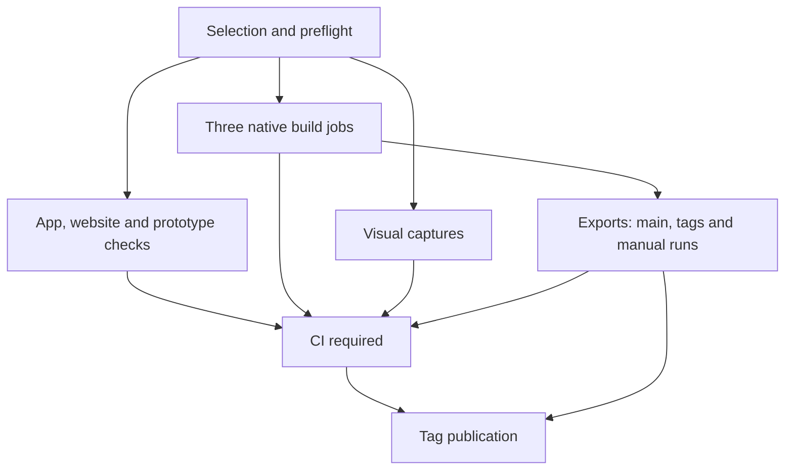

# CI audit completed

**Your CI correctly rejects failed required jobs and tightly controls release publication, but several successful checks provide less validation than their names or test counts suggest.** I found two current validation regressions, missing native integration coverage, two conditional false-pass paths, a reproducible local orchestration-test defect, and a dependency-installation failure that consumed almost six hours.

The complete report includes the workflow map, code locations, run evidence, corrections, acceptance tests, and remediation sequence:

[OpenRC-CI-Audit-347905ca.pdf](https://chatgpt.com/library?file_id=libfile_fde3_f-f6ec2946c29481919b215e1719b8ae5c_ac5d15b10f548191b3cb750779cf7c10&account_id=personal)

The evidence bundle contains selected logs and API responses, nine downloaded artifacts, reproduction probes, 41 source snapshots, and checksums:

[OpenRC-CI-Audit-Evidence-347905ca.zip](https://chatgpt.com/library?file_id=libfile_fde3_f-8fec888afb808191890cf2ea8113dff7_ac5d15b10f548191b3cb750779cf7c10&account_id=personal)

## Reviewed source and status

The full review is pinned to:

| Item | Reviewed value |
|---|---|
| Repository | `bultodepapas/OpenRCsimulator` |
| Branch | `main` |
| Commit | **`347905cafed505cad758107f2790fab2b018e4c6`** |
| Associated CI run | [42312091090](https://github.com/bultodepapas/OpenRCsimulator/actions/runs/42312091090) |
| Closing status check | **2026-11-07 00:23 UTC** |
| Repository changes made by this audit | **None** |

I read [`external Audits/CONSOLIDATED-AUDITS.md`](https://github.com/bultodepapas/OpenRCsimulator/blob/347905cafed505cad758107f2790fab2b018e4c6/external%20Audits/CONSOLIDATED-AUDITS.md) before reviewing the implementation, then cross-checked the completed-work ledger and the existing [PT1-CI efficiency plan](https://github.com/bultodepapas/OpenRCsimulator/blob/347905cafed505cad758107f2790fab2b018e4c6/docs/plans/release-ci-efficiency.md).

**Main advanced during the audit.** The later commit `181d7ca638285f24c1ec9e5089ed07b35b7ea418` repairs the companion solver pin and includes a retained-tape comparison receipt. I inspected that change and the updated audit ledgers. Consequently, I distinguish the companion failure at the frozen commit from its later source repair.

At the closing check, both the frozen-source run and the [later run](https://github.com/bultodepapas/OpenRCsimulator/actions/runs/42316231444) were still in progress. The frozen run already had three failed unit shards; neither run can be described as a completed green gate.

---

## 1. Map of the CI system

There is **one checked-in workflow**, [`.github/workflows/ci.yml`](https://github.com/bultodepapas/OpenRCsimulator/blob/347905cafed505cad758107f2790fab2b018e4c6/.github/workflows/ci.yml), with **11 logical jobs and up to 19 job instances** after expanding the app matrix. I found no repository-local composite actions or reusable workflow definitions.



| Job | Main implementation | What success actually establishes |
|---|---|---|
| **Selection and release preflight** | `tools/ci` tests, `release_preflight.py`, `policy.py`, `check_docs.py` | Orchestration fixtures and source/version prerequisites pass; selection evidence and eligible documentation-link checks are valid. |
| **Website** | Locale generator/tests, `test_downloads.cjs`, analytics tests | Static localization and download-selection logic pass. This does not validate live release downloads or the deployed site in a browser. |
| **Archived three.js prototype** | `npm ci`, type checking, Vitest, Playwright capture/E2E | The archived prototype still builds and runs its browser checks. Capture and E2E each perform a Vite build/preview. |
| **App: integration + eight unit shards** | `app/test.sh`, source generators, offline tools, checked Godot runner, phase rosters | Imports, runtime checks, **905 unit-script invocations**, and a **701-script parse complement** complete. These counts do not establish that every conditional assertion executed. |
| **RC native Linux** | Ground-vehicle native builder | Linux class loading, float64 behavior, 733 evaluator parity checks, lake comparisons, and binary receipts. |
| **RC native Windows** | Same builder with pinned Windows Godot and MSVC | Equivalent Windows evaluator/load qualification and a platform-specific DLL receipt. |
| **NK-3 Linux** | Native kernel builder, oracles, mutant, required production markers | Aircraft-native oracle and negative-control checks, production session/replay routes, and source/toolchain/binary evidence. |
| **Visuals** | `app/capture.sh` and image checkers | The complete current Xvfb/Mesa capture schedule passes. This does not establish native GPU or Metal behavior. |
| **Exports** | `app/export.sh`, native installation, release manifest and package probes | Three platform archives are produced and inspected; actual Linux packaged routes execute. Windows/macOS applications are not launched on their target OS. |
| **CI required** | Policy recomputation and exact roster reconciliation | Every selected job succeeds, and the parse/unit receipts cover the discovered scripts without missing or duplicate partitions. |
| **Release** | `tools/release/publish.py` | A qualifying tag publishes the verified six-file set from the same run, with source/tag/run/repository and retry checks. |

The history also contains GitHub-managed **Pages deployment** and **Copilot Code Review** workflows. They are separate from simulator validation. The [sampled Pages run](https://github.com/bultodepapas/OpenRCsimulator/actions/runs/41944758163) successfully uploaded and deployed `gh-pages`; [`site/publish.py`](https://github.com/bultodepapas/OpenRCsimulator/blob/347905cafed505cad758107f2790fab2b018e4c6/site/publish.py) is the explicit publisher for that branch.

---

## 2. Prioritized findings

**P1** denotes an observed blocker at the reviewed source. **P2** denotes a material validation or reliability problem. **P3** denotes conditional correctness or lower-priority maintenance.

| ID | Priority | Finding | Classification |
|---|---:|---|---|
| **CI-01** | P1 | Battery test references removed `WarningsBar.DANGER` | **New confirmed regression** |
| **CI-02** | P1 | Brake comparison requires historical full identities after the accepted glow-law change | **New validation regression linked to previously documented repairs** |
| **CI-03** | P1 at frozen SHA | Companion qualification pins the old solver | **Known A17/A24 issue; later source repair inspected, full CI pending** |
| **CI-04** | P2 | Native RC session and trajectory branches skip throughout CI | **New concrete coverage gap** |
| **CI-05** | P2 | Three-FPS comparison accepts only two emitted hashes | **Confirmed latent false-pass path** |
| **CI-06** | P2 | Converted human-texture check returns before rejecting an empty set | **Confirmed latent false-pass path** |
| **CI-07** | P2 | Package installation can consume the six-hour app-job limit | **Observed operational failure path** |
| **CI-08** | P2 | Capture-group fixture mixes Python version identities | **Reproduced local false failure** |
| **CI-09** | P2 | Whole pixel suites succeed as invocations while executing no pixel assertions | **Known qualification boundary with a reporting gap** |
| **CI-10** | P3 | Custom Windows/Linux templates are omitted from captured build inputs | **Fixture-confirmed conditional gap; current presets use official templates** |

### CI-01 — The battery suite fails during parsing

**Affected:** app unit shard 6; [`test_overlay_battery.gd:299–301`](https://github.com/bultodepapas/OpenRCsimulator/blob/347905cafed505cad758107f2790fab2b018e4c6/app/tests/test_overlay_battery.gd#L299-L301).

The test still references `WarningsBar.DANGER`, while severity classification now belongs to `AlertPolicy`. The [current job log](https://github.com/bultodepapas/OpenRCsimulator/actions/runs/42312091090/job/128216782017) records three missing-member parse errors and failure to load the script. The older green-source implementation did define that constant, establishing a regression after that source.

The wrapper correctly fails the shard. The practical problem is that the battery checks never execute, and CI cannot complete successfully. This does **not** establish a gameplay battery defect.

**Correction:** update the test to `AlertPolicy.severity()` or the observable classification contract. Preserve all five expectations inside the existing check: empty/critical/LVC are danger; low/hot are caution.

**Verification:** run the script through the checked runner, prove that a deliberately incorrect severity fails, then run the shard and full required CI. Fixing an early parse failure can expose later tests that the failed shard never reached.

### CI-02 — The brake oracle rejects the documented glow-law identity migration

**Affected:** units-0 pre-gate; [`fixed_brake_legacy.py`](https://github.com/bultodepapas/OpenRCsimulator/blob/347905cafed505cad758107f2790fab2b018e4c6/tools/godot/fixed_brake_legacy.py#L133-L152), followed by duplicate historical digest requirements in [`test_fixed_gear_brake_input.gd:355–385`](https://github.com/bultodepapas/OpenRCsimulator/blob/347905cafed505cad758107f2790fab2b018e4c6/app/tests/test_fixed_gear_brake_input.gd#L355-L385).

The [units-0 job](https://github.com/bultodepapas/OpenRCsimulator/actions/runs/42312091090/job/128216782088) stops at:

> `candidate differs: gp-extra-300s-60 checkpoint`

I inspected the retained candidate and matched-reference captures. For the Extra:

- The checkpoint’s `configuration` hash and `glow_law` differ.
- Metadata and the CSV header change from the v4 propulsion identity to `glow-mean-cycle-segmented-firing-v6`.
- **All numerical checkpoint fields and the three-tick digest match.**
- The other three aircraft match all four reported digests.

The comparator demands identical whole checkpoint, metadata and CSV hashes across a documented law-version change. This is a conflict between the historical comparison contract and the implemented A4/A6 work. The sampled evidence does not demonstrate a new numerical brake defect, and three matching ticks do not establish general flight parity.

The log’s **39/39 passed checked invocations** is also easy to misread: that summary covers child processes, while the separate comparison subsequently fails the job.

**Correction:** establish an explicit, narrow v4→v6 comparison contract. Preserve frozen historical goldens, verify permitted identity changes independently, and compare every unaffected field and physical continuation. Update **both** the Python pre-gate and later GDScript checks.

**Verification:** unexpected identity, checkpoint state, metadata, CSV or continuation changes must still fail. Avoid blanket metadata stripping or unexplained golden replacement.

### CI-03 — Companion qualification was stale, but a later repair has landed

**Affected:** `test_companions_profiles`, the companion profile and `tools/companions/qualification.json`.

The [frozen-source job](https://github.com/bultodepapas/OpenRCsimulator/actions/runs/42312091090/job/128216781941) rejects pinned solver `880d1911` against current `84cac259`. This was already known through A17 and explicitly recorded in the later A24 audit; it is not a new discovery or evidence of flaky infrastructure.

During this review, commit `181d7ca6…` updated both pins. Its [rebind receipt](https://github.com/bultodepapas/OpenRCsimulator/blob/181d7ca638285f24c1ec9e5089ed07b35b7ea418/docs/research/ai-companions/AFC-02/rebinds/2026-11-06-880d1911-to-84cac259.json) records **nine tapes, 2,881 rows each, with matching baseline/candidate CSV hashes**. The recorded solver tree did not change between the receipt’s source and that later commit.

**Disposition:** the source pin has been repaired with retained-tape evidence. The new full CI run remains pending. The receipt itself correctly limits its claim: it is not exact replay, general requalification or physical validation.

For future changes, keep using the documented report-first rebind process. If tapes differ, renew qualification instead of updating hashes blindly.

### CI-04 — Important native RC integration tests never execute with native installed

**Affected:** the boundary between app shards, RC native builds and export:

- [`test_rcv_session.gd:704–733`](https://github.com/bultodepapas/OpenRCsimulator/blob/347905cafed505cad758107f2790fab2b018e4c6/app/tests/test_rcv_session.gd#L704-L733).
- [`test_rcv_vehicle_dynamics.gd:335–388`](https://github.com/bultodepapas/OpenRCsimulator/blob/347905cafed505cad758107f2790fab2b018e4c6/app/tests/test_rcv_vehicle_dynamics.gd#L335-L388).

App shards never install the native RC artifacts. Consequently, they skip:

- Native-session backend-switch checkpoint/replay/tick guards.
- The 180-tick driven, steered and braked native/reference trajectory comparison.

This happened in an otherwise [successful PR run](https://github.com/bultodepapas/OpenRCsimulator/actions/runs/42179405160): the [Session log](https://github.com/bultodepapas/OpenRCsimulator/actions/runs/42179405160/job/127766980285) and [trajectory log](https://github.com/bultodepapas/OpenRCsimulator/actions/runs/42179405160/job/127766980412) explicitly print the native-not-staged skips.

The native build jobs validate an isolated evaluator project. Export later checks class/ABI/receipt identity. Neither substitutes for these production integration branches. NK-3’s stronger production markers cover a different, aircraft-native backend.

**Correction:** add an installed-library production-test phase after the matching native artifacts exist. The installation contract currently requires both platform receipts, so a post-build OS matrix is a reasonable implementation. Require explicit markers proving native execution, with fallback or skip treated as failure.

**Verification:** missing, unloadable or stale libraries, an internal skip, and deliberately broken assertions must fail. Preserve the existing evaluator parity checks.

### CI-05 — The three-FPS comparison can pass with a missing result

**Affected:** app integration runtime, [`app/test.sh:619–643`](https://github.com/bultodepapas/OpenRCsimulator/blob/347905cafed505cad758107f2790fab2b018e4c6/app/test.sh#L619-L643).

Both the state and flight comparisons concatenate extracted hashes into a whitespace-separated string, then require one distinct nonempty value. Missing positions disappear during shell word splitting.

Therefore, **two matching hashes plus one missing hash can pass**. A child can still exit successfully and emit its `ticks=` line, satisfying the preceding output check.

The exact predicate accepted an isolated two-token reproduction. However, the sampled green run emitted all three matching hashes; I did not observe a hosted missing-result false success.

**Correction:** require exactly one valid, anchored 64-hex digest from **each** FPS invocation, retain its FPS association, and compare exactly three entries.

**Verification:** reject every missing-result position, malformed/duplicate records and unequal hashes. Three valid equal hashes must pass. Preserve the numerical-equivalence requirement.

### CI-06 — The converted-texture check returns before its failure assertions

**Affected:** [`test_landscape_population_assets.gd:171–208`](https://github.com/bultodepapas/OpenRCsimulator/blob/347905cafed505cad758107f2790fab2b018e4c6/app/tests/test_landscape_population_assets.gd#L171-L208).

When a declared human variant produces no converted shader texture paths, the test prints that the pose is not staged and returns. The following nonempty and missing-set checks cannot reject that condition.

Earlier assertions inspect the original GLB materials. A converter regression could therefore preserve the original textures while dropping production material bindings, causing the production-sharing assertion to be bypassed.

This is a source-confirmed latent path. The sampled green log resolved all 11 variants and passed the shared-texture check; no present texture defect was established.

**Correction:** fail on an empty converted set for declared shipped variants. Any supported incomplete-staging mode should be explicit and reported as unqualified.

**Verification:** remove both converted texture bindings in a disposable mutation while preserving valid source textures. The specific check and shard must fail.

### CI-07 — Dependency installation can consume the entire six-hour app budget

**Affected:** [`ci.yml:97,149`](https://github.com/bultodepapas/OpenRCsimulator/blob/347905cafed505cad758107f2790fab2b018e4c6/.github/workflows/ci.yml#L97-L149).

In [run 41249676177](https://github.com/bultodepapas/OpenRCsimulator/actions/runs/41249676177):

| Job | Time spent in the APT step |
|---|---|
| [Integration](https://github.com/bultodepapas/OpenRCsimulator/actions/runs/41249676177/job/124680799221) | 22:51:56–04:50:49 UTC |
| [Units 3](https://github.com/bultodepapas/OpenRCsimulator/actions/runs/41249676177/job/124680799209) | 22:52:41–04:50:56 UTC |

Both were canceled before tests. Logs show repeated mirror retrieval attempts and then no progress. The evidence does not establish the underlying network cause or cancellation initiator.

The step is bounded by the **360-minute job timeout**, but has no shorter installation deadline.

**Correction:** add a separate setup deadline—provisionally 10–15 minutes, tuned against successful hosted setup data—and bounded transport timeouts/retries. GitHub supports step-level deadlines; APT exposes transport timeout and retry settings. [GitHub Docs](https://docs.github.com/en/actions/reference/workflows-and-actions/workflow-syntax?utm_source=chatgpt.com)

**Verification:** a disposable stalling/unreachable package source must fail within the setup budget; normal installation and tests must still complete. Keep retries limited to transient setup operations.

### CI-08 — The orchestration fixture produces a false failure under another Python

**Affected:** [`test_capture_groups.py:38–55`](https://github.com/bultodepapas/OpenRCsimulator/blob/347905cafed505cad758107f2790fab2b018e4c6/tools/ci/test_capture_groups.py#L38-L55) and its reducer invocation at lines 277–303.

I ran:

```sh
python3 -m unittest discover -s tools/ci -p 'test_*.py'
```

**Result: 79 tests, one failure.**

The fixture hard-codes `/usr/bin/python3` for capture while using `sys.executable` for reduction. In this environment:

| Interpreter | Version |
|---|---:|
| Default `python3` | 3.12.14 |
| `/usr/bin/python3` | 3.12.3 |

The production receipt correctly includes the exact orchestrator Python version. These two versions therefore produce different configurations. Running the failing test under `/usr/bin/python3` passed.

**Correction:** use one explicit interpreter identity throughout the fixture. Keep the production configuration mismatch rejection.

**Verification:** run the focused fixture and full orchestration suite under system Python and another supported environment. Distinct executable paths alone need not fail; the demonstrated issue is differing recorded version strings. Hosted scope at the audited SHA passed.

### CI-09 — Two pixel suites execute zero pixel assertions in headless CI

**Affected:**

- [`test_lighting_skin_patterns.gd:30–37`](https://github.com/bultodepapas/OpenRCsimulator/blob/347905cafed505cad758107f2790fab2b018e4c6/app/tests/test_lighting_skin_patterns.gd#L30-L37).
- [`test_lighting_segment_filter.gd:19–23`](https://github.com/bultodepapas/OpenRCsimulator/blob/347905cafed505cad758107f2790fab2b018e4c6/app/tests/test_lighting_segment_filter.gd#L19-L23).

Both print `SKIPPED` and exit successfully before assertions under headless display. The unit runner always invokes them headlessly, and `app/capture.sh` does not invoke them separately.

Their invocations can therefore appear passed in the roster and JUnit output without examining pixels. This is an existing documented rendering qualification boundary, not evidence of a new shader defect.

**Correction:** either run them display-backed with required completion markers and suitable 1920×1080 rendering, or represent them explicitly as skipped/unqualified cases.

**Verification:** headless execution and missing markers must not count as pixel validation; a deliberately broken pattern must fail the rendered case. Xvfb results still do not qualify actual GPU/driver behavior.

### CI-10 — Future custom templates can escape input identity tracking

**Affected:** [`tools/release/manifest.py:167–200`](https://github.com/bultodepapas/OpenRCsimulator/blob/347905cafed505cad758107f2790fab2b018e4c6/tools/release/manifest.py#L167-L200).

Input capture resolves a custom template for macOS, but records installed official templates for Linux and Windows. Godot supports per-preset `custom_template/release` on both platforms. [Godot Engine (latest) documentation in English](https://docs.godotengine.org/en/latest/classes/class_editorexportplatformwindows.html?utm_source=chatgpt.com)

A disposable manifest fixture selected an ignored Windows custom template, captured inputs, changed its bytes, and captured again. **The custom path was absent and both input/source identities remained unchanged.**

Current presets use official templates, so this is conditional. The probe did not run a Godot export.

**Correction:** resolve the actual selected template for every preset. Either reject unsupported custom settings or record and validate their exact selected bytes, including the Linux package receipt.

**Verification:** a selected-template mutation between capture and finalization must fail; default-template behavior must remain unchanged.

---

## 3. Architecture and failure handling that should be preserved

Several existing controls are doing their job:

- **The aggregate independently recomputes selection.** It rejects failed, canceled, missing and unexpectedly skipped selected jobs.
- **Exact roster reconciliation is meaningful.** One parse receipt plus eight disjoint unit receipts must cover the frozen checkout.
- **The checked Godot runner goes beyond exit codes.** It catches engine/script/shader errors, supports required markers, preserves logs and bounds execution.
- **Expected failures are separated from ordinary successful evidence.**
- **Export and publication have separate gates.** An export can complete while a later test fails, but publication remains blocked.
- **No `continue-on-error` masking was found in the checked-in workflow.**

These conclusions are supported by the [workflow’s aggregate/release definitions](https://github.com/bultodepapas/OpenRCsimulator/blob/347905cafed505cad758107f2790fab2b018e4c6/.github/workflows/ci.yml#L636-L689), [policy implementation](https://github.com/bultodepapas/OpenRCsimulator/blob/347905cafed505cad758107f2790fab2b018e4c6/tools/ci/policy.py), and sampled failed/canceled runs.

GitHub distinguishes skipped jobs from workflows suppressed by filters; the explicit aggregate avoids relying on those statuses alone. [GitHub Docs](https://docs.github.com/en/pull-requests/how-tos/merge-and-close-pull-requests/troubleshooting-required-status-checks?plain=1\&utm_source=chatgpt.com)

### Trigger and enforcement boundaries

The workflow runs on main pushes, `v*` tag pushes, PRs and manual dispatch. There are no workflow path filters. Selection is deliberately in **shadow mode**, so production and prototype work still runs broadly.

PR runs intentionally skip export. Main, tag and manual runs preserve separate verification; only superseded PR runs share cancellation groups. These are documented choices in the existing plan, not newly discovered defects.

The branch API reported `main` as unprotected and repository rulesets were empty. The detailed administration-only protection endpoint was inaccessible. **The name “CI required” does not itself enforce a merge or push restriction.** The prior plan explicitly requests direct-to-main work without a PR requirement, so I am not proposing an unsolicited policy change.

---

## 4. Performance: measured bottlenecks and existing unfinished work

The following durations come from GitHub job start/end timestamps:

| Job | Successful PR [42179405160](https://github.com/bultodepapas/OpenRCsimulator/actions/runs/42179405160) | Successful main [41467280394](https://github.com/bultodepapas/OpenRCsimulator/actions/runs/41467280394) |
|---|---:|---:|
| Visuals | **2h 48m 05s** | **2h 02m 36s** |
| Integration | 49m 30s | 1h 07m 06s |
| NK-3 native | 17m 16s | 21m 25s |
| Eight unit shards | 14m 12s–31m 33s | — |
| Export | Skipped on PR | 24m 57s |

**Visuals are the observed critical path in both examples.** In the PR visual log, ground and vegetation alone total **94m 58s**.

These runs have different source and runner conditions; they do not constitute a controlled performance comparison.

The existing PT1-CI plan already identifies the correct major work:

1. Qualify the seven experimental visual groups against the full case/output union.
2. Activate conservative scope skipping after representative full-run evidence.
3. Balance unit shards using measured durations.
4. Split integration phases while preserving all runtime contracts.
5. Evaluate safe import/cache reuse only after correctness evidence.

The experimental visual reducer’s `production_qualified=false` is appropriate. Removing that boundary before rendered equivalence is established would exchange runtime savings for uncertain coverage.

Repeated source checks have already been reduced: 17 generator commands are centralized, nine repeated calls were removed, and redundant standalone parsing of unit scripts is replaced by required execution. Those completed improvements should not be reported again as unfinished work. See the [current CI guide](https://github.com/bultodepapas/OpenRCsimulator/blob/347905cafed505cad758107f2790fab2b018e4c6/tools/ci/README.md).

---

## 5. Environments, artifacts and release confidence

### Reproducibility and caching

The editor/templates pin **Godot `4.8.beta2.official.cafc17a19`** and verify archive/member hashes. Editor caches include OS, architecture and getter identity; imported projects and native builds are not broadly shared through that cache.

The distinction between parsing, completed imports and exports matters: Godot documents these as different operations, and the workflow generally treats them that way. [Godot Engine (latest) documentation in English](https://docs.godotengine.org/en/latest/tutorials/editor/command_line_tutorial.html?utm_source=chatgpt.com)

Runner images and Node 24’s patch level can still evolve. Native recipes and receipts provide additional identity checks. I found no concrete stale-cache false pass; GitHub’s ref-scoped cache visibility also means a warm cache is not guaranteed across every PR/tag context. [GitHub Docs](https://docs.github.com/en/actions/reference/workflows-and-actions/dependency-caching?utm_source=chatgpt.com)

### Artifact footprint and interpretation

Failed main [42282222388](https://github.com/bultodepapas/OpenRCsimulator/actions/runs/42282222388) retained:

| Artifact | Observed size |
|---|---:|
| `captures-app` | 3,121,831,520 bytes |
| `release-builds` | 4,420,453,840 bytes |
| Combined | **Approximately 7.54 GB** |

The observed expiry was 90 days later. These are logical artifact sizes, not a billing calculation.

Canceled visual jobs also retain partial artifacts under `captures-app`. **Artifact existence is not proof of completed visual validation.** Preserve partial diagnostics, but make completion state explicit and inventory consumers before reducing retained content.

### Published release and platform limits

The inspected [v0.1.10 tag run](https://github.com/bultodepapas/OpenRCsimulator/actions/runs/41906314098), at commit `0514cc3f9f8e36b86a867946a65ce25314178e03`, completed its aggregate, export and publication gates. Its publication log reports that the release was created and verified.

I also downloaded the current small native artifacts. Their binaries match their receipts, and the recorded source/lock identities match the pinned checkout. That establishes identity consistency, not an independently reproduced build.

The platform boundary remains:

- **Linux:** actual packaged runtime/native/replay/fallback checks execute.
- **Windows:** the native evaluator executes on Windows, but the exported simulator does not.
- **macOS:** archive/resource/universal-binary checks occur from the export host; the application is not launched on macOS.

These are existing qualification limits, not newly observed launch defects.

Two smaller maintenance observations remain: the desktop delivery plan still calls beta1 the current pin, and `v0.1.9-beta.1` currently has stable-release metadata despite beta naming. The latter’s cause and intended state are unestablished; the current publisher checks channel consistency.

---

## 6. Practical remediation order

| Stage | Action | Required acceptance |
|---|---|---|
| **1. Restore a meaningful green run** | Repair CI-01; implement the explicit brake migration contract in both layers; retain and verify the later companion repair. | Focused checks and negative controls pass, followed by complete CI at the exact repaired source. |
| **2. Close misleading success paths** | Add installed-native production tests; enforce per-FPS digest cardinality; reject empty converted textures; expose pixel skips. | Missing libraries, results, bindings or completion markers fail the required check. |
| **3. Improve reliability and portability** | Bound dependency setup; make the capture fixture use one interpreter; summarize the first enclosing gate failure clearly. | Stalled setup fails within budget; normal hosted setup passes; orchestration fixtures pass under supported Python environments. |
| **4. Finish PT1-CI optimization** | Qualify visual groups and conservative selection, then rebalance/split remaining work. | Equivalent case/output coverage and matched measurements of critical path and total worker time. |
| **5. Tighten release maintenance** | Reject or track custom templates; update engine-pin documentation; set artifact retention by consumer. | Selected-template drift fails, documentation matches actual pins, and useful diagnostics remain available. |

Keep each change independently reviewable. Preserve physics tolerances, frozen evidence, source identities and negative controls while changing scheduling or validation plumbing.

## Evidence limits

The initial latest-100-run snapshot contained 93 CI runs: 59 failed, 10 canceled, 23 successful and one in progress. **That is not a flakiness rate.** Several inspected failures were deterministic source or fixture problems.

I used GitHub tools for source, history, PR/issue context, runs, jobs, logs, artifacts and releases. Local verification included orchestration and checked-runner fixtures, the missing-hash predicate, template-input capture, and native artifact identity checks.

I did **not** rerun the full Godot suite, rebuild native libraries, execute full exports, download the multi-gigabyte archives, or perform target-device/physical validation. The small published release-manifest body was unavailable through the attempted connector path, and artifact wrappers expose only their first page. The source review also does not claim an assertion-by-assertion audit of all 905 unit scripts.

The most consequential next result is a completed green run at the repaired source **with explicit evidence that the native production branches and other required cases actually executed**.